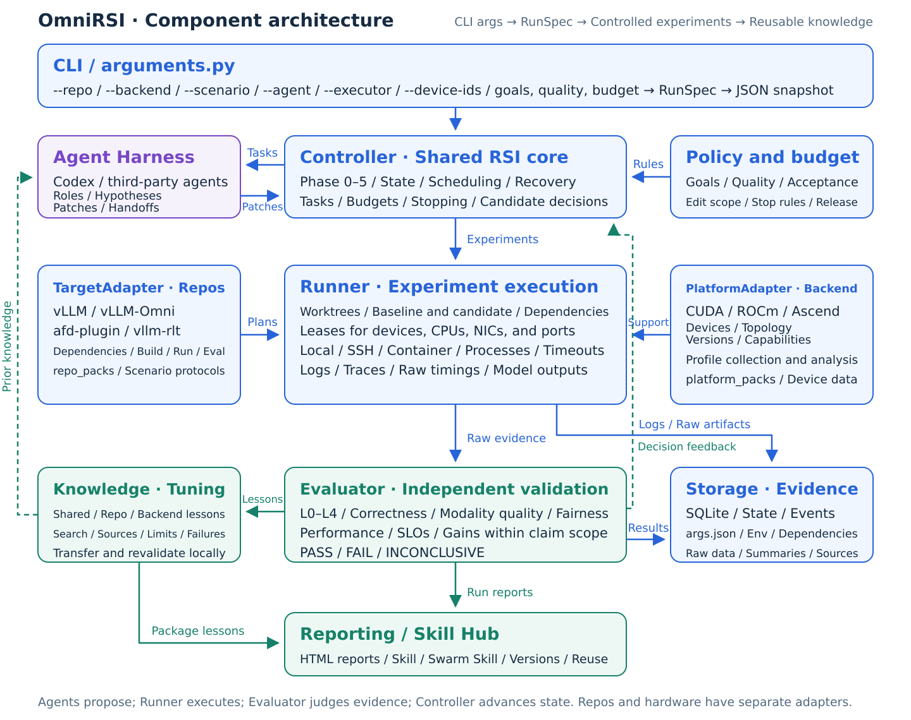
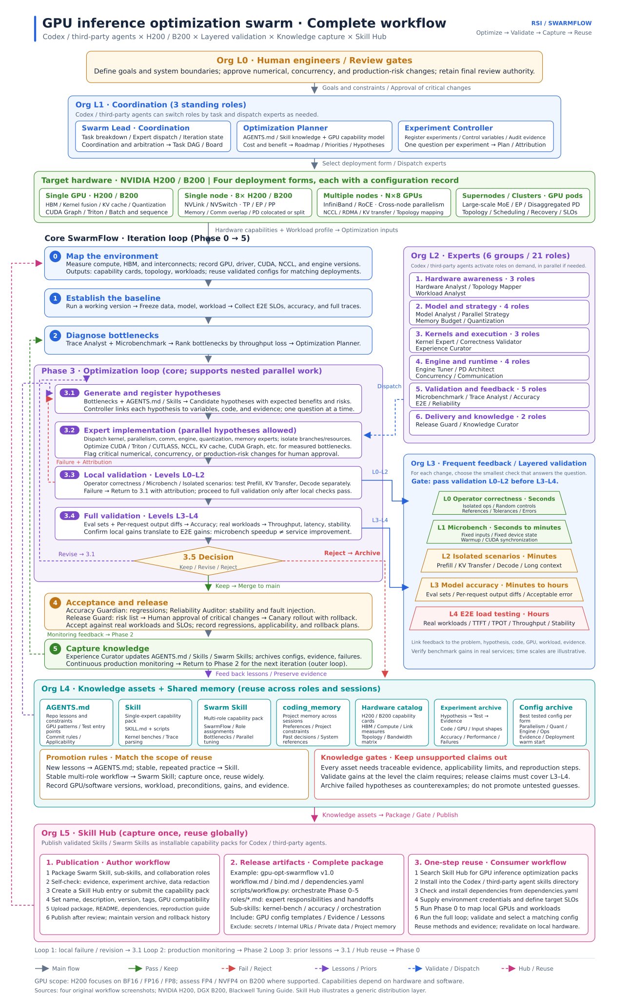

<div align="center">


**Turn inference bottlenecks into verified improvements.**

[](pyproject.toml)
[](docs/quickstart.md)
[](https://github.com/vllm-project/vllm-omni/pull/8739)

[Why OmniRSI](#why-omnirsi) · [Results](#results) · [Quickstart](#quickstart) · [Architecture](#architecture) · [Docs](#docs)

</div>

OmniRSI is a **CLI workbench for inference optimization with coding agents**. Bring your benchmark and quality checks; compare implementations, trace every gain to its source, and carry useful tuning lessons into the next experiment.

<a id="why-omnirsi"></a>

## ⚡ Why OmniRSI

- **Profile first.** Ground each optimization in measured bottlenecks and sourced tuning knowledge.
- **Prove the gain.** Run repeated A/B comparisons with quality gates, source fingerprints, and an HTML evidence report.
- **Keep the lessons.** Search prior experience and export cited context for Codex or other coding agents.

You drive profiling and code changes; OmniRSI runs and evaluates the benchmark and validation commands you provide.

<a id="results"></a>

## 📊 From profiling to a 30.60% latency reduction

**Qwen-Image-2.1-Turbo · 4× NVIDIA B300 · 1280×704 · BF16 · Native 8 steps**

| Baseline E2E | Optimized E2E | Image validation |
| :---: | :---: | :---: |
| **384.16 ms** | **266.60 ms** | **44/44 pixel-identical** |

Recorded local campaign: five alternating AB/BA groups, warmed repeated prompts with new seeds, and complete RGBA PNG responses. Accuracy checks cover 40 formal images and 4 held-out images. Latencies are medians of trial means for this workload.

[Results, source pins & every iteration →](docs/qwen21-turbo-b300-phase2-results.md) · [Acceptance issue](https://github.com/ThinkFlowLab/OmniRSI/issues/3) · [Upstream PR](https://github.com/vllm-project/vllm-omni/pull/8739)

<a id="quickstart"></a>

## 🚀 Quickstart

Requires **Python 3.10+**. From this checkout:

```bash
python -m venv .venv
source .venv/bin/activate
python -m pip install .

# Explore tuning knowledge, then export context for your coding agent.
omnirsi knowledge search 'MiniMax-H3' --repo-type vllm_omni --backend cuda
omnirsi context --repo-type vllm_omni --backend cuda --output context.md
```

Ready to measure your own model? [Connect your benchmark and quality checks →](docs/quickstart.md#real-remote-experiment)

<a id="architecture"></a>

## 🧩 Architecture

**Profile → Optimize → Validate → Reuse.** The diagrams describe the target design; the [architecture guide](docs/architecture.md) maps it to the current implementation.

<details>
<summary><strong>Explore the component architecture</strong></summary>



[Chinese original](docs/assets/component-architecture.svg)

</details>

<details>
<summary><strong>Explore the complete optimization workflow</strong></summary>



[Chinese original](docs/assets/gpu-workflow.svg)

</details>

<a id="docs"></a>

## 📚 Go deeper

| Start here | What you will find |
| --- | --- |
| [Quickstart](docs/quickstart.md) | Installation, real A/B experiments, and reports |
| [Optimization plan](docs/qwen21-turbo-b300-phase2-plan.md) | Profiling, operator tasks, KDA skills, and quality gates |
| [Knowledge base](src/omnirsi/data/repo_packs/vllm_omni/knowledge/README.md) | Tuning methods, sources, and applicability |
| [Contributor guide](docs/repo-template.md) | Development workflow, evidence contracts, and CI |

**Build with us.** Bring a bottleneck, a reproducible optimization, or a tuning lesson. [Open an issue →](https://github.com/ThinkFlowLab/OmniRSI/issues) Use `git commit -s` for contributions.
