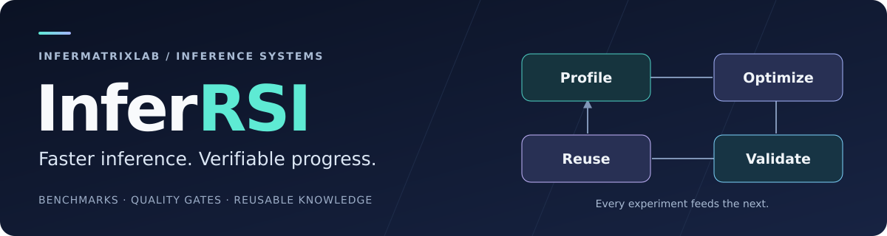
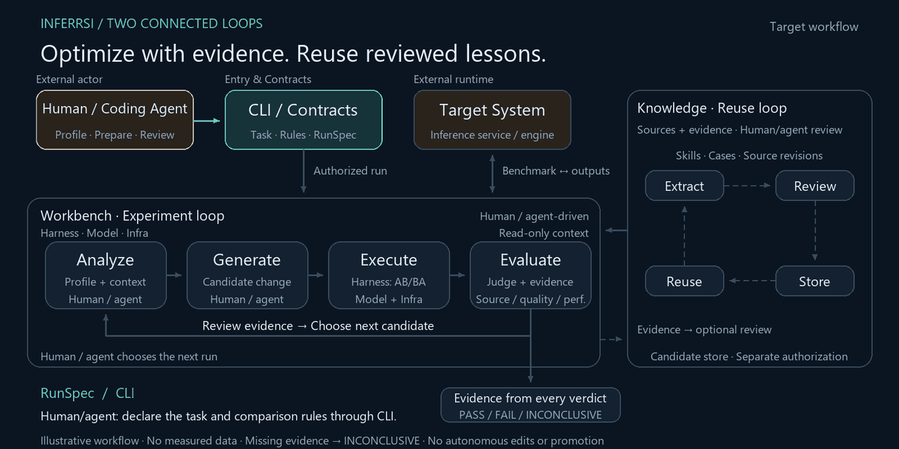
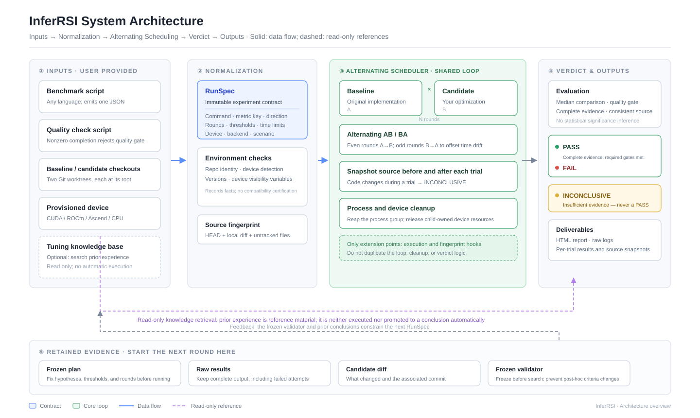
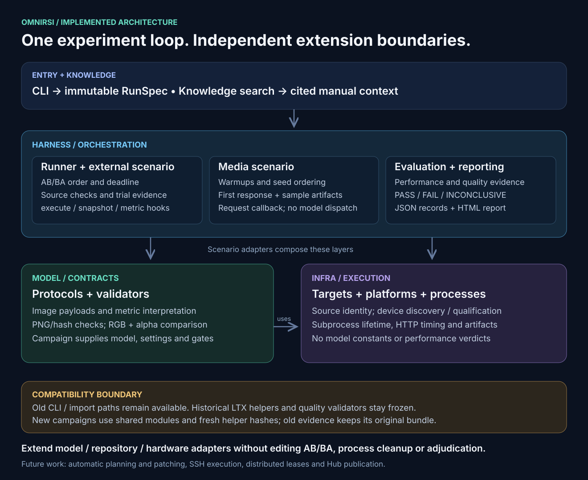
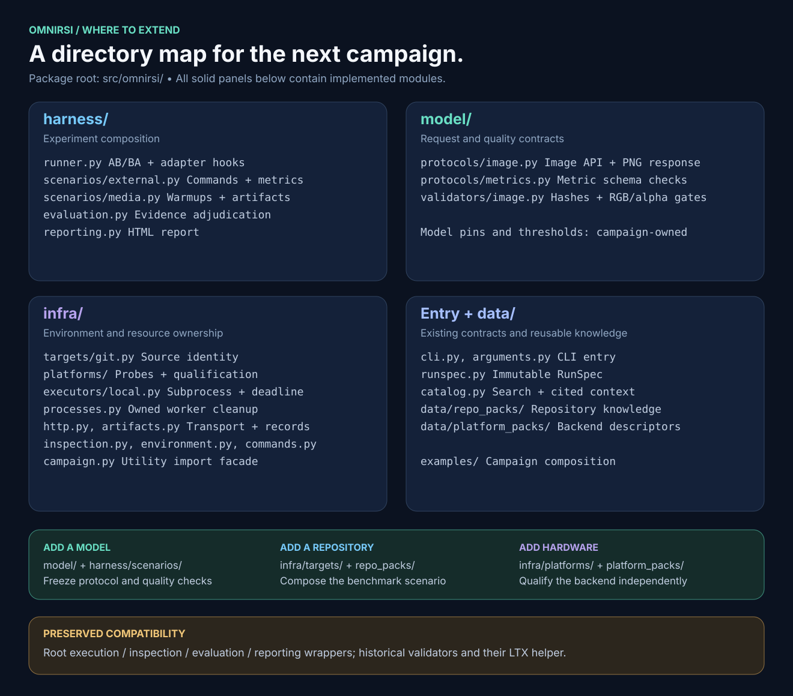

<div align="center">



**Turn inference bottlenecks into verified improvements.**

[](pyproject.toml)
[](docs/quickstart.md)
[](https://github.com/vllm-project/vllm-omni/pull/8739)

[Why InferRSI](#why-inferrsi) · [How It Works](#how-it-works) · [Results](#results) · [Quickstart](#quickstart) · [Architecture](#architecture) · [Docs](#docs)

</div>

InferRSI is a **CLI workbench for inference optimization with coding agents**. Bring your benchmark and quality checks; compare implementations, trace every gain to its source, and carry useful tuning lessons into the next experiment.

<a id="why-inferrsi"></a>

## ⚡ Why InferRSI

- **Profile first.** Ground each optimization in measured bottlenecks and sourced tuning knowledge.
- **Prove the gain.** Run repeated A/B comparisons with quality gates, source fingerprints, and an HTML evidence report.
- **Keep the lessons.** Search prior experience and export cited context for Codex or other coding agents.

You drive profiling and code changes; InferRSI runs and evaluates the benchmark and validation commands you provide.

<a id="how-it-works"></a>

## 🔁 How It Works

**Optimize with evidence. Reuse reviewed lessons.** Humans and coding agents
prepare candidates; Workbench runs controlled comparisons against the target
engine. Evidence guides the next experiment and may inform reusable knowledge,
including limitations from failed attempts.
[Architecture](#architecture) · [Roadmap](https://github.com/InferMatrixLab/InferRSI/issues/61).

<a href="docs/assets/inferrsi-loop.mp4">
  <picture>
    <source media="(prefers-reduced-motion: reduce)" srcset="docs/assets/inferrsi-loop.png">
    
  </picture>
</a>

Illustrative target workflow; no measured results. [Watch the MP4](docs/assets/inferrsi-loop.mp4).

Knowledge retrieval is read-only; candidate storage is optional and separately
authorized. Automatic search and automatic knowledge promotion remain planned. Missing
or incomplete evidence stays `INCONCLUSIVE`.

## Choose your starting path

| You want to… | Start at |
| --- | --- |
| Modify InferRSI itself | [Contributor guide](docs/contributing.md) and [agent collaboration](docs/agent-collaboration.md), under an accepted Issue scope |
| Use the Workbench to run experiments | [Quickstart](docs/quickstart.md): prepared target environment, benchmark/quality contracts, authorized experiment, recorded evidence |
| Deliver an independent inference engine | [Engine delivery template](docs/template/README.md): copyable scaffold and recipe handoff; no InferRSI runtime dependency |

For every CLI/Python operation — discovery, normalized reads, store candidates, experiments — see the [operation guide](docs/operations.md).

<a id="results"></a>

## 📊 From profiling to a 30.60% latency reduction

**Qwen-Image-2.1-Turbo · 4× NVIDIA B300 · 1280×704 · BF16 · Native 8 steps**

| Baseline E2E | Optimized E2E | Image validation |
| :---: | :---: | :---: |
| **384.16 ms** | **266.60 ms** | **44/44 pixel-identical** |

Recorded local campaign: five alternating AB/BA groups, warmed repeated prompts with new seeds, and complete RGBA PNG responses. Accuracy checks cover 40 formal images and 4 held-out images. Latencies are medians of trial means for this workload.

[Results, source pins & every iteration →](docs/qwen-image-2.1-turbo-b300.md) · [Acceptance issue](https://github.com/InferMatrixLab/InferRSI/issues/3) · [Upstream PR](https://github.com/vllm-project/vllm-omni/pull/8739)

### Ascend NPU: up to 22.0% reported latency reduction

**Qwen-Image-2.1-Turbo · 1× Ascend 910B1 · 1280×704 · BF16 · Native 8 steps · eager**

| Optimization | Mean vs 3111.5 ms baseline | Reported image validation |
| --- | :---: | --- |
| Conditioning reuse + interleaved RoPE | **2459.6 ms (−21.0%)** | Pixel-identical RGBA |
| + opt-in VAE fastpath | **2425.5 ms (−22.0%)** | Quality gate passed; not pixel-identical |

Author-reported means from three requests after two warmups; not independently verified by this import. **The 30% target is not met.** The B300 and NPU cohorts use separate hardware and measurement protocols.

[Ascend measurements and rejected rounds →](docs/qwen-image-2.1-turbo-ascend.md) · [Upstream NPU patch](https://github.com/vllm-project/vllm-omni/pull/8729)

### Standalone speech engines

Concurrency 1 (C1) results reported by each project. Values are **engine / vLLM-Omni / SGLang-Omni**; compare within a row, since workloads and audio-frame definitions differ.

| Project | Device | Throughput (frames/s) ↑ | TTFA p50 (ms) ↓ | Report and status |
| --- | --- | --- | --- | --- |
| [Drama 3](https://github.com/InferMatrixLab/drama-3-single-b300-engine) | 1× B300 | **309.17** / 195.89 / 169.80 | **32.83** / 47.29 / 79.38 | [3-run medians](https://github.com/InferMatrixLab/drama-3-single-b300-engine/blob/58a1882a4d941f8d21bfce6be37d3d5e7c9fde80/docs/current-results.md); overall target unmet |
| [Qwen3-TTS](https://github.com/InferMatrixLab/qwen3-tts-rsi-npu-engine) | 1× Ascend 910B1 | **61.12** / 12.71 / 4.31 | **50.41** / 263.51 / 439.72 | [3-run means](https://github.com/InferMatrixLab/qwen3-tts-rsi-npu-engine/blob/a29f8193b557c415175d70919bdfb9bd3dcd51fc/evidence/campaign-20261017/same-card-performance.md); source campaign accepted |
| [MiniCPM-o 4.5](https://github.com/InferMatrixLab/minicpm-o-4.5-single-gpu-engine) | 1× L20X | **397.43** / 187.52 / 278.72 | **126.2** / 295.3 / 381.2 | [5-run means](https://github.com/InferMatrixLab/minicpm-o-4.5-single-gpu-engine/blob/a4f4778f312791c2d190b48e521141887ed160c8/docs/current-results.md); target unmet, quality unqualified |

MiniCPM's SGLang baseline returns a complete waveform, so its TTFA equals end-to-end latency. These external results were not rerun in InferRSI.

<a id="quickstart"></a>

## 🚀 Quickstart

Requires **Python 3.10+**. From this checkout:

```bash
python -m venv .venv
source .venv/bin/activate
python -m pip install .

# Explore tuning knowledge, then export context for your coding agent.
inferrsi knowledge search 'Qwen-Image-2.1' --repo-type vllm_omni --backend ascend
inferrsi context --repo-type vllm_omni --backend cuda --output context.md
```

For Ascend image-generation context:

```bash
inferrsi context --repo-type vllm_omni --backend ascend \
  --scenario diffusion.image_generation --output ascend-context.md
```

Ready to measure your own model? [Connect your benchmark and quality checks →](docs/quickstart.md#real-remote-experiment)

<a id="architecture"></a>

## 🧩 Architecture

**One experiment loop. Independent model, repository and hardware adapters.**
The implemented [Harness × Model × Infra boundary](docs/architecture.md) keeps new
campaigns out of the common AB/BA scheduler, process cleanup and evaluator.



[English SVG](docs/assets/system-architecture-en.svg) ·
[中文原图](docs/assets/system-architecture-zh-CN.svg)

The supplied overview and its English translation summarize the intended workflow.
Evidence feeds the next experiment through explicit review and user-selected
constraints; automatic evidence-to-knowledge promotion or RunSpec population is
not implemented. Process-cleanup behavior still needs platform-specific validation.
See the [source audit and proposed remedies](docs/reviews/source-audit-ac70272.md)
for the 34 review points, qualifications and suggested acceptance checks.

<details>
<summary><strong>See the implemented modules</strong></summary>



</details>

<details>
<summary><strong>Find the right directory to extend</strong></summary>



</details>

[Extension guide and compatibility boundary →](docs/architecture.md#where-to-extend) ·
[Original design diagrams (English / Chinese) →](docs/architecture.md#knowledge-and-evidence-ownership)

<a id="docs"></a>

## 📚 Go deeper

| Start here | What you will find |
| --- | --- |
| [Quickstart](docs/quickstart.md) | Installation, real A/B experiments, and reports |
| [Operation guide](docs/operations.md) | Every CLI/Python operation: entry point, effect class, boundary and example |
| [Qwen B300](docs/qwen-image-2.1-turbo-b300.md) | Reproduction, profiling, optimization ledger and exact image checks |
| [Qwen Ascend](docs/qwen-image-2.1-turbo-ascend.md) | NPU results, rejected rounds and verification scope |
| [Knowledge base](src/inferrsi/data/knowledge_packs/README.md) | Three learning tiers: contribution, dependency impact and peer techniques |
| [Skill catalog](src/inferrsi/data/repo_packs/inferrsi/knowledge/README.md) | Searchable records for 48 categorized skills, linking full packaged procedures and resources |
| [Source audit](docs/reviews/source-audit-ac70272.md) | 34 review points with proposed remedies, qualifications and validation criteria |
| [Daily learning prompt](docs/daily-learning-prompt.md) | 06:00 Asia/Shanghai L2C + performance workflow and prerequisites |
| [Complete skill library](src/inferrsi/data/skill_library/README.md) | 48 registered skills and 21 English engine/workflow documents, organized by owner |
| [vLLM-Omni experience records](src/inferrsi/data/repo_packs/vllm_omni/knowledge/README.md) | Backend-scoped tuning methods, sources, and applicability |
| [Contributor guide](docs/contributing.md) | Development workflow, evidence contracts, and CI |
| [Engine delivery template](docs/template/README.md) | Copyable engine scaffold, branding, evidence and schema-v1 catalog recipe |

**Build with us.** Bring a bottleneck, a reproducible optimization, or a tuning lesson. [Open an issue →](https://github.com/InferMatrixLab/InferRSI/issues) Use `git commit -s` for contributions.
