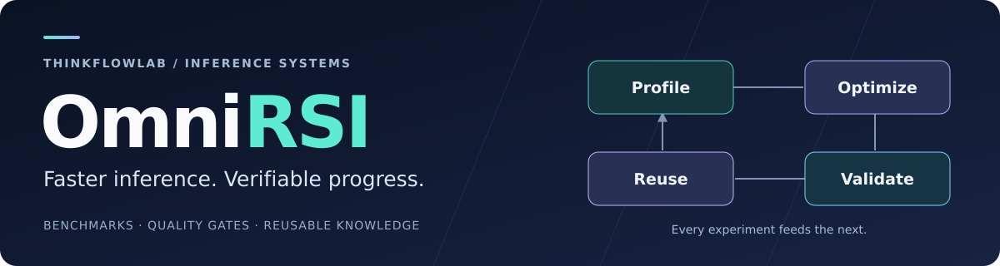

<div align="center">



**Turn inference bottlenecks into verified improvements.**

[](pyproject.toml)
[](docs/quickstart.md)
[](https://github.com/vllm-project/vllm-omni/pull/8739)

[Why OmniRSI](#why-omnirsi) · [Results](#results) · [Quickstart](#quickstart) · [Architecture](#architecture) · [Docs](#docs)

</div>

OmniRSI is a **CLI workbench for inference optimization with coding agents**. Bring your benchmark and quality checks; compare implementations, trace every gain to its source, and carry useful tuning lessons into the next experiment.

<a id="why-omnirsi"></a>

## ⚡ Why OmniRSI

- **Profile first.** Ground each optimization in measured bottlenecks and sourced tuning knowledge.
- **Prove the gain.** Run repeated A/B comparisons with quality gates, source fingerprints, and an HTML evidence report.
- **Keep the lessons.** Search prior experience and export cited context for Codex or other coding agents.

You drive profiling and code changes; OmniRSI runs and evaluates the benchmark and validation commands you provide.

<a id="results"></a>

## 📊 From profiling to a 30.60% latency reduction

**Qwen-Image-2.1-Turbo · 4× NVIDIA B300 · 1280×704 · BF16 · Native 8 steps**

| Baseline E2E | Optimized E2E | Image validation |
| :---: | :---: | :---: |
| **384.16 ms** | **266.60 ms** | **44/44 pixel-identical** |

Recorded local campaign: five alternating AB/BA groups, warmed repeated prompts with new seeds, and complete RGBA PNG responses. Accuracy checks cover 40 formal images and 4 held-out images. Latencies are medians of trial means for this workload.

[Results, source pins & every iteration →](docs/qwen-image-2.1-turbo-b300.md) · [Acceptance issue](https://github.com/ThinkFlowLab/OmniRSI/issues/3) · [Upstream PR](https://github.com/vllm-project/vllm-omni/pull/8739)

### Ascend NPU: up to 22.0% reported latency reduction

**Qwen-Image-2.1-Turbo · 1× Ascend 910B1 · 1280×704 · BF16 · Native 8 steps · eager**

| Optimization | Mean vs 3111.5 ms baseline | Reported image validation |
| --- | :---: | --- |
| Conditioning reuse + interleaved RoPE | **2459.6 ms (−21.0%)** | Pixel-identical RGBA |
| + opt-in VAE fastpath | **2425.5 ms (−22.0%)** | Quality gate passed; not pixel-identical |

Author-reported means from three requests after two warmups; not independently verified by this import. **The 30% target is not met.** The B300 and NPU cohorts use separate hardware and measurement protocols.

[Ascend measurements and rejected rounds →](docs/qwen-image-2.1-turbo-ascend.md) · [Upstream NPU patch](https://github.com/vllm-project/vllm-omni/pull/8729)

<a id="quickstart"></a>

## 🚀 Quickstart

Requires **Python 3.10+**. From this checkout:

```bash
python -m venv .venv
source .venv/bin/activate
python -m pip install .

# Explore tuning knowledge, then export context for your coding agent.
omnirsi knowledge search 'Qwen-Image-2.1' --repo-type vllm_omni --backend ascend
omnirsi context --repo-type vllm_omni --backend cuda --output context.md
```

For Ascend image-generation context:

```bash
omnirsi context --repo-type vllm_omni --backend ascend \
  --scenario diffusion.image_generation --output ascend-context.md
```

Ready to measure your own model? [Connect your benchmark and quality checks →](docs/quickstart.md#real-remote-experiment)

<a id="architecture"></a>

## 🧩 Architecture

**One experiment loop. Independent model, repository and hardware adapters.**
The implemented [Harness × Model × Infra boundary](docs/architecture.md) keeps new
campaigns out of the common AB/BA scheduler, process cleanup and evaluator.

<details>
<summary><strong>See the implemented modules</strong></summary>


</details>

<details>
<summary><strong>Find the right directory to extend</strong></summary>


</details>

[Extension guide and compatibility boundary →](docs/architecture.md#where-to-extend) ·
[Original design diagrams (English / Chinese) →](docs/architecture.md#knowledge-and-evidence-ownership)

<a id="docs"></a>

## 📚 Go deeper

| Start here | What you will find |
| --- | --- |
| [Quickstart](docs/quickstart.md) | Installation, real A/B experiments, and reports |
| [Qwen B300](docs/qwen-image-2.1-turbo-b300.md) | Reproduction, profiling, optimization ledger and exact image checks |
| [Qwen Ascend](docs/qwen-image-2.1-turbo-ascend.md) | NPU results, rejected rounds and verification scope |
| [Knowledge base](src/omnirsi/data/knowledge_packs/README.md) | Three learning tiers: contribution, dependency impact and peer techniques |
| [Daily learning prompt](docs/daily-learning-prompt.md) | 06:00 Asia/Shanghai L2C + performance workflow and prerequisites |
| [Contributor guide](docs/contributing.md) | Development workflow, evidence contracts, and CI |

**Build with us.** Bring a bottleneck, a reproducible optimization, or a tuning lesson. [Open an issue →](https://github.com/ThinkFlowLab/OmniRSI/issues) Use `git commit -s` for contributions.
