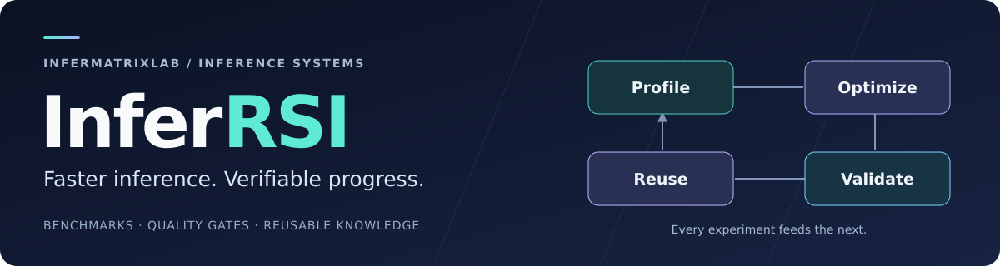
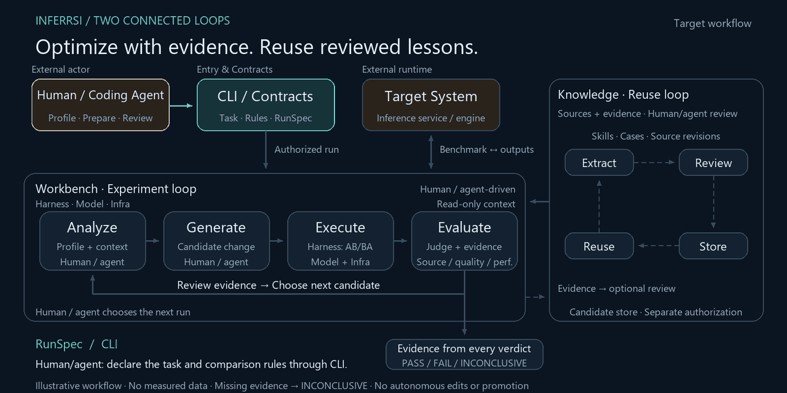
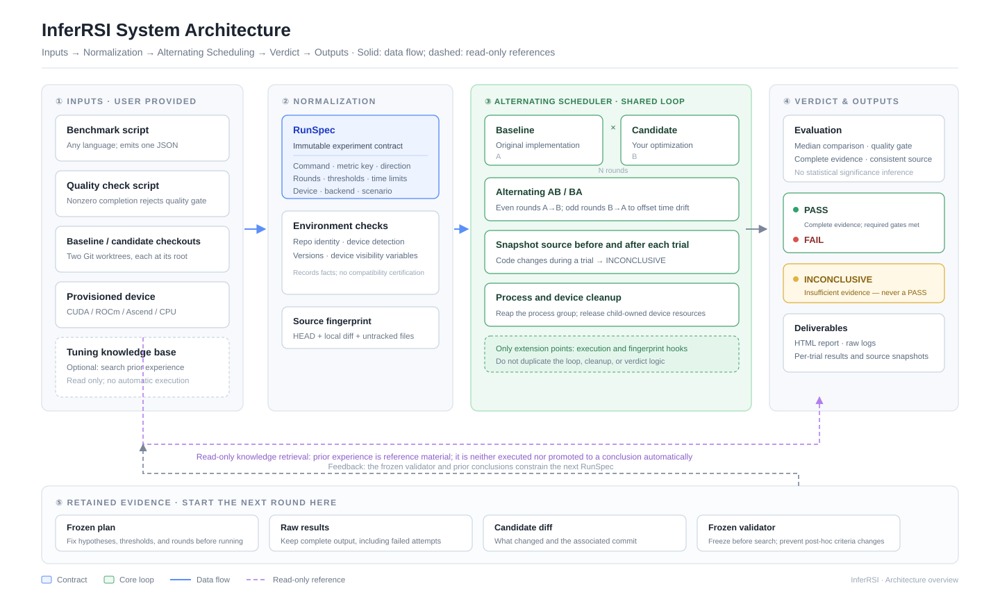
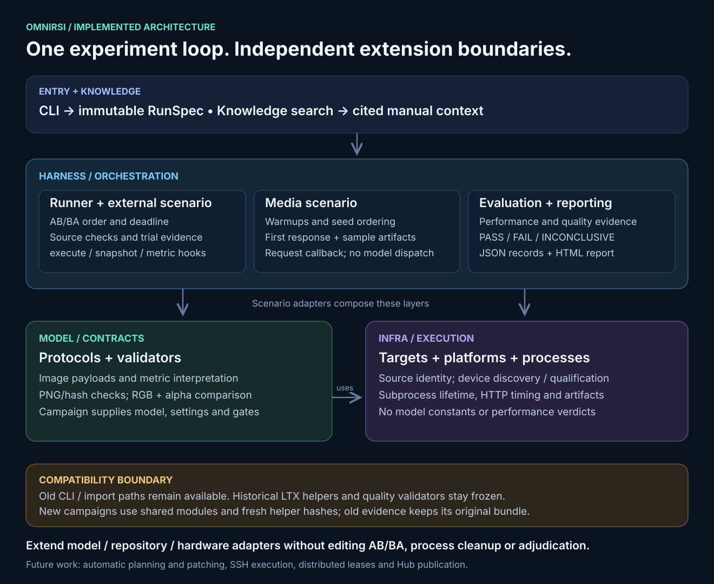
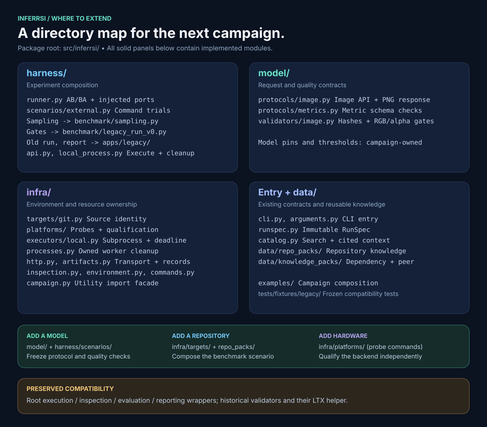

<div align="center">



**Turn inference bottlenecks into verified improvements.**

[](pyproject.toml)
[](docs/quickstart.md)
[](#results)

[Why InferRSI](#why-inferrsi) · [How It Works](#how-it-works) · [Results](#results) · [Quickstart](#quickstart) · [Architecture](#architecture) · [Docs](#docs)

</div>

InferRSI is a **CLI workbench for inference optimization with coding agents**. Bring your benchmark and quality checks; compare implementations, trace every gain to its source, and carry useful tuning lessons into the next experiment.

<a id="why-inferrsi"></a>

## ⚡ Why InferRSI

- **Profile first.** Ground each optimization in measured bottlenecks and sourced tuning knowledge.
- **Prove the gain.** Run repeated A/B comparisons with quality gates, source fingerprints, and an HTML evidence report.
- **Keep the lessons.** Search prior experience and export cited context for Codex or other coding agents.

You drive profiling and code changes; InferRSI runs and evaluates the benchmark and validation commands you provide.

<a id="how-it-works"></a>

## 🔁 How It Works

**Optimize with evidence. Reuse reviewed lessons.** Humans and coding agents
prepare candidates; Workbench runs controlled comparisons against the target
engine. Evidence guides the next experiment and may inform reusable knowledge,
including limitations from failed attempts.
[Architecture](#architecture) · [Roadmap](https://github.com/InferMatrixLab/InferRSI/issues/61).

<a href="docs/assets/inferrsi-loop.mp4">
  <picture>
    <source media="(prefers-reduced-motion: reduce)" srcset="docs/assets/inferrsi-loop.png">
    
  </picture>
</a>

Illustrative target workflow; no measured results. [Watch the MP4](docs/assets/inferrsi-loop.mp4).

Knowledge retrieval is read-only; candidate storage is optional and separately
authorized. Automatic model-backed search and automatic knowledge promotion remain
planned. Missing or incomplete evidence stays `INCONCLUSIVE`.

The **offline harness-improvement MVP** adds a separate Skill Eval path for supplied
declarative candidates. Its fixed-output experiments validate the controller;
real-model gains remain unmeasured. [Flow, limits and reproduction →](docs/harness-improvement.md)

<a id="choose-your-starting-path"></a>

## 🧭 Choose your starting path

| You want to… | Start at |
| --- | --- |
| Modify InferRSI itself | [Contributor guide](docs/contributing.md) and [agent collaboration](docs/agent-collaboration.md), under an accepted Issue scope |
| Use the Workbench to run experiments | [Quickstart](docs/quickstart.md): prepared target environment, benchmark/quality contracts, authorized experiment, recorded evidence |
| Complete an optimization benchmark in the current Agent | [Iterative task sessions](docs/optimization-benchmarks.md), with frozen rounds, independent feedback and final retesting |
| Deliver an independent inference engine | [Engine delivery template](docs/template/README.md): copyable scaffold and recipe handoff; no InferRSI runtime dependency |

For every CLI/Python operation — discovery, normalized reads, store candidates, experiments — see the [operation guide](docs/operations.md).

<a id="results"></a>

## 📊 InferRSI × vLLM-Omni: Optimization Results

InferRSI campaigns and upstream experiments cover image, video and speech models.
Each result applies to its linked workload and measured revisions. Some results
are reported directly by upstream contributors, with validation scoped to their benchmarks.

<details open>
<summary>Benchmarks, validation limits, and upstream PRs</summary>

| Model | Hardware | Optimization approach | Measured gains | Validation and limits | Evidence | vLLM-Omni PR |
| --- | --- | --- | --- | --- | --- | --- |
| **Qwen-Image-2.1-Turbo** | 4× B300 | <ul><li>Text-conditioning reuse</li><li>BF16 operator fusion</li><li>Symmetric-memory Ulysses with batched QKV exchange</li></ul> | **384.16 → 266.60 ms (−30.60%)**<br>Warm HTTP end-to-end latency, repeated prompts | Historical InferRSI campaign. Latencies are medians of five trial means from alternating AB/BA groups. All 44 RGBA images were pixel-identical. | [Campaign #3](https://github.com/InferMatrixLab/InferRSI/issues/3) · [Pinned results](docs/qwen-image-2.1-turbo-b300.md) | [#8739](https://github.com/vllm-project/vllm-omni/pull/8739) (merged) |
| **Qwen-Image-2.1-Turbo** | 1× Ascend 910B1 | <ul><li>Conditioning cache for repeated prompts</li><li>Shared modulation once per denoising step</li><li>Native interleaved NPU RoPE with frequency-table reuse</li></ul> | **−22.20%** offline generation latency<br>Warm repeated prompts | Upstream parent-to-merge comparison. 18/18 RGBA images were pixel-identical. The 30% target was unmet. Both arms aborted during teardown, leaving lifecycle `INCONCLUSIVE`. | [Final-merge measurements](https://github.com/vllm-project/vllm-omni/pull/8729#:~:text=Final%2Dmerge%20performance%20and%20image%20comparison) · [Earlier Ascend cohorts](docs/qwen-image-2.1-turbo-ascend.md) | [#8729](https://github.com/vllm-project/vllm-omni/pull/8729) (merged) |
| **MiniMax-H3 Ref2VA** | 8× Ascend 910B1 | <ul><li>Lossy Cache-DiT profile tuning</li></ul> | **407.27 → 108.12 s (−73.45%)**<br>5 s video, HTTP end-to-end vs. dense inference | All 14 frozen quality comparisons passed. | [Campaign #293](https://github.com/InferMatrixLab/InferRSI/issues/293) · [Pinned results](evidence/h3-ref2va-ascend-293/results/final-5s/README.md) | [#9698](https://github.com/vllm-project/vllm-omni/pull/9698) (draft) |
| **MiniMax-H3 Ref2VA** | 4 logical Ascend 910C devices | <ul><li>Ref2VA migration changes</li><li>Opt-in BF16 prefix attention</li></ul> | **291.25 → 286.67 s (−1.57%)**<br>5 s video, HTTP end-to-end | One lossless screening pair. Strict quality checks passed for the screened candidate. Overall campaign `INCONCLUSIVE`. | [Campaign #297](https://github.com/InferMatrixLab/InferRSI/issues/297) · [Evidence PR #317](https://github.com/InferMatrixLab/InferRSI/pull/317) | [#9745](https://github.com/vllm-project/vllm-omni/pull/9745) (draft) |
| **MiniMax-H3-Image** | 4× Ascend 910B1 | <ul><li>Opt-in VAE tile graphs</li><li>Approximate encoder/decoder tile batching</li></ul> | **16.89 → 10.82 s** · 4736×3552 generation<br>**4.18 → 2.67 s** · 1024×1024 generation<br>**5.68 → 4.57 s** · 1024×1024 editing | Single-launch HTTP medians vs. the same-layout SP4 control. All 30 numerical image screens passed. Latency targets were unmet and final qualification remains `INCONCLUSIVE`. | [Campaign #390](https://github.com/InferMatrixLab/InferRSI/issues/390) · [Evidence PR #394](https://github.com/InferMatrixLab/InferRSI/pull/394) | [#10184](https://github.com/vllm-project/vllm-omni/pull/10184) (open) |
| **MiniMax-H3-Image** | 2× RTX 3090 | <ul><li>Rank-local layerwise offload</li><li>Selected DiT weights kept resident</li><li>AdaLN caching</li><li>Request-local text refinement reuse</li></ul> | **36.62 → 14.59 s (−60.16%)**<br>Warm mean HTTP delivery latency | One upstream A/B of complete deployment profiles. All nine image pairs had identical decoded RGB pixels, including warmups. Repeated qualification remains incomplete. | [Paired deployment benchmark](https://github.com/vllm-project/vllm-omni/pull/10243#:~:text=One%20paired%20deployment%20comparison) | [#10243](https://github.com/vllm-project/vllm-omni/pull/10243) (open) |
| **MiniCPM-o 4.5** | 1× L20X | <ul><li>Packed conditioning on a tuned configuration</li><li>TensorRT speaker extraction + CUDA MPS (separate comparison)</li></ul> | **+15.55%** throughput · **−27.69%** median TTFA<br>Packed conditioning, C32, same 50-frame window<br>**+20.5%** at C16 · **+25.4%** at C32<br>TensorRT + MPS throughput | The packed-conditioning candidate missed the exploratory WER margin against the tuning reference at the 50-frame setting. The separate TensorRT + MPS comparison had speech-quality verdict `FAIL`. | [Campaign #49](https://github.com/InferMatrixLab/InferRSI/issues/49) | [#9218](https://github.com/vllm-project/vllm-omni/pull/9218), [#9188](https://github.com/vllm-project/vllm-omni/pull/9188) (both merged) |
| **Qwen3-Omni** | 2× L20X | <ul><li>cuDNN codec autotuning in the MRv2 deployment</li></ul> | **+7.79%** throughput · **−6.06%** mean RTF<br>One C64 pilot | Median time to first audio **regressed by 7.12%**. Campaign `INCONCLUSIVE`. | [Campaign #112](https://github.com/InferMatrixLab/InferRSI/issues/112) · [Pinned pilot](https://github.com/InferMatrixLab/InferRSI/tree/e1ae256fc075ea9ab64aec68da749cf4a8c22ac7/evidence/qwen3-omni-2gpu-20261023/results/pr9283-cudnn-performance) | [#9283](https://github.com/vllm-project/vllm-omni/pull/9283) (draft) |
| **LFM3-Omni-2B** | 1× Ascend 910B1 | <ul><li>Depth graphs</li><li>Grouped greedy sampling</li></ul> | **0.285 → 0.593 requests/s**<br>Upstream offline Omni API A/B, C4, temperature 0 | Retained audio waveforms matched bit-for-bit within each tested temperature. | [Offline A/B benchmark](https://github.com/vllm-project/vllm-omni/pull/9827#:~:text=Performance%20results) | [#9827](https://github.com/vllm-project/vllm-omni/pull/9827) (merged) |
| **LingBot-World** | 4× Ascend 910C1 | <ul><li>Whole-block paged KV gather with <code>index_select</code></li></ul> | **108.29 → 103.89 s (−4.06%)**<br>Full-request latency, upstream AB/BA | Pre-codec tensors and decoded RGB frames matched exactly. | [KV gather benchmark](https://github.com/vllm-project/vllm-omni/pull/8112#:~:text=Performance%3A%20whole%2Dblock%20index_select%20KV%20gather%20on%20NPU) | [#8112](https://github.com/vllm-project/vllm-omni/pull/8112) (merged) |

**Earlier Qwen-Image-2.1-Turbo Ascend measurements.** On one Ascend 910B1 at
1280×704, BF16, eager, and eight native steps, the author reported a 3111.5 ms
baseline. Conditioning reuse with interleaved RoPE reached **2459.6 ms (−21.0%)**
with pixel-identical RGBA. Adding the opt-in VAE fastpath reached **2425.5 ms
(−22.0%)** and passed the reported quality gate with changed pixels. Each mean
covers three requests after two warmups. InferRSI verification covered the
import, so acceptance remains `INCONCLUSIVE`. The 30% target was unmet. The B300
campaign and this cohort used different hardware and measurement protocols.
[Earlier Ascend report](docs/qwen-image-2.1-turbo-ascend.md)

TTFA is time to first audio. RTF is real-time factor. WER is word error rate.

Upstream PR statuses checked on 2026-11-12.

</details>

<a id="standalone-engine-benchmarks"></a>

## 🧪 Standalone engine benchmarks

### Standalone video/audio engines

[h3-metal](https://github.com/zuiho-kai/h3-metal) provides Metal-native FastH3 and MiniMax-H3 text-to-video/audio inference on Apple GPUs.

Author-reported results on **Apple M5 Max (40-core GPU), 128 GB, macOS 27**, at **768×448, 49 frames, seed 0**, using real weights with one engine running at a time.

| Engine | Device | Steps | Cold | Warm | vs. MLX (cold / warm) | vs. h3.c (cold / warm) |
| --- | --- | --- | --- | --- | --- | --- |
| `PipeNetwork/minimax-h3-mlx` (4-bit) | Apple M5 Max (40-core GPU) | 20 | 153.1 s | 134.6 s | 1.00× / 1.00× | 0.44× / 0.54× |
| `antirez/h3.c`, default preset | Apple M5 Max (40-core GPU) | 20 | 67.6 s | 73.3 s | 2.26× / 1.84× | 1.00× / 1.00× |
| **h3-metal**, original H3 | Apple M5 Max (40-core GPU) | 20 | **54.29 s** | **29.89 s** | **2.82× / 4.50×** | **1.25× / 2.45×** |
| **h3-metal**, FastH3 4-step + block-sparse attention | Apple M5 Max (40-core GPU) | 4 ¹ | **48.23 s** | **18.20 s** | **3.17× / 7.40×** | **1.40× / 4.03×** |

Cold includes the first clip's weight loading, text encoding and preparation; warm reuses loaded weights and prepared state.

¹ FastH3 uses a distilled 4-step checkpoint, unlike the 20-step configurations. Warm values average clips 2–4 for the 20-step rows and two A/B/B/A warm runs for FastH3.

[Author's report and reproduction →](https://github.com/zuiho-kai/h3-metal/blob/53b7fa5d88e2497ab427ab9c7155535f7e6e6817/README.md#performance). These external results were not rerun in InferRSI.

### Standalone speech engines

Concurrency 1 (C1) results reported by each project. Values are **engine / vLLM-Omni / SGLang-Omni**; compare within a row, since workloads and audio-frame definitions differ.

| Project | Device | Throughput (frames/s) ↑ | TTFA p50 (ms) ↓ | Report and status |
| --- | --- | --- | --- | --- |
| [Drama 3](https://github.com/InferMatrixLab/drama-3-single-b300-engine) | 1× B300 | **309.17** / 195.89 / 169.80 | **32.83** / 47.29 / 79.38 | [3-run medians](https://github.com/InferMatrixLab/drama-3-single-b300-engine/blob/58a1882a4d941f8d21bfce6be37d3d5e7c9fde80/docs/current-results.md); overall target unmet |
| [Qwen3-TTS](https://github.com/InferMatrixLab/qwen3-tts-rsi-npu-engine) | 1× Ascend 910B1 | **61.12** / 12.71 / 4.31 | **50.41** / 263.51 / 439.72 | [3-run means](https://github.com/InferMatrixLab/qwen3-tts-rsi-npu-engine/blob/a29f8193b557c415175d70919bdfb9bd3dcd51fc/evidence/campaign-20261017/same-card-performance.md); source campaign accepted |
| [MiniCPM-o 4.5](https://github.com/InferMatrixLab/minicpm-o-4.5-single-gpu-engine) | 1× L20X | **397.43** / 187.52 / 278.72 | **126.2** / 295.3 / 381.2 | [5-run means](https://github.com/InferMatrixLab/minicpm-o-4.5-single-gpu-engine/blob/a4f4778f312791c2d190b48e521141887ed160c8/docs/current-results.md); target unmet, quality unqualified |

MiniCPM's SGLang baseline returns a complete waveform, so its TTFA equals end-to-end latency. These external results were not rerun in InferRSI.

<a id="quickstart"></a>

## 🚀 Quickstart

Requires **Python 3.10+**. Licensed under [Apache-2.0](LICENSE).

**InferRSI is a Developer Preview (pre-release), with no API stability promise.**
The [daily release bot](docs/releases.md) publishes a version when the default
branch changes.

### Use InferRSI in Codex

Install the plugin in two steps. Use a local Codex client with ZIP upload support,
Python 3.10+ and Git.

1. **Download the package from GitHub.** Open
   [Releases](https://github.com/InferMatrixLab/InferRSI/releases) and download
   `inferrsi-codex-plugin-vX.Y.Z.zip` from the selected version's assets.
2. **Install it in Codex.** If your client offers **Plugins → Add → Upload plugin
   archive**, use it to import the downloaded ZIP. Select **Install plugin** on
   the InferRSI detail page if that action is available. Once installed, enable
   InferRSI and start a new conversation in your target repository.

[Installation video (English)](docs/assets/inferrsi-codex-install-en.mp4)

The runtime and knowledge are bundled; core operations need no separate pip
install or InferRSI source checkout. The [plugin guide](docs/codex-plugin.md#install-from-the-release-zip)
covers checksum verification and client compatibility. The video highlights the
click order with English UI illustrations based on the supplied Codex screenshots;
it does not record a completed installation.

Try a first task:

> Use InferRSI to research this engine's memory bottleneck. Find relevant
> knowledge and explain what is needed for a controlled comparison.

Or inspect existing evidence:

> Use InferRSI to inspect the existing run I provide and explain its verdict,
> missing evidence and next action.

Setup checks readiness without starting benchmarks. Experiments run locally on
the prepared target machine using your accepted gates and budget. See the
[plugin guide](docs/codex-plugin.md#install-from-the-release-zip) for installation,
updates and troubleshooting.

### Use InferRSI in other clients

For DeepSeek Harness, build and install the [native DSH bundle](docs/dsh-plugin.md).
For openJiuwen WorkSwarm v0.2.7, use the [native plugin ZIP](docs/workswarm-plugin.md#download-and-install).

### Use the CLI

This preview is not on PyPI. Download the wheel and `SHA256SUMS` from the selected
[Release](https://github.com/InferMatrixLab/InferRSI/releases), verify its checksum,
then install the downloaded wheel:

```bash
python -m pip install "<download-directory>/inferrsi-<version>-py3-none-any.whl"
```

For CLI development from this checkout:

```bash
python -m venv .venv
source .venv/bin/activate
python -m pip install .

# Explore tuning knowledge, then export context for your coding agent.
inferrsi knowledge search 'Qwen-Image-2.1' --repo-type vllm_omni --backend ascend
inferrsi context --repo-type vllm_omni --backend cuda --output context.md
```

For Ascend image-generation context:

```bash
inferrsi context --repo-type vllm_omni --backend ascend \
  --scenario diffusion.image_generation --output ascend-context.md
```

Ready to measure your own model? [Connect your benchmark and quality checks →](docs/quickstart.md#real-remote-experiment)

<a id="architecture"></a>

## 🧩 Architecture

**One experiment loop. Independent model, repository and hardware adapters.**
The implemented [Harness × Model × Infra boundary](docs/architecture.md) keeps new
campaigns out of the common AB/BA scheduler, process cleanup and evaluator.



[English SVG](docs/assets/system-architecture-en.svg) ·
[Chinese original](docs/assets/system-architecture-zh-CN.svg)

The supplied overview and its English translation summarize the intended workflow.
Evidence feeds the next experiment through explicit review and user-selected
constraints; automatic evidence-to-knowledge promotion or RunSpec population is
not implemented. Process-cleanup behavior still needs platform-specific validation.
See the [source audit and proposed remedies](docs/reviews/source-audit-ac70272.md)
for the 34 review points, qualifications and suggested acceptance checks.

Alongside the engine loop, the [offline improvement controller](docs/harness-improvement.md)
composes the existing Skill Eval comparator and independent verifier. Its acceptance
rules live in `benchmark/improvement.py` and its search progression in
`harness/improvement.py`; the tool adapter freezes snapshots and
carries the total budget across probes, rerun and holdout. The engine diagrams above
continue to describe the engine path; this additional lane does not provide engine
performance evidence or an autonomous model-backed optimizer.

<details>
<summary><strong>See the implemented modules</strong></summary>



</details>

<details>
<summary><strong>Find the right directory to extend</strong></summary>



</details>

[Extension guide and compatibility boundary →](docs/architecture.md#where-to-extend) ·
[Original design diagrams (English / Chinese) →](docs/architecture.md#knowledge-and-evidence-ownership)

<a id="docs"></a>

## 📚 Go deeper

| Start here | What you will find |
| --- | --- |
| [Quickstart](docs/quickstart.md) | Installation, real A/B experiments, and reports |
| [Operation guide](docs/operations.md) | Every CLI/Python operation: entry point, effect class, boundary and example |
| [Bounded skill evaluation](docs/skill-evaluation.md) | Real-client skill/task comparisons, independent outcomes and evidence limits |
| [Offline harness improvement](docs/harness-improvement.md) | One INV/DOM step, quality/cost selection, held-out gate and reproducible controller experiments |
| [Qwen B300](docs/qwen-image-2.1-turbo-b300.md) | Reproduction, profiling, optimization ledger and exact image checks |
| [Qwen Ascend](docs/qwen-image-2.1-turbo-ascend.md) | NPU results, rejected rounds and verification scope |
| [h3-metal lessons](docs/h3-metal-apple-silicon-lessons.md) | MiniMax-H3 on Apple silicon: measurement pitfalls, gains, rejected directions and search-loop lessons |
| [Apple silicon playbook](docs/apple-silicon-playbook.md) | Measured, engine-agnostic lessons for Metal/MLX engines: unified memory, Metal execution and benchmarking a shared Mac |
| [Knowledge base](src/inferrsi/knowledge/data/knowledge_packs/README.md) | Three learning tiers: contribution, dependency impact and peer techniques |
| [Skill catalog](src/inferrsi/knowledge/data/repo_packs/inferrsi/knowledge/README.md) | Searchable records linking categorized skills to full packaged procedures and resources |
| [Source audit](docs/reviews/source-audit-ac70272.md) | 34 review points with proposed remedies, qualifications and validation criteria |
| [Daily learning prompt](docs/daily-learning-prompt.md) | 06:00 Asia/Shanghai L2C + performance workflow and prerequisites |
| [Complete skill library](src/inferrsi/knowledge/data/skill_library/README.md) | Registered skills and English engine/workflow documents, organized by owner |
| [vLLM-Omni experience records](src/inferrsi/knowledge/data/repo_packs/vllm_omni/knowledge/README.md) | Backend-scoped tuning methods, sources, and applicability |
| [Contributor guide](docs/contributing.md) | Development workflow, evidence contracts, and CI |
| [Engine delivery template](docs/template/README.md) | Copyable engine scaffold, branding, evidence and schema-v1 catalog recipe |

**Build with us.** Bring a bottleneck, a reproducible optimization, or a tuning lesson. [Open an issue →](https://github.com/InferMatrixLab/InferRSI/issues) Use `git commit -s` for contributions.
