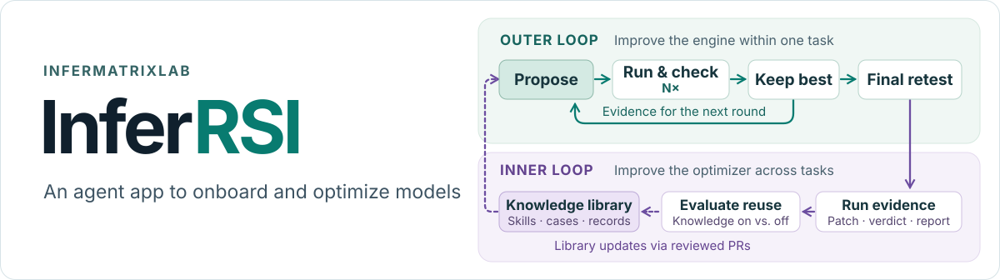
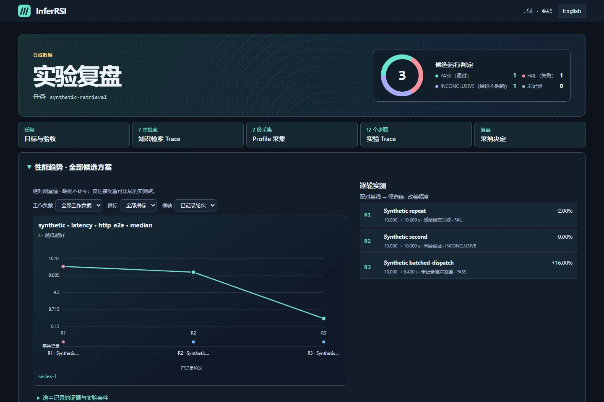

<div align="center">



[🚀 Quickstart](#quickstart) · [🔁 How It Works](#how-it-works) · [📊 Selected Results](#selected-results) · [📚 Docs](#documentation) · [🤝 Contributing](#contributing)

</div>

InferRSI helps coding agents and engineers profile inference workloads, test
optimizations against a baseline, and verify output quality before adopting a
change. Bring an engine checkout, a workload, and your quality checks.

<a id="quickstart"></a>

## 🚀 Quickstart

**🖥️ Use the CLI.** Install from source and list the packaged benchmarks on a
development machine with Python 3.10+.

```bash
git clone https://github.com/InferMatrixLab/InferRSI.git
cd InferRSI
python -m venv .venv
source .venv/bin/activate
python -m pip install .
inferrsi benchmarks list
```

From a target vLLM-Omni checkout, run the CPU readiness probe.

```bash
inferrsi doctor --repo . --repo-type vllm_omni --backend cpu
```

Setup and task discovery run without starting a benchmark. For a target host,
select its backend (`cpu`, `cuda`, `rocm`, `ascend`, or `mlx`).
[Install guide](docs/quickstart.md#install-and-smoke) · [Release wheels and checksums](https://github.com/InferMatrixLab/InferRSI/releases)

**🤖 Use a coding agent.** Install the plugin and ask it to check the target
checkout, workload, and quality criteria before starting an experiment.
[Codex](docs/codex-plugin.md#install-from-the-release-zip) · [DeepSeek Harness](docs/dsh-plugin.md) · [WorkSwarm](docs/workswarm-plugin.md#download-and-install)

**🧪 Run your first experiment.** [Try a packaged benchmark](docs/optimization-benchmarks.md#start-the-complete-workflow) · [Bring your own workload](docs/quickstart.md#real-remote-experiment)

<a id="architecture"></a>

<a id="how-it-works"></a>

## 🔁 How It Works

**Outer loop.** To improve the engine, the agent profiles the workload and
proposes a change. InferRSI checks quality and measures the candidate against
the baseline under the same frozen protocol. Round evidence guides the next
change. A fresh process retests the best candidate at the end of the campaign.

**Inner loop.** To improve the optimizer, compare paired campaigns with
knowledge on and off to measure whether access to the library helps the agent.
Reviewed PRs add findings to the library for agents to consult in later
campaigns.
[Knowledge comparison](docs/benchmark-comparison.md)

- **Knowledge** supplies source-linked skills, prior measurements, and implementation notes for the agent to consult.
- **Harness** freezes the experiment inputs and gates, runs the rounds, and records the verdict and evidence.
- **Benchmark** supplies packaged tasks, measurements, and acceptance rules. Project campaigns supply their own workload and checks.

**Apps** assembles these capabilities into the CLI, client integrations, and
result views.
[Module responsibilities](docs/architecture.md#module-responsibilities-and-dependencies) · [Workflow diagram](docs/optimization-workflow-unification.md#时序图) · [Architecture decision #362](https://github.com/InferMatrixLab/InferRSI/issues/362#issuecomment-6722325612) · [Apps migration #371](https://github.com/InferMatrixLab/InferRSI/issues/371)

**Review a run in the dashboard.** Compare baseline and candidate profiles and
trace each experiment back to its evidence. From a recorded run directory,
open it with `inferrsi dashboard --input .`, which writes `dashboard.html` beside the run.
[Dashboard guide](docs/dashboard.md#generate-and-open) · [Download the interactive example](docs/examples/dashboard-profile-review.html)

<p align="center">
  <a href="docs/examples/dashboard-profile-review.webp">
    
  </a>
  <br>
  <sub>Dashboard demo with synthetic data.</sub>
</p>

<a id="results"></a>

<a id="selected-results"></a>

## 📊 Selected Results

Model bring-up and measured optimizations across text, image, video, and speech.
Performance tables highlight metrics that improved by at least 20% against the
listed baseline. The evidence column gives the scope and validation status.
🔥 marks the largest gain in its table, ✅ a row whose quality checks passed, and
⚠️ a failed or unqualified check, or an inconclusive campaign.

<a id="model-onboarding"></a>

### 🧩 Model onboarding

| Model | Engine and hardware | Milestone | Evidence |
| --- | --- | --- | --- |
| **DeepSeek V4.1 Flash** | vLLM-Ascend · 8× Ascend 910C | W8A8 service on the 8K-input / 1K-output workload. Six independent runs gave **39.28 / 44.07 / 56.86 ms/token** at C1 / C4 / C16; the 25 ms/token target remains unmet. | [Bring-up and baseline](https://github.com/InferMatrixLab/InferRSI/issues/353#issuecomment-6641425447) |
| **Qwen3.8-27B** | Standalone nano-vLLM-derived engine · 1× H20 | FP8 service passed scoped HTTP/SSE lifecycle checks; quality and performance qualification incomplete. | [Service bring-up](https://github.com/InferMatrixLab/InferRSI/issues/57) · [Performance campaign](https://github.com/InferMatrixLab/InferRSI/issues/67) |
| **LFM3-Omni-2B** | vLLM-Omni · 1× Ascend 910B1 | ✅ Two real-weight serving tests passed; a functional eager adapter served as the offline audio baseline. | [Serving checks and A/B benchmark](https://github.com/vllm-project/vllm-omni/pull/9827) |

<a id="text-serving"></a>

### 💬 Text serving

| Model | Measured change and baseline | Metric and hardware | Validation and evidence |
| --- | --- | --- | --- |
| **DeepSeek V4.1 Flash** | **+54.45% / +36.12% / +20.80%**<br>Baseline: 68,239 / 1,711.98 / 1,132.9 tokens/s per card | Per-card throughput, prefill / decode / end-to-end · Ascend A3, W4A8, 1P1D | Throughput and latency rechecked at each scenario's latency limit; decode rechecked once. Long-output accuracy not verified. [Workloads and evidence](https://github.com/jiaran-king/dsv4.1-optimize) |

<a id="image-and-video-generation"></a>

### 🎨 Image and video generation

| Model | Measured change and baseline | Metric and hardware | Validation and evidence |
| --- | --- | --- | --- |
| **MiniMax-H3 Ref2VA** | **−73.45%**<br>Baseline: Dense inference · 407.27 s | 5 s video, HTTP latency · 8× Ascend 910B1 | **3.77×** with lossy Cache-DiT. ✅ 14 / 14 quality comparisons passed. [Campaign](https://github.com/InferMatrixLab/InferRSI/issues/293) · [Benchmark](evidence/h3-ref2va-ascend-293/results/final-5s/README.md) |
| **MiniMax-H3 Ref2VA** | **−76.3%**<br>Baseline: In-run dense control · 701.95 s | 5 s video, 50-step denoising time · 4× Ascend 950PR | **🔥 4.22×** in five retained A/B slots. ⚠️ Historical; performance and quality inconclusive. [Archive record](https://github.com/InferMatrixLab/InferRSI/issues/520) · [Recipe benchmark](https://github.com/vllm-project/vllm-omni/pull/9955#:~:text=in%2Drun%20dense%20median) |
| **MiniMax-H3-Image** | **−60.16%**<br>Baseline: Original layer offload · 36.62 s | Warm HTTP latency · 2× RTX 3090 | One paired comparison; ✅ 9 pixel-identical outputs. [Upstream results](https://github.com/vllm-project/vllm-omni/pull/10243#:~:text=One%20paired%20deployment%20comparison) |
| **MiniMax-H3-Image** | **−35.9% / −36.1%**<br>Baseline: Same-layout SP4 control · 16.89 / 4.18 s | HTTP generation latency at 4736×3552 / 1024×1024 · 4× Ascend 910B1 | ✅ 30 / 30 numerical checks passed. Latency targets unmet. [Benchmark](https://github.com/InferMatrixLab/InferRSI/pull/394) |
| **Qwen-Image-2.1-Turbo** | **−30.60%**<br>Baseline: Pinned control · 384.16 ms | Warm HTTP latency · 4× B300 | ✅ 44 pixel-identical outputs. [InferRSI results](docs/qwen-image-2.1-turbo-b300.md) |
| **Qwen-Image-2.1-Turbo** | **−22.20%**<br>Baseline: Upstream parent · 2,921.23 ms | Warm offline generation latency · 1× Ascend 910B1 | ⚠️ Upstream reference; 18 pixel-identical outputs. Teardown inconclusive. [Upstream results](https://github.com/vllm-project/vllm-omni/pull/8729#:~:text=Final%2Dmerge%20performance%20and%20image%20comparison) |

<a id="speech-and-multimodal-serving"></a>

### 🔊 Speech and multimodal serving

| Model | Measured change and baseline | Metric and hardware | Validation and evidence |
| --- | --- | --- | --- |
| **LFM3-Omni-2B** | **+108.1%**<br>Baseline: Functional eager adapter · 0.285 req/s | Offline greedy request throughput · 1× Ascend 910B1, C4 | ✅ Retained audio bit-identical at every tested temperature. [Upstream results](https://github.com/vllm-project/vllm-omni/pull/9827#:~:text=Performance%20results) |
| **MiniCPM-o 4.5** | **+100.6% / −50.72%**<br>Baseline: Pinned upstream main · 11.46 req/s / 0.65548 RTF | Request throughput / mean real-time factor · 1× L20X, C32 | ⚠️ Five matched runs per arm; speech-quality non-inferiority unestablished. [Campaign](https://github.com/InferMatrixLab/InferRSI/issues/431) · [Benchmark](https://github.com/vllm-project/vllm-omni/pull/10331) |
| **MiniCPM-o 4.5** | **−27.69%**<br>Baseline: Tuned 50-frame deployment before packed conditioning | Median time to first audio · 1× L20X, C32 | ⚠️ Missed the exploratory word-error-rate margin. [Benchmark](https://github.com/vllm-project/vllm-omni/pull/9218) |
| **MiniCPM-o 4.5** | **+20.5% / +25.4%**<br>Baseline: Pinned upstream main before TensorRT + MPS | Throughput at C16 / C32 · 1× L20X | ⚠️ Speech quality check failed. [Benchmark](https://github.com/vllm-project/vllm-omni/pull/9188) |
| **Qwen3-TTS 1.7B** | **+158%**<br>Baseline: Fresh no-PR control · 1.869 audio s/s | Streaming audio throughput · 1× Ascend 910B1, C1 | **🔥** ⚠️ Historical upstream reference; Mandarin speaker similarity and some ASR scores regressed. [Upstream benchmark](https://github.com/vllm-project/vllm-omni/pull/9068) |
| **Drama 3** | **+31% / −23%**<br>Baseline: Piecewise graphs · 17.31 frames/s / 1.237 RTF | Throughput / mean real-time factor · 2× Ascend 910B1, C1 | Two runs per arm; real-time-factor targets unmet. [Campaign](https://github.com/InferMatrixLab/InferRSI/issues/132) · [Benchmark](https://github.com/vllm-project/vllm-omni/pull/9308) |

<a id="standalone-engine-benchmarks"></a>

<a id="standalone-engines"></a>

### ⚙️ Standalone engines

Engine projects report these comparisons. Speech benchmarks use one concurrent
request per engine and measure audio frames per second and median time to first audio.

| Engine | Measured change and baseline | Metric and hardware | Benchmark scope and evidence |
| --- | --- | --- | --- |
| **Qwen3-TTS** | **+381% / −81%**<br>Baseline: vLLM-Omni · 12.71 frames/s / 263.51 ms | Audio throughput / time to first audio · 1× Ascend 910B1 | **🔥** ✅ Three runs per engine; audio and contract checks passed. [Same-card benchmark](https://github.com/InferMatrixLab/qwen3-tts-rsi-npu-engine/blob/a29f8193b557c415175d70919bdfb9bd3dcd51fc/evidence/campaign-20261017/same-card-performance.md) |
| **MiniCPM-o 4.5** | **+112% / −57%**<br>Baseline: vLLM-Omni · 187.52 frames/s / 295.3 ms | Audio throughput / time to first audio · 1× L20X | ⚠️ Target unmet; quality unqualified. [Same-card benchmark](https://github.com/InferMatrixLab/minicpm-o-4.5-single-gpu-engine/blob/a4f4778f312791c2d190b48e521141887ed160c8/docs/current-results.md) |
| **Drama 3** | **+58% / −31%**<br>Baseline: vLLM-Omni · 195.89 frames/s / 47.29 ms | Audio throughput / time to first audio · 1× B300 | Three-run medians; overall target unmet. [Same-card benchmark](https://github.com/InferMatrixLab/drama-3-single-b300-engine/blob/58a1882a4d941f8d21bfce6be37d3d5e7c9fde80/docs/current-results.md) |
| **h3-metal** | **−59%**<br>Baseline: h3.c · 73.3 s | Warm video generation latency · Apple M5 Max | Both engines used the original MiniMax-H3 at 20 steps. [Author benchmark](https://github.com/zuiho-kai/h3-metal/blob/53b7fa5d88e2497ab427ab9c7155535f7e6e6817/README.md#performance) |

[Run your first experiment](#quickstart) · [Benchmark details and historical records](docs/optimization-results.md) · [vLLM-Omni model optimization roadmap](https://github.com/InferMatrixLab/InferRSI/issues/416)

<a id="docs"></a>

<a id="documentation"></a>

## 📚 Documentation

- **▶️ Run and review.** [Operations](docs/operations.md) · [Packaged optimization benchmarks](docs/optimization-benchmarks.md) · [Result delivery](docs/result-delivery.md)
- **🧠 Use knowledge.** [Skill library](src/inferrsi/knowledge/data/skill_library/README.md) · [CANNbot setup and revocation](docs/external-channels.md#setting-one-up) · [MindIE setup and revocation](docs/codex-plugin.md#enable-and-revoke)
- **📓 Field lessons.** [Apple silicon playbook](docs/apple-silicon-playbook.md) · [Inkling 2 Mini on Apple silicon](docs/inkling2-mini-apple-silicon.md) · [Scheduling RSI lessons](docs/scheduling-rsi-lessons.md) · [h3-metal lessons](docs/h3-metal-apple-silicon-lessons.md)
- **🧭 Understand and extend.** [Module layout and import migration](docs/module-layout.md) · [Architecture and directory map](docs/architecture.md) · [Standalone engine template](docs/template/README.md)
- **📌 Follow changes.** [Releases](https://github.com/InferMatrixLab/InferRSI/releases) · [Changelog](CHANGELOG.md)

<a id="contributing"></a>

## 🤝 Contributing

**🤝 People decide in issues; agents write the PRs.**

People agree on the scope, resources, and acceptance criteria in the issue.
Agents implement the agreed scope, run tests, and submit PRs with evidence.
To merge, a PR must pass the required checks and receive two independent
approvals. The issue owner uses the evidence to accept the work or reopen it.

Start with a reproducible workload, a baseline, and evidence of the bottleneck.
Sign off commits with `git commit -s`.
[Open an issue](https://github.com/InferMatrixLab/InferRSI/issues/new/choose) · [Human–agent collaboration](docs/agent-collaboration.md) · [Contributor guide](docs/contributing.md) · [License](LICENSE)

Run the local development checks before submitting a change.

```bash
python -m pip install -e ".[dev]"
pytest
ruff check src tests
```
