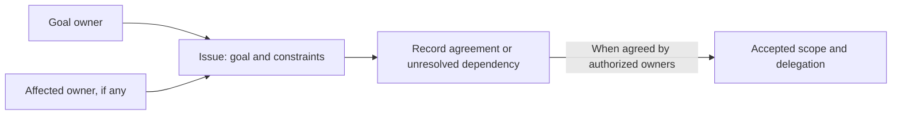
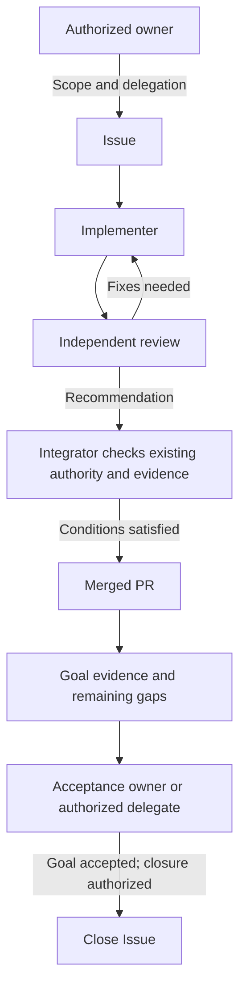
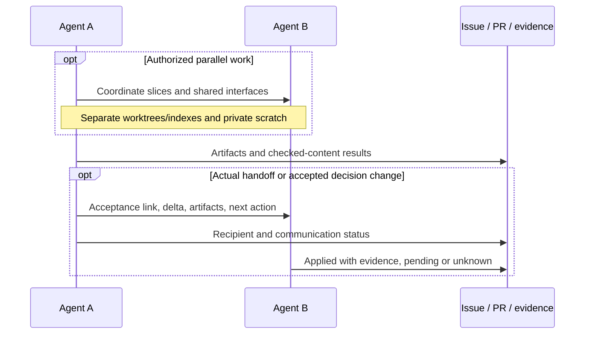

# Agent collaboration (issue-led)

Conventions for coordinating humans and agents through Issues and PRs, delivered
per the collaboration RFC
([#21](https://github.com/InferMatrixLab/OmniRSI/issues/21)). They are
documentation only: no new automation, permissions, merge gates or CI lanes.
Campaign acceptance, DCO, CI lanes and evidence rules stay in
[contributing](contributing.md); the agent entry contract stays in
[AGENTS](../AGENTS.md).

## Identity and authority

- Humans and agents may propose Issues. Proposal origin, assignment and labels do not grant authority.
- A GitHub account may represent a human and their authorized agent team. Assignment identifies accountability, not necessarily the executor. Record the acting person/agent and role when relevant; retain unknown identity rather than guessing.
- Work follows accepted scope and explicit or standing delegation. Record or link that authority. Material scope changes and exceptions return to the authorized owner.
- Routine PR review and integration may be delegated without fresh human approval per PR. Existing repository permissions and acceptance policies still apply.
- Completion is accepted by the named person or authorized agent. Acceptance/closure authority must be clear before those actions; it need not block already-authorized implementation.

## Roles

| Role | Responsibility |
| --- | --- |
| Implementer | Own a bounded slice; plan, research, coordinate, change, check and report actual results. |
| Reviewer | Independently inspect accepted requirements, actual diff, affected consumers and evidence; return revision-scoped findings and a recommendation. |
| Integrator | Verify authorization, current head/base, dependencies and applicable review/check results; integrate or report a blocker. |

Roles are responsibilities, not three mandatory agents or services. Separate
agents may act under one account; an author's role switch is still self-review.
A substantive reviewer edit makes that reviewer a contributor requiring
appropriate independent review. Review recommendation is not merge permission.

## Interaction patterns

Illustrative responsibilities, not required services or new authority.

### Human–Human: shared decisions only

Shared-owner coordination is conditional; unresolved dependencies do not authorize blocked work.

### Human–Agent: delegate work, accept the goal

No human-per-PR gate. Blocked integration or incomplete goals remain open; material scope exceptions return to the authorized owner.

### Agent–Agent: isolated work and conditional handoff

## Working rules

1. **Scope:** identify requirements, exclusions, owner and relevant dependencies. Keep each PR a coherent delivery slice; small follow-ups may reuse an Issue.
2. **Isolation:** concurrent writers use separate working directories/indexes and private scratch files. Branch names alone are insufficient. Inspect staged/committed content and coordinate shared IDs, schemas and interfaces.
3. **Evidence:** link checks to actual checked content and relevant environment/test definitions. Distinguish passed, failed, cancelled, skipped, timed-out and not-run. H/B/T—reviewed head, assessed base, tested content—may come from existing records, not mandatory worksheets.
4. **Refresh:** reassess affected evidence after relevant head/base/content/environment/check changes. Refresh checks or explain continued applicability. Neither blanket reuse nor full hardware reruns is the default; changed hashes alone prove neither content change nor equivalence.
5. **Handoff:** only for an actual transfer or accepted decision change, record the delta, recipient and next action. Keep acceptance status/link, communication status and application status separate. "Applied" needs artifact/evidence; otherwise retain pending or unknown. No full conversation traces or new ledger.
6. **Completion:** merged PR ≠ accepted goal ≠ campaign `PASS` ≠ release. Use non-closing `Refs #N` until closure is authorized. Subtasks cannot implicitly close a parent goal. Knowledge proposals to [#17](https://github.com/InferMatrixLab/OmniRSI/issues/17) are optional; no automatic promotion.

## Records

- **Issue:** goal/criteria; scope; accountable account and actor if known; acceptance/delegation link; completion/closure owner. Unknown fields may remain TBD while proposed. Ordinary work starts from the [scoped-task template](../.github/ISSUE_TEMPLATE/scoped-task.md); baseline-vs-candidate campaigns use the [campaign acceptance form](../.github/ISSUE_TEMPLATE/campaign-acceptance.yml).
- **PR:** governing Issue; delivered artifacts; checks/results/limitations; dependencies and gaps. Add requirement-to-artifact mapping only when useful, and handoff fields only when applicable. No author-prefilled independent approval. Start from the [PR template](../.github/PULL_REQUEST_TEMPLATE.md).
- **Commit:** short descriptive subject; why/what and Issue reference when useful. Preserve the required DCO sign-off (`git commit -s`); never invent a signing identity.

Labels document coordination intent; they do not grant it. Reuse existing labels
where adequate: type (`bug`, `enhancement`, `documentation`, optionally `rfc`),
decision (`proposed`, `accepted`, `deferred`, at most one), coordination
(`blocked`, with a blocker link). Do not duplicate native open/closed or
review/check states with labels. Decision labels are synchronized with recorded
decisions by an authorized owner or delegate; setting labels up is a separate
decision, not part of these conventions.

## Evidence refresh — hypothetical example

**Hypothetical illustration only; it records no actual PR, run or result in this
repository.**

Suppose a PR changing `src/omnirsi/harness/runner.py` was reviewed at head `H1`
against base `B1`, then is rebased onto `B2` (new head `H2`) because `B2` touched
the same file. Rule 4 asks what changed, not for a blanket rerun:

- Compare the affected files between `H1` and `H2`. If the delta is empty and dependencies are unchanged, the earlier review and CI remain applicable; cite them with their original run and state that reasoning in the PR.
- If the delta is non-empty, refresh the affected checks on `H2` — for example `ruff check src tests` plus the relevant `pytest` selection — and report which content each result ran on.
- Either way, distinguish passed, skipped and not-run checks instead of implying a full rerun. A changed hash alone proves neither content change nor equivalence.

## Historical evidence and limits

These conventions are OmniRSI proposals informed by the reviewed C1–C7 case pack
from two pinned snapshots: the
[Magpie repository](https://github.com/yetone/magpie/tree/778000326adaa49cd790846acd2d535572ad5ceb)
and the separate
[release-workflow repository](https://github.com/yetone/magpie-releases/tree/fc85a074b1ba73417d2afda783e1c0a27ed79a1f).
The per-case summary and limits live in
[RFC #21](https://github.com/InferMatrixLab/OmniRSI/issues/21): C1–C3 inform
ownership and review; C4–C5, CI trade-offs; C6, completion states; C7, learning.

They are proposals, not demonstrated Magpie enforcement or a causal speedup.
Described practice, inspected implementation, observed records and proposed
adaptations remain distinct evidence classes; see #21 for the per-case limits,
including the unresolved C1 root cause and the absence of a demonstrated
simultaneous deployment.
