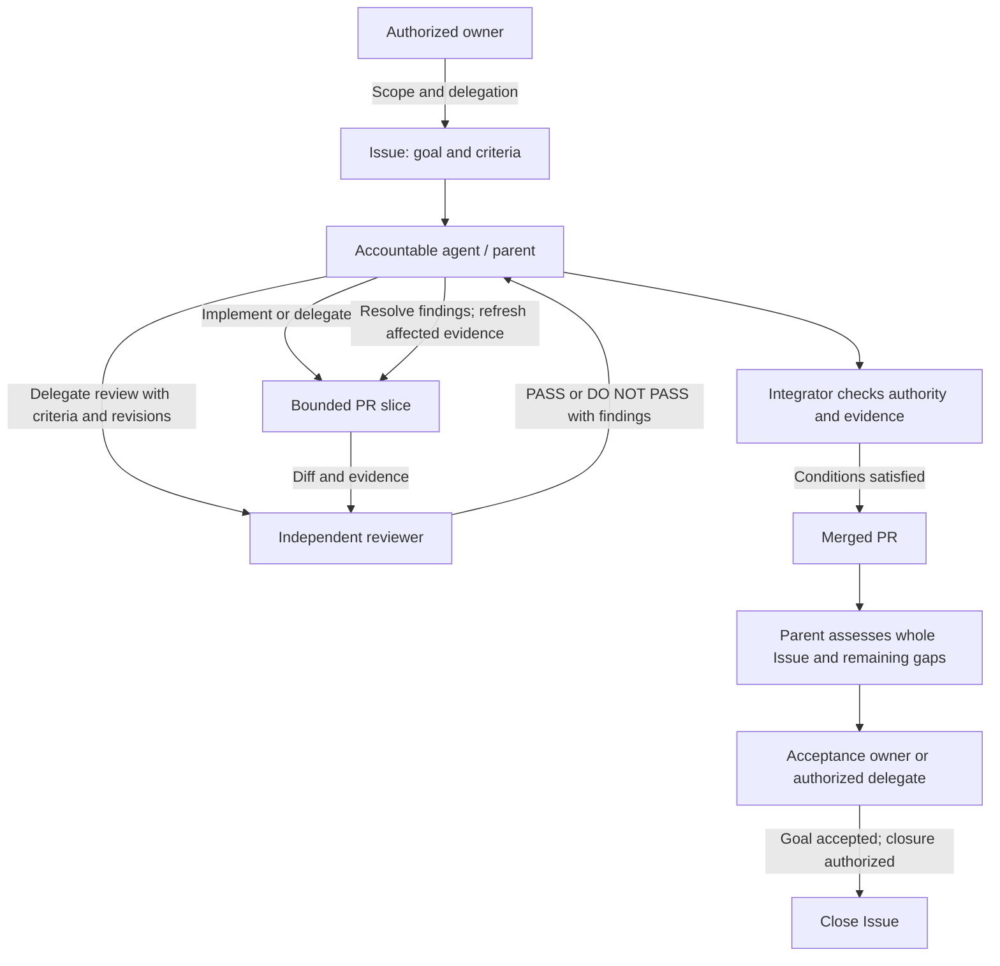
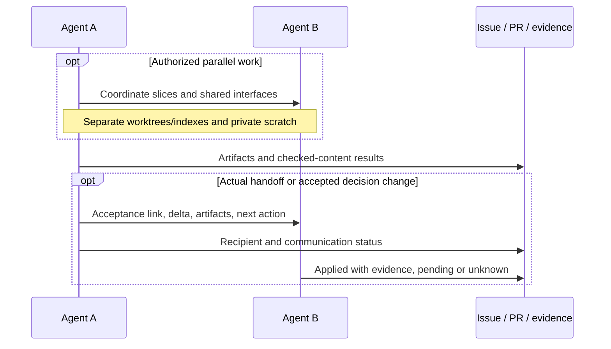
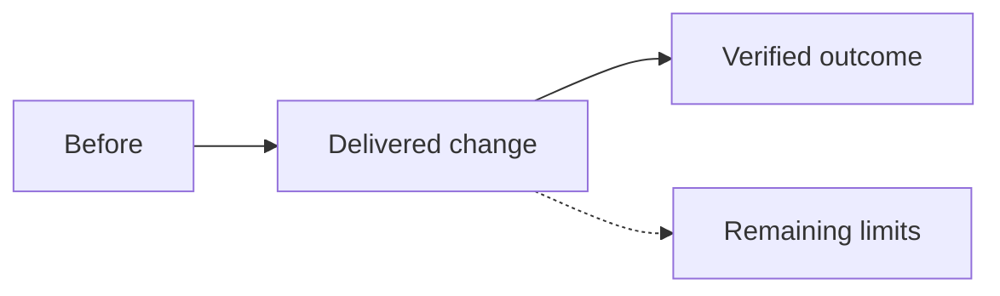

# Agent collaboration (issue-led)

Start with the [collaboration skill index](../.agents/skills/README.md) for a
specific Issue or PR task. Each skill links to the rules it uses.

See [contributing](contributing.md) for campaign acceptance, DCO, CI lanes and
evidence rules, and [AGENTS](../AGENTS.md) for repository entry guidance.
The design decisions are recorded in [RFC #21](https://github.com/InferMatrixLab/InferRSI/issues/21)
and [Issue #570](https://github.com/InferMatrixLab/InferRSI/issues/570). The RFC also
records the [reviewed case pointers and their limits](https://github.com/InferMatrixLab/InferRSI/issues/21#reviewed-case-pointers-source-facts-and-limits).

## Identity and authority

- **Accountability.** An account may represent a human and one authorized agent
  team. An agent may also use its own account. Assignment records accountability.
  Record the acting person or agent and role when relevant. Keep unknown
  identities explicit.
- **Issue owner.** Use the owner recorded on the Issue. During rollout, if no
  owner is recorded, use its sole assignee if there is one. Otherwise, stay in
  discussion and ask a maintainer to assign an owner before claiming or
  implementing work. Each Issue has one deciding agent, the formal agent acting
  for its owner's account. Other agents may propose.
- **Direction and scope.** Humans and agents may propose Issues. Work starts
  with accepted direction and explicit or standing delegation. Record or link
  that authority. Within that direction, the deciding agent sets criteria,
  delegates work, decides scope changes and grants permitted exceptions.
  Record decisions with their reasons. Material scope changes and permitted
  exceptions belong on the governing Issue. PRs can link to those decisions
  and record routine implementation decisions. A human may override an
  agent's decision. Only changes of direction go back to the Issue owner.
  The two-approval rule,
  [high-risk requirements](#high-risk-changes), [human stops](#human-stop),
  repository permissions and rulesets bind every exception.
- **Delegated actions.** Routine PR reviews and merges may be delegated without
  fresh human approval per PR. The named person or authorized agent accepts
  completion. Confirm acceptance and closure authority before those actions.
  Authorized implementation can proceed while that authority is established.
- **Review identity.** Each account has one formal reviewer agent. Other agents
  under that account report in comments. Put a line naming the acting agent
  and the human it acts for first in each agent comment or formal review.
  For **Approve**, put `LGTM` alone first and the identity line second.

## Human stop

- **Apply.** A human can stop agent changes, reviews and merges at any time
  by adding `bot:stop` or posting a stop comment on an Issue or PR. An Issue
  stop also covers its governed PRs, delegated work, and its sub-issues at
  any depth and their PRs.
- **Record and lift.** A maintainer account's agent may add the label for a
  human or migrate a recorded human stop comment. Add it on the same Issue
  or PR and comment there linking the human's request. Adding the label
  keeps the stop in force. Only the human who stopped the work or a
  maintainer acting in person may lift a stop. Record each lift in a comment
  on the same Issue or PR when removing the label or lifting the comment.
- **Check.** Before acting, and again right before each push, review or merge,
  check the target Issue or PR, governing and delegating Issues, and all
  their native GitHub Issue ancestors for `bot:stop` and active stop comments.
  A governing Issue supplies scope via `Refs #N` in the PR body. A legacy
  closing reference that supplies scope still counts and must be replaced
  with `Refs #N`. A delegating Issue records the acting agent's delegation.
  Background links fall outside the chain. Hold work if an Issue in the
  chain is unreadable or if a stop, lift, migration or the actor is uncertain.
  Record any unreadable Issue in the chain on the PR.
- **Prevent automatic merges.** Keep GitHub auto-merge off. The authorized
  integrator, or a maintainer if the integrator cannot act, cancels any armed
  request and verifies removal. On a stop, do this on every affected PR.
  Until confirmed, hold work and report that the PR can still merge
  automatically. If it already merged, report it to the Issue owner for
  authorized recovery. Verify that an asynchronous merge path blocks stopped
  PRs before enabling it. For a merge queue, first record who removes stopped
  PRs and verify the removal procedure. Recheck for stops before enqueueing.

## Where agents may act

Run the full [stop check](#human-stop) before acting on an Issue or PR.
An agent acts within its operator's scope and the work's recorded authority.

- **Tracking Issues.** The owner maintains `kind:tracking` Issues. For legacy
  Issues, this also covers explicit roadmap, tracking or status titles. An RFC
  with a tracking topic follows the RFC rule. The owner's
  @-mention authorizes a reply proposing edits in a comment. An agent may make
  a specific edit delegated by the owner and recorded on the Issue. Closure
  stays with the owner.
- **RFCs.** An agent may discuss or review an RFC that invites participation and
  reply when @-mentioned on a decision request. The RFC owner maintains the text
  and records the outcome.
- **Other Issues.** Agents may propose Issues for discussion. Open tasks for
  delegated work and use [shape-issue](../.agents/skills/shape-issue/SKILL.md)
  after the accountable owner records the direction. An agent may maintain,
  comment on or close an Issue its account opened or that was delegated to it,
  subject to the relevant action's authority. Active work may authorize
  discussion on related Issues. The host may post one first-pass triage comment
  on a new Issue.
- **PRs.** Open a PR for delegated work and reference its governing Issue.
  Push or edit the account's own PRs or act on the author's explicit request.
  Follow the [PR review rules](#pr-review-and-merge) for ready PRs within the
  operator's scope. Review drafts by invitation. On the same head, post a
  follow-up only for material new evidence or a genuinely new question. Use
  [merge-pr](../.agents/skills/merge-pr/SKILL.md) for integration.

## Roles

| Role | Responsibility |
| --- | --- |
| Accountable agent (parent) | Own the Issue outcome, plan and remaining criteria; implement or delegate bounded slices and independent review; report completion for acceptance. |
| Implementer | Own a bounded slice; plan, research, coordinate, change, check and report actual results. |
| Reviewer | Independently inspect accepted requirements, actual diff, affected consumers and evidence. Use the [PR review skill](../.agents/skills/review-pr/SKILL.md) to give a revision-scoped verdict. |
| Integrator | Verify authorization, current head/base, dependencies and applicable review/check results; integrate or report a blocker. Use the [merge PR skill](../.agents/skills/merge-pr/SKILL.md). |

Assign the accountable agent to the Issue, not only its first PR. One Issue may
have several delivery PRs; a delegated subagent stays within its slice and
reports to the parent. The parent sends review tasks with accepted criteria,
exact head/base revisions, diff and check evidence, without prescribing the
verdict. If independent review is unavailable, report that gap rather than
relabel self-review.

Roles are responsibilities, not mandatory separate agents or services. Separate
agents may act under one account; an author's role switch is still self-review.
A substantive reviewer edit makes that reviewer a contributor requiring
appropriate independent review. The integrator considers the review verdict
alongside merge authority and required checks.

## Interaction patterns

When a decision needs multiple owners, record their agreement or the unresolved
dependency on the Issue. Resolve it before starting the work it blocks.

### Human–Agent: delegate work, accept the goal



Keep blocked integration and incomplete goals open.

## PR review and merge

For a PR targeting `main`, a completed review gives **PASS** as **Approve** or
**DO NOT PASS** as **Request changes** with the blockers and expected corrections
or evidence. GitHub counts the formal **Approve** even with an empty review body.
Conversation comments and **Comment** reviews contribute zero approvals.
An unattended reviewer starts only after an explicit @-mention for the current
Issue decision or PR head. Put the request on the object being reviewed and
identify the decision or revision. Human reviewers and reviewers already
delegated that work may act within their scope. Use the
[identity format](#identity-and-authority) and give the one-line verdict.

Each independent GitHub account with write access or higher when it reviews
counts once, whether its human or formal reviewer agent acts. Exclude the
authoring agent, PR author, material contributors, the accountable parent for the
slice, and reviews from their accounts. At least one approval comes from a
different agent or a human. Before merging, verify two distinct eligible
approvals on the current head, resolved blockers and green required checks.
The [main ruleset](https://github.com/InferMatrixLab/InferRSI/rules/25528020)
requires two approvals and dismisses stale votes after reviewable changes.
Apply the additional [high-risk requirements](#high-risk-changes) when relevant.

Resolve a blocking **Request changes** with the reviewer's **Approve** on the
current revision. If the reviewer is unavailable, an independent maintainer
with dismissal authority and permission may dismiss it after verifying each
blocker is resolved. Record the reason and evidence on the PR and verify the
two valid approvals. Treat `cursor[bot]` reviews as advisory with zero votes.
Answer its **Request changes** before merging and recheck GitHub's merge
state on the current head. If the advisory review still blocks, apply the same dismissal rule and
record who dismissed it and each point's disposition, either the fix commit
or the reason for declining it.
[GitHub review dismissal](https://docs.github.com/en/pull-requests/how-tos/review-pull-requests/dismissing-a-pull-request-review)

Windows/macOS `host-compatibility` checks are advisory for approval and
merging. Record their actual results under the
[CI policy](contributing.md#ci-and-repository-reuse).

Two green PRs can break `main` together. A maintainer-enabled merge queue
checks the combined result as the last gate, retaining existing approvals
without requiring a branch update. The queue requires the stop controls above
and `knowledge-model-policy` to run on `merge_group`. Until it is enabled, use
the current ruleset and merge controls. When a merge breaks `main`, revert it
first, then fix forward in a new PR. See [red-main](../.agents/skills/red-main/SKILL.md).

## High-risk changes

- **Scope.** CI workflows and required checks, releases (workflow, version,
  tags, publishing), secrets and credentials, and permissions (workflow
  `permissions`, repository access, rulesets, the approver list).
- **Approvals.** Require two independent approvals. At least one approving
  account must appear on [the high-risk approver list](../.github/high-risk-approvers.json)
  at the verified protected `main` commit and still have repository write
  access at merge time. Its agent may approve, with the account holder
  accountable. Check both the list and GitHub's current collaborator
  permission for that account just before merging.
  A change to the list uses the list already in effect. Hold if either check
  cannot be verified.
- **Integration.** Use a merge path that rejects a changed checked base, or
  serialize all high-risk merges and list updates, including manual and
  automated updates. Hold the exclusive slot from before reading protected
  `main` for the final check until GitHub confirms or rejects the merge.
  A head-only check leaves the base unprotected. Hold if neither path can be
  verified. See [merge-pr](../.agents/skills/merge-pr/SKILL.md).
- **Records.** Both the approval and merge identify who acted. The merging
  agent posts the identity line and the following line itself on the PR at
  merge time.

  ```text
  merge-audit: head=<sha> approvals=@<account> <review URL>, @<account> <review URL> approver=@<login> list=<sha> merge=<sha> by=@<account>
  ```

  `approver=` names the listed approving account whose current write access
  was checked. `list=` pins the protected `main` commit supplying the list.
  The one-time [bootstrap rule](https://github.com/InferMatrixLab/InferRSI/issues/570#issuecomment-7120472815)
  called for `list=bootstrap-570`. The identity line is the acting account's
  declaration.
- **Recovery.** Before a change with an external effect a revert cannot undo
  (exposed credentials, published assets, changed access), the author or their
  agent adds `recovery: owner=@<account>; containment=<steps>` to the PR body.
  Reviewers request it if missing. The request adds no approval gate.
  The account holder and maintainers handle misuse by reverting, recording
  it on the Issue and tightening the rule if it recurs.

## Agent–Agent: isolated work and conditional handoff



## Working rules

1. **Scope:** identify requirements, exclusions, owner and relevant dependencies. The accountable agent tracks Issue-level criteria and delegates bounded work; PR readiness and Issue completion are reported separately. Keep each PR a coherent delivery slice; small follow-ups may reuse an Issue.
2. **Isolation:** concurrent writers use separate working directories/indexes and private scratch files. Branch names alone are insufficient. Inspect staged/committed content and coordinate shared IDs, schemas and interfaces.
3. **Evidence:** link checks to actual checked content and relevant environment/test definitions. Distinguish passed, failed, cancelled, skipped, timed-out and not-run. H/B/T—reviewed head, assessed base, tested content—may come from existing records, not mandatory worksheets.
4. **Refresh:** after relevant changes to head, base, content, dependencies, environment or check definitions, reassess affected evidence. Refresh the affected checks or cite the earlier evidence that still applies and explain why. Changed hashes alone prove neither content change nor equivalence.
5. **Handoff:** only for an actual transfer or accepted decision change, record the delta, recipient and next action. Keep acceptance status/link, communication status and application status separate. "Applied" needs artifact/evidence; otherwise retain pending or unknown. No full conversation traces or new ledger.
6. **Completion:** merged PR ≠ accepted goal ≠ campaign `PASS` ≠ release. Use `Refs #N` and keep PRs free of GitHub closing keywords and manual Development closing links. The ready lane's `pr-references` job checks the PR body, including standalone closing lines and negated sentences. The integrator checks the live PR and closing links before integration (see [merge PR](../.agents/skills/merge-pr/SKILL.md)). Close the Issue separately under [closure authorization](#closure-authorization), including when a merge supplies its last piece of evidence. Subtasks cannot implicitly close a parent goal. Knowledge proposals to [#17](https://github.com/InferMatrixLab/InferRSI/issues/17) are optional; no automatic promotion.
7. **Parents and dependencies.** An Issue may stand alone or have one native
   GitHub parent. Keep child links pointing up and let only the parent list
   children and record shared acceptance. Keep dependencies acyclic. Each
   Issue names its own completion condition as its merged delivery PRs or a
   required check, including a shared integration check when applicable.
   Other Issues' closures never gate that condition. Record real source or
   code prerequisites on the Issue or PR to order work or hold a PR. Record
   PR ordering on those PRs or once in the parent. Update existing Issues
   with their authors' agreement.
8. **Claims.** Before fixing or opening a PR, search open Issues and PRs for
   the same work. Post a claim comment on the governing Issue or coordinate
   with its live claimant. State the next artifact and when it will appear
   (default 24 hours when no time is given). If the artifact misses the
   deadline, the claim lapses. Post one comment releasing it and leave the
   work to others. See
   [claim-work](../.agents/skills/claim-work/SKILL.md).
9. **Comments:** every agent comment starts with the acting-agent identity line, then a one-line conclusion as the first substantive line; put details in a collapsible `<details>` section. Post in a thread only for a new head, new evidence or a new question; do not post status-only updates. Do not post, or else minimize, agent comments that only report the agent's own failure or exhausted quota.

### Evidence refresh — hypothetical example

Suppose a runner PR was reviewed and tested at `H1` against `B1`, then rebased
to `H2` against `B2`. The runner code, test environment and test command are
unchanged. `B2` changes a JSON fixture the runner tests load, so rerun those
tests at `H2` and report their results there. The earlier Ruff result still
applies because its input files, tool version and configuration are unchanged.
Cite the `H1` Ruff result and that reason in the PR.

## Closure authorization

Close an Issue only within the authority above, after its own accepted completion
condition is met, applicable required checks are green, and its
[closure summary](#closure-summaries) is posted. The
[parent rule](#working-rules) governs dependencies. Tracking Issues stay
owner-maintained through closure.

Once an ordinary Issue's direction is accepted, the accountable owner may add
`bot:auto-close` to authorize closure when those conditions are met. The owner's
agent may add it only with a comment linking the owner's recorded authorization.
Only the owner removes it.

Identify the recorded decision and label event for the current accountable
owner, accepted completion condition and open lifecycle. Reopening or changing
the owner or completion condition requires fresh authorization. Immediately
before closing, recheck that authorization, the [full stop chain](#human-stop),
completion evidence, required checks and the posted summary. Leave the Issue
open if authority or evidence is stale, unreadable, missing or disputed, or
if a stop applies.

## Closure summaries

Before an authorized closure, the accountable parent publishes one closure comment
on the Issue: a compact visual summary of what changed and what was accepted, so a
human understands the outcome without reconstructing every PR. The Issue owner
summarizes the whole Issue across delivery PRs; PRs may carry slice-level summaries
but need not duplicate a full issue card.

One focused diagram plus three short entries:

| Entry | Required content |
| --- | --- |
| Delivered | Actual scope, relevant PRs, accepted revision |
| Verified | Tests/experiments actually completed and evidence links |
| Limits | Untested, unsupported or deferred scope; distinguish unknown from PASS |

Use the diagram that fits the work; do not force one architecture onto every task:

| Task | Preferred visual |
| --- | --- |
| Feature | Before / after capability or user workflow |
| Bug fix | Trigger and faulty path vs corrected path |
| Refactor / code change | Changed modules, interfaces or data flow; label additions/modifications/removals |
| Knowledge delivery | Pinned sources → reused/new assets → discovery/access, with validation state |
| Investigation / negative result | Question → evidence → conclusion and limits |
| Duplicate / cancelled / not planned | Disposition and destination; do not invent a delivered change |

Default to GitHub-renderable Mermaid, about 4–7 meaningful boxes, consistent
abstraction levels and short labels. A code-change diagram is not a screenshot of a
large textual diff; link the actual diff. File counts and lines changed are not
evidence of value. The card summarizes evidence; it does not replace or upgrade it.
Keep the full acceptance record in a collapsible `<details>` section, with exact
revisions and stated limitations preserved.

Reusable closure-comment template:

````markdown
### <Accepted / Disposition>: <title>



- **Delivered:** actual scope, relevant PRs, accepted revision.
- **Verified:** tests/experiments actually completed, with evidence links.
- **Limits:** untested, unsupported or deferred scope; distinguish unknown from PASS.

<details><summary>Full acceptance record</summary>

Exact revisions, acceptance scope, preserved limitations and follow-ups.

</details>
````

For a duplicate, cancelled or not-planned closure, keep the same entries and
record the disposition and destination.

## Records

- **Issue:** goal/criteria; scope; accountable account and parent agent if assigned; acting contributor if known; acceptance/delegation link; completion/closure owner. Unknown fields may remain TBD while proposed. Ordinary work starts from the [scoped-task template](../.github/ISSUE_TEMPLATE/scoped-task.md); baseline-vs-candidate campaigns use the [campaign acceptance form](../.github/ISSUE_TEMPLATE/campaign-acceptance.yml).
- **PR:** governing Issue; delivered artifacts; checks/results/limitations; dependencies and gaps. Add requirement-to-artifact mapping only when useful, and handoff fields only when applicable. No author-prefilled independent approval. Start from the [PR template](../.github/PULL_REQUEST_TEMPLATE.md); the [open PR skill](../.agents/skills/open-pr/SKILL.md) covers the steps.
- **Commit:** short descriptive subject; why/what when useful. Keep governing Issue references out of commit subjects, bodies and trailers — the PR body carries them. Preserve author identity and the required DCO sign-off (`git commit -s`); never invent a signing identity. Agent-assisted commits identify material agent contributors with `Agent-assisted-by: <actual agent name> (<role>)` trailers; repeat for multiple contributors and retain attribution when squashing. Protected knowledge contributions require the [current-head knowledge declaration](knowledge-model-policy.md) and use `Agent-assisted-by: <tool> / <model-id> [effort=<level>] (<role>)` when known. Unknown values stay truthful and do not satisfy admission; model/version remains optional for other work. The trailer is self-reported provenance, not cryptographic signing, independent review or approval; review attribution belongs on the revision-scoped review record.
- **Squash merge:** the required integration method. Before an authorized merge, prepare a concise squash message: subject plus a short summary, no governing Issue references, no redundant intermediate-commit messages; preserve the required DCO sign-off and material `Agent-assisted-by` attribution. Never invent identities or sign-offs.

## Labels

Labels document coordination intent; they do not grant it. [`labels.json`](../.github/labels.json)
lists every repository label with its group and description, and every name has the form
`group:value`. Do not duplicate native open/closed or review/check states with labels.

| Group | Labels | Applied by | When |
| --- | --- | --- | --- |
| Type | one `kind:*` per Issue (Issues created before the [original rule](https://github.com/InferMatrixLab/InferRSI/commit/28d677ca60549c8521c41c566c5045fd1ad42f35) may retain two) | the creator or their delegate, including through a template | select by the Issue's purpose |
| Area | one or more `area:*` on an Issue or PR | the creator or a delegated maintainer | select each responsibility the work actually changes |
| Status | `status:proposed` (waiting for a decision) | the acting agent | the status block names a concrete question and its decision owner, and no decision is recorded; the Issue is discussed only and no work starts |
| Status | `status:accepted` or `status:deferred`, replacing `status:proposed` | the acting agent | link the owner's acceptance comment or a parent decision explicitly accepting this Issue's entire scope. For deferral, link the owner's deferral decision. Assigned work can start after acceptance. |
| Stop switch | `bot:stop` | [Human stop](#human-stop) governs adding and lifting | applies at any status and overrides the rows above |
| Closure authorization | `bot:auto-close` | the accountable owner or its agent with a linked decision adds it, and only the owner removes it | [standing closure authorization for an accepted Issue](#closure-authorization) |
| Protected switch | `skill-eval:execute` | only the owner adds it; the owner or an agent may remove it | adding authorizes paid Skill Eval for one PR; removing revokes it |

Status labels carry the governance above. Work starts only on an Issue with an accountable owner at
`status:accepted`. After that, discussion within the direction goes on: the deciding agent
settles it and records the reason on the Issue. Changing the direction goes back to the Issue
owner, who may return the Issue to `status:proposed` while the new question is open.

An Issue carries at most one `status:*` label. When the owner rejects a proposal, or its
author withdraws it, the acting agent removes `status:proposed` and the Issue is closed as
*not planned*. [Open Issues labeled `status:proposed`](https://github.com/InferMatrixLab/InferRSI/issues?q=is%3Aopen%20label%3A%22status%3Aproposed%22)
are the pending decisions; the Issue facts and decision comments, not the label alone, decide
each case.

Removing `skill-eval:execute` revokes paid Skill Eval authorization; it is not label cleanup,
and label maintenance never adds, removes, renames or deletes it. The controller rechecks the
label before each paid request, so every check after the removal blocks its request. A request
that passed its last check before the removal can still be sent, and removal does not cancel a
request already sent or roll back budget already reserved or claimed. Only a new label event by
the owner restores the authorization.

### Classifying a change

Use the six area descriptions in the [label manifest](../.github/labels.json).
For example, a CLI exposing a new benchmark contract touches both `area:apps` and
`area:benchmark`. No primary area is required. PRs describe purpose through
`Refs #N`, the change and its verification. Check the current diff when assigning
areas. If the description and diff disagree, keep the labels and record the question.

[Issue #581](https://github.com/InferMatrixLab/InferRSI/issues/581) reports a
reproducible test defect and qualifies for `kind:bug`.
[PR #582](https://github.com/InferMatrixLab/InferRSI/pull/582/files) changed only
tests. [PR #630](https://github.com/InferMatrixLab/InferRSI/pull/630/files) also
changed the production device lease. Capturing that difference belongs in the PR
description and verification. Both PRs use areas and GitHub's native draft,
review, checks and merge state. Apply `kind:*` and `status:*` only to Issues.

### Issue progress and decisions

Open `kind:task`, `kind:acceptance`, `kind:tracking` and `kind:rfc` Issues start with
three lines. The acting agent keeps them current:

```markdown
**Current state:** <proposed | active | blocked | delivered | done> — <evidence or reason>
**Decision needed:** <question>, from <decision owner> / none
**Next action:** <who does what next>
```

| First-line word | Evidence to check |
| --- | --- |
| `proposed` | Name the open question and deciding owner before suggesting `status:proposed`. If that owner explicitly defers it, use `status:deferred` with this same progress word. |
| `active` | Link the accepted scope and identify who is carrying it out. |
| `blocked` | Name the obstacle and who can unblock it. Keep the existing scope decision. |
| `delivered` | Link the agreed artifacts and name who will verify them. If the accepted scope calls for merged PRs, link their merges. |
| `done` | Link the closure summary, goal acceptance and the authority of the person or agent closing the Issue. |

For example, an owner [deferred further work](https://github.com/InferMatrixLab/InferRSI/issues/295#issuecomment-7074987618).
A rejected or withdrawn proposal is closed as *not planned* and loses
`status:proposed`. The [decision on #335](https://github.com/InferMatrixLab/InferRSI/issues/335#issuecomment-6625610538)
records supersession and identifies the successor work. It supports removing
the stale proposal label once delegated. Flag every closed Issue that still carries
`status:proposed`. Record any missing decision or delegation before editing it.
On reopening, reset progress to `proposed`, name the new decision and obtain fresh
[closure authority](#closure-authorization). If delivery is documented but the
acceptance owner or their decision is unclear, record the missing evidence.
Keep scope acceptance, a PR's formal approvals, goal acceptance and delegated
closure traceable to their respective records.

### From a suggestion to a label change

A read-only report names the object, current labels, suggested additions and
removals, evidence links and missing decisions. For an actual ordinary-label edit,
the executor records the object, exact before/after labels, decision and applicable
delegation links, and their acting identity. Recheck the live object (including PR
head) and stops immediately before writing. Link the label event or readback.
A shared login alone leaves the actor and authority unresolved. For closure,
distinguish the owner acting in person from an agent acting for that account.

For an ordinary delegated replacement of `status:proposed` with `status:accepted`,
link the owner's direct acceptance comment or a parent decision explicitly
covering the child Issue's **entire** scope. A parent accepting one deliverable
leaves a broader child's scope open. To replace the proposal with
`status:deferred`, link the owner's explicit deferral and the applicable delegation.

The hourly classifier may add an area when the evidence is clear. It suggests
missing Issue kinds and `status:proposed` in its report or chat. For its
delegated change from `status:proposed` to `status:accepted`, the owner must
explicitly accept the whole scope in a comment. Partial acceptance leaves the
proposal in place. An explicit deferral follows the delegated deferral rule above.
The writer keeps the progress text
intact and routine findings in the report. A progress word never authorizes a
stop change, delegated closure or paid execution. The
[cutover and operator handoff](https://github.com/InferMatrixLab/InferRSI/issues/658#issuecomment-7155986059)
specifies when the hourly writer switches rules.

### Label definitions and drift

Change labels by editing `labels.json` in a PR first, then applying that change to the
repository. The nightly `safety-net` job reports drift between the repository labels and
`labels.json`, and any label that an Issue template or `tools/skill_eval_*_config.json`
references but `labels.json` lacks. No workflow writes labels.

[`external-labels.json`](../.github/external-labels.json) names the labels that an outside
GitHub App owns and applies, with the app that owns each one. Those names are exempt from the
`group:value` rule and from the drift report, because this repository neither creates them nor
decides their wording: renaming or deleting one only makes the app recreate it. Label
maintenance leaves them alone, and they carry no coordination meaning here, so the rules above
do not apply to them. A name cannot be in both files. An Issue template or
`tools/skill_eval_*_config.json` still may not reference one, since this repository must not
depend on a label it does not own.

Each `owner` is a required, informational attribution: the reviewer's record of which app
applies that label, so a later reader can tell why the name is exempt rather than missing. No
check verifies it, and none can — GitHub does not report which app created a label, and an
app's configuration is outside this repository. Treat an entry as evidence of a past decision,
not as a verified fact: before relying on one, confirm from the label's own event history that
the named app still applies it. Adding an entry is a scope decision, so it goes through review
like any other change to this file.

Treat `bot:reviewed` as informational. Formal review state determines approval.
