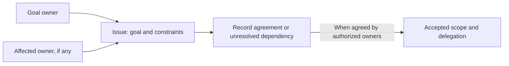
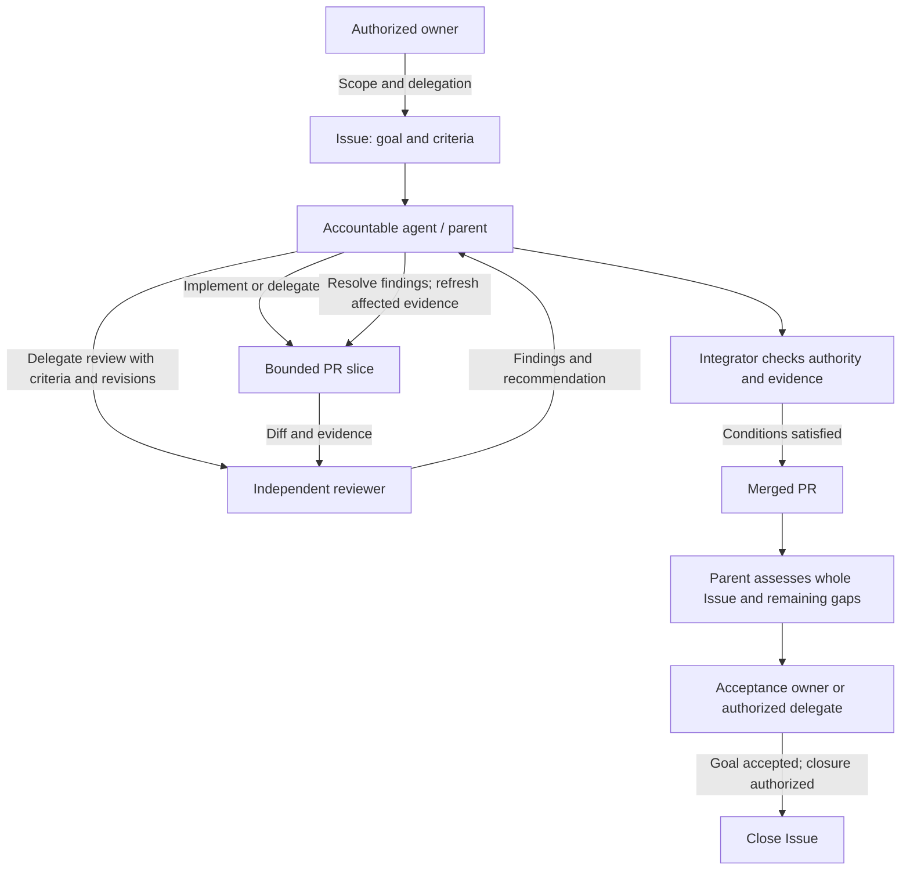
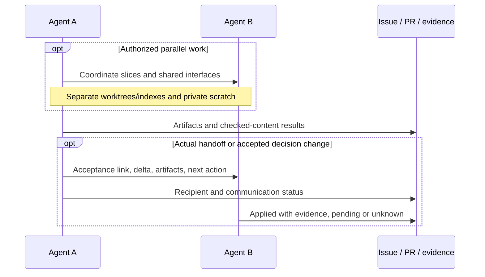
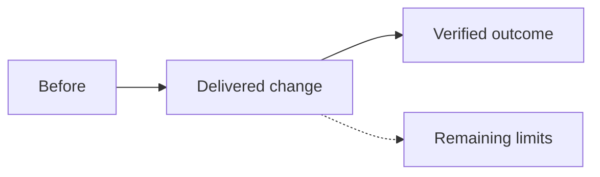
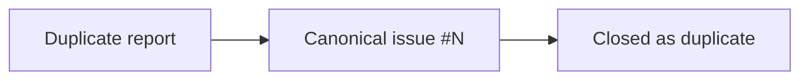

# Agent collaboration (issue-led)

Conventions for coordinating humans and agents through Issues and PRs, delivered
per the collaboration RFC
([#21](https://github.com/InferMatrixLab/InferRSI/issues/21)). They add no merge
gates or CI lanes; the checks they mention are reports in the existing lanes.
Campaign acceptance, DCO, CI lanes and evidence rules stay in
[contributing](contributing.md); the agent entry contract stays in
[AGENTS](../AGENTS.md).

## Identity and authority

- Humans and agents may propose Issues. Proposal origin, assignment and labels do not grant authority.
- A GitHub account may represent a human and their authorized agent team. Assignment identifies accountability, not necessarily the executor. Record the acting person/agent and role when relevant; retain unknown identity rather than guessing.
- Work follows accepted scope and explicit or standing delegation. Record or link that authority. Material scope changes and exceptions return to the authorized owner.
- Routine PR review and integration may be delegated without fresh human approval per PR. Existing repository permissions and acceptance policies still apply.
- Completion is accepted by the named person or authorized agent. Acceptance/closure authority must be clear before those actions; it need not block already-authorized implementation.

## Roles

| Role | Responsibility |
| --- | --- |
| Accountable agent (parent) | Own the Issue outcome, plan and remaining criteria; implement or delegate bounded slices and independent review; report completion for acceptance. |
| Implementer | Own a bounded slice; plan, research, coordinate, change, check and report actual results. |
| Reviewer | Independently inspect accepted requirements, actual diff, affected consumers and evidence; return revision-scoped findings and a recommendation. |
| Integrator | Verify authorization, current head/base, dependencies and applicable review/check results; integrate or report a blocker. |

Assign the accountable agent to the Issue, not only its first PR. One Issue may
have several delivery PRs; a delegated subagent stays within its slice and
reports to the parent. The parent sends review tasks with accepted criteria,
exact head/base revisions, diff and check evidence, without prescribing the
verdict. If independent review is unavailable, report that gap rather than
relabel self-review.

Roles are responsibilities, not mandatory separate agents or services. Separate
agents may act under one account; an author's role switch is still self-review.
A substantive reviewer edit makes that reviewer a contributor requiring
appropriate independent review. Review recommendation is not merge permission.

## Interaction patterns

Illustrative responsibilities, not required services or new authority.

### Human–Human: shared decisions only



Shared-owner coordination is conditional; unresolved dependencies do not authorize blocked work.

### Human–Agent: delegate work, accept the goal



Review reports remain attributable and available to the integrator; the parent cannot substitute its own approval for independent findings. No human-per-PR gate. Blocked integration or incomplete goals remain open; material scope exceptions return to the authorized owner.

### Agent–Agent: isolated work and conditional handoff



## Working rules

1. **Scope:** identify requirements, exclusions, owner and relevant dependencies. The accountable agent tracks Issue-level criteria and delegates bounded work; PR readiness and Issue completion are reported separately. Keep each PR a coherent delivery slice; small follow-ups may reuse an Issue.
2. **Isolation:** concurrent writers use separate working directories/indexes and private scratch files. Branch names alone are insufficient. Inspect staged/committed content and coordinate shared IDs, schemas and interfaces.
3. **Evidence:** link checks to actual checked content and relevant environment/test definitions. Distinguish passed, failed, cancelled, skipped, timed-out and not-run. H/B/T—reviewed head, assessed base, tested content—may come from existing records, not mandatory worksheets. Tracked evidence files are bounded by a 512 KiB per-file budget and a 2.0 MiB per-PR net addition budget. Larger raw artifacts (traces, weights) must be hosted as GitHub Release assets and registered in `tools/evidence_inventory.json` with an accessible HTTPS URL, SHA-256 digest, byte count, and retention owner. The ready lane's `evidence-budget` job reports violations.
4. **Refresh:** reassess affected evidence after relevant head/base/content/environment/check changes. Refresh checks or explain continued applicability. Neither blanket reuse nor full hardware reruns is the default; changed hashes alone prove neither content change nor equivalence.
5. **Handoff:** only for an actual transfer or accepted decision change, record the delta, recipient and next action. Keep acceptance status/link, communication status and application status separate. "Applied" needs artifact/evidence; otherwise retain pending or unknown. No full conversation traces or new ledger.
6. **Completion:** merged PR ≠ accepted goal ≠ campaign `PASS` ≠ release. Use non-closing `Refs #N` until closure is authorized. GitHub treats a closing keyword followed by an Issue reference as closing syntax even inside a negated sentence, so never write one in PR text; for an authorized closure, put `Closes #N` alone on its own line. The ready lane's `pr-references` job reports any other use. Subtasks cannot implicitly close a parent goal. Knowledge proposals to [#17](https://github.com/InferMatrixLab/InferRSI/issues/17) are optional; no automatic promotion. Before an authorized closure, publish a closure summary card ([closure summaries](#closure-summaries)).

## Closure summaries

Before an authorized closure, the accountable parent publishes one closure comment
on the Issue: a compact visual summary of what changed and what was accepted, so a
human understands the outcome without reconstructing every PR. The Issue owner
summarizes the whole Issue across delivery PRs; PRs may carry slice-level summaries
but need not duplicate a full issue card.

One focused diagram plus three short entries:

| Entry | Required content |
| --- | --- |
| Delivered | Actual scope, relevant PRs, accepted revision |
| Verified | Tests/experiments actually completed and evidence links |
| Limits | Untested, unsupported or deferred scope; distinguish unknown from PASS |

Use the diagram that fits the work; do not force one architecture onto every task:

| Task | Preferred visual |
| --- | --- |
| Feature | Before / after capability or user workflow |
| Bug fix | Trigger and faulty path vs corrected path |
| Refactor / code change | Changed modules, interfaces or data flow; label additions/modifications/removals |
| Knowledge delivery | Pinned sources → reused/new assets → discovery/access, with validation state |
| Investigation / negative result | Question → evidence → conclusion and limits |
| Duplicate / cancelled / not planned | Disposition and destination; do not invent a delivered change |

Default to GitHub-renderable Mermaid, about 4–7 meaningful boxes, consistent
abstraction levels and short labels. A code-change diagram is not a screenshot of a
large textual diff; link the actual diff. File counts and lines changed are not
evidence of value. The card summarizes evidence; it does not replace or upgrade it.
Keep the full acceptance record in a collapsible `<details>` section, with exact
revisions and stated limitations preserved.

Reusable closure-comment template:

````markdown
### <Accepted / Disposition>: <title>



- **Delivered:** actual scope, relevant PRs, accepted revision.
- **Verified:** tests/experiments actually completed, with evidence links.
- **Limits:** untested, unsupported or deferred scope; distinguish unknown from PASS.

<details><summary>Full acceptance record</summary>

Exact revisions, acceptance scope, preserved limitations and follow-ups.

</details>
````

Examples: [functional change and scoped acceptance (#40)](https://github.com/InferMatrixLab/InferRSI/issues/40#issuecomment-6330534277) and [knowledge delivery with preserved validation limits (#48)](https://github.com/InferMatrixLab/InferRSI/issues/48#issuecomment-6330592855).

Non-delivery closures (duplicate, cancelled, not planned) keep the same entries but
record disposition and destination instead of a delivered change. Illustrative card:



- **Delivered:** none.
- **Verified:** overlap with the canonical issue confirmed by the acceptance owner.
- **Limits:** none applicable.

## Records

- **Issue:** goal/criteria; scope; accountable account and parent agent if assigned; acting contributor if known; acceptance/delegation link; completion/closure owner. Unknown fields may remain TBD while proposed. Ordinary work starts from the [scoped-task template](../.github/ISSUE_TEMPLATE/scoped-task.md); baseline-vs-campaign campaigns use the [campaign acceptance form](../.github/ISSUE_TEMPLATE/campaign-acceptance.yml).
- **PR:** governing Issue; delivered artifacts; checks/results/limitations; dependencies and gaps. Add requirement-to-artifact mapping only when useful, and handoff fields only when applicable. No author-prefilled independent approval. Start from the [PR template](../.github/PULL_REQUEST_TEMPLATE.md).
- **Commit:** short descriptive subject; why/what when useful. Keep governing Issue references out of commit subjects, bodies and trailers — the PR body carries them. Preserve author identity and the required DCO sign-off (`git commit -s`); never invent a signing identity. Agent-assisted commits identify material agent contributors with `Agent-assisted-by: <actual agent name> (<role>)` trailers; repeat for multiple contributors and retain attribution when squashing. Protected knowledge contributions require the [current-head knowledge declaration](knowledge-model-policy.md) and use `Agent-assisted-by: <tool> / <model-id> [effort=<level>] (<role>)` when known. Unknown values stay truthful and do not satisfy admission; model/version remains optional for other work. The trailer is self-reported provenance, not cryptographic signing, independent review or approval; review attribution belongs on the revision-scoped review record.
- **Squash merge:** the required integration method. Before an authorized merge, prepare a concise squash message: subject plus a short summary, no governing Issue references, no redundant intermediate-commit messages; preserve the required DCO sign-off and material `Agent-assisted-by` attribution. Never invent identities or sign-offs.

## Labels

Labels document coordination intent; they do not grant it. [`labels.json`](../.github/labels.json)
lists every repository label with its group and description, and every name has the form
`group:value`. Do not duplicate native open/closed or review/check states with labels.

| Group | Labels | Applied by | When |
| --- | --- | --- | --- |
| Type | exactly one `kind:*` per Issue, including `kind:bug`; Issues only (Issues created before the label change may keep two) | the creator; templates | at creation |
| Area | one or more `area:*` | the creator | at creation |
| Status | `status:proposed` (waiting for a decision) | the acting agent | the status block names a concrete question and its decision owner, and no decision is recorded |
| Status | `status:accepted` or `status:deferred`, replacing `status:proposed` | the acting agent | only after the decision owner records that decision in a comment |
| Priority | at most one `priority:P0/P1/P2`, only with `status:proposed` or `status:accepted` | the acting agent; the decision owner may change it | with `status:proposed`, how soon the owner should decide; with `status:accepted`, how soon work should start; removed at `status:deferred` |
| Help | `help:wanted` | the creator or a maintainer | an Issue needs an owner or contributor |
| Protected switch | `skill-eval:execute` | only the owner adds it; the owner or an agent may remove it | adding authorizes paid Skill Eval for one PR; removing revokes it |

An Issue carries at most one `status:*` label. When the owner rejects a proposal, or its
author withdraws it, the acting agent removes `status:proposed` and the Issue is closed as
*not planned*. [Open Issues labeled `status:proposed`](https://github.com/InferMatrixLab/InferRSI/issues?q=is%3Aopen%20label%3A%22status%3Aproposed%22)
are the pending decisions; the Issue facts and decision comments, not the label alone, decide
each case.

Removing `skill-eval:execute` revokes paid Skill Eval authorization; it is not label cleanup,
and label maintenance never adds, removes, renames or deletes it. The controller rechecks the
label before each paid request, so every check after the removal blocks its request. A request
that passed its last check before the removal can still be sent, and removal does not cancel a
request already sent or roll back budget already reserved or claimed. Only a new label event by
the owner restores the authorization.

Open `kind:task`, `kind:acceptance`, `kind:tracking` and `kind:rfc` Issues start with a
three-line status block that the acting agent keeps current:

```markdown
**Current state:** <one sentence>
**Decision needed:** <question>, from <decision owner> / none
**Next action:** <who does what next>
```

Change labels by editing `labels.json` in a PR first, then applying that change to the
repository. The nightly `safety-net` job reports drift between the repository labels and
`labels.json`, and any label that an Issue template or `tools/skill_eval_*_config.json`
references but `labels.json` lacks. No workflow writes labels.

## Evidence refresh — hypothetical example

**Hypothetical illustration only; it records no actual PR, run or result in this
repository.**

Suppose a PR changing `src/inferrsi/harness/runner.py` was reviewed at head `H1`
against base `B1`, then is rebased onto `B2` (new head `H2`) because `B2` touched
the same file. Rule 4 asks what changed, not for a blanket rerun, and a
file-only comparison is insufficient on its own:

- Assess affected content, dependencies, environment and check definitions together: the `H1..H2` delta of the affected files, whether `B1..B2` changed anything the checks depend on (imports, fixtures, CI workflow steps, tool versions), and whether the earlier check definitions still test the same contract.
- If that assessment supports reuse, the earlier review and CI **may** remain applicable — say so with an explicit reason, and name in the PR exactly which earlier evidence is reused and why.
- If it does not, refresh the affected checks on `H2` — for example `ruff check src tests` plus the relevant `pytest` selection — and report which content each result ran on.
- Either way, distinguish passed, skipped and not-run checks instead of implying a full rerun. A changed hash alone proves neither content change nor equivalence.

## Historical evidence and limits

These conventions are InferRSI proposals informed by the reviewed C1–C7 case pack.
The two pinned snapshots — the
[Magpie repository](https://github.com/yetone/magpie/tree/778000326adaa49cd790846acd2d535572ad5ceb)
and the separate
[release-workflow repository](https://github.com/yetone/magpie-releases/tree/fc85a074b1ba73417d2afda783e1c0a27ed79a1f)
— identify lineage; they are not themselves a link to the case pack. An
accessible case summary with concrete source pointers and stated limits — the
"Reviewed case pointers" section of
[RFC #21](https://github.com/InferMatrixLab/InferRSI/issues/21) — covers C1–C7
at the level this guide relies on; the full reviewed pack remains with its
owner and is not imported here. C1–C3 inform ownership and review; C4–C5, CI trade-offs; C6,
completion states; C7, learning.

They are proposals, not demonstrated Magpie enforcement or a causal speedup.
Described practice, inspected implementation, observed records and proposed
adaptations remain distinct evidence classes; see #21 for the per-case limits,
including the unresolved C1 root cause and the unestablished final
tested/merged equivalence.