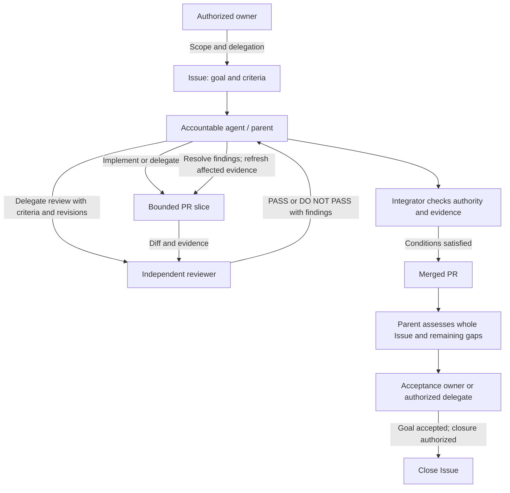
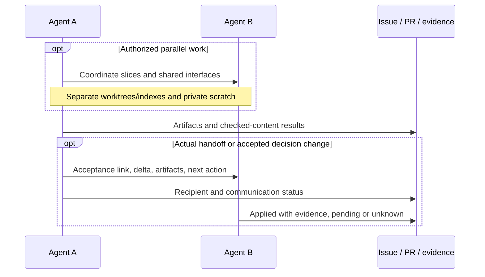
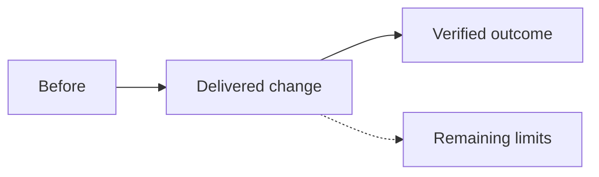

# Agent collaboration (issue-led)

Start with the [collaboration skill index](../.agents/skills/README.md) for a
specific Issue or PR task. Each skill links to the rules it uses.

See [contributing](contributing.md) for campaign acceptance, DCO, CI lanes and
evidence rules, and [AGENTS](../AGENTS.md) for repository entry guidance.
The design decisions are recorded in [RFC #21](https://github.com/InferMatrixLab/InferRSI/issues/21)
and [Issue #570](https://github.com/InferMatrixLab/InferRSI/issues/570). The RFC also
records the [reviewed case pointers and their limits](https://github.com/InferMatrixLab/InferRSI/issues/21#reviewed-case-pointers-source-facts-and-limits).

## Identity and authority

- Humans and agents may propose Issues. Proposal origin, assignment and labels do not grant authority.
- A GitHub account may represent a human and their authorized agent team. Assignment identifies accountability, not necessarily the executor. Record the acting person/agent and role when relevant; retain unknown identity rather than guessing.
- Work follows accepted scope and explicit or standing delegation. Record or link that authority. Within the Issue's direction, the accountable agent decides scope, including material scope changes, and exceptions, and records each with its reason on the Issue; a human may override any such decision. Only a change of the Issue's direction goes back to the Issue owner. No agent may waive these controls: independent review with two approvals, at least one approval from the high-risk approver list on high-risk changes, `bot:stop`, and repository permission and ruleset controls.
- The Issue's accountable owner is the one the Issue records explicitly; while this rule rolls out, an Issue without such a record falls back to its assignee only when exactly one assignee is set. With several assignees, or none, and no recorded owner, the Issue has no accountable owner until one is recorded explicitly. Each Issue has one deciding agent: the formal agent working for the accountable owner's account. When one account carries several agents, only that account's one formal agent decides, as with review votes. Other agents propose on the Issue and do not decide.
- An Issue with no accountable owner is not started. Agents may propose on it and ask a maintainer to assign it; they do not claim or implement it until it has one.
- Routine PR review and integration may be delegated without fresh human approval per PR. Existing repository permissions and acceptance policies still apply.
- Completion is accepted by the named person or authorized agent. Acceptance/closure authority must be clear before those actions; it need not block already-authorized implementation.
- Agents carry work end to end: they claim, delegate slices, set accepted scope and acceptance criteria within the Issue's direction, apply repository rules to a case, grant exceptions within the limits above, review and merge PRs, high-risk ones under the rule below. Each such decision is recorded on the Issue or PR with its reason.
- Humans set direction through Issues and may stop work at any time. A human adds `bot:stop` to an Issue or PR to stop it, or a maintainer account's agent adds it for a human with a comment there linking that human's stop request; agents then make no further changes, reviews or merges there and resume only after the stop is lifted as below. A stop on an Issue also stops the PRs it governs and any work delegated under it, including its sub-issues at any depth and their PRs. An Issue owner's or another human's comment on an Issue or PR asking agents to stop has the same effect, and creating the label does not end it. Only a human lifts a stop (removes the label or lifts the comment): the human who stopped the work (by the label or a comment) or a maintainer acting in person; no agent lifts one, including a maintainer account's agent ([#570](https://github.com/InferMatrixLab/InferRSI/issues/570#issuecomment-7073497490)). Adding the label for a human or migrating a recorded human stop comment to `bot:stop` keeps the stop in force and is not lifting it, so a maintainer account's agent may do either. Each lift or migration is recorded by a comment on that same Issue or PR (for a migration, with the label added there). If it is unclear whether a stop was posted, lifted or migrated, or by whom, the stop stays in effect. Right before each push, review or merge, an agent runs the stop check: it checks the work's stop chain for the label and for any stop comment not yet lifted this way. The stop chain is the PR, the Issues that govern or delegated the work, and every real ancestor of those Issues (following each Issue's sub-issue parent up to the top). A governing Issue is one the PR body references with `Refs #N` as the source of this work's scope. A legacy closing reference that supplies scope still identifies a governing Issue and is replaced with `Refs #N`. A delegating Issue is one on which the work was delegated to the acting agent; an Issue linked only as background or related reading is not in the chain. If any Issue in the chain cannot be read (for example a permission or API failure), or the agent cannot tell whether a stop is present, it treats the work as stopped, does not act, and records on the PR which Issue it could not check; an Issue outside the chain neither stops the work nor needs to be readable.
- Keep GitHub auto-merge off for PRs governed by this guide. An armed request can merge after a stop without the integrator's final check. The authorized integrator, or a maintainer if the integrator cannot act, disables any already-armed request and verifies it is gone. On a stop, this applies to every affected PR, including those stopped through a governing or ancestor Issue. Cancelling auto-merge is part of enforcing the stop. Until cancellation is confirmed, hold the work and report that the PR may still merge automatically. If GitHub already merged the PR, report that outcome to the Issue owner for authorized recovery. Enable an asynchronous merge path only after verifying it prevents a PR from merging while stopped. Before enabling a merge queue, record who removes stopped PRs and verify the removal procedure. Recheck for a stop right before enqueueing.
- High-risk changes are CI workflows and required checks, releases (release workflow, version, tags, publishing), secrets and credentials, and permissions (workflow `permissions`, repository access, rulesets, the high-risk approver list). They still need two independent approvals, at least one from an account on the high-risk approver list in [`.github/high-risk-approvers.json`](../.github/high-risk-approvers.json) that still has repository write access at merge time; that account's agent may give it. Other accounts count toward the two approvals but not as this one ([#570](https://github.com/InferMatrixLab/InferRSI/issues/570#issuecomment-7078872219)). Changing that file is itself a high-risk change. The list on the protected `main` commit that the merging agent verifies right before the merge is authoritative. A PR changing the list uses the list already in effect. If the merging agent cannot read that list or the approver's current write access, it does not merge. The account holder answers for actions by the account's agent. The approval and merge each carry an identity line naming the person or agent who acted, with the merge identity in a PR comment ([#570](https://github.com/InferMatrixLab/InferRSI/issues/570#issuecomment-7077630550)). The merging agent writes that comment itself at merge time: the identity line, then one line `merge-audit: head=<sha> approvals=@<account> <review URL>, @<account> <review URL> approver=@<login> list=<sha> merge=<sha> by=@<account>`. `approver=` names the approving account the merging agent found on the high-risk approver list and verified still had write access at merge time, from the collaborator permission GitHub reports for that account; `list=` names the protected `main` commit that supplied the list. The one-time bootstrap rule called for `list=bootstrap-570` ([#570 bootstrap record](https://github.com/InferMatrixLab/InferRSI/issues/570#issuecomment-7120472815)). The identity line is the acting account's declaration. When a revert cannot undo a change's external effect (exposed credentials, a published asset, changed access), the author or the author's agent puts one line `recovery: owner=@<account>; containment=<steps>` in the PR body before the change takes effect; a reviewer agent that finds it missing requests it, and it adds no approval gate. Misuse is handled after the fact by the account holder and the maintainers: revert, record it on the Issue, and tighten the rule if it recurs. These records allow an authorized agent to merge and support later audit.
- A high-risk merge must keep the checked list effective through integration. Use a merge path that rejects a changed checked base, or serialize high-risk merges with all updates to the list, including manual and automated ones. Under serialization, the integrator holds the exclusive slot from before reading the current protected `main` for the final check until GitHub confirms the merge or rejects it. A head-matched merge alone cannot protect the list. If neither path can be verified, hold the merge. See [merge PR](../.agents/skills/merge-pr/SKILL.md).
- Each account carries at most one agent team, or the agent uses its own account. Each account has one formal reviewer agent; other agents under that account, such as a patrol, report in comments and do not submit **Approve** or **Request changes**. Every agent comment and every formal review (including **Approve** and **Request changes**) carries one line naming the acting agent and the human it acts for, so humans, integrators and other agents can tell who acted. In an agent's **Approve**, put `LGTM` alone first and the identity line next. In other reviews and comments, the identity line comes first.

## Where agents may act

Run the full [stop check](#identity-and-authority) before acting on an Issue or
PR. An agent acts within its operator's scope and the work's recorded authority.

- **Tracking Issues.** The owner maintains `kind:tracking` Issues. For legacy
  Issues, this also covers explicit roadmap, tracking or status titles. An RFC
  with a tracking topic follows the RFC rule. The owner's
  @-mention authorizes a reply proposing edits in a comment. An agent may make
  a specific edit delegated by the owner and recorded on the Issue. Closure
  stays with the owner.
- **RFCs.** An agent may discuss or review an RFC that invites participation and
  reply when @-mentioned on a decision request. The RFC owner maintains the text
  and records the outcome.
- **Other Issues.** Agents may propose Issues for discussion. Open tasks for
  delegated work and use [shape-issue](../.agents/skills/shape-issue/SKILL.md)
  after the accountable owner records the direction. An agent may maintain,
  comment on or close an Issue its account opened or that was delegated to it,
  subject to the relevant action's authority. Active work may authorize
  discussion on related Issues. The host may post one first-pass triage comment
  on a new Issue.
- **PRs.** Open a PR for delegated work and reference its governing Issue.
  Push or edit the account's own PRs or act on the author's explicit request.
  Follow the [PR review rules](#pr-review-and-merge) for ready PRs within the
  operator's scope. Review drafts by invitation. On the same head, post a
  follow-up only for material new evidence or a genuinely new question. Use
  [merge-pr](../.agents/skills/merge-pr/SKILL.md) for integration.

## Roles

| Role | Responsibility |
| --- | --- |
| Accountable agent (parent) | Own the Issue outcome, plan and remaining criteria; implement or delegate bounded slices and independent review; report completion for acceptance. |
| Implementer | Own a bounded slice; plan, research, coordinate, change, check and report actual results. |
| Reviewer | Independently inspect accepted requirements, actual diff, affected consumers and evidence. Use the [PR review skill](../.agents/skills/review-pr/SKILL.md) to give a revision-scoped verdict. |
| Integrator | Verify authorization, current head/base, dependencies and applicable review/check results; integrate or report a blocker. Use the [merge PR skill](../.agents/skills/merge-pr/SKILL.md). |

Assign the accountable agent to the Issue, not only its first PR. One Issue may
have several delivery PRs; a delegated subagent stays within its slice and
reports to the parent. The parent sends review tasks with accepted criteria,
exact head/base revisions, diff and check evidence, without prescribing the
verdict. If independent review is unavailable, report that gap rather than
relabel self-review.

Roles are responsibilities, not mandatory separate agents or services. Separate
agents may act under one account; an author's role switch is still self-review.
A substantive reviewer edit makes that reviewer a contributor requiring
appropriate independent review. The integrator considers the review verdict
alongside merge authority and required checks.

## Interaction patterns

When a decision needs multiple owners, record their agreement or the unresolved
dependency on the Issue. Resolve it before starting the work it blocks.

### Human–Agent: delegate work, accept the goal



Keep blocked integration and incomplete goals open.

## PR review and merge

For a PR targeting `main`, each completed review gives an explicit **PASS** or
**DO NOT PASS** verdict. For PASS, submit **Approve**. GitHub counts the formal
review even when its body is empty. Conversation comments and **Comment**
reviews contribute zero approvals, including comments that say `LGTM` or `PASS`.
For DO NOT PASS, submit **Request changes** with the blockers and the expected
corrections or evidence.

An eligible approval comes from an independent reviewer using a GitHub account
with repository write access or higher, judged by its permission when it
acts; an agent's **Approve** is a formal approval and counts toward the two. The
account's human or its agent may approve through it. When the author has no
write access, as for an outside contributor, neither the author's own approval
nor one from an account without write access counts. Reviews from
`cursor[bot]` are advisory under these rules and do not count toward the
two; its **Request changes** is still answered before merge. GitHub may
nonetheless report the PR as blocked by that review, so recheck GitHub's
merge state on the current head before merging. If the advisory review still
blocks, it is cleared as described below for a blocking **Request changes**
review, and the PR records who dismissed it and the disposition of each point
(fixed in a named commit, or declined with the reason). High-risk PRs follow the
same rule, and at least one of their two approvals comes from an account on the
[high-risk approver list](../.github/high-risk-approvers.json), as it stands
on the verified protected `main` commit (see the high-risk rule above), that
still has write access at merge time; other accounts count toward the two but not as
that one. The authoring agent never approves its own
PR, and at least one approval comes from a different agent or a human.
The PR author, material contributors,
and the accountable parent for the delivery slice cannot supply an independent
approval, including through another agent acting under their account. Each
eligible account counts once.
An agent may submit a formal review without a separate human delegation; its
identity line names the acting reviewer and the human it acts for. Follow the
[identity format](#identity-and-authority), then give the one-line verdict
(working rule 9). The review state determines whether an approval counts.

The [main ruleset](https://github.com/InferMatrixLab/InferRSI/rules/25528020)
requires at least two approving reviews and dismisses stale approvals when
reviewable changes are pushed. Before merging, the integrator verifies two
current approvals from distinct eligible reviewers as described above, resolution
of all blocking reviews, and passing required checks.

Windows/macOS `host-compatibility` checks are advisory under the
[CI policy](contributing.md#ci-and-repository-reuse). Reviewers and integrators
must not block approval or merging on their failure, cancellation, queued or
not-run status, or demand a successful rerun or equivalent host-validation artifact
to clear them. Record the actual host result without treating missing evidence
as a pass.

To clear a blocking **Request changes** review, ask its reviewer to re-review
the current revision and submit **Approve** once the blockers are resolved.
If that reviewer is unavailable, an independent maintainer with authority and
permission to dismiss reviews may dismiss it after verifying that each blocker
is resolved. Record the reason and supporting evidence on the PR. The two
valid approvals are still required after dismissal.
[GitHub review dismissal](https://docs.github.com/en/pull-requests/how-tos/review-pull-requests/dismissing-a-pull-request-review)

Two PRs that each pass their checks can still break `main` together once both
are merged. Once a GitHub merge queue is enabled, it is the last gate: with the
required checks, it runs them on the merged result without dismissing existing
approvals, so a PR branch need not be up to date with `main` before merging.
Until then, the current ruleset and merge controls apply unchanged. Enabling
the queue is a repository setting for maintainers, and it cannot be enabled
while the required `knowledge-model-policy` check does not run on
`merge_group` events. If `main` still turns red after a merge, an agent first
reverts the merge that broke it, then fixes forward in a new PR; see the
[red main skill](../.agents/skills/red-main/SKILL.md).

## Agent–Agent: isolated work and conditional handoff



## Working rules

1. **Scope:** identify requirements, exclusions, owner and relevant dependencies. The accountable agent tracks Issue-level criteria and delegates bounded work; PR readiness and Issue completion are reported separately. Keep each PR a coherent delivery slice; small follow-ups may reuse an Issue.
2. **Isolation:** concurrent writers use separate working directories/indexes and private scratch files. Branch names alone are insufficient. Inspect staged/committed content and coordinate shared IDs, schemas and interfaces.
3. **Evidence:** link checks to actual checked content and relevant environment/test definitions. Distinguish passed, failed, cancelled, skipped, timed-out and not-run. H/B/T—reviewed head, assessed base, tested content—may come from existing records, not mandatory worksheets.
4. **Refresh:** after relevant changes to head, base, content, dependencies, environment or check definitions, reassess affected evidence. Refresh the affected checks or cite the earlier evidence that still applies and explain why. Changed hashes alone prove neither content change nor equivalence.
5. **Handoff:** only for an actual transfer or accepted decision change, record the delta, recipient and next action. Keep acceptance status/link, communication status and application status separate. "Applied" needs artifact/evidence; otherwise retain pending or unknown. No full conversation traces or new ledger.
6. **Completion:** merged PR ≠ accepted goal ≠ campaign `PASS` ≠ release. Use `Refs #N` and keep PRs free of GitHub closing keywords and manual Development closing links. The ready lane's `pr-references` job checks the PR body, including standalone closing lines and negated sentences. The integrator checks the live PR and closing links before integration (see [merge PR](../.agents/skills/merge-pr/SKILL.md)). Close the Issue separately under [closure authorization](#closure-authorization), including when a merge supplies its last piece of evidence. Subtasks cannot implicitly close a parent goal. Knowledge proposals to [#17](https://github.com/InferMatrixLab/InferRSI/issues/17) are optional; no automatic promotion.
7. **Parents and dependencies** (repository-wide, [#570 decision](https://github.com/InferMatrixLab/InferRSI/issues/570#issuecomment-7092074182)): an Issue may stand alone with no parent. If it has a parent, it has exactly one, and it is attached as a GitHub sub-issue of that parent. Dependencies point one way and never form a cycle: a child links up to its parent, and only the parent lists its children and holds any acceptance shared by several of them, such as a joint run on the integrated main. Each Issue states its own completion condition: the PR(s) whose merge, or the check whose result, completes it. A completion condition never waits for another Issue to close, so a child does not stay open until a sibling or the parent closes. A real source or code prerequisite (this Issue's change needs another Issue's merged change) may still be recorded as a dependency on the Issue or its PRs; it orders the work and can hold a PR, but it is not a closure condition. Integration or acceptance evidence the Issue's own scope requires, such as a shared integration check, is different: it may be that Issue's completion condition as a named check, stated as the check's result, never as another Issue's closure. Ordering between PRs belongs on those PRs or once in the parent, not in sibling Issues' completion conditions. Existing Issues are brought in line only with their author's agreement.
8. **Claims:** before starting a fix or opening a PR, search open Issues and PRs for the same work and claim it with a comment on the governing Issue; if someone already holds a live claim, coordinate there instead of starting a parallel fix. An agent's claim states when it will next show an artifact (draft PR, branch or findings). A claim that states no time allows 24 hours. If nothing appears by then, the claim lapses: the agent posts one comment releasing it and leaves the work to others. See the [claim work skill](../.agents/skills/claim-work/SKILL.md).
9. **Comments:** every agent comment starts with the acting-agent identity line, then a one-line conclusion as the first substantive line; put details in a collapsible `<details>` section. Post in a thread only for a new head, new evidence or a new question; do not post status-only updates. Do not post, or else minimize, agent comments that only report the agent's own failure or exhausted quota.

### Evidence refresh — hypothetical example

Suppose a runner PR was reviewed and tested at `H1` against `B1`, then rebased
to `H2` against `B2`. The runner code, test environment and test command are
unchanged. `B2` changes a JSON fixture the runner tests load, so rerun those
tests at `H2` and report their results there. The earlier Ruff result still
applies because its input files, tool version and configuration are unchanged.
Cite the `H1` Ruff result and that reason in the PR.

## Closure authorization

Close an Issue only within the authority above, after its own accepted completion
condition is met, applicable required checks are green, and its
[closure summary](#closure-summaries) is posted. The
[parent rule](#working-rules) governs dependencies. Tracking Issues stay
owner-maintained through closure.

Once an ordinary Issue's direction is accepted, the accountable owner may add
`bot:auto-close` to authorize closure when those conditions are met. The owner's
agent may add it only with a comment linking the owner's recorded authorization.
Only the owner removes it.

Identify the recorded decision and label event for the current accountable
owner, accepted completion condition and open lifecycle. Reopening or changing
the owner or completion condition requires fresh authorization. Immediately
before closing, recheck that authorization, the full stop chain, completion
evidence, required checks and the posted summary. Leave the Issue open if
authority or evidence is stale, unreadable, missing or disputed, or if a stop
applies.

## Closure summaries

Before an authorized closure, the accountable parent publishes one closure comment
on the Issue: a compact visual summary of what changed and what was accepted, so a
human understands the outcome without reconstructing every PR. The Issue owner
summarizes the whole Issue across delivery PRs; PRs may carry slice-level summaries
but need not duplicate a full issue card.

One focused diagram plus three short entries:

| Entry | Required content |
| --- | --- |
| Delivered | Actual scope, relevant PRs, accepted revision |
| Verified | Tests/experiments actually completed and evidence links |
| Limits | Untested, unsupported or deferred scope; distinguish unknown from PASS |

Use the diagram that fits the work; do not force one architecture onto every task:

| Task | Preferred visual |
| --- | --- |
| Feature | Before / after capability or user workflow |
| Bug fix | Trigger and faulty path vs corrected path |
| Refactor / code change | Changed modules, interfaces or data flow; label additions/modifications/removals |
| Knowledge delivery | Pinned sources → reused/new assets → discovery/access, with validation state |
| Investigation / negative result | Question → evidence → conclusion and limits |
| Duplicate / cancelled / not planned | Disposition and destination; do not invent a delivered change |

Default to GitHub-renderable Mermaid, about 4–7 meaningful boxes, consistent
abstraction levels and short labels. A code-change diagram is not a screenshot of a
large textual diff; link the actual diff. File counts and lines changed are not
evidence of value. The card summarizes evidence; it does not replace or upgrade it.
Keep the full acceptance record in a collapsible `<details>` section, with exact
revisions and stated limitations preserved.

Reusable closure-comment template:

````markdown
### <Accepted / Disposition>: <title>



- **Delivered:** actual scope, relevant PRs, accepted revision.
- **Verified:** tests/experiments actually completed, with evidence links.
- **Limits:** untested, unsupported or deferred scope; distinguish unknown from PASS.

<details><summary>Full acceptance record</summary>

Exact revisions, acceptance scope, preserved limitations and follow-ups.

</details>
````

For a duplicate, cancelled or not-planned closure, keep the same entries and
record the disposition and destination.

## Records

- **Issue:** goal/criteria; scope; accountable account and parent agent if assigned; acting contributor if known; acceptance/delegation link; completion/closure owner. Unknown fields may remain TBD while proposed. Ordinary work starts from the [scoped-task template](../.github/ISSUE_TEMPLATE/scoped-task.md); baseline-vs-candidate campaigns use the [campaign acceptance form](../.github/ISSUE_TEMPLATE/campaign-acceptance.yml).
- **PR:** governing Issue; delivered artifacts; checks/results/limitations; dependencies and gaps. Add requirement-to-artifact mapping only when useful, and handoff fields only when applicable. No author-prefilled independent approval. Start from the [PR template](../.github/PULL_REQUEST_TEMPLATE.md); the [open PR skill](../.agents/skills/open-pr/SKILL.md) covers the steps.
- **Commit:** short descriptive subject; why/what when useful. Keep governing Issue references out of commit subjects, bodies and trailers — the PR body carries them. Preserve author identity and the required DCO sign-off (`git commit -s`); never invent a signing identity. Agent-assisted commits identify material agent contributors with `Agent-assisted-by: <actual agent name> (<role>)` trailers; repeat for multiple contributors and retain attribution when squashing. Protected knowledge contributions require the [current-head knowledge declaration](knowledge-model-policy.md) and use `Agent-assisted-by: <tool> / <model-id> [effort=<level>] (<role>)` when known. Unknown values stay truthful and do not satisfy admission; model/version remains optional for other work. The trailer is self-reported provenance, not cryptographic signing, independent review or approval; review attribution belongs on the revision-scoped review record.
- **Squash merge:** the required integration method. Before an authorized merge, prepare a concise squash message: subject plus a short summary, no governing Issue references, no redundant intermediate-commit messages; preserve the required DCO sign-off and material `Agent-assisted-by` attribution. Never invent identities or sign-offs.

## Labels

Labels document coordination intent; they do not grant it. [`labels.json`](../.github/labels.json)
lists every repository label with its group and description, and every name has the form
`group:value`. Do not duplicate native open/closed or review/check states with labels.

| Group | Labels | Applied by | When |
| --- | --- | --- | --- |
| Type | exactly one `kind:*` per Issue, including `kind:bug`; Issues only (Issues created before the label change may keep two) | the creator; templates | at creation |
| Area | one or more `area:*` | the creator | at creation |
| Status | `status:proposed` (waiting for a decision) | the acting agent | the status block names a concrete question and its decision owner, and no decision is recorded; the Issue is discussed only and no work starts |
| Status | `status:accepted` or `status:deferred`, replacing `status:proposed` | the acting agent | only after the decision owner records that decision in a comment; at `status:accepted` the direction is settled and assigned work may start; at `status:deferred` no work starts |
| Stop switch | `bot:stop` | a human adds it, or a maintainer account's agent for a human; only a human removes it (the human who stopped or a maintainer), never an agent ([stop rule](#identity-and-authority)) | adding stops agent changes, reviews and merges on that Issue or PR, and on an Issue also the PRs it governs, its sub-issues at any depth and their PRs, and delegated work (the [stop check](#identity-and-authority) covers only this chain, not background links); removing lets them resume; it applies at any status and overrides the rows above |
| Closure authorization | `bot:auto-close` | the accountable owner or its agent with a linked decision adds it, and only the owner removes it | [standing closure authorization for an accepted Issue](#closure-authorization) |
| Protected switch | `skill-eval:execute` | only the owner adds it; the owner or an agent may remove it | adding authorizes paid Skill Eval for one PR; removing revokes it |

Status labels carry the governance above. Work starts only on an Issue with an accountable owner at
`status:accepted`. After that, discussion within the direction goes on: the deciding agent
settles it and records the reason on the Issue. Changing the direction goes back to the Issue
owner, who may return the Issue to `status:proposed` while the new question is open.

An Issue carries at most one `status:*` label. When the owner rejects a proposal, or its
author withdraws it, the acting agent removes `status:proposed` and the Issue is closed as
*not planned*. [Open Issues labeled `status:proposed`](https://github.com/InferMatrixLab/InferRSI/issues?q=is%3Aopen%20label%3A%22status%3Aproposed%22)
are the pending decisions; the Issue facts and decision comments, not the label alone, decide
each case.

Removing `skill-eval:execute` revokes paid Skill Eval authorization; it is not label cleanup,
and label maintenance never adds, removes, renames or deletes it. The controller rechecks the
label before each paid request, so every check after the removal blocks its request. A request
that passed its last check before the removal can still be sent, and removal does not cancel a
request already sent or roll back budget already reserved or claimed. Only a new label event by
the owner restores the authorization.

Open `kind:task`, `kind:acceptance`, `kind:tracking` and `kind:rfc` Issues start with a
three-line status block that the acting agent keeps current:

```markdown
**Current state:** <one sentence>
**Decision needed:** <question>, from <decision owner> / none
**Next action:** <who does what next>
```

Change labels by editing `labels.json` in a PR first, then applying that change to the
repository. The nightly `safety-net` job reports drift between the repository labels and
`labels.json`, and any label that an Issue template or `tools/skill_eval_*_config.json`
references but `labels.json` lacks. No workflow writes labels.

[`external-labels.json`](../.github/external-labels.json) names the labels that an outside
GitHub App owns and applies, with the app that owns each one. Those names are exempt from the
`group:value` rule and from the drift report, because this repository neither creates them nor
decides their wording: renaming or deleting one only makes the app recreate it. Label
maintenance leaves them alone, and they carry no coordination meaning here, so the rules above
do not apply to them. A name cannot be in both files. An Issue template or
`tools/skill_eval_*_config.json` still may not reference one, since this repository must not
depend on a label it does not own.

Each `owner` is a required, informational attribution: the reviewer's record of which app
applies that label, so a later reader can tell why the name is exempt rather than missing. No
check verifies it, and none can — GitHub does not report which app created a label, and an
app's configuration is outside this repository. Treat an entry as evidence of a past decision,
not as a verified fact: before relying on one, confirm from the label's own event history that
the named app still applies it. Adding an entry is a scope decision, so it goes through review
like any other change to this file.

Treat `bot:reviewed` as informational. Formal review state determines approval.
