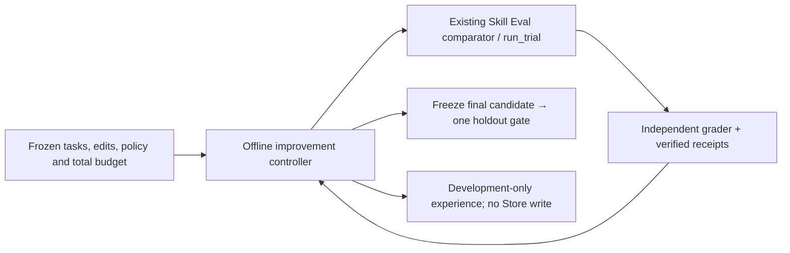
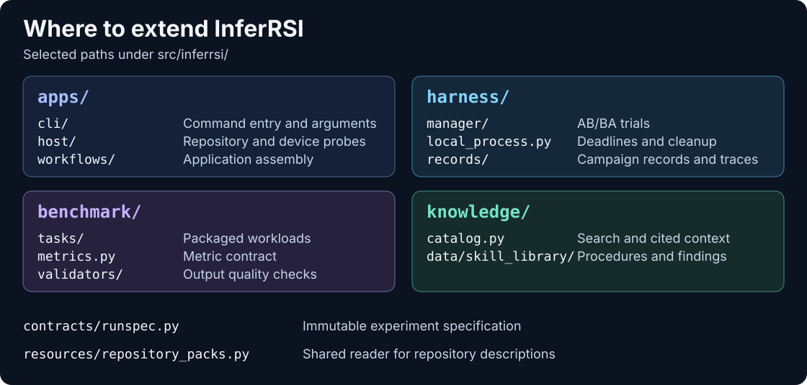

# Modular architecture

The [engineering task library](benchmarks/engineering-benchmarks.md) packages MoE forward,
Qwen-Image denoising and real-model Qwen3-TTS under
`benchmark/tasks`. `inferrsi benchmarks list|show` discovers the
packages. `inferrsi benchmarks run <package> ...` launches the package's
`benchmark.py`. Task-specific orchestration, sampling and assessment live inside
each package. The task library owns its `index.json` registration. The existing
`benchmark/registry.py` discovers the resources. The CLI package `apps/cli/`
and `apps/workflows/benchmark_operations.py` provide application assembly and launch.
Each task retains its own protocol and task-specific code.

The [current-Agent optimization session](benchmarks/optimization-benchmarks.md) assembles
the first complete handoff for the Qwen task. `harness/manager/_state.py` controls
budget, attempts, feedback records, selection and independent final execution.
Harness Executor freezes a supplied resource directory with `prepare_task_protocol`
and starts its task-owned protocol in an isolated child with `run_task_protocol`.
The CLI resolves task resources and supplies the task assessor, knowledge access and
capture callback to `harness/manager/_session.py`.
The external Agent chooses and edits candidates between round submissions.
The same controller serves ordinary projects through `campaign start/round/final`
and packaged tasks through `benchmarks session`. The
[shared workflow and sequence diagram](guides/optimization-workflow-unification.md)
describe multi-file candidates, explicit acceptance inputs, stop rules and
dashboard projections from one control record. Harness Executor freezes caller-provided
project checks and runs the steps in order. Evaluator inspects each retained step before
execution continues and uses the same rule for the final AB/BA verdict. For packaged
tasks, Evaluator invokes the task assessor supplied by Apps. Ordinary optimization
does not import Benchmark. Benchmark supplies task definitions and specialized
rules, while Harness manages their execution and the complete optimization lifecycle.
Neither infers quality criteria from a natural-language goal.
Ordinary projects default to the current Agent conversation.
The optional [service-reuse protocol](guides/service-reuse-campaigns.md) adds project
assessment and foreground service ownership within this same controller.
Executor freezes the inputs, owns the foreground service and records stage receipts.
Evaluator checks the receipts and decides the next stage or formal verdict. Candidate
checkpoints retain that verdict before profiling and service cleanup.
The [experimental speculative search](guides/speculative-search.md) composes immutable
candidate trees, bounded completion menus, synchronous VATS and CPU GVO roles.
Its work controller uses shared RunStore transactions and the existing local
process executor. Apps supplies Engine/Skill grading; the support matrix identifies
remaining production accounting and pilot evidence. Serial session commands keep
their existing controller and behavior.
The [native host handoff](guides/native-agent-sessions.md) lets the initiating Agent
resolve the task request before any campaign exists, use its host's new-session
tool and retain the native identity and returned artifacts. The child owns the
complete start/knowledge/round/final lifecycle; the parent observes and collects. This path records the handoff; it
does not implement a background Agent CLI driver or a native-host deadline.

The application injects `harness.executor.trials.external.execute_trial` into the
[two-rank MoE entry](benchmarks/moe-forward-benchmark.md). The standalone image benchmark
and [TTS service protocol](benchmarks/tts-benchmark.md) expose their documented execution
boundaries. Apps and Harness callers assemble these operations into optimization
rounds under the #362 target architecture. Each task records its qualification.

The diagrams below show where the CLI assembles an experiment, which package
owns each step and where to extend it. The [compatibility notes](#compatibility-and-historical-evidence)
cover retained interfaces and imports that moved.

## Architecture anchors

Use these anchors to trace review findings to their source. The linked source
governs if wording differs. The governing Issue owner decides anchor changes.
The checks below identify existing test coverage. The linked acceptance
criteria are specifications for review.

### A1 — Core imports and assembly

[D001](contracts/current-design.md#d001--one-distribution-three-cores-plus-apps-document-contracts-rather-than-shared-business-dtos)
keeps Knowledge, Harness and Benchmark as sibling cores and Apps as the only
assembler, so the [import gate](guides/module-layout.md#import-gate) restricts
cross-core imports and admits the exact `python -m inferrsi` CLI delegation,
while [shared layers](#module-responsibilities-and-dependencies) stay
independent of campaigns in `examples/`.

**Checked by** `tests/repository/test_target_module_import_gate.py` and
`tests/repository/test_module_boundaries.py::test_shared_layers_do_not_import_campaigns_or_reverse_dependencies`.

### A2 — Versioned envelopes and technical leaves

Cross-core traffic uses versioned JSON envelopes with explicit conversion and
core-owned business types, with shared technical leaves limited to the exact
[D001 list](contracts/current-design.md#d001--one-distribution-three-cores-plus-apps-document-contracts-rather-than-shared-business-dtos)
and its [neutral-leaf importer rule](guides/module-layout.md#permanent-neutral-leaf-importer-rule-proposed).

**Checked by** `tests/repository/test_first_wave_isolation_policy.py`.

### A3 — Retired paths

[Retired module paths](guides/module-layout.md#retired-root-modules) stay retired
without forwarders or aliases, and the [tracked package root](contracts/current-design.md#d018--first-wave-gate-policy-detail)
holds only `__init__.py` and `__main__.py`.

**Checked by** `tests/repository/test_package_root_inventory.py` and
`tests/repository/test_target_module_import_gate.py`.

### A4 — Benchmark judgment

Benchmark owns [claim, metric, eligibility, comparison and scope semantics](contracts/current-design.md#boundaries-and-ports)
and [scope containment](contracts/current-design.md#d004--scope-and-claim-are-independent-apps-performs-no-semantic-derivation),
while Apps [maps roles, fields and versions verbatim](contracts/current-design.md#d005--worker-definition-execution-and-the-prepared-resource-closure)
without imposing sampling, retry, budget or judgment rules.

**Checked by** review.

### A5 — Execution and offline assessment

[Harness owns lifecycle, deadlines, budget, cleanup and the optimization loop](contracts/current-design.md#d005--worker-definition-execution-and-the-prepared-resource-closure),
Benchmark owns the worker recipe, sampling and aggregation, and its
`prepare` and `assess` start no worker, with [offline `assess`](contracts/current-design.md#d003--c2-explicit-offline-assess-of-a-committed-fixed-non-terminal-snapshot)
making no subprocess, network or device call.

**Checked by** review against [T04–T07 and T15–T17](contracts/acceptance-criteria.md).

### A6 — Evidence and verdicts

[Unknown budget facts](contracts/current-design.md#d010--three-budget-facts-and-no-scope-reset)
use `null` with a reason, [unperformed checks](contracts/current-design.md#d006--identity-errors-lifecycle-and-unique-return-on-re-entry)
use `not_performed`, `finished` requires confirmed cleanup of external resources
when applicable, and a [same-claim, same-scope conflict](contracts/current-design.md#d004--scope-and-claim-are-independent-apps-performs-no-semantic-derivation)
defaults to `INCONCLUSIVE` under the frozen rules.

**Checked by** review against [T01–T14 and T22–T24](contracts/acceptance-criteria.md).

### A7 — Legacy compatibility and frozen evidence

[D013](contracts/current-design.md#d013--legacy-entry-point-compatibility)
preserves its legacy CLI entry points, arguments, `Path` behavior, output bytes
and [old `run` exit codes](guides/module-layout.md#old-run-exit-codes), while
[historical evidence](#compatibility-and-historical-evidence) retains its
original bytes and a new campaign with a changed implementation requires
fresh frozen references.

**Checked by** `tests/apps/test_legacy_run_v0_frozen.py` for the legacy `run` exit codes
and `evaluation.json` bytes. Review covers the remaining clauses.

### A8 — Shared scenario and adapter lifecycle

[Scenario and adapter extensions](#where-to-extend) reuse the common AB/BA loop,
process cleanup and performance adjudication.

**Checked by**
`tests/repository/test_module_boundaries.py::test_new_scenario_target_and_backend_share_abba_and_verdict`.

### A9 — Governing approval for contract changes

Changes to these anchors, `docs/contracts/**`, the `docs/guides/module-layout.md`
rules or `docs/legacy-knowledge-manifest.json` require a same-repository
governing Issue whose recorded decision accepts the specific change and
independent review under the [review rules](agent-collaboration.md#pr-review-and-merge)
and [D018](contracts/current-design.md#d018--first-wave-gate-policy-detail).

**Checked by** review. The advisory CI check is a separate delivery in
[#574](https://github.com/InferMatrixLab/InferRSI/issues/574).

## Three-objective delivery framing

The current WIP develops three connected objectives:

1. **Roofline / Optimization Headroom:** source-grounded bounds, observed
   attainable limits, calibrated predictions and experiment selection. The
   ceiling skill provides guidance and pure conditional arithmetic for supplied
   L1 inputs; application results require their own measurements.
2. **Dense Commit Coordination:** ownership, concurrent work, review, testing,
   integration, release and feedback into later changes. The existing Magpie
   material is history analysis. A first-hand coordination case is pending Dot
   delivery and owner review; neither that analysis nor paper methodology
   implements or verifies an autonomous development pipeline.
3. **Skill System:** reusable candidate skills, knowledge and cases, the
   [Reference Matrix](reference-matrix.md),
   [SearchSpace Matrix](searchspace-matrix.md) and the generated
   [Skill Coverage View](skill-coverage.md), and explicit read-only access.
   The Reference Matrix records inspected sources. The SearchSpace Matrix also
   supplies the verified resource/stage pairs used when a caller selects a
   [coordinate filter](knowledge-operations.md#ranked-discovery-and-budgeted-context)
   for Find. The coverage view projects the same sources by skill. Execution
   requires a separate request.

This framing is presentation and delivery traceability, not a third primary
matrix. Dot owns source extraction, the owner approves sources and reviews
content/mappings, and the integration workstream owns reconciliation with the
current artifacts. Candidate coverage and empirical validation stay separate.
Paper versions/readsets remain distinct from implementation pins; a shared
lineage or a linked paper is not independent corroboration.

Reviewed paper comparisons, readsets and cases live under their owning skill's
`references/` tree; distinct workflows receive their own candidate entrypoints.
Paper knowledge does not supply repository-only schema fields such as a Git SHA,
so it remains linked Markdown rather than a parallel registry or fabricated
`repo_packs` record. The [knowledge-base contract](knowledge-base.md) defines
skill-local metadata ownership, typed source examples, shared checkout references and
legacy package compatibility. Normalized reads and bounded Collect
([knowledge-operations.md](knowledge-operations.md)) and the authorized local
store ([knowledge-store.md](knowledge-store.md)) are implemented Python
interfaces; existing CLI commands remain supported.

## Module responsibilities and dependencies


| Module | Owns | Does not own |
| --- | --- | --- |
| Knowledge | The skill library and knowledge records, search, cited knowledge/context export and the collected-context projection | Execution, task grading or campaign composition |
| Harness | Command execution and process domains, AB/BA order, deadlines, source checks, optimization sessions, retained records and evidence | Task grading and verdicts, report presentation, device-specific conditions, request schemas or kernel dispatch |
| Benchmark | Task discovery and packages, graders, metric validation, assessments and the old-run gates | Process execution, knowledge search or presentation |
| Apps | CLI and the assembly of the three cores, host bindings (source identity, device discovery/qualification, environment facts), artifact digests and JSON writes, provider integrations including the Anthropic adapters, views and reports | Model constants, task rules or performance verdicts |
| `contracts/`, `resources/` | The immutable RunSpec, JSON, claim and evidence-path helpers, and the neutral repository-pack reader | Business DTOs or core initialization; neither package is a fourth core |

Dependencies flow from entrypoints to Harness. #498 removed the Infra and Model
packages, so Harness reaches neither. None
of these shared packages imports a campaign from `examples/`.

Environment inspection follows that direction. `apps/host/inspection.py` is the
facts API: it takes the command probe and the repository snapshot as ports.
`apps/host/prepared_environment.py` binds those ports to this host with
`apps.host.commands.probe_command` and `apps.host.targets.repository_identity`,
and the CLI calls that composition. The `apps/host/` package moved from Infra in
#498 slice 3a and keeps its limit: it reaches no Knowledge, Harness or Benchmark
module. `apps/host/inspection.py` reads a
repository-pack description through the neutral `resources.repository_packs`
leaf, under the one permanent importer rule in
[module-layout.md](guides/module-layout.md#permanent-neutral-leaf-importer-rule-proposed).

The [target module layout](guides/module-layout.md) describes the migration and the
scope of the static import checks. The [migration manifest](legacy-knowledge-manifest.json)
records the retired compatibility pairs and the permanent neutral-leaf importer rule.

The caller still prepares the benchmark runtime and baseline/candidate source
checkouts. Separate working directories alone do not isolate Python imports,
resources or an existing server. The local executor can run directly on a
prepared remote machine; SSH dispatch, distributed leases, automatic planning,
patch generation and Hub publication remain future work.

Local executor commands are noninteractive and receive EOF on standard input.
Supply their inputs through command arguments or files rather than the caller's
input stream.

### Offline harness-improvement lane

The [single-step offline controller](guides/harness-improvement.md) adds a bounded policy
above the existing Skill Eval comparator. Supplied declarative INV/DOM edits are
materialized as immutable Git snapshots. Development grades select a successor;
it must run again before freezing for one independent held-out accept/reject gate.
The controller accounts for the entire loop; candidate execution cost is reported
separately. It reuses `run_trial` and the local executor, including their inherited
absolute deadline, rather than creating another execution backend.



The feedback arrow represents development evidence only. Holdout cannot select a
different candidate or cause another edit. Real-client execution, autonomous
proposal generation, external sandbox enforcement and Store/CAS reuse are outside
this MVP. [PR skill evaluation](skill-eval-pr.md) is another existing consumer of
the comparator; the engine AB/BA path retains its independent acceptance contract.

## Directory map



The four core READMEs cover current entry points and extension rules.

- [Knowledge](../src/inferrsi/knowledge/README.md) owns retrieval and the packaged knowledge corpus.
- [Harness](../src/inferrsi/harness/README.md) owns execution, run records and recovery.
- [Benchmark](../src/inferrsi/benchmark/README.md) owns task definitions and independent assessment.
- [Apps](guides/apps.md) owns the CLI and Python composition, host adapters and result delivery.

The [contracts](contracts/) define versioned interfaces. The neutral
[resources package](../src/inferrsi/resources/) reads repository-pack
descriptors. Use the [module layout](guides/module-layout.md) for ownership,
compatibility and placement rules.

The package root holds exactly two tracked files: `__init__.py` and `__main__.py`.
`__main__.py` and the console script call `inferrsi.apps.cli:main`.
The build generates `_version.py` as wheel metadata. See the
[retired paths and replacements](guides/module-layout.md#retired-root-modules) and
the [import gate](guides/module-layout.md#import-gate) for migration and dependency rules.

## Where to extend

| Add | Main extension locations | Required qualification |
| --- | --- | --- |
| Model or scenario | `harness/executor/serving`, `benchmark/metrics.py`, `benchmark/validators`; trials run through the model-independent `harness/executor/trials/external.py` | Frozen request and metric contract; model-specific quality coverage |
| Repository | `apps/host/targets`, a composed scenario, `resources/repo_packs` | Stable source identity; command/result contract; environment isolation |
| Hardware | `apps/host/platforms` | Device selection, process exclusivity and independent backend/model evidence; a backend is registered in `apps/host/platforms/__init__.py` and its probe command is defined in the implementing module under `apps/host/platforms/`, not in package data |

The acceptance rule is: **a new model or hardware adapter must reuse the common
AB/BA loop, process cleanup and performance adjudication.** The extension
regression test composes a new metric schema, non-Git source adapter and backend
probe through those interfaces while running real subprocesses. Its numbers are
synthetic contract fixtures, not accelerator measurements.

### Compose a new scenario

`apps.legacy.run.run_experiment(spec, environment, *, execute, snapshot)` composes
the old run and accepts small callable adapters. It passes them, the Benchmark v0
gates and the report to `harness.manager.run_experiment`, whose four ports
(`execute`, `snapshot`, `assess`, `report`) have no defaults. An omitted
`execute` or `snapshot` is read from `apps.legacy.run` when the run starts
(`execute_trial` and `repository_identity`), which is the two-argument call
that the retired root `execution.run_experiment` provided. For a new external
benchmark format, reuse the standard executor and only replace metric interpretation:

```python
from functools import partial

from inferrsi.apps.legacy.run import execute_trial, run_experiment
from inferrsi.benchmark.metrics import read_metric


def read_engine_metric(document, key):
    normalized = {"metrics": {"latency_ms": float(document["duration_seconds"]) * 1000}}
    return read_metric(normalized, key)


run_dir = run_experiment(
    spec,
    environment,
    execute=partial(execute_trial, metric_reader=read_engine_metric),
)
```

The standard executor retains timeout, cancellation, logs, result paths and child
cleanup. A custom `execute(command, cwd, trial_dir, deadline, metric_key)` must
preserve that trial record contract. Prefer composing `execute_trial` over
reimplementing process lifetime. Metric readers convert a result document into a
float; `benchmark.legacy_run_v0.trial_metric` then applies the one finite, positive
metric contract (`benchmark.metrics.validate_metric`) to whatever the reader
returns, so a reader that yields `0.0`, a `bool` or a non-finite value records a
metric error rather than entering the evaluation. The Harness executor
`harness.executor.trials.external.execute_trial` holds no metric rule: a caller that
passes a metric key also passes `metric=`, its validation function.

Run state is written by the termination path, never assumed. `status.json`
reports `completed` only after the final artifacts were written;
a run stopped by a command state keeps `timeout`, `failed` or `cancelled`; an
exception outside the adapter error contract writes `crashed` and re-raises; and a
failure while writing the terminal artifacts writes `termination_failed` with the
original measurement error beside it.

A new source adapter implements `snapshot(repo, excluded_run_dir)` and returns
`available` plus a stable `snapshot_hash` and explanatory metadata. It must
fingerprint relevant source, including changes between individual commands; it
must not claim availability without a trustworthy identity. Git remains the
default. Alternative adapters must define their own exclusion semantics.

Image campaigns can compose `ImageProtocol.request` with
`benchmark.sampling.collect_samples`.
The protocol receives model name, dimensions and sampling parameters from the
campaign. The collector owns warmups, first-response retention, groups and
artifact hashes; it accepts a request callback and file suffix, so it has no
model/backend dispatch. The Qwen example now uses these shared modules.

For new image quality checks, install `inferrsi[image]` and construct an explicit
`ImageQualityGate` from the frozen campaign plan. No SSIM/PSNR threshold is
selected by the shared validator. RGB and alpha are checked separately, and a
campaign can additionally require exact pixels. Image dependencies are lazy;
the default control package continues to require only the standard library.

Diffusion video uses `inferrsi.benchmark.validators.video` instead of a pixel
gate. A legal change of parallel layout can move the sampler onto another
trajectory, where reference PSNR scores a sharp clip below a blurred one
([#364](https://github.com/InferMatrixLab/InferRSI/issues/364)). The video
validator compares each candidate with a dense reference that matches it on the
campaign's `matched_controls`, such as precision, parallel layout and inputs.
It judges decoded luma: sharpness ratio, temporal ratio and luma delta, each
against two-sided per-sample bounds and two-sided bounds on the median over the
complete sample set. The campaign's `VideoQualityGate` supplies every bound;
the validator selects none, and PSNR is reported only as a diagnostic. The gate
and each clip copy their bounds and controls when they are constructed, so later
edits to the caller's dictionaries or lists cannot change a verdict, and the
report records the bounds that were applied. Control values must be strings,
booleans, null or finite numbers, so the report stays valid strict JSON; any
other value rejects the plan before decoding. A matched control counts as
verified only when both sides carry a non-null value of the same JSON type and
equal value, so `true` does not match `1` and `1` does not match `1.0`.

Media integrity is checked before quality. A candidate whose decoded size,
frame rate or frame count breaks the frozen `MediaContract` fails. Missing,
undecodable or hash-mismatched media, a reference outside the contract,
mismatched controls and a flat or motionless reference are `INCONCLUSIVE`.
An observed violation fails the set even when another sample is inconclusive.
The report's `passed` field is `true`, `false` or `null`, and its `dataset`
field repeats the frozen sample-set identity that the caller passes in. A
project quality command writes the report as its result and sets `quality_key`
to `passed`, so `INCONCLUSIVE` reaches the Harness missing-evidence branch
rather than a candidate rejection. An intake-approved campaign freezes the same
identity as its quality benchmark. If it also bounds the quality result, it uses
metric `passed`, comparator `equal`, limit `1` and unit `boolean`.
Decoding needs `ffprobe` and `ffmpeg` on `PATH`, and measurement needs NumPy
from `inferrsi[image]`. The report states its metric definitions and scope:
audio, semantics, prompt adherence and defects confined to a few frames are
not judged.

### Add a platform or repository

Register a device probe in `apps.host.platforms.PLATFORM_PROBES`; supply the selected
IDs, device model and bounded command runner. A new backend name additionally
needs an entry in `knowledge.catalog.BACKENDS`, which supplies the CLI `--backend` choices
and the accepted knowledge and skill backends; no package-data descriptor is
required. Adding a device SKU within a backend is a parameter/configuration
change. CUDA qualification takes an explicit device count and model; it contains
no B300 or four-device default. ROCm and Ascend currently expose raw tool facts
and require independent qualification. Discovery is not compatibility or
performance certification.

For a new repository, start with the Git target adapter if applicable, add the
repository descriptor/knowledge pack and compose its benchmark scenario. Update
catalog choices for a new named repository type. These registrations do not
change the AB/BA algorithm, process cleanup or evaluator.

## Compatibility and historical evidence

The supervised server helpers `launch_server` and `stop_server` in `inferrsi.harness.executor`
require Linux with a readable `/proc` process table. They reject other platforms
before launch; missing or inaccessible process enumeration raises an error rather
than reporting successful cleanup. Workers must remain in their owned process
group. Windows Job Object support in the general command executor
(`harness.executor.local_process`) does not extend to these server helpers. These constraints do not restrict read-only knowledge
operations or the control CLI to Linux.

- Existing CLI flags, external JSON metrics, run artifacts, cancellation
  handling and report generation are retained. Root Python import paths are
  not all retained: #451 and #412 R1 retired the root modules listed in
  [CHANGELOG.md](../CHANGELOG.md) with no forwarding shell or alias. That file
  maps each old path to its replacement and states the pickle impact.
- `examples/qwen21_turbo_b300.py` retains its command interface and campaign
  settings while delegating lifecycle, requests and sampling to shared modules.
- The LTX helper and quality script, plus the pre-cleanup Qwen quality script,
  are preserved byte-for-byte under `tests/fixtures/legacy/` for historical
  regression tests. The current Qwen quality entrypoint imports the same shared
  artifact utilities directly; its numerical and manifest checks are unchanged.
  Current examples no longer depend on LTX campaign code.
- The Qwen runner hashes every Python module in the installed control package
  plus its current runner and quality entrypoints. A changed implementation
  **requires fresh frozen references for a new campaign**. Do not combine a new
  runner with an old guard-hash manifest or rewrite previous evidence to make
  it pass. Replay historical campaigns with their original source-pinned bundle.

## Knowledge and evidence ownership

The [knowledge library](../src/inferrsi/knowledge/data/skill_library/README.md)
owns packaged procedures, engineering records and their provenance. Its
[layout and retrieval guide](guides/knowledge/knowledge-layout.md) maps the registered owners,
search configuration and generated build inputs. The
[knowledge base contract](knowledge-base.md) defines applicability, source
attribution and verification. Runtime reads preserve the source revision and
dependency resources. Imported knowledge supplies guidance for the caller to
verify against the target workload.

Run evidence remains in the caller-selected run directory. Frozen campaign
plans, results, patches and validators live under [evidence/](../evidence/).

The earlier [component design](assets/component-architecture-en.svg) and
[complete workflow](assets/gpu-workflow-en.svg) remain long-term references.
Their [Chinese component](assets/component-architecture.svg) and
[Chinese workflow](assets/gpu-workflow.svg) originals are preserved.

The supplied system overview is also available in [English](assets/system-architecture-en.svg)
and [Chinese](assets/system-architecture-zh-CN.svg). It summarizes inputs,
normalization, the AB/BA loop, adjudication and retained evidence. Its feedback
arrow represents explicit review and reuse by the caller, not implemented
automatic promotion into the knowledge catalog or RunSpec. The original diagram
is preserved; the [source audit](reviews/source-audit-ac70272.md) tracks cleanup
portability and other implementation gaps.
