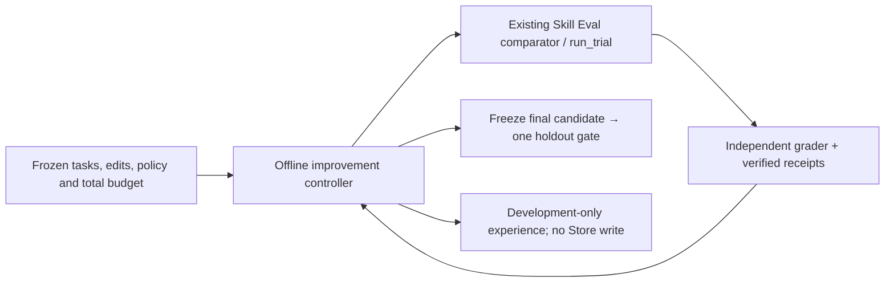

# Modular architecture

The local experiment path now has concrete Harness, Model and Infra modules. The
CLI, RunSpec, knowledge retrieval and existing command contracts remain stable.
The diagrams below describe implemented code, with the historical compatibility
boundary called out separately.

## Three-objective delivery framing

The current WIP develops three connected objectives:

1. **Roofline / Optimization Headroom:** source-grounded bounds, observed
   attainable limits, calibrated predictions and experiment selection. The
   ceiling skill provides guidance and pure conditional arithmetic for supplied
   L1 inputs; application results require their own measurements.
2. **Dense Commit Coordination:** ownership, concurrent work, review, testing,
   integration, release and feedback into later changes. The existing Magpie
   material is history analysis. A first-hand coordination case is pending Dot
   delivery and owner review; neither that analysis nor paper methodology
   implements or verifies an autonomous development pipeline.
3. **Skill System:** reusable candidate skills, knowledge and cases, the
   [Reference Matrix](reference-matrix.md),
   [SearchSpace Matrix](searchspace-matrix.md) and the generated
   [Skill Coverage View](skill-coverage.md), and explicit read-only access.
   The two matrices describe evidence and coverage; they do not drive an
   automatic router or execution loop. The coverage view reads them from the
   skill outward and owns no fact of its own.

This framing is presentation and delivery traceability, not a third primary
matrix. Dot owns source extraction, the owner approves sources and reviews
content/mappings, and the integration workstream owns reconciliation with the
current artifacts. Candidate coverage and empirical validation stay separate.
Paper versions/readsets remain distinct from implementation pins; a shared
lineage or a linked paper is not independent corroboration.

Reviewed paper comparisons, readsets and cases live under their owning skill's
`references/` tree; distinct workflows receive their own candidate entrypoints.
Paper knowledge does not supply repository-only schema fields such as a Git SHA,
so it remains linked Markdown rather than a parallel registry or fabricated
`repo_packs` record. The [knowledge-base contract](knowledge-base.md) defines
local sidecar ownership, typed source examples, shared checkout references and
legacy package compatibility. Normalized reads and bounded Collect
([knowledge-operations.md](knowledge-operations.md)) and the authorized local
store ([knowledge-store.md](knowledge-store.md)) are implemented Python
interfaces; existing CLI commands remain supported.

## Module responsibilities and dependencies


| Layer | Owns | Does not own |
| --- | --- | --- |
| Entry and knowledge | CLI arguments, immutable RunSpec, cited knowledge/context export | Model execution or automatic source editing |
| Harness | AB/BA order, deadlines, source checks, scenario composition, evidence, performance adjudication and reporting | Device-specific conditions, request schemas or kernel dispatch |
| Model | Request payloads, metric schemas, output decoding and explicit quality checks | Scheduling, worker lifetime or hardware selection |
| Infra | Repository identity, device discovery/qualification, process ownership, HTTP transport, storage and artifacts | Model constants, campaign gates or performance verdicts |

Dependencies flow from entrypoints to Harness, from scenarios to Model/Infra,
and from Model to Infra utilities. Infra does not import Model or Harness. None
of these shared packages imports a campaign from `examples/`.

The caller still prepares the benchmark runtime and baseline/candidate source
checkouts. Separate working directories alone do not isolate Python imports,
resources or an existing server. The local executor can run directly on a
prepared remote machine; SSH dispatch, distributed leases, automatic planning,
patch generation and Hub publication remain future work.

Local executor commands are noninteractive and receive EOF on standard input.
Supply their inputs through command arguments or files rather than the caller's
input stream.

### Offline harness-improvement lane

The [single-step offline controller](harness-improvement.md) adds a bounded policy
above the existing Skill Eval comparator. Supplied declarative INV/DOM edits are
materialized as immutable Git snapshots. Development grades select a successor;
it must run again before freezing for one independent held-out accept/reject gate.
The controller accounts for the entire loop; candidate execution cost is reported
separately. It reuses `run_trial` and the local executor, including their inherited
absolute deadline, rather than creating another execution backend.



The feedback arrow represents development evidence only. Holdout cannot select a
different candidate or cause another edit. Real-client execution, autonomous
proposal generation, external sandbox enforcement and Store/CAS reuse are outside
this MVP. [PR skill evaluation](skill-eval-pr.md) is another existing consumer of
the comparator; the engine AB/BA path retains its independent acceptance contract.

## Directory map


```text
src/inferrsi/
  cli.py, arguments.py       Existing CLI
  runspec.py, contracts.py   Immutable experiment contract and compatibility export
  catalog.py                Knowledge search and cited context
  skill_catalog.py          Packaged/default or custom skill metadata/body/resource resolution
  knowledge_operations.py   Normalized reads and bounded Collect (KnowledgeReader)
  knowledge_store.py        Authorized local store Create/Update (KnowledgeStore)
  research.py               Read-only model-aware discovery joined over catalog queries
  _skill_selection.py       Deterministic lexical skill ranking and context view
  claim.py                  Campaign verdict labels PASS/FAIL/INCONCLUSIVE; rules only
  evidence_paths.py         Per-campaign evidence tree: plan/results/patch/validator
  summary_chart.py          Stdlib SVG gain chart (chain/branch) and report figure spec
  harness/
    improvement.py          Offline quality-first selection and usage accounting
    skill_evaluation.py     Skill trial/client interface and independent grading
    runner.py               One AB/BA loop; execute/snapshot adapter hooks
    evaluation.py           Performance/quality/source-integrity adjudication
    reporting.py            HTML evidence report
    scenarios/
      external.py           External benchmark/validator commands; metric-reader hook
      media.py              Warmup seeds, first-response retention, sample/artifact groups
  model/
    protocols/
      metrics.py            Finite positive dotted-key metric contract
      image.py              OpenAI-style image payload and PNG response protocol
    validators/
      image.py              Explicit PNG dimensions/mode, hashes, RGB/alpha quality gates
  infra/
    executors/local.py      Real subprocesses and whole-run deadline
    processes.py            Owned process groups; Windows jobs; server cleanup
    targets/git.py          Repository identity and source snapshots
    platforms/              Backend discovery registry; CUDA qualification
    inspection.py           Environment inspection coordinator
    commands.py             Bounded read-only probes
    environment.py          Dependency versions and storage checks
    http.py                 HTTP POST/download timing
    artifacts.py            Hashing and evidence writes
    campaign.py             Legacy runner utility facade; transitive helper hashes
  data/
    repo_packs/             Contribution descriptors and versioned tuning knowledge
    knowledge_packs/        Dependency and peer knowledge, preserving existing tiers
    skill_library/          Complete categorized English skills and resources
    platform_packs/         Backend metadata and qualification context
  execution.py              Compatibility entrypoint -> harness.runner
  evaluation.py             Compatibility exports -> harness.evaluation
  inspection.py             Compatibility entrypoint -> infra.inspection
  reporting.py              Compatibility export -> harness.reporting
examples/                   Current Qwen runner, image validator and v4 adapter
tests/fixtures/legacy/      Frozen historical validation dependencies for regressions
```

## Where to extend

| Add | Main extension locations | Required qualification |
| --- | --- | --- |
| Model or scenario | `model/protocols`, `model/validators`, `harness/scenarios` | Frozen request and metric contract; model-specific quality coverage |
| Repository | `infra/targets`, a composed scenario, `data/repo_packs` | Stable source identity; command/result contract; environment isolation |
| Hardware | `infra/platforms`, `data/platform_packs` | Device selection, process exclusivity and independent backend/model evidence |

The acceptance rule is: **a new model or hardware adapter must reuse the common
AB/BA loop, process cleanup and performance adjudication.** The extension
regression test composes a new metric schema, non-Git source adapter and backend
probe through those interfaces while running real subprocesses. Its numbers are
synthetic contract fixtures, not accelerator measurements.

### Compose a new scenario

`harness.runner.run_experiment(spec, environment, *, execute, snapshot)` accepts
small callable adapters. For a new external benchmark format, reuse the standard
executor and only replace metric interpretation:

```python
from functools import partial

from inferrsi.harness.runner import run_experiment
from inferrsi.harness.scenarios.external import execute_trial
from inferrsi.model.protocols.metrics import read_metric


def read_engine_metric(document, key):
    normalized = {"metrics": {"latency_ms": float(document["duration_seconds"]) * 1000}}
    return read_metric(normalized, key)


run_dir = run_experiment(
    spec,
    environment,
    execute=partial(execute_trial, metric_reader=read_engine_metric),
)
```

The standard executor retains timeout, cancellation, logs, result paths and child
cleanup. A custom `execute(command, cwd, trial_dir, deadline, metric_key)` must
preserve that trial record contract. Prefer composing `execute_trial` over
reimplementing process lifetime. Metric readers must preserve the finite,
positive metric contract before returning a float.

A new source adapter implements `snapshot(repo, excluded_run_dir)` and returns
`available` plus a stable `snapshot_hash` and explanatory metadata. It must
fingerprint relevant source, including changes between individual commands; it
must not claim availability without a trustworthy identity. Git remains the
default. Alternative adapters must define their own exclusion semantics.

Image campaigns can compose `ImageProtocol.request` with `collect_samples`.
The protocol receives model name, dimensions and sampling parameters from the
campaign. The collector owns warmups, first-response retention, groups and
artifact hashes; it accepts a request callback and file suffix, so it has no
model/backend dispatch. The Qwen example now uses these shared modules.

For new image quality checks, install `inferrsi[image]` and construct an explicit
`ImageQualityGate` from the frozen campaign plan. No SSIM/PSNR threshold is
selected by the shared validator. RGB and alpha are checked separately, and a
campaign can additionally require exact pixels. Image dependencies are lazy;
the default control package continues to require only the standard library.

### Add a platform or repository

Register a device probe in `infra.platforms.PLATFORM_PROBES`; supply the selected
IDs, device model and bounded command runner. New backend names also need a
catalog/CLI descriptor and a platform pack. Adding a device SKU within a backend
is a parameter/configuration change. CUDA qualification takes an explicit device
count and model; it contains no B300 or four-device default. ROCm and Ascend
currently expose raw tool facts and require independent qualification. Discovery
is not compatibility or performance certification.

For a new repository, start with the Git target adapter if applicable, add the
repository descriptor/knowledge pack and compose its benchmark scenario. Update
catalog choices for a new named repository type. These registrations do not
change the AB/BA algorithm, process cleanup or evaluator.

## Compatibility and historical evidence

The supervised server helpers (`infra.processes.launch_server` / `stop_server`)
require Linux with a readable `/proc` process table. They reject other platforms
before launch; missing or inaccessible process enumeration raises an error rather
than reporting successful cleanup. Workers must remain in their owned process
group. Windows Job Object support in the general command executor does not extend
to these server helpers. These constraints do not restrict read-only knowledge
operations or the control CLI to Linux.

- Existing CLI flags, root import paths, external JSON metrics, run artifacts,
  cancellation handling and report generation are retained.
- `examples/qwen21_turbo_b300.py` retains its command interface and campaign
  settings while delegating lifecycle, requests and sampling to shared modules.
- The LTX helper and quality script, plus the pre-cleanup Qwen quality script,
  are preserved byte-for-byte under `tests/fixtures/legacy/` for historical
  regression tests. The current Qwen quality entrypoint imports the same shared
  artifact utilities directly; its numerical and manifest checks are unchanged.
  Current examples no longer depend on LTX campaign code.
- The Qwen runner hashes every Python module in the installed control package
  plus its current runner and quality entrypoints. A changed implementation
  **requires fresh frozen references for a new campaign**. Do not combine a new
  runner with an old guard-hash manifest or rewrite previous evidence to make
  it pass. Replay historical campaigns with their original source-pinned bundle.

## Knowledge and evidence ownership

Package data is the canonical source for noneditable installations:

```text
inferrsi/data/repo_packs/REPO/knowledge/
  README.md                       Organization and navigation only
  BACKEND/COMPONENT/ENTRY.json     One canonical reusable experience
inferrsi/data/knowledge_packs/
  README.md                       Three-tier source navigation
  dependency/REPO/BACKEND/COMPONENT/ENTRY.json
  peer/REPO/BACKEND/COMPONENT/ENTRY.json
inferrsi/data/platform_packs/BACKEND/pack.json
```

JSON owns applicability, claims, recommendations, validation and limitations;
`knowledge search`, `knowledge show` and human-readable `context` use that same
record. Per-entry duplicate READMEs are removed. The loader validates that
repository, backend, component and stable ID agree with the path.
The learning tier is an independent acquisition policy: contribution packs
retain their paths, while external dependency/peer packs add source-owned
candidates. Tier/source/backend/scenario filters intersect before ranking and
limits; no downstream repository inherits external knowledge implicitly.
Knowledge-only sources do not extend the executable repository registry.

A backend filter includes that backend and repository-local `common` methods;
scenario filters select exact workloads or component wildcards. Model, SKU,
dtype and software prerequisites stay in `applicability`, not extra directory
levels. A common method cannot inherit another backend's validation.

Source attribution keeps repositories, revisions, dates and known authors;
experience records and exported context omit PR links. Evidence levels describe
guidance or reported measurements independently from a source's merge status.
Imported skills are source material, not executable tool authority. CPU tests
do not upgrade imported knowledge to a validated claim.

The optional `skills` CLI defaults to the installed `data/skill_library/` and
its `skill-index.json` registry of stable skill IDs. Hardware-specific content
lives under `hardware/ascend`, `hardware/cuda` or `hardware/host`; other skills
are grouped by framework, repository, method or workflow. Full procedures,
sidecars, references and cases ship with the package. Engine entry skills live
under `repositories/<engine>/`, the collection router under
`workflows/inference-engine-research/`. All library content is in English.
Supporting documents are owner-local; only `README.md` and `skill-index.json`
remain at the library root. An explicit
`--root` can still select a custom flat skills tree or a registry-based library. The CLI uses PyYAML from the `skills` extra,
lists metadata, reads a named body or resolves a named resource for an external
file reader. It never executes, installs or promotes skills. Core knowledge
commands read catalog JSON and packaged documents without the optional parser;
the two matrices retain their authority.

Run evidence remains in the caller-selected run directory; frozen campaign
plans/results/patches/validators remain under `evidence/`.

See the [knowledge guide](../src/inferrsi/data/knowledge_packs/README.md)
for all entries, retrieval rules and the maintenance workflow.

The earlier [component design](assets/component-architecture-en.svg) and
[complete workflow](assets/gpu-workflow-en.svg) remain long-term references.
Their [Chinese component](assets/component-architecture.svg) and
[Chinese workflow](assets/gpu-workflow.svg) originals are preserved.

The supplied system overview is also available in [English](assets/system-architecture-en.svg)
and [Chinese](assets/system-architecture-zh-CN.svg). It summarizes inputs,
normalization, the AB/BA loop, adjudication and retained evidence. Its feedback
arrow represents explicit review and reuse by the caller, not implemented
automatic promotion into the knowledge catalog or RunSpec. The original diagram
is preserved; the [source audit](reviews/source-audit-ac70272.md) tracks cleanup
portability and other implementation gaps.

The migrated skills have [generated catalog records](../src/inferrsi/data/repo_packs/inferrsi/knowledge/README.md)
in `data/repo_packs/inferrsi/knowledge/`, with backend-scoped IDs and
`skill_documents.original` pointing to the complete packaged procedures.
Normalized reads retain the library's dependency resources. The library is the
single content owner.
