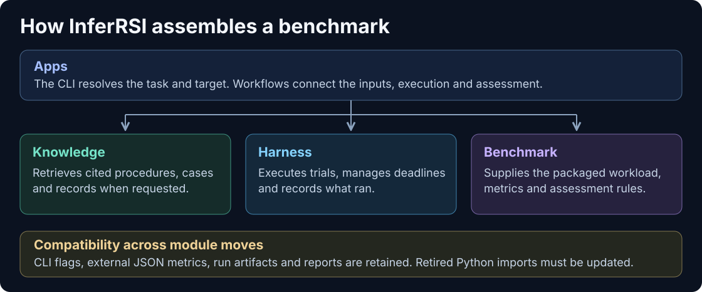
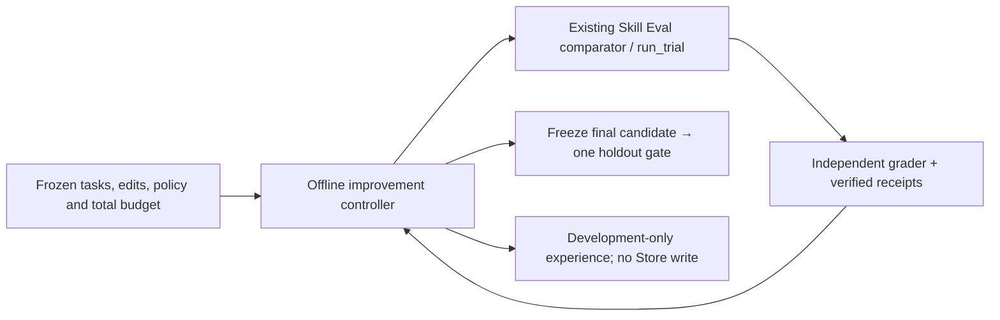

# Modular architecture

The [engineering task library](engineering-benchmarks.md) packages MoE forward,
Qwen-Image denoising and real-model Qwen3-TTS under
`benchmark/tasks`. `inferrsi benchmarks list|show` discovers the
packages. `inferrsi benchmarks run <package> ...` launches the package's
`benchmark.py`. Task-specific orchestration, sampling and assessment live inside
each package. The task library owns its `index.json` registration. The existing
`benchmark/registry.py` discovers the resources. The CLI package `apps/cli/`
and `apps/workflows/benchmark_operations.py` provide application assembly and launch.
Each task retains its own protocol and task-specific code.

The [current-Agent optimization session](optimization-benchmarks.md) assembles
the first complete handoff for the Qwen task. `harness/optimization.py` controls
budget, attempts, feedback records, selection and independent final execution.
`harness/task_protocol.py` freezes a supplied resource directory and loads its
task-owned assessment protocol. `harness/optimization_session.py` assembles
execution and assessment; the CLI resolves task resources and injects knowledge
access and the capture callback from `apps/workflows/campaign.py`.
The external Agent chooses and edits candidates between round submissions.
The same controller serves ordinary projects through `campaign start/round/final`
and packaged tasks through `benchmarks session`. The
[shared workflow and sequence diagram](optimization-workflow-unification.md)
describe multi-file candidates, explicit acceptance inputs, stop rules and
dashboard projections from one control record. `harness/project.py` freezes
caller-provided checks and assesses their retained outputs. Ordinary optimization
does not import Benchmark. Benchmark supplies task definitions and specialized
rules, while Harness manages their execution and the complete optimization lifecycle.
Neither infers quality criteria from a natural-language goal.
Ordinary projects default to the current Agent conversation.
The optional [service-reuse protocol](service-reuse-campaigns.md) adds project
assessment and foreground service ownership within this same controller. Its
protocol and result rules live in `harness.project_service`, with process
lifetime managed by `local_process`.
The [native host handoff](native-agent-sessions.md) lets the initiating Agent
resolve the task request before any campaign exists, use its host's new-session
tool and retain the native identity and returned artifacts. The child owns the
complete start/knowledge/round/final lifecycle; the parent observes and collects. This path records the handoff; it
does not implement a background Agent CLI driver or a native-host deadline.

The application injects `harness.scenarios.external.execute_trial` into the
[two-rank MoE entry](moe-forward-benchmark.md). The standalone image benchmark
and [TTS service protocol](tts-benchmark.md) expose their documented execution
boundaries. Apps and Harness callers assemble these operations into optimization
rounds under the #362 target architecture. Each task records its qualification.

The diagrams below show where the CLI assembles an experiment, which package
owns each step and where to extend it. The [compatibility notes](#compatibility-and-historical-evidence)
cover retained interfaces and imports that moved.

## Three-objective delivery framing

The current WIP develops three connected objectives:

1. **Roofline / Optimization Headroom:** source-grounded bounds, observed
   attainable limits, calibrated predictions and experiment selection. The
   ceiling skill provides guidance and pure conditional arithmetic for supplied
   L1 inputs; application results require their own measurements.
2. **Dense Commit Coordination:** ownership, concurrent work, review, testing,
   integration, release and feedback into later changes. The existing Magpie
   material is history analysis. A first-hand coordination case is pending Dot
   delivery and owner review; neither that analysis nor paper methodology
   implements or verifies an autonomous development pipeline.
3. **Skill System:** reusable candidate skills, knowledge and cases, the
   [Reference Matrix](reference-matrix.md),
   [SearchSpace Matrix](searchspace-matrix.md) and the generated
   [Skill Coverage View](skill-coverage.md), and explicit read-only access.
   The two matrices describe evidence and coverage; they do not drive an
   automatic router or execution loop. The coverage view reads them from the
   skill outward and owns no fact of its own.

This framing is presentation and delivery traceability, not a third primary
matrix. Dot owns source extraction, the owner approves sources and reviews
content/mappings, and the integration workstream owns reconciliation with the
current artifacts. Candidate coverage and empirical validation stay separate.
Paper versions/readsets remain distinct from implementation pins; a shared
lineage or a linked paper is not independent corroboration.

Reviewed paper comparisons, readsets and cases live under their owning skill's
`references/` tree; distinct workflows receive their own candidate entrypoints.
Paper knowledge does not supply repository-only schema fields such as a Git SHA,
so it remains linked Markdown rather than a parallel registry or fabricated
`repo_packs` record. The [knowledge-base contract](knowledge-base.md) defines
skill-local metadata ownership, typed source examples, shared checkout references and
legacy package compatibility. Normalized reads and bounded Collect
([knowledge-operations.md](knowledge-operations.md)) and the authorized local
store ([knowledge-store.md](knowledge-store.md)) are implemented Python
interfaces; existing CLI commands remain supported.

## Module responsibilities and dependencies



| Layer | Owns | Does not own |
| --- | --- | --- |
| Entry and knowledge | CLI arguments, immutable RunSpec, cited knowledge/context export | Model execution or automatic source editing |
| Harness | AB/BA order, deadlines, source checks, scenario composition, evidence, performance adjudication and reporting | Device-specific conditions, request schemas or kernel dispatch |
| Model | Anthropic provider adapters and their request authorization | Scheduling, worker lifetime, hardware selection, request payloads, metric contracts or quality checks |
| Apps | CLI, host bindings (source identity, device discovery/qualification, environment facts), artifact digests and JSON writes, provider integrations | Model constants, campaign gates or performance verdicts |

Dependencies flow from entrypoints to Harness. #498 removed the Infra and Model
packages, so Harness reaches neither. None
of these shared packages imports a campaign from `examples/`.

Environment inspection follows that direction. `apps/host/inspection.py` is the
facts API: it takes the command probe and the repository snapshot as ports.
`apps/inspection.py` binds those ports to this host with
`apps.host.commands.probe_command` and `apps.host.targets.repository_identity`,
and the CLI calls that composition. The `apps/host/` package moved from Infra in
#498 slice 3a and keeps its limit: it reaches no Knowledge, Harness or Benchmark
module. `apps/host/inspection.py` reads a
repository-pack description through the neutral `resources.repository_packs`
leaf, under the one permanent importer rule in
[module-layout.md](module-layout.md#permanent-neutral-leaf-importer-rule-proposed).

The [target module layout](module-layout.md) describes the migration and the
scope of the static import checks. The [migration manifest](legacy-knowledge-manifest.json)
records the retired compatibility pairs and the permanent neutral-leaf importer rule.

The caller still prepares the benchmark runtime and baseline/candidate source
checkouts. Separate working directories alone do not isolate Python imports,
resources or an existing server. The local executor can run directly on a
prepared remote machine; SSH dispatch, distributed leases, automatic planning,
patch generation and Hub publication remain future work.

Local executor commands are noninteractive and receive EOF on standard input.
Supply their inputs through command arguments or files rather than the caller's
input stream.

### Offline harness-improvement lane

The [single-step offline controller](harness-improvement.md) adds a bounded policy
above the existing Skill Eval comparator. Supplied declarative INV/DOM edits are
materialized as immutable Git snapshots. Development grades select a successor;
it must run again before freezing for one independent held-out accept/reject gate.
The controller accounts for the entire loop; candidate execution cost is reported
separately. It reuses `run_trial` and the local executor, including their inherited
absolute deadline, rather than creating another execution backend.



The feedback arrow represents development evidence only. Holdout cannot select a
different candidate or cause another edit. Real-client execution, autonomous
proposal generation, external sandbox enforcement and Store/CAS reuse are outside
this MVP. [PR skill evaluation](skill-eval-pr.md) is another existing consumer of
the comparator; the engine AB/BA path retains its independent acceptance contract.

## Directory map


```text
src/inferrsi/
  benchmark/
    registry.py             Generic task resource discovery
    tasks/                  Task-specific definitions, workloads and assessment
    legacy_run_v0.py        Old run gates: metric contract, summaries and verdict
    metrics.py              Finite positive dotted-key metric contract
    artifacts.py            Benchmark-owned file digests and JSON writes
    validators/
      flare.py              Offline Flare delivery-evidence adapter and pair check
      image.py              Explicit PNG dimensions/mode, hashes, RGB/alpha quality gates
    sampling.py             Warmup seeds, first-response retention, sample/artifact groups
    skill_evaluation.py     Skill trial check validity, verdict and condition statistics
    skill_eval_diagnostic.py   Synthetic KV admission diagnosis task and grader
    skill_eval_engineering.py  Serving-parser task, public vectors and vector judgment
    improvement.py          Improvement-step thresholds and acceptance rules
  contracts/
    runspec.py              Immutable experiment contract; the initializer re-exports only RunSpec
    json_v1.py              Canonical inferrsi-json-v1 encoder and decoder
    claim.py                Campaign verdict labels PASS/FAIL/INCONCLUSIVE; rules only
    evidence.py             Evidence segments and per-campaign path rules; no filesystem I/O
  resources/
    __init__.py             Import-free initializer
    repository_packs.py     Neutral REPO_TYPES and pack.json reader; imports no inferrsi module
  apps/
    api.py                  Python entry points for assembling and publishing Apps operations
    cli/                    CLI entry `main` and its argument parser
    inspection.py           Environment inspection bound to the host probe and Git identity
    host/
      inspection.py         Environment inspection facts API; command and snapshot ports
      commands.py           Bounded read-only probes
      environment.py        Dependency versions and storage checks
      platforms/            Backend discovery registry; CUDA qualification
      targets/git.py        Repository identity and source snapshots
    legacy/
      run.py                Old run composed from Harness, Benchmark and the report
      evaluation.py         Old evaluate entry: RunSpec to the Benchmark gates
      reporting.py          HTML evidence report
    handoff/
      bridge.py             Bind preparations to specs and fixed records to evidence
      context_provider.py   Deliver Knowledge bytes and pins for Harness sealing
      candidate_provider.py Plan generation and collect fixed candidate outputs
    storage/
      archive.py            Immutable preparations/assessments and manifest.json/result.json
      artifact_reader.py    Read verified artifacts through authorized mounts
      result.py             AppsResultV1 construction and validation
      evidence_layout.py    Create plan/results/patch/validator evidence directories
    workflows/
      campaign.py           Knowledge values connected to Harness campaign records
      benchmark_operations.py Resolve a task entry and launch it through Harness
      benchmark_compare.py  Paired benchmark plans, native handoff, collection and reports
      skill_evaluation.py   Composed bundle export, trial run and summary
      skill_eval_engineering.py Composed artifact check: task rules around sandbox replay
      improvement.py        Composed assessment, selection, rerun and holdout acceptance
    integrations/
      cannbot/
        __init__.py         CannbotChannel implementation and channel result adaptation
        project.py          Opt-in checkout/interpreter grant and read-only operations
        read_worker.py      Standalone worker run by the approved Cannbot interpreter
      anthropic/
        anthropic_agent.py  Bounded direct Messages agent with frozen cost reservations
        anthropic_edit_agent.py  Bounded edit-and-check protocol
        request_guard.py    Request authorization broker, loaded by file location
    artifacts.py            Apps-owned hashing, file lock and evidence writes
    mindie/
      project.py            Opt-in per-checkout grant, the worker launch and the recorded read
      context.py            Export supplied MindIE reads into a caller-reviewed campaign trace
      mcp.py                Stdio MCP for the two approved local MindIE reads
      read_worker.py        Standalone worker run by the approved MindIE interpreter
    views/
      summary_chart.py      Stdlib SVG gain chart (chain/branch) and report figure spec
      optimization_chart.py Managed optimization objective/token curves and final result
      dashboard.py          Offline snapshot and HTML rendering
      dashboard_data.py     Recorded run/campaign evidence into a view model
      dashboard_live.py     Read-only loopback server for live observation
      dashboard_timeline.py Stage/result timeline SVG
      dashboard_workflow.py Paired command events into reviewable work units
      dashboard_external.py Protocol-specific external measurements
      template.html         Dashboard view template
      optimization_story.py Caller narrative resolved against captures and runs
      profile_searches.py  Pre-profile search presentation
      experiment_timing.py Experiment timing presentation
      search_attribution.py Import attributable file-search evidence into a campaign
      search_archive.py    Reviewed search-archive uses
      capture_delivery.py  Visible capture resources in a reviewed tool return
      codex_search.py      Bounded attributable file-search evidence from Codex rollouts
      codex_tool_returns.py Correlate Codex tool-return windows
  knowledge/
    catalog.py              Knowledge search and cited context
    skill_catalog.py        Packaged/default or custom skill metadata/body/resource resolution
    knowledge_operations.py Normalized reads and bounded Collect (KnowledgeReader)
    knowledge_store.py      Authorized local store Create/Update (KnowledgeStore)
    research.py             Read-only model-aware discovery joined over catalog queries
    _skill_selection.py     Deterministic lexical skill ranking and context view
    _source_snapshot.py     Shared source snapshot for stored records: manifest, compact, resolve
    context_projection.py   Collected context text and item projection
  harness/
    api.py                  H public allocate/execute/read over one RunStore and CPU target
    execution_service.py    Ordinary-command execute: admission, binding, steps, record
    input_binding.py        Input capture, byte-equivalent copies and file digests
    local_process.py        Windows Job / POSIX process group; deadline, cancel, cleanup
    run_store.py            Local SQLite RunStore: claim, owner lock, fixed records
    errors.py               H PublicError codes and partial execution facts
    records/
      evidence.py           Bounded evidence reads and record text rules
      optimization_log.py   Campaign log write/read and reference checks
      optimization_trace.py Optimization trace parse, assemble and read
      knowledge_capture.py  Delivered context capture and byte verification
      campaign_records.py   Campaign manifest, candidate and decision records
      campaign_trace.py     Correlation envelope for existing agent events
      profile_timeline.py   Profile attachment records
      timing_clock.py       Recorded timing clock
    optimization_session.py Shared start/knowledge/round/final operation assembly
    project.py              Freeze supplied project checks and assess retained results
    task_protocol.py        Freeze supplied task resources and load their protocol
    optimization.py         Current-Agent round budget, records and recovery
    usage.py                Shared observed-token normalization and totals
    improvement.py          Offline search progression over injected assessments
    skill_evaluation.py     Skill client adapter, trial execution and retention; injected rules
    artifact_sandbox.py     Artifact capture and bubblewrap replay; no vectors or verdicts
    atomic_json.py          Harness-owned atomic JSON evidence writes
    runner.py               One AB/BA loop; execute/snapshot/assess/report ports injected
    scenarios/
      external.py           External command trials; metric validation injected
    serving/
      server.py             Supervised Linux serving workers and their group cleanup
      http.py               Timed JSON POST transport
      image.py              OpenAI-style image payload and PNG response protocol
  knowledge/data/skill_library/  Registered skills, engineering records, configuration and compiled inputs
  harness/data/repo_packs/       Execution target descriptors
examples/                   Current Qwen runner, image validator and v4 adapter
tests/fixtures/legacy/      Frozen historical validation dependencies for regressions
```

The package root holds exactly two tracked files: `__init__.py` and `__main__.py`.
#452 M1 moved the MindIE adapter to `apps/mindie/` (`project.py`, `context.py`,
`mcp.py` and the standalone `read_worker.py`) and deleted root `mindie_project.py`,
`mindie_context.py`, `mindie_mcp.py` and `_mindie_read_worker.py` with no forwarding
shell or alias. #408 A2 moved the chart renderer to
`apps/views/summary_chart.py` and the task launcher to `apps/workflows/benchmark_operations.py`
and deleted root `summary_chart.py` and `benchmark_operations.py` the same way. #408 A1 moved the CLI and its parser to `apps/cli/`
and deleted root `cli.py` and `arguments.py`;
`__main__.py` and the console script call `inferrsi.apps.cli:main`. #412 R1 deleted eleven root modules with no
forwarding shell or alias: the seven Knowledge shells, whose code is in
`knowledge/`; the three old-run forwarders `evaluation.py`, `execution.py` and
`reporting.py`, whose code is in `apps/legacy/`; and `inspection.py`, whose
host binding is `apps/inspection.py`. The build-generated `_version.py` is ignored
wheel metadata, not a tracked root file.
The [migration list](module-layout.md#retired-root-modules) maps each retired
path to its replacement. The [import gate](module-layout.md#import-gate) defines
the dependency checks.

## Where to extend

| Add | Main extension locations | Required qualification |
| --- | --- | --- |
| Model or scenario | `harness/serving`, `benchmark/metrics.py`, `benchmark/validators`, `harness/scenarios` | Frozen request and metric contract; model-specific quality coverage |
| Repository | `apps/host/targets`, a composed scenario, `harness/data/repo_packs` | Stable source identity; command/result contract; environment isolation |
| Hardware | `apps/host/platforms` | Device selection, process exclusivity and independent backend/model evidence; a backend is registered in `apps/host/platforms/__init__.py` and its probe command is defined in the implementing module under `apps/host/platforms/`, not in package data |

The acceptance rule is: **a new model or hardware adapter must reuse the common
AB/BA loop, process cleanup and performance adjudication.** The extension
regression test composes a new metric schema, non-Git source adapter and backend
probe through those interfaces while running real subprocesses. Its numbers are
synthetic contract fixtures, not accelerator measurements.

### Compose a new scenario

`apps.legacy.run.run_experiment(spec, environment, *, execute, snapshot)` composes
the old run and accepts small callable adapters. It passes them, the Benchmark v0
gates and the report to `harness.runner.run_experiment`, whose four ports
(`execute`, `snapshot`, `assess`, `report`) have no defaults. An omitted
`execute` or `snapshot` is read from `apps.legacy.run` when the run starts
(`execute_trial` and `repository_identity`), which is the two-argument call
that the retired root `execution.run_experiment` provided. For a new external
benchmark format, reuse the standard executor and only replace metric interpretation:

```python
from functools import partial

from inferrsi.apps.legacy.run import execute_trial, run_experiment
from inferrsi.benchmark.metrics import read_metric


def read_engine_metric(document, key):
    normalized = {"metrics": {"latency_ms": float(document["duration_seconds"]) * 1000}}
    return read_metric(normalized, key)


run_dir = run_experiment(
    spec,
    environment,
    execute=partial(execute_trial, metric_reader=read_engine_metric),
)
```

The standard executor retains timeout, cancellation, logs, result paths and child
cleanup. A custom `execute(command, cwd, trial_dir, deadline, metric_key)` must
preserve that trial record contract. Prefer composing `execute_trial` over
reimplementing process lifetime. Metric readers convert a result document into a
float; `benchmark.legacy_run_v0.trial_metric` then applies the one finite, positive
metric contract (`benchmark.metrics.validate_metric`) to whatever the reader
returns, so a reader that yields `0.0`, a `bool` or a non-finite value records a
metric error rather than entering the evaluation. The Harness executor
`harness.scenarios.external.execute_trial` holds no metric rule: a caller that
passes a metric key also passes `metric=`, its validation function.

Run state is written by the termination path, never assumed. `status.json`
reports `completed` only after the final artifacts were written;
a run stopped by a command state keeps `timeout`, `failed` or `cancelled`; an
exception outside the adapter error contract writes `crashed` and re-raises; and a
failure while writing the terminal artifacts writes `termination_failed` with the
original measurement error beside it.

A new source adapter implements `snapshot(repo, excluded_run_dir)` and returns
`available` plus a stable `snapshot_hash` and explanatory metadata. It must
fingerprint relevant source, including changes between individual commands; it
must not claim availability without a trustworthy identity. Git remains the
default. Alternative adapters must define their own exclusion semantics.

Image campaigns can compose `ImageProtocol.request` with
`benchmark.sampling.collect_samples`.
The protocol receives model name, dimensions and sampling parameters from the
campaign. The collector owns warmups, first-response retention, groups and
artifact hashes; it accepts a request callback and file suffix, so it has no
model/backend dispatch. The Qwen example now uses these shared modules.

For new image quality checks, install `inferrsi[image]` and construct an explicit
`ImageQualityGate` from the frozen campaign plan. No SSIM/PSNR threshold is
selected by the shared validator. RGB and alpha are checked separately, and a
campaign can additionally require exact pixels. Image dependencies are lazy;
the default control package continues to require only the standard library.

### Add a platform or repository

Register a device probe in `apps.host.platforms.PLATFORM_PROBES`; supply the selected
IDs, device model and bounded command runner. A new backend name additionally
needs an entry in `knowledge.catalog.BACKENDS`, which supplies the CLI `--backend` choices
and the accepted knowledge and skill backends; no package-data descriptor is
required. Adding a device SKU within a backend is a parameter/configuration
change. CUDA qualification takes an explicit device count and model; it contains
no B300 or four-device default. ROCm and Ascend currently expose raw tool facts
and require independent qualification. Discovery is not compatibility or
performance certification.

For a new repository, start with the Git target adapter if applicable, add the
repository descriptor/knowledge pack and compose its benchmark scenario. Update
catalog choices for a new named repository type. These registrations do not
change the AB/BA algorithm, process cleanup or evaluator.

## Compatibility and historical evidence

The supervised server helpers (`harness.serving.server.launch_server` / `stop_server`)
require Linux with a readable `/proc` process table. They reject other platforms
before launch; missing or inaccessible process enumeration raises an error rather
than reporting successful cleanup. Workers must remain in their owned process
group. Windows Job Object support in the general command executor
(`harness.local_process`) does not extend to these server helpers. These constraints do not restrict read-only knowledge
operations or the control CLI to Linux.

- Existing CLI flags, external JSON metrics, run artifacts, cancellation
  handling and report generation are retained. Root Python import paths are
  not all retained: #451 and #412 R1 retired the root modules listed in
  [CHANGELOG.md](../CHANGELOG.md) with no forwarding shell or alias. That file
  maps each old path to its replacement and states the pickle impact.
- `examples/qwen21_turbo_b300.py` retains its command interface and campaign
  settings while delegating lifecycle, requests and sampling to shared modules.
- The LTX helper and quality script, plus the pre-cleanup Qwen quality script,
  are preserved byte-for-byte under `tests/fixtures/legacy/` for historical
  regression tests. The current Qwen quality entrypoint imports the same shared
  artifact utilities directly; its numerical and manifest checks are unchanged.
  Current examples no longer depend on LTX campaign code.
- The Qwen runner hashes every Python module in the installed control package
  plus its current runner and quality entrypoints. A changed implementation
  **requires fresh frozen references for a new campaign**. Do not combine a new
  runner with an old guard-hash manifest or rewrite previous evidence to make
  it pass. Replay historical campaigns with their original source-pinned bundle.

## Knowledge and evidence ownership

Package data is the canonical source for noneditable installations:

```text
inferrsi/knowledge/data/skill_library/
  tasks/  systems/  playbooks/  workflows/  casebooks/  Registered owners
  records/<stable-id>.json       One authored engineering finding
  config/                        Aliases and research profiles
  _compiled/                     Build-time YAML headers and Git fingerprints
  skill-index.json               Stable ID, physical path and backend
```

JSON owns applicability, claims, recommendations, validation and limitations;
`knowledge search`, `knowledge show` and human-readable `context` use that same
record. The tier identifies each source relationship. The reader validates the repository, backend and component encoded in the stable filename.

A backend filter includes that backend and repository-local `common` methods;
scenario filters select exact workloads or component wildcards. Model, SKU,
dtype and software prerequisites stay in `applicability`, not extra directory
levels. A common method cannot inherit another backend's validation.

Source attribution keeps repositories, revisions, dates and known authors;
experience records and exported context omit PR links. Evidence levels describe
guidance or reported measurements independently from a source's merge status.
Imported skills are source material, not executable tool authority. CPU tests
do not upgrade imported knowledge to a validated claim.

The bundled skill CLI uses `data/skill_library/` and its `skill-index.json` registry.
The main agent selects one primary procedure from `tasks/` and reads it with
`skills enter <task-id>` before searching for supporting evidence. The base
runtime loads the complete packaged primary procedure and its host header without PyYAML.
The structured InferRSI annotation stays in the pinned source file.

Supporting procedures live in `systems/`, `playbooks/`, `workflows/` and
`casebooks/`. Engine owners live under `systems/engines/<engine>/`. Each owner
packages its full English procedure, embedded metadata, references and cases. The library
also owns authored findings in `records/`, search configuration in `config/`
and generated build inputs in `_compiled/`. An explicit `--root` selects a
custom flat or registry-based library. Readers that parse skill frontmatter use
PyYAML from the `skills` extra. Core knowledge commands read catalog views and
packaged documents with the base interpreter. The two matrices retain their
authority. [Directory and search diagrams](knowledge-layout.md)

Run evidence remains in the caller-selected run directory; frozen campaign
plans/results/patches/validators remain under `evidence/`.

See the [knowledge guide](../src/inferrsi/knowledge/data/skill_library/records/README.md)
for all entries, retrieval rules and the maintenance workflow.

The earlier [component design](assets/component-architecture-en.svg) and
[complete workflow](assets/gpu-workflow-en.svg) remain long-term references.
Their [Chinese component](assets/component-architecture.svg) and
[Chinese workflow](assets/gpu-workflow.svg) originals are preserved.

The supplied system overview is also available in [English](assets/system-architecture-en.svg)
and [Chinese](assets/system-architecture-zh-CN.svg). It summarizes inputs,
normalization, the AB/BA loop, adjudication and retained evidence. Its feedback
arrow represents explicit review and reuse by the caller, not implemented
automatic promotion into the knowledge catalog or RunSpec. The original diagram
is preserved; the [source audit](reviews/source-audit-ac70272.md) tracks cleanup
portability and other implementation gaps.

The migrated skills have [generated catalog records](../src/inferrsi/knowledge/data/skill_library/README.md)
assembled at read time, with backend-scoped IDs and
`skill_documents.original` pointing to the complete packaged procedures.
Normalized reads retain the library's dependency resources. The library is the
single content owner.
