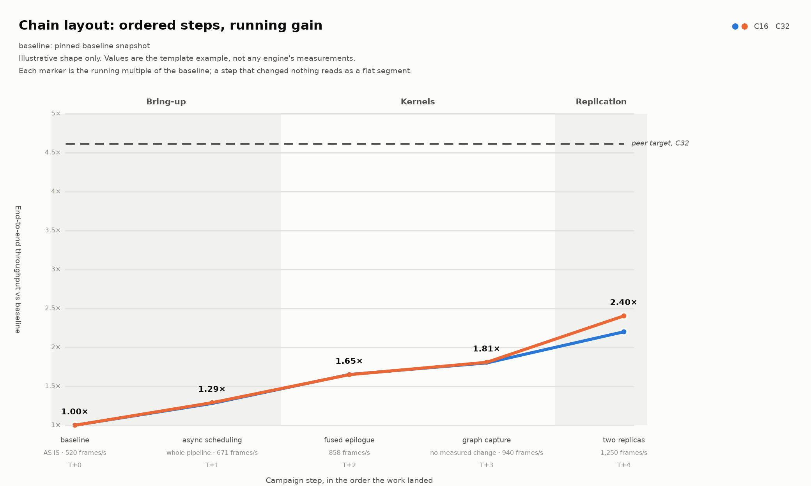
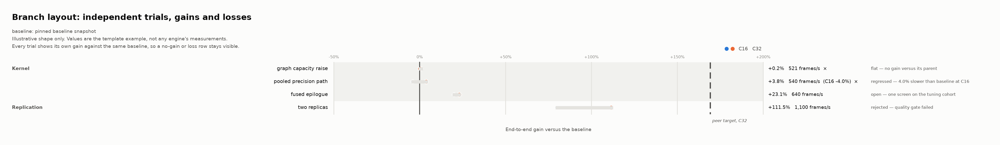

# Campaign summary chart

One figure per campaign that answers "what did this campaign move, and by
how much". It is drawn automatically when an experiment finishes, and the same
renderer produces a standalone figure for a multi-step campaign.

The renderer is [inferrsi/summary_chart.py](../src/inferrsi/summary_chart.py),
also exposed as [tools/campaign_summary_chart.py](../tools/campaign_summary_chart.py)
and listed in the [operation guide](operations.md#summarize-a-campaign-figure--campaign_summary_chartpy).
It uses only the standard library and writes SVG, so a committed figure
reproduces without installing a plotting package.

## Two layouts, two campaign shapes

| Layout | Use it when | What it draws |
| --- | --- | --- |
| `chain` (default for a multi-step campaign) | Steps accumulate on each other over the course of the campaign | A line of running gain in multiples of the baseline, one marker per step, stage bands behind it |
| `branch` | Trials each start from the same baseline and are independent | One signed gain axis; every trial shows its own gain, so a no-gain or loss row stays as visible as the best result |





Both images are drawn from the template example values, so they show the
*shape* of each layout and are not the measurements of any engine.

The `chain` layout is the published "gain over time" figure: the height of each
segment is what that step added, and the label above each marker is the running
multiple. A step that changed nothing appears as a flat segment rather than
being dropped.

The `branch` layout exists because a trial that failed or regressed has no
place on an accumulating curve. If a campaign has both, draw both: the chain
for the story of the accepted steps, the branch table for the full search.

## Automatic figure at the end of a run

`inferrsi report` (and `run`, which calls it) renders
`<run-dir>/summary-chart.svg` and inlines it into `report.html`. Nothing extra
is needed for a single pairing: the figure shows the recorded baseline and
candidate medians as a two-point chain.

A campaign with several steps commits its own chain specification as
`summary-chart.json` in the run directory. That specification wins over the
two-point default, because it records the whole campaign rather than one
pairing. When neither exists, the report states why no figure was drawn
instead of showing an empty chart.

## Use the command line for a campaign figure

```bash
python tools/campaign_summary_chart.py evidence/<campaign-id>/results/summary-chart.json \
  -o evidence/<campaign-id>/results/summary-chart.svg \
  --markdown evidence/<campaign-id>/results/summary-chart.md
```

Commit the specification next to the figure. The specification is the source of
truth: it names the measured values, and a reviewer can re-derive the figure and
check each row against the result files it summarizes. Two shape examples ship
with the evidence template:
[chain](../evidence/_template/results/summary-chart.example.json) and
[branch](../evidence/_template/results/summary-chart-branch.example.json).

## Specification fields

| Field | Required | Meaning |
| --- | --- | --- |
| `title` | yes | Figure title; also the SVG `<title>` |
| `layout` | no | `chain` or `branch`; defaults to `chain` when `points` is present, `branch` when `trials` is |
| `subtitle` | no | Lines under the title: screen protocol, cohort, and what a delta does not prove |
| `phases` | chain only | Stage names in order; each step's `phase` must be one of them |
| `unit` | no | Measurement unit, e.g. `frames/s` |
| `baseline.label` | yes | Which snapshot the gains are measured against |
| `baseline.metrics` | yes | One positive baseline value per metric key |
| `metrics` | yes | Ordered metric list, each `{key, label}`; at most seven per figure |
| `label_metric` | no | Metric whose multiple is labelled and whose gain orders rows; defaults to the last |
| `axis.step` | chain only | Vertical grid step in multiples, default `0.5` |
| `axis.tick` | branch only | Horizontal grid step in percentage points, default `50` |
| `axis.label` / `axis.y_label` | no | Axis captions |
| `references` | no | Reference lines, each `{label, metric, value}`; a chain draws them as a dashed projection |
| `points` | chain only | Ordered steps, each `{phase, label, values, note}`; mark the first `baseline: true` |
| `trials` | branch only | Trials, each `{group, label, values, status, note}`; duplicate group and label pairs are rejected |
| `statuses` | branch only | Per-status `mark` and `strong` overrides on top of the conventional set |

Conventional branch statuses are `open` (measured, not carried to a repeated
comparison), `rejected` (failed a frozen gate), `flat` (no gain against its
parent) and `regressed` (slower than baseline). `flat` and `regressed` carry a
`×` mark; a campaign may rename or add statuses through `statuses`.

Malformed specifications fail with a message naming the field, instead of
rendering something misleading. Every step or trial must supply every declared
metric.

## Rules for the surrounding text

- Say in the subtitle how many requests and repeats a screen used. A single-run
  screen is not a confirmation.
- Say when a step changed the workload rather than the implementation (a
  different window, sequence length or batch geometry); such steps do not add
  up with the kernel steps.
- A chain implies that each step builds on the previous one. Only order the
  points that way when the campaign actually landed them in that order.
- Do not use the figure to claim a `PASS`. It summarizes recorded results; the
  verdict still comes from the frozen gates.
