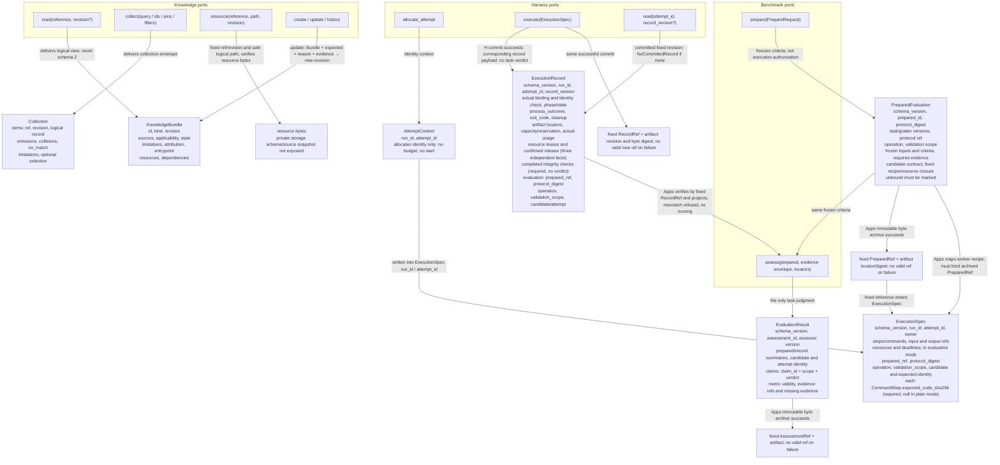
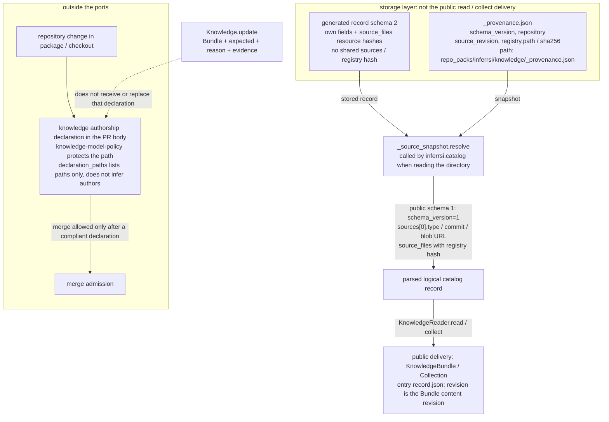
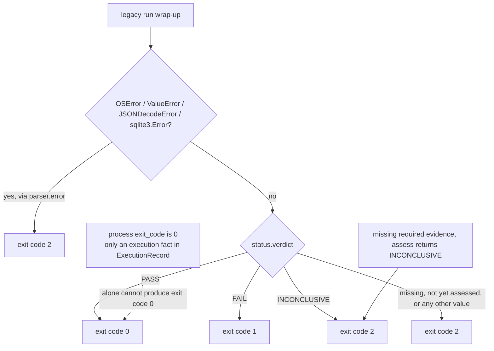
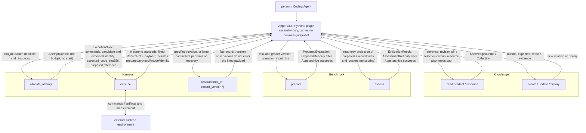
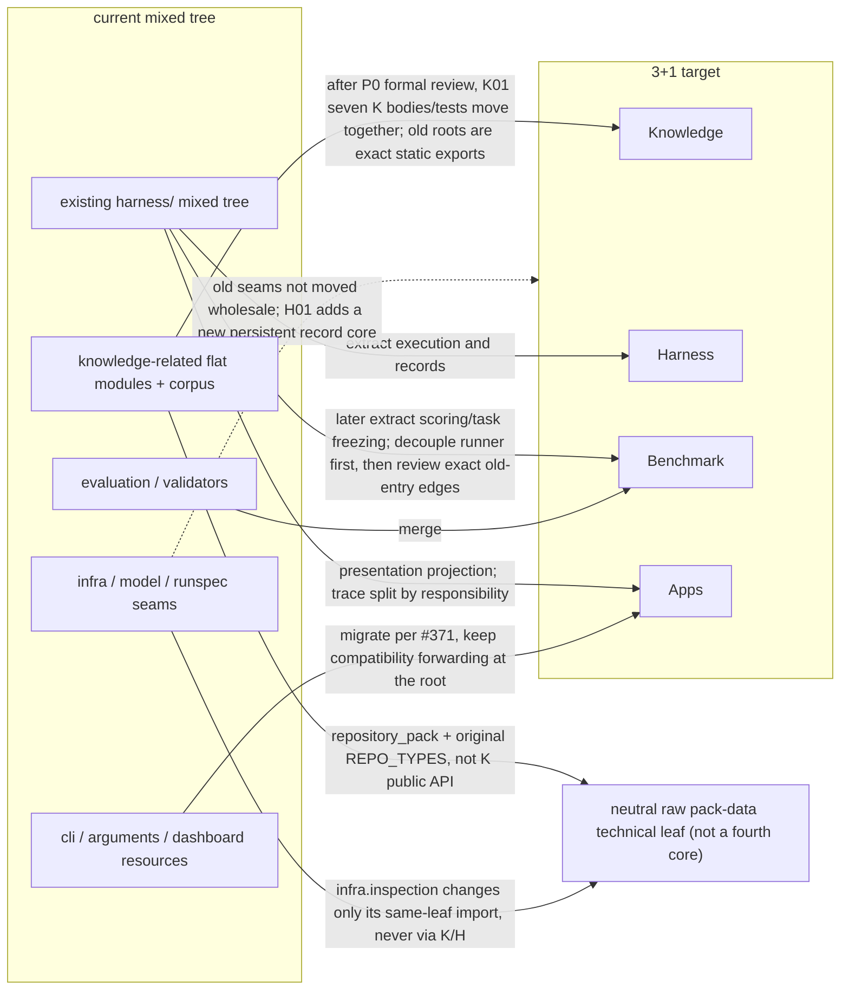

# All eight figures

Status: **Proposed**. Figures are explanatory, not a state machine or implementation status. Full fields are authoritative in the machine schema and V01–V35; a figure omitting a field does not make it optional. Target ports do not mean `src` already has a production implementation; first-wave scope is per D019. Where a figure touches D023, the labels match [`D023.md`](D023.md).

## 1. Public ports and primitives



`PE` also delivers, **outside the object and in-process**, the canonical bytes of the frozen protocol and a read-only per-role entry to the resource closure (D023-1/V31). Those are not extra fields on `PreparedEvaluation`, so they are not drawn as `PE` fields.

## 2. Fixed handoff from execute to assess

```mermaid
sequenceDiagram
  participant H as Harness.execute
  participant Rec as ExecutionRecord
  participant A as Apps mapping
  participant Dash as dashboard / trace
  participant B as Benchmark.assess

  H->>Rec: observed facts, artifact locators, completed checks, identity binding result
  Note over Rec: no task verdict; exit_code is only an execution fact
  Dash--x B: claim-style records are not assessment input
  Rec->>A: committed fixed RecordRef and payload, prepared_ref, protocol, scope and identity
  A->>A: check top-level prepared / record revision, attempt, operation, scope
  alt top-level handoff mismatch
    A-->>A: refuse handoff; do not call assess, produce no normal assessment
  else top-level handoff correct
    A->>A: project to Benchmark read-only evidence envelope (retain fields, no scoring)
    A->>B: fixed PreparedEvaluation + evidence envelope + actual candidate binding
    Note over B: starts no process; reads no current/latest; top-level mismatch still refused if missed upstream
    B->>B: check top-level objects; retain phase/process/cleanup; check frozen evidence by claim/scope
    Note over B: D003 selected: accept a legal fixed non-terminal snapshot; not a successful measurement
    alt evidence sufficient and protocol passes
      B-->>A: EvaluationResult.claims[claim_id,scope].verdict = PASS
    else candidate proven wrong within the declared scope
      B-->>A: EvaluationResult.claims[claim_id,scope].verdict = FAIL
    else correct combination but missing/corrupt/unusable evidence
      B-->>A: EvaluationResult.claims[claim_id,scope].verdict = INCONCLUSIVE (or metric invalid)
    end
    Note over A,B: each claim/scope independent; actual candidate anomaly is not a wrong record; unknown cleanup does not override an independent candidate error
  end
```

## 3. Knowledge read and internal schema



## 4. Legacy run v0 exit codes (not the new multi-scope aggregate)



## 5. Target port topology (current legacy residue registered separately by D018)



## 6. End-to-end handoff and failure/replay branches

```mermaid
sequenceDiagram
  actor U as person / Coding Agent
  participant A as Apps
  participant K as Knowledge
  participant B as Benchmark
  participant H as Harness
  participant T as external runtime
  participant Arc as Apps ByteArchive
  participant R as H RunStore

  U->>A: goal, task and candidate source
  A->>B: prepare(PrepareRequest)
  break prepare fails
    B-->>A: stop; no valid PreparedRef
  end
  B-->>A: PreparedEvaluation (fixed worker recipe/resource closure, candidate may be unbound) + in-process protocol bytes and per-role resource entry
  A->>Arc: verify and save prepared immutable bytes and the fixed recipe/protocol/required resource closure
  break prepared archive fails
    Arc-->>A: stop; no valid PreparedRef
  end
  Arc-->>A: fixed PreparedRef
  opt knowledge needed
    A->>K: read / collect(reference, pins, filters)
    K-->>A: KnowledgeBundle / Collection (logical records; no schema 2)
    A-->>U: knowledge package
  end
  Note over U: propose hypotheses, choose method, edit candidate
  U->>A: candidate reference and expected identity
  A->>H: allocate_attempt(run_id, owner, deadline and resources)
  H-->>A: AttemptContext (attempt_id; no budget, no start)
  A->>A: check the prepared / candidate / identity to run, build ExecutionSpec
  break binding fails
    A-->>A: stop; no execute, nothing written to RunStore
  end
  A->>H: execute(ExecutionSpec: verbatim fixed worker recipe/roles/deadline, expected_code_sha256 from prepared.recipe)
  break unregistered illegal spec
    H-->>A: InvalidExecutionSpec; no start, no started record fabricated
  end
  break same request_id different request_digest
    H-->>A: RequestConflict; original request preserved
  end
  break re-entry: still executing or existing controller state unknown
    H-->>A: AttemptInProgress or RecoveryRequired, with known attempt/latest_record_ref if any
    Note over A,H: short-circuit before any new execution; no wait, no controller replacement, no takeover, no rerun
  end
  alt same request already has a finished record
    H-->>A: original fixed flat ExecutionRecord; no new start
  else first legal new request
  H->>R: atomically register request/attempt/digest and owner (no uncommitted RecordRef issued)
  break pre-start persistence fails
    H-->>A: not started; no valid new RecordRef
  end
  break pre-bind budget/resource/capability admission refused
    H->>R: submit not_started revision
    alt submission succeeds
      H-->>A: not_started + fixed RecordRef; not a successful measurement, stop automatic progression
    else submission fails
      H-->>A: no valid new RecordRef; known identity and facts retained
    end
  end
  H->>H: bind actual candidate bytes, record identity check
  H->>R: retain input bytes/directory manifest and verify fixed digest
  break input retention write fails (before start)
    H-->>A: ExecutionPersistenceError(started=false); no valid new RecordRef
  end
  break actual input identity check fails (before start)
    H->>R: must submit not_started revision with this actual binding/check failure
    alt submission succeeds
      H-->>A: fixed RecordRef + not_started/identity refusal reason; stop automatic progression
    else submission fails
      H-->>A: ExecutionPersistenceError(started=false); no valid new ref
    end
  end
  H->>H: verify actual entry code digest against expected_code_sha256 before starting the candidate
  break code digest mismatch or entry unresolvable
    H->>R: mismatch -> not_started with check-failure fact; unresolvable -> not_performed/unknown, never a fabricated mismatch
    H-->>A: fixed RecordRef if submitted, else ExecutionPersistenceError per start state; candidate process never started on mismatch
  end
  H->>T: commands and input binding
  T-->>H: known artifacts and measurement observations (may be incomplete; unknown listed separately)
  H->>H: collect known facts, attempt cleanup, record three budget facts separately, integrity checklist
  Note over H,R: a record submittable after this run may still be phase=recovery_required / cleanup=unknown
  Note over H,R: do not reclassify as a re-entry anomaly; on success deliver fixed facts, on failure retain partial facts per started=true, never auto-rerun
  H->>R: commit immutable record revision and retained evidence
  break commit fails
    H-->>A: no valid new RecordRef; retain still-valid old refs and known facts; no automatic rerun
  end
  R-->>H: fixed RecordRef and payload
  H-->>A: flat ExecutionRecord (record_ref and fixed payload fields)
  end
  break synchronous return of not_started or recovery_required
    A-->>U: committed fixed record; stop this automatic assessment
  end
  Note over A,R: the path below may also be entered by an independent offline call reading an existing fixed revision; includes legal non-terminal snapshots (D003 selected)
  Note over A,R: the break above stops only this synchronous flow; it does not forbid this independent call; uncommitted partial facts must not be substituted
  A->>A: read the same fixed revision and its prepared, check original byte digests and top-level handoff identity
  break prepared / record revision, attempt, operation or scope mismatch
    A-->>A: refuse handoff; no normal assessment
  end
  A->>A: project to Benchmark read-only evidence envelope (no scoring)
  A->>B: assess(fixed PreparedEvaluation, evidence envelope, artifact locators)
  Note over B: starts no process; dashboard / trace is not assessment input
  break B detects a missed top-level mismatch, unknown protocol, or illegal envelope
    B-->>A: refuse; no normal assessment, not archived as a judgment result
  end
  B->>B: judge by each claim/scope frozen protocol inside the correct fixed combination; phase does not replace evidence sufficiency
  B-->>A: EvaluationResult.claims (PASS / FAIL / INCONCLUSIVE per claim/scope)
  A->>Arc: save judgment immutable bytes with prepared/record association
  break assessment archive fails
    Arc-->>A: no valid AssessmentRef; original RecordRef retained, explicit re-assessment allowed
  end
  Arc-->>A: fixed AssessmentRef
  A-->>U: execution facts, per claim/scope judgments and fixed refs side by side; no write-back overwrite
  opt repository knowledge change
    U->>K: or through a PR: author declaration in PR/CI, not in the port
  end
  opt controlled store update
    U->>K: update(Bundle, expected, reason, evidence)
    K-->>U: new revision
  end
```

## 7. Migration overview (formally accept the gate first, then migrate in batches)



## 8. Apps assembly sequence

```mermaid
sequenceDiagram
    participant A as Apps
    participant B as Benchmark
    participant S as Apps ByteArchive
    participant H as Harness
    A->>B: prepare(fixed task, inputs, operation/scope)
    break prepare fails
        B-->>A: no PreparedEvaluation/valid PreparedRef; stop
    end
    B-->>A: PreparedEvaluation + fixed worker recipe/required resource closure + in-process protocol bytes and per-role resource entry
    A->>S: verify and save prepared bytes/protocol/recipe/required resources
    break prepared archive fails
        S-->>A: no valid PreparedRef; stop, no execute
    end
    S-->>A: PreparedRef(prepared_id, schema_version, artifact)
    A->>H: allocate_attempt(owner, target, deadline, budget)
    H-->>A: AttemptContext
    A->>A: bind_execution -> H.ExecutionSpec; verbatim role/version/deadline mapping, expected_code_sha256 mapped from prepared.recipe
    break binding mismatch
        A-->>A: stop; nothing written to H RunStore, no start
    end
    A->>H: execute(spec, cancellation)
    Note over A,H: H internally handles schema/conflict/re-entry, admission/actual binding, code digest check and execution per figure 6; this figure shows only the external handoff
    break pre-start persistence fails
        H-->>A: ExecutionPersistenceError(started=false); no start, no valid RecordRef
    end
    break admission refused
        Note over A,H: H must submit a not_started revision (write failure yields no valid new ref); only on success does it deliver its own fixed RecordRef
        H-->>A: not_started + RecordRef (if submitted), otherwise no valid new ref
    end
    break re-entry short-circuit (before any new start)
        H-->>A: AttemptInProgress or RecoveryRequired, with known fixed refs if any
        Note over A,H: no wait, no controller replacement, no takeover, no new execution
    end
    break commit failure after this start
        H-->>A: ExecutionPersistenceError(started=true, partial_record, retained_refs)
        Note over A,H: no automatic rerun; partial facts do not impersonate a fixed payload; an old Ref proves only its own revision
    end
    H-->>A: committed flat ExecutionRecord (record_ref and fixed payload fields)
    break synchronous record not_started or recovery_required
        A-->>A: stop automatic assessment; later independent explicit assess still allowed
    end
    Note over A,H: may change process, read by fixed revision; the path below may also be an independent explicit assess
    Note over A,H: D003 accepts a legal fixed non-terminal snapshot, not a completed measurement; uncommitted partial facts are not used
    A->>H: read(attempt_id, record_version)
    A->>S: read frozen bytes and resources by the record's prepared_ref
    A->>A: verify original bytes/top-level identity; project EvidenceInput retaining facts and original refs
    break top-level mismatch / unsupported version
        A-->>A: refuse; no EvaluationResult/AssessmentRef for this call, non-judgment diagnostics allowed
    end
    A->>B: assess(prepared, EvidenceInput, ArtifactReader)
    B->>B: re-check the top level; interpret evidence per each claim/scope frozen rule
    break B detects a missed top-level mismatch / unsupported version
        B-->>A: refuse; no EvaluationResult/AssessmentRef for this call
    end
    B-->>A: EvaluationResult.claims (scopes independent, with metric validity/missing items)
    A->>S: save judgment and its fixed prepared/record associations
    break judgment archive fails
        S-->>A: no valid new AssessmentRef; original RecordRef retained, explicit re-assessment allowed
    end
    S-->>A: AssessmentRef(assessment_id, schema_version, artifact)
    A->>A: show execution facts and each scope side by side; CLI summarizes only the declared primary scope
```

`ContextProvider.collect` and `DeliveredContext` follow D023-3/V33: a draft is in-process and carries no uncommitted valid `ArtifactRef`; H seals the final `DeliveredContext` through its own capture/commit and writes the generation manifest. Apps never writes the H RunStore.
