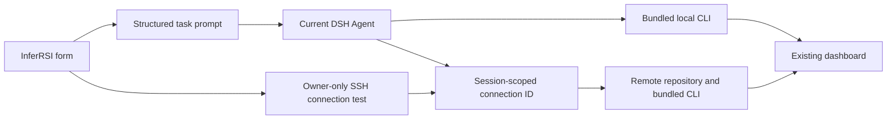

# InferRSI plugin for DeepSeek Harness

Use InferRSI in a DeepSeek Harness (DSH) session to research an inference
bottleneck, prepare a controlled comparison, or inspect an existing run. The
bundled CLI also serves InferRSI's live optimization dashboard for recorded
runs and campaigns. The manual-install preview implements the DSH slice of
[RFC #152](https://github.com/InferMatrixLab/InferRSI/issues/152).

## Build and install

From the InferRSI source checkout, build the native bundle with Python 3.10+.

```text
python -m tools.build_dsh_plugin
```

The command creates `dist/inferrsi-dsh.tgz` and prints its SHA-256. Use
`--output <new-path>.tgz` to build again. The archive includes the entry skill,
launcher, Python runtime, knowledge, and license. Keep the printed checksum
with the archive when moving it to another machine. The archive includes the
pure JavaScript SSH transport with its license notices, Python runtime and
knowledge resources.

On the DSH machine, select the profile you use and install the archive. The
examples use `web`. Use an absolute archive path so it resolves from the
profile directory.

```text
dsh --version
dsh plugin --profile web add "<absolute-path>/inferrsi-dsh.tgz"
dsh --profile web
```

This preview targets DSH 0.2.1, starting at `0.2.1-rc.2`. Initial Windows checks
with DSH `0.2.1-rc.5` covered native installation, skill discovery, and removal.
Put `pnpm` on `PATH` for plugin management. For DSH and Node.js setup, see the
[DeepSeek Harness bundle guide](https://github.com/deepseek-ai/deepseek-harness/blob/master/docs/user/develop/basic/publish.md).

Python 3.10+ must be available to the session's terminal. Core InferRSI
operations run from the bundled runtime. The optional
`skills` CLI and explicit checkout-skill sources require PyYAML. Git and the
prepared target environment are needed for comparisons.

## Start an iteration from the form

In DSH Web, open a target repository and its conversation, then click
**InferRSI** beside the message composer. The form fills the repository path from the
current session when available. Choose the framework, GPU or NPU hardware,
local or remote execution, and SIAS plane,
enter the model and optimization objective, and supply the maximum optimization
rounds and total time budget in minutes.

Expand the execution conditions to provide an existing acceptance issue or
plan, baseline revision, prepared device, benchmark/quality scripts, campaign
directory and constraints. Unknown fields can stay empty while the Agent
checks the repository and prepares the missing prerequisites. Numerical gates
come from the selected acceptance record and user inputs.

**Start iteration** sends one formatted prompt to the Agent in the current
conversation. The optional prompt preview shows the complete instructions and
structured task parameters before submission. Submission is disabled while the
Agent is running or the request is being sent. A successful submission appears
in the conversation; subsequent execution follows the selected Agent, its model
connection and existing permissions. The form retains its values on failure.

The request directs the Agent to use InferRSI, freeze the required gates before
candidate experiments, stop at the submitted round/time budgets, record campaign
history, and open the existing live dashboard. Fields stay in browser memory
until submitted through the normal DSH message path. Reloading or switching
sessions closes the unsent form. The form is a Web client contribution; the
native entry skill remains available in other profiles.

## Run on a remote machine

Select **Remote machine**, then provide the remote repository's absolute Linux
path, IP address, SSH port, username and authentication method. Upload an SSH
private key and enter its passphrase when needed, or enter the account password.
Use the local DSH page or an HTTPS deployment when providing credentials.

Click **Test connection**. For a new server, compare the displayed SHA-256 host
key fingerprint against a trusted value, then choose **Trust this fingerprint
and test**. A supplied fingerprint must match exactly. Successful testing checks
SSH authentication, Linux command execution and access to the selected repository.
GPU/NPU availability and benchmark readiness are checked by the Agent afterward.

After a successful test, **Start iteration** becomes available. Changing the
host, authentication, repository or designated scripts clears the tested
connection. Passwords, uploaded keys and key passphrases are cleared from the
form after authentication. An authenticated SSH client remains in Host memory
for that Agent session. DSH shutdown, plugin removal, session disposal or an
explicit connection close releases it. A lost connection needs a new test.

The prompt contains the hardware class, execution location, task inputs and an
opaque connection ID. Credentials, IP address and SSH username use the
authenticated owner-only connection endpoint and stay outside the prompt,
dashboard and experiment records. Connection testing does not submit an Agent
task. Connection failures return fixed diagnostic categories.

The Agent uses `inferrsi_remote` through DSH's normal tool execution pipeline.
Its operations are repository file listing/reading/writing, the designated
benchmark or quality script, canonical InferRSI CLI operations, a live dashboard
tunnel, and connection close. Paths are checked against the selected remote
repository. Scripts execute with the connected user's permissions and must be
trusted as part of the accepted task. Remote Python 3.10+, Git, the selected
engine, accelerator runtime and model resources must be prepared separately.

Canonical CLI operations unpack the bundled runtime into a private remote
temporary directory. Dashboard mode keeps that runtime alive while the view
is open and forwards the remote loopback listener to an OS-assigned local
loopback port on the DSH Host. Use the returned local URL when the browser and
DSH Host run on the same machine. For a remotely hosted DSH Web deployment,
also forward that Host loopback port to the browser machine before opening it.
Stopping a remote operation requests process cleanup and closes its connection
when necessary. After interruption, inspect recorded state before a new run.

## Integration design



| Owner | Responsibility |
| --- | --- |
| Form and prompt builder | Collect GPU/NPU, execution location, goal, SIAS plane, user budgets and optional acceptance inputs |
| DSH conversation | Deliver the prompt once to the selected session, preserving its model and permissions |
| SSH connection bridge | Authenticate the owner request, verify host key and login, retain a session-bound connection and return an opaque ID |
| `inferrsi_remote` | Carry explicit repository operations and cancellation through DSH tools without including authentication material |
| Canonical InferRSI runtime | Research, freeze, run, evaluate and record campaign rounds using the existing contracts |
| Existing dashboard | Display recorded progress, candidate history, results and evidence through local or forwarded loopback access |

User-supplied round and time budgets are part of the task prompt. Runtime command
limits and recorded experiment verdicts retain their existing meaning. A form
submission, successful SSH test or completed process does not accept a campaign.

## Use in a target workspace

Open the repository you want to investigate in a new session and invoke
`/inferrsi` or ask the agent to use InferRSI. For example, ask it to find
relevant knowledge for your engine's memory bottleneck and preview a comparison.
The skill tells the agent how to use its installed launcher while keeping the
target repository as the working directory. From the installed skill directory,
the launcher is `scripts/inferrsi.py`.

- Use `--plugin-info` to check the selected interpreter, bundled runtime version,
  and content SHA-256. An unbuilt source checkout can report `0+unknown` as the
  runtime version.
- Use `collect` to find relevant packaged knowledge and `read` to inspect a
  selected revision and its resources.
- Use `plan` to preview a comparison. Running a comparison requires the
  accepted scope, frozen gates, and prepared target environment.
- Use `status` and `report` to inspect an existing run and retain its recorded
  verdict. `report` writes the HTML report into that run directory.
- Use `dashboard` to observe recorded work through InferRSI's existing live
  dashboard, following the workflow below.

If the skill is missing, verify that you opened the profile where you installed
the bundle and that the profile provides the DSH skills service and skill tool.
If Python is missing or incompatible, select a compatible interpreter in the
same terminal environment. If the launcher reports an incomplete bundle or
version mismatch, rebuild or reinstall the `.tgz`.

## Open the live dashboard

In the DSH session, ask InferRSI to open the dashboard for the intended run or
campaign. Resolve `<launcher>` to `scripts/inferrsi.py` under the installed
skill's resource directory and use the same Python interpreter selected for
the other InferRSI commands.

```text
python -X utf8 "<launcher>" dashboard --input "<CAMPAIGN_OR_RUN_DIRECTORY>" --live --port 0
```

The command prints a JSON object whose `dashboard` field contains the selected
loopback URL. Open that URL in an external browser and share it as a clickable
link in the DSH session. Port `0` lets the operating system choose an available
port. Keep the server running through DSH's terminal/process tools and retain
the process identity so it can be stopped through that same process when the
view is finished.

Choose a directory containing `campaign.json` to show its recorded rounds,
candidates, optimization history, and linked runs. A directory containing
`run.lock.json` shows that individual run. The page checks for changes about
every three seconds and keeps the current selections where possible. The
header shows the last successful check and refresh failures. Recorded verdicts,
missing evidence, and partial results remain visible in the dashboard.

Populate the campaign as the work happens. Use `campaign capture-context` for
the knowledge retrievals being prepared, `campaign record` to associate runs
with candidates and rounds, and `campaign log` for the reviewed goal, search
space, round hypotheses, decisions, and success/failure summaries. Follow the
[campaign integration guide](https://github.com/InferMatrixLab/InferRSI/blob/main/docs/dashboard.md#campaign-integration) for the exact
fields and commands. These caller-supplied records are the dashboard's source
for the optimization story. Record missing context or reasoning as missing
when it was not captured during the work.

Run the dashboard server on the machine holding the evidence. It binds to
loopback. For a remote target, forward the printed remote port to the browser's
machine, then open the forwarded local URL. Follow the
[live dashboard guide](https://github.com/InferMatrixLab/InferRSI/blob/main/docs/dashboard.md#live-observation) for port forwarding,
access boundaries, and shutdown. The same guide documents offline exports
and reviewed translation overlays.

## Disable, update, or remove

In Web's Plugin Manager, disable the bundle and restart the profile if prompted.
To remove it, run the following and reopen the profile.

```text
dsh plugin --profile web remove inferrsi-dsh
```

To replace a manual preview, remove the old package and install the new `.tgz`
in the same profile. Run `--plugin-info` again to identify the selected runtime.
Experiment records stay in their original output directories.
