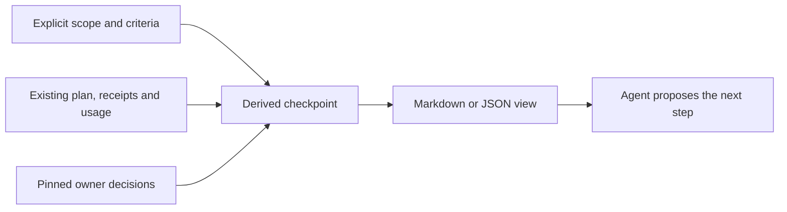

# Offline goal checkpoints

`python -m tools.goal_checkpoint` rebuilds a goal view from explicit owner
records and one existing [configured skill comparison](skill-eval-comparison.md).
It reads the retained artifacts through the comparison controller's
`read_report` function. It does not call a model or write comparison reports.



The goal input is a small, explicit description of accepted scope and observed
decisions, not a runner configuration. The view is disposable: rebuild it from
the same pinned inputs instead of updating a second status history. It cannot
resume or retry an experiment, authorize spending, close an Issue, change a
verdict or promote knowledge. There is no scheduler or persistent registry.

## Inputs and ownership

Run from a development checkout, using its existing dependencies. The selected
comparison must have been prepared by that controller version. Its frozen
controller/file checks and retained result receipts remain authoritative.
Historical comparisons need their original controller checkout; a checkpoint
does not rewrite their freeze to make them readable by a newer controller.

The caller supplies one UTF-8 JSON goal file:

```json
{
  "schema_version": 1,
  "id": "<goal-id>",
  "title": "<goal title>",
  "scope": {"path": "scope.md", "sha256": "<scope-file-sha256>"},
  "acceptance_owner": "<explicit acceptance owner or null>",
  "criteria": [
    {
      "id": "<criterion-id>",
      "description": "<explicit accepted requirement>",
      "evidence": [],
      "acceptance": null
    }
  ],
  "dependencies": [],
  "next_step": "<bounded proposed step>",
  "plan_sha256": "<comparison-plan/freeze.json-sha256>",
  "authorization": null
}
```

Replace placeholders with actual values. Unknown `acceptance_owner` is JSON
`null`, not the string `"null"`. Criteria must be nonempty with unique IDs.
Every file reference uses a path relative to the goal file and the SHA-256 of
its actual bytes. Evidence files may be outside that directory through an
explicit relative path. Only name files the caller is authorized to read; no
private sessions, credentials or automatic Issue scraping are inputs.

| Input | Meaning |
| --- | --- |
| `scope` | Pinned accepted scope/decision supplied by the authorized caller; its prose is never parsed for authority |
| Criterion `evidence` | Explicit supporting files, each with `path` and `sha256`; an empty list remains incomplete |
| Criterion `acceptance` | Optional pinned JSON decision from the named acceptance owner, bound to this exact criterion and evidence |
| `dependencies` | Explicit records with unique `id`, `description`, `state` (`waiting` or `resolved`) and one pinned `evidence` file |
| `plan_sha256` | Exact intended comparison freeze, including revisions, model/settings, limits and frozen input identities |
| `authorization` | Optional pinned, explicit authorization evidence for that plan; never inferred from a merged PR or a budget value |

File hashes establish byte identity, not who wrote or approved a document. The
caller must select authentic owner records and accepted criteria. A third-party
comment, arbitrary file or agent-generated status is not authority merely
because it has a hash. This tool does not introduce an authorization-receipt
service; the existing execution path still requires its exact-plan authorization.

An optional authorization evidence file has this shape:

```json
{
  "plan_sha256": "<authorized-plan-sha256>",
  "authorized_by": "<actual authorizer>",
  "reference": "<explicit authorization decision reference>"
}
```

A criterion acceptance file has exactly these fields:

```json
{
  "goal_id": "<goal-id>",
  "criterion_id": "<criterion-id>",
  "criterion_sha256": "<bound-criterion-sha256>",
  "accepted_by": "<named acceptance owner>",
  "decision": "accepted"
}
```

Use `tools.goal_checkpoint.criterion_sha256(goal, criterion)` to compute the
binding before recording acceptance. It covers goal ID, pinned accepted scope,
intended plan, criterion ID/description and its evidence references. Changing
any of these needs fresh acceptance evidence. The acceptance pointer itself is
excluded so the record has no circular digest. Accepting a negative comparison
is possible when the goal asks for reliable evidence; the tool never changes
that comparison's grades or paired outcomes.

## Read, decide and save

```bash
python -m tools.goal_checkpoint --goal <goal.json> --comparison <comparison-dir>
python -m tools.goal_checkpoint --goal <goal.json> --comparison <comparison-dir> \
  --output <new-checkpoint.md>
python -m tools.goal_checkpoint --goal <goal.json> --comparison <comparison-dir> \
  --format json --output <new-checkpoint.json>
```

Without `--output`, the command only prints the view. Explicit output must be a
new file outside the comparison directory; existing files are never overwritten.
Keep the goal file and owner/evidence records as sources, not edits to generated
views. JSON and Markdown are alternative projections; no parallel histories are
required. Exit 0 means the view was built, including a stop/repair recommendation.
Malformed goal input or an output error exits 2. An unreadable comparison or
missing/stale evidence appears as `repair_evidence`, with reason codes and
source identities, rather than becoming execution permission.

`build_checkpoint(Path(goal), Path(comparison))` returns the derived facts and
typed `Recommendation` fields. `recommend(checkpoint)` applies ordered rules:

| Facts | Action |
| --- | --- |
| Changed/missing evidence, unbound acceptance, stale plan, corrupt receipt, interrupted or ambiguous attempt | `repair_evidence` |
| Completed comparison and every criterion explicitly accepted, with no waiting dependency | `report_accepted` |
| Recorded time/token limit reached | `stop_budget` |
| Other stopped attempt | `prepare_new_plan`; never retry that output directory |
| Fresh plan and every criterion explicitly accepted without requiring a run | `report_accepted`; only the stated goal is accepted |
| Explicit unresolved dependency | `wait_dependency`, naming the dependency ID |
| Completed comparison with remaining/unknown acceptance | `wait_acceptance` |
| Fresh plan without matching recorded authorization | `request_authorization` |
| Fresh plan with matching recorded authorization | `propose_step` through the existing authorized path |

Observed tokens are a lower bound when provider usage is incomplete. Missing
input/output token totals and cost stay `null`; no reporting path debits a
budget. The threshold stops new trials in the existing controller and is not a
provider-side hard spending cap. A recommendation never executes anything.

## Before / after example

The deterministic regression fixture uses the existing comparison test client
and real local subprocess/receipt paths, with **zero model calls**. These are
software-contract fixtures, not measured agent effectiveness or paid-pilot
results. Run `python -m pytest tests/test_goal_checkpoint.py` to verify them.

Before: the comparison is recorded as completed, and a merged-code record is
available, but the goal owner has not accepted its criterion. A returning agent
must not turn either fact into goal completion. The generated view says:

```text
Goal: offline-goal
Acceptance owner: unknown
Next action: wait_acceptance
Reasons: criteria_not_accepted, comparison_already_executed
comparison | Owner accepts the evidence | remaining / unknown
```

After: the explicit acceptance owner and their pinned, criterion-bound
acceptance record are supplied. The underlying comparison grades and usage are
unchanged. Rebuilding says:

```text
Goal: offline-goal
Acceptance owner: Fixture Owner
Next action: report_accepted
Reasons: all_criteria_explicitly_accepted
comparison | Owner accepts the evidence | accepted
```

Both views also carry the proposed step, dependency facts, frozen revisions and
model/settings, remaining criteria, usage, reason codes and evidence digests.
The agent can recover those facts from the view without earlier chat history.
A changed requirement, missing receipt or interrupted attempt instead produces
`repair_evidence`, even if an acceptance pointer remains present.
Input identity includes the actual plan/validator/results files and comparison
controller bytes even when report reading fails early, so different damaged
inputs remain distinguishable rather than collapsing into one error identity.

An authentic client failure/timeout with valid receipts instead remains a
recorded stopped attempt and recommends `prepare_new_plan`. A completed trial's
evaluation failure remains its existing `INCONCLUSIVE` outcome and waits for
owner acceptance; it is not evidence corruption. Changed inputs or damaged
retained artifacts still block acceptance, including when the same trial also
records an execution failure. No recommendation edits the retained failure.
