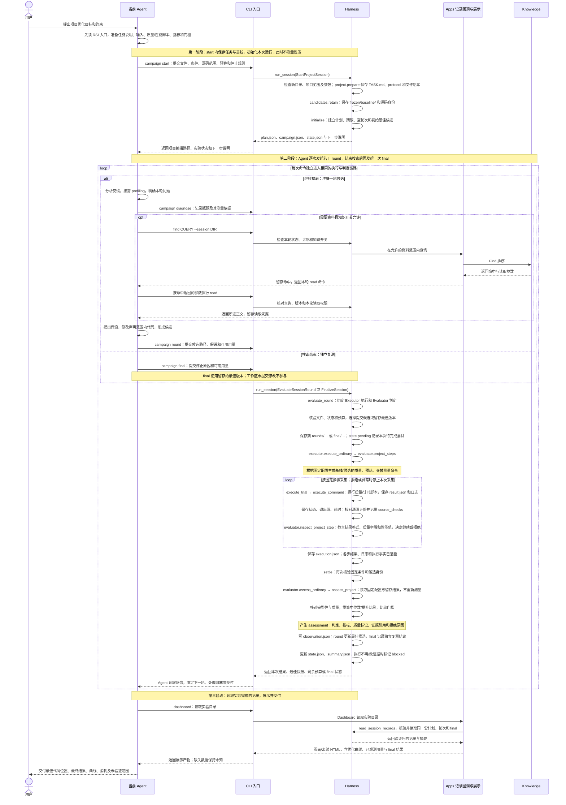
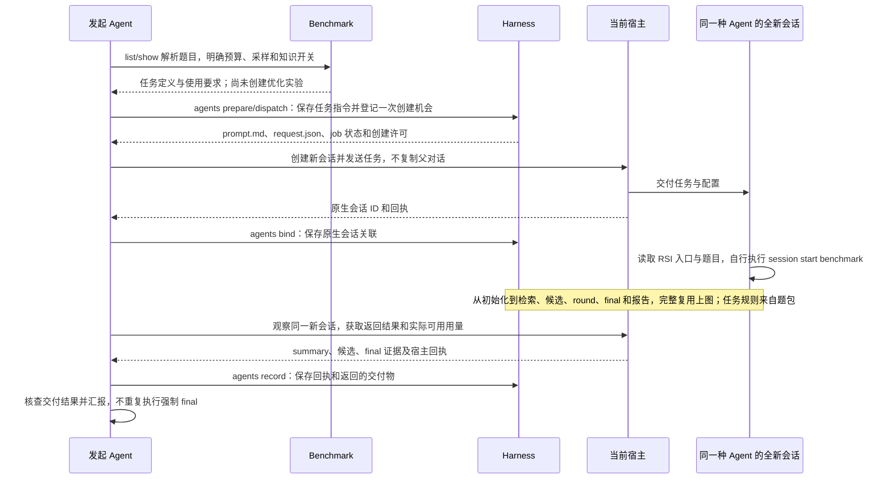

# 普通任务与 Benchmark 任务共用的 RSI 优化流程

CLI `final` 返回后自动生成 `delivery/<export-id>/report.md`、离线 `report.html`、
`campaign-result.json` 和 `artifacts.json`。先阅读 Markdown；HTML 链接标注
“Open in a browser”。执行结果与导出结果分别返回。中途快照或导出重试可使用
`inferrsi export --input <campaign-directory> --output <new-delivery-directory>`，
不会重新测量。字段、证据缺口和历史格式边界见 [结果交付契约](result-delivery.md)。

**Agent 理解需求并修改代码；Harness 固化明确提供的任务和验收协议，执行检查、判定留存结果，管理候选、轮次、预算和最终复测；Benchmark 提供题包及其专用规则；Knowledge 提供按需检索的资料。**

普通用户任务默认在当前 Agent 会话完成。题库 Benchmark 默认交给当前宿主中同一种 Agent 的全新会话；发起方只解析任务配置、派发并回收结果，新会话自行创建优化实验并执行到 final。用户明确要求当前会话时也可直接执行。新会话由 Agent 调用宿主工具创建，Benchmark 不自动启动 Agent。

本页描述已接通的局部实现，遵循 [已接受的架构决定](https://github.com/InferMatrixLab/InferRSI/issues/362#issuecomment-6722325612) 和 [模块设计](https://github.com/InferMatrixLab/InferRSI/issues/362#issuecomment-6708348735)。它没有完成整个仓库的模块迁移，也没有添加 Apps 包或 DSH/Agent CLI 启动器。

## Harness 固定什么，规则从哪里来

“固定”指保存明确的参数、脚本和输入身份，在后续受管操作中检测漂移。**它不表示从自然语言自动推导验收标准，也不表示隔离了所有外部环境。**

| 条件 | 由谁给出 | 本实现如何使用 |
| --- | --- | --- |
| 任务目标、可修改代码和基线 | 用户/Agent，或内置题包 | 保存 TASK.md、声明的输入文件与基线快照 |
| 工作负载、模型配置、质量含义 | 项目的验收脚本/输入，或题包协议 | 留存协议目录；外部模型、数据、依赖和硬件由调用方固定并核验 |
| 性能指标、方向和通过门槛 | 用户/Agent 明确准备，或题包声明 | 固定命令、JSON 字段、单位、方向、门槛与采样参数 |
| Agent、知识开关和实验预算 | 实验发起方 | 保存条件标签、知识开关、轮次/时间限制与 final 预留；宿主配置另留回执 |
| 候选是否可接受 | 固定检查的实际结果 | 正确性拒绝为 FAIL；缺少结果或无法解释的执行失败为 INCONCLUSIVE |

例如用户说“帮我优化 vLLM 推理吞吐，输出质量不能下降”，Agent 需要先把模型、精度、请求集、并发/请求速率、输入输出长度、计时口径和质量检查落实为可运行协议。可以复用项目已有脚本，并在需要时补适配。Harness 不会自行选择这些参数，也不能用任意输出相似度替代用户认可的质量要求。普通请求直接进入 Harness，无需经过 Benchmark。

题库场景由 Benchmark 提供这些任务资源与专用规则。以 Qwen 为例，输出误差、完整 case 覆盖与计时样本检查留在题包自己的脚本中；Harness 负责冻结和加载协议、执行脚本、留存判定并选优，不把 Qwen 专用逻辑搬进公共目录。

服务吞吐目标需要覆盖约定服务负载的测量与质量检查，单算子一致性或一个 forward 加速不足以说明该目标已达成。当前项目适配器只判定所给脚本及门槛；它不自动证明质量测试充分、环境可比或收益有统计显著性。

## 时序图

以下是普通项目默认 AB/BA 模式的完整流程。CLI 将参数转为会话请求，调用 `inferrsi.harness.manager.run_session`。Manager 负责初始化、预算和结算，Executor 执行，Evaluator 判定。CLI 注入 KnowledgeReader 和 `apps/workflows/campaign.py` 的知识捕获回调。`apps/views` 展示结果，`harness/records` 保存记录。

先准备任务条件，再调用 start。start 内复制任务、脚本和基线并写入计划/状态，不执行测量。Agent 逐次调用 round，最后调用 final 独立重测已保存的最佳版本。



### 题库新会话只增加派发与回收



通用 Agent job 与优化实验是两个独立记录：前者保存派发及宿主状态，后者由执行会话创建并管理。任务指令写明运行时/题目版本、入口、环境和预算；通用 `agents prepare` 保存 prompt，不自动校验题包版本，执行 Agent 必须在 start 前核对。宿主完成不代表任务通过，缺少 final 时仍须报告不完整。

Harness 没有常驻 Agent 驱动。Agent 逐次调用这些操作，代码在调用时检查固定条件、状态与预算。入口说明引导 Agent 使用这条链路，不能保证所有外部 shell 行为都进入记录。未提交修改不成为受管候选，未完成 final 的搜索不能算完成评测。

## 两个入口，共用一套控制器

| 场景 | 入口 | 候选与停止规则 |
| --- | --- | --- |
| 普通项目优化 | `session start project/diagnose/round/status/final/recover`，`find QUERY --session DIR` | 声明多个文件或目录；默认 `up_to` 轮次上限，final 必须说明结束原因；也支持 `exact` |
| 题库优化 | `session start benchmark/diagnose/round/status/final/recover`，`find QUERY --session DIR` | 题包定义候选和评测；当前 Qwen 是单个 Python 文件、固定轮数 |
| 题库默认新会话 | `agents prepare/dispatch/bind/record` + 宿主工具 | 先派发任务；新会话创建 campaign 并执行到 final，父会话回收结果 |
| 一次测量 | 原有 `run` 或 `benchmarks run` | 保留独立使用方式；不会自动生成多轮候选 |
| 旧式手动 campaign | 原有 `evidence init/record/decide` | 兼容已有记录；不允许写进新控制器管理的 campaign 形成第二套状态 |

两个优化入口和直接调用的 Python 程序都向 `inferrsi.harness.manager.run_session` 提交同一组请求。Manager 在会话锁内登记轮次、预算和待恢复操作。AB/BA 与题包按普通会话指纹验收，service_reuse 按冻结的包版本和服务清理凭据恢复。普通项目从准备到判定均可独立于 Benchmark 运行。

题库 `start` 由 CLI 经 `benchmark.registry` 定位资源目录，再交给 `harness.executor.prepare_task_protocol` 固化；后续从冻结目录加载题包自己的 `optimization.py`，无需再次查询注册表。专用协议检查仍属于题包。两类 `assess` 都只读留存结果，不重新测量。KnowledgeReader 与 `apps/workflows/campaign.py` 的记录回调由 CLI 注入，Harness 不直接导入 Benchmark 或目标 Knowledge 模块，也不经记录模块间接引入知识实现。

本次交付可以分成三块：**Benchmark 的优化题目、Harness 的优化管理与验收、Harness 与宿主协作的新会话派发和回收**。第三块不改变第二块的生命周期；新会话仍自行 start 到 final。

受管操作退出码 0 表示本次状态操作正常完成，包含正常记录一个 FAIL 候选；blocked 或参数错误返回 2。是否达成优化目标必须读取 assessment 的 verdict，不能把操作退出码当成验收结论。旧 `run` 的退出码约定保持不变。

当前完整题库迭代适配为 Qwen。MoE/TTS 仍是自己的单候选测量入口，尚未因此自动支持 `benchmarks session`。

## 普通项目怎么接入

普通项目默认使用下面的 AB/BA 流程。需要复用服务时，可显式选择
[service_reuse 模式](service-reuse-campaigns.md)，按该协议准备初始 baseline、
多场景指标、同服务质量与 profile 脚本，以及恢复和 final 所需条件。

无需先登记成题库任务。Agent 准备一个协议目录，包含测量、质量脚本以及要固定的输入/配置，再调用 `session start project --help` 按实际项目填写参数。

下面是命令结构；尖括号是需要落实的项目条件，不是可直接执行的默认值。命令以 argv 执行，不经 shell；Windows 命令参数中的路径建议用正斜杠。

启动前，按[任务确认流程](task-intake.md#campaign-hand-off)准备实际启动参数，复述任务书并等待用户确认。

```bash
inferrsi session start project --intake <approved-record.json> --directory <campaign-dir-outside-project> \
  --repo <editable-project> --include <source-dir> --include <config-file> \
  --protocol <acceptance-dir> --instructions <task.md> \
  --measure-command '"{python}" "{protocol}/measure.py" --project "{candidate}" --result "{result}"' \
  --quality-command '"{python}" "{protocol}/quality.py" --project "{candidate}" --reference "{baseline}" --result "{result}"' \
  --metric-key <json.field> --metric-unit <unit> --direction <maximize-or-minimize> \
  --quality-benchmark <dataset-version-and-split> --quality-key <json.boolean-field> \
  --scope <actual-validation-scope> \
  --min-improvement-pct <agreed-gate> --warmups <count> --repetitions <count> \
  --rounds <limit> --round-mode up_to --max-minutes <total-budget> \
  --evaluation-timeout-seconds <per-evaluation-budget> --knowledge on
```

`{candidate}` 在基线步骤指向留存基线，在候选步骤指向本轮快照；`{baseline}` 始终是基线。`{protocol}` 指向冻结协议，`{result}` 是本步骤输出文件。脚本需从这些路径读取项目和条件；已有 editable 安装、绝对导入或外部服务不会被自动改成候选版本。Agent 必须验证脚本确实测到指定版本。

项目适配器先检查基线和候选质量，再做 warmup 和交替顺序的基线/候选测量；每轮和 final 使用相同协议。每步骤启动新进程，因此跨进程 warmup 只能预热可持久缓存；设备/进程内 warmup 必须在测量脚本内完成并说明。性能取声明指标的中位数，当前没有通用服务生命周期管理器或统计显著性判定。

assessment 另附 `paired_statistics`：同一次重复内的第 k 个基线与第 k 个候选样本按顺序配对，计算逐对加速比的中位数及其 95% 精确次序统计量区间（即符号检验反演），并给出区间与冻结门槛的关系（`above_gate`、`straddles_gate`、`below_gate`；门槛没有有限加速比时为 `gate_unreachable`；对数不足时为 `insufficient_pairs`；样本或派生值无效为 `unavailable`）。`agrees_with_point_gate` 标出中位数点估计的判定与配对区间是否一致。默认只报告，不改变 verdict、eligible 或选优，记录 `report_only: true`，`statistical_significance` 仍为 `not_established`；只有 `--decision paired` 用它判定，此时记录 `report_only: false`。

区间取逐对加速比排序后的第 j 小与第 j 大，j 是使 P(Bin(n, 1/2) ≤ j−1) ≤ 2.5% 的最大秩，并记录 `order_statistic_rank` 和实际置信度 `achieved_confidence`。当各对独立、来自连续分布时，下界高于真实中位数的概率不超过 2.5%，与重复次数无关；因此真实中位加速比恰好等于门槛时（门槛为 0% 即 A/A），`above_gate` 的概率不超过 2.5%。5 对时最极端的一对也有 1/32 ≈ 3.1% 的单侧误差，所以至少需要 6 对才给区间。区间假设各次重复独立，不能消除同一对内共同的设备争用，也不构成环境资格。合成对照可用 `python tools/measurement_simulation.py` 复算，`--gate-pct 0` 给出门槛处的 A/A 比例与精确上界 `exact_one_sided_bound`。

结果协议：

- 测量脚本正常结束并写 JSON，提供指定字段的有限正数。
- 对于有评分的结果，质量脚本在顶层 `dataset` 字段自行报告数据集、版本和切分标识。Harness 将它与已批准的 `--quality-benchmark` 核对；缺少标识或标识不一致时，该评分结果为 `INCONCLUSIVE`。
- 质量脚本正常结束并写 JSON，提供指定字段的严格布尔值。`false` 拒绝候选；基线拒绝说明协议/基线前提不成立。
- 脚本可捕获已知候选错误，正常结束并写 `{"status":"candidate_failure","reason":"..."}`。候选失败保留为 FAIL 并消耗一轮，后续可修改。不要把设备故障捕获成候选错误。
- 非零退出、超时、缺少或无法解析的输出不猜测为正确性失败，而是 INCONCLUSIVE，阻止继续把缺失证据当成有效比较。

准备后，Agent 在当前会话循环：

```bash
inferrsi session diagnose --directory <campaign-dir> --bottleneck '<observed-bottleneck>' --evidence <measurement-summary.txt>
inferrsi find '<current-question>' --session <campaign-dir>
# 运行所选命中返回的 read 命令，取得正文和读取凭据。
inferrsi session round --directory <campaign-dir> --candidate <editable-project> --hypothesis '<what-and-why>'
inferrsi session status --directory <campaign-dir>
inferrsi session final --directory <campaign-dir> --reason '<why-search-ended>'
inferrsi dashboard --input <campaign-dir> --output <report.html>
```

普通项目和题库都用 `find` 查询。本轮先记录返回的命中，执行命中的 `read` 后记录实际返回的正文、版本和凭据；引用凭据的候选另行说明采用了什么。需要附件时再按资源路径读取。冻结为 `--knowledge off` 的对照组禁止轮内检索和读取。

Harness 将证据优先的顺序默认写入新会话计划，适用于知识开启和关闭。Agent 先用同条件的
profile 或测量确定瓶颈，提交包含 workload 和观测值的 UTF-8 摘要，再按需检索和
提交候选。Harness 保留摘要，并把检索和候选轮次关联到诊断记录。已有记录可以
继续使用，瓶颈变化时重新运行 `diagnose`。service-reuse 的 reference epoch 改变后
需要记录新诊断。已有会话按其冻结计划继续。

每次主动查询都有独立的请求 ID。相同交付再次返回时只登记一次。Manager 在会话锁内
核对诊断 ID 和条件轮次，同一条件下重新诊断也会使先前派发的回执失效。
普通会话保留捕获文件的摘要，service-reuse 保留标明已准备交付的记录。
Python 调用者从 `inferrsi.harness.analyzer` 导入 `diagnosis_draft`，从
`inferrsi.harness.indexer` 导入 `resolve_frozen_ranking`。此前后者位于
`inferrsi.harness.optimization`。[组件接口与会话时序](../../src/inferrsi/harness/README.md#managed-session-interfaces)

### 用 profile 解释改进（可选）

端到端时间会随时钟、温度和共享负载整体漂移，单凭数值很难区分真实改进与波动。测量脚本可以在结果 JSON 中额外输出同一步骤的分区域耗时和工作量计数，单位由脚本自定并在各步骤保持一致：

```json
{"metric": 8.1,
 "breakdown": {"attention": 4.0, "norm": 0.1, "other": 4.0},
 "counters": {"kernel_launches": 20, "dram_bytes": 8.0e8}}
```

每轮可以用 `--mechanism-file` 声明机制和可核对的预期特征：

```json
{"mechanism": "把 norm 融合进 attention 的 epilogue，少一次 HBM 往返",
 "expect": [{"region": "norm", "direction": "decrease"},
            {"region": "attention", "direction": "unchanged"},
            {"counter": "kernel_launches", "direction": "decrease"}]}
```

assessment 的 `profile_evidence` 按重复配对比较每个区域和计数，`raw` 保留原始比值。声明为 `unchanged` 的区域是本轮的假设，不是结论：其他区域另外给出除以同一步骤参照区域总和后的 `normalized` 比较，`share_based_speedup` 用参照区域在步骤总时间中的占比推算整体加速。只有当某种变化让同一步骤的所有区域按同一比例缩放时，它才会被抵消；若各区域受影响程度不同（例如降频对计算受限和访存受限的区域影响不同），抵消就不成立。参照区域本身始终只做原始比较，不会互相归一化，因此整体漂移较大时它可能显示为变化，使解释判为矛盾。若某区域的 `raw` 与 `normalized` 给出明确相反的方向（例如原始耗时增加、相对参照却下降），记为 `raw_normalized_conflict`：绝对变化和相对变化互相矛盾，而机制声明无法表达"只预期相对变化"，所以两个方向都不采信，该条核对为 `unverifiable`。原始无明显变化、归一化后检出变化不算冲突，这正是归一化要抵消的整体漂移。计数一类的工作量指标基本不随时钟和温度变化，可以说明波动范围内的小幅改进是否可重复。方向只由配对区间判断（区间整体低于或高于 1），仓库内没有设置数值容差；基线为 0 的计数没有比值，记为 `undefined`。区间包含 1 记为 `no_clear_change`，它只表示没有检出变化，不是"没有变化"的证据。声明了 k 条预期时，所有区域和计数的区间按 Bonferroni 校正使用 1 − 5%/k 的置信度（记录 `family_size`、`confidence`、`pairs_needed`），使任一条核对因噪声误判的概率合计不超过 5%。所需对数随 k 增加：k = 1 为 6 对，k = 2–3 为 7 对，k = 4–6 为 8 对，k = 7–12 为 9 对；对数不足时记为 `insufficient_pairs`。`profile_evidence` 只描述数据，不判断机制文字本身。

每条核对记录 `outcome`：预期变化的项为 `confirmed`（方向一致）、`not_shown`（未检出变化）或 `contradicted`（方向相反）；声明 `unchanged` 的项只能是 `not_contradicted`（未检出变化）或 `contradicted`（检出变化），永远不会被"确认不变"。`explanation.status` 取值：`explained`（每条预期变化都 `confirmed`，且没有任何一条 `contradicted`）、`unsupported`（有预期变化 `not_shown`）、`contradicted`（任一条 `contradicted`）、`unverifiable`（缺少对应区域或计数、比值无定义、原始与归一化方向冲突、对数不足以支撑校正后的置信度，或证据的 `family_size` 小于声明条数）、`not_declared`（本轮未声明）。机制声明在执行前绑定：判定使用执行前保存的声明，并核对其摘要与 attempt 目录中的 `mechanism.json`；副本被改动时按完整性错误阻断 campaign。执行后被中断、经 `recover` 结算的轮次无法证明执行前绑定的是哪份声明，因此按未声明处理（记录 `mechanism_unverified_after_recovery`），在 `--require-explanation` 下不会被采纳。final 沿用被选中轮次绑定的机制重新核对。

两个开关在 `session start project` 时冻结，默认都不改变原有判定：

- `--require-explanation`：只有 `explained` 的候选可以被采纳。与配对性能判定同一原则区分证据：只有 `contradicted`（数据与预期相反）记为 FAIL；`unsupported`（预期变化未检出，区间仍可能包含预期的变化）、`unverifiable`、`not_declared` 都是证据不足，记为 INCONCLUSIVE，`reason` 为 `explanation_<status>`。两类候选都不被采纳，也都不阻塞后续轮次。打开此开关时，`session start project` 要求至少 6 次重复（否则任何预期都拿不到区间，没有候选能被采纳）；`session round --mechanism-file` 在执行前拒绝所需对数超过冻结重复次数的声明（例如 4 条预期需要 8 对），不会因此消耗一轮预算。不打开此开关时，机制声明只做报告，不受这两条限制。
- `--decision paired`：用 `paired_statistics` 判定，要求至少 6 次重复。区间整体高于门槛为 PASS（`paired_interval_above_gate`）；区间整体低于门槛为 FAIL（`performance_gate_not_met`），即有证据表明门槛没达到；区间跨过门槛为 INCONCLUSIVE，`reason` 为 `within_noise`——这只说明没能证明过门槛，不是门槛未达到的证据，所以不记 FAIL；候选不被采纳，搜索继续；统计不可用时为 INCONCLUSIVE，不退回未配对的中位数规则。默认 `point` 保持中位数点估计规则。`paired` 只看区间，不再看点估计：点估计未过门槛、但配对区间整体高于门槛时判 PASS；反过来点估计过门槛、区间跨过门槛时判 INCONCLUSIVE（`within_noise`）。两者不一致时 `paired_statistics.agrees_with_point_gate` 为 `false`，供评审查看。

`paired` 同时决定选优，判定和采纳用同一份证据。启动时冻结的 `selection` 为 `{"metric": "paired_median_speedup", "direction": "maximize", "initial_score": 1.0}`：每轮的 `score` 和 `speedup` 是本轮相对冻结基线的逐对加速比中位数，基线记为 1.0，`improvement_pct` 由该加速比换算（极端比值换算后不是有限值时为空）。判 PASS 且该加速比高于当前最佳的候选才被采纳，独立中位数不能否决配对 PASS；中位数点估计保留在 `point_estimate`（`improvement_pct`、`speedup`），原始中位数仍在 `metrics`。每轮都与冻结基线交替重测，所以不同轮次的配对加速比都相对同一基线、可以直接比较。统计不可用时该轮为 INCONCLUSIVE、不会被采纳，`score`、`speedup`、`improvement_pct` 与 `score_basis` 均为空，不用点估计顶替配对值，搜索继续；独立 final 遇到这种情况时 `optimization_speedup` 也为空。默认 `point` 的选优不变，仍比较候选中位数（`score_basis: candidate_median`）。

每个轮次记录都带 `selection`：`outcome` 为 `adopted`、`not_eligible`（verdict 不是 PASS 或未完成）、`not_better_than_best`（按冻结的选择指标没有超过当前最佳）或 `baseline_identity`（提交的就是基线），并附上本轮 `score` 与比较时的 `best_score_before`，说明一个 PASS 轮次为什么没有被选中。

两个开关同时打开时按固定顺序判定：先由 `--decision` 得到性能结论，`--require-explanation` 只作用于性能结论为 PASS 的轮次，把它降为 FAIL 或 INCONCLUSIVE，不会提升或改写非 PASS 的结论。因此性能结论已是 FAIL 或 INCONCLUSIVE（包括 `within_noise`）时，无论 `explanation.status` 是什么，最终 verdict 和 `reason` 都保持性能结论；`explanation` 仍完整写入报告。

两个开关和 `--mechanism-file` 只适用于默认的 AB/BA 评估：`--evaluation-mode service_reuse` 不产生这些开关读取的 AB/BA 逐对样本和逐次测量的 `breakdown`/`counters`（它可选的 profiling 阶段，包括 `session profile` 补采，产生的是 profiler 回执和产物，不是这些开关的输入），因此该模式下 `session start project` 拒绝这两个开关，`session round` 拒绝 `--mechanism-file`，不会悄悄忽略。

提交未修改的候选可以作为 A/A 对照，`paired_statistics` 的区间即给出该环境的噪声范围；`--require-explanation` 下的 A/A 轮次在声明的变化项上应为 `not_shown`。

## 实际保留什么、保护什么

`campaign.json` 关联计划，`plan.json` 固定协议、预算和候选格式，`state.json` 是唯一可写控制状态。`summary.json` 是可重建摘要，dashboard 从同一记录生成展示；不额外写一份 `rounds.jsonl`。原有知识交付和优化日志格式继续复用。

每轮保存声明的多文件候选、假设、执行记录、检查输出和判定。新增文件、内容变化与符号链接会接受范围检查；目录候选同时绑定文件权限。冻结协议的文件集合变化会被拒绝。未声明的模型权重、系统依赖与外部服务不因此被打包或验证。哈希是漂移检查，不是可信执行沙箱。

只有满足质量和性能门槛的候选参与选优；方向可为延迟最小或吞吐最大。没有有效改善则保留基线。final 从留存最佳快照执行，不使用工作目录中未提交修改。总预算预留 final 时间，默认等于一次评测上限；新会话搜索使用扣除预留后的预算。固定轮数未完成不能提前宣称结束；`up_to` 至少一轮后才能带原因结束搜索。

失败轮保留，基础设施失败标记 blocked。普通项目在独立执行副本中运行，日志和缓存不写入冻结基线或留存候选；已声明源码的修改仍会被拒绝。执行后发现冻结内容漂移时，留存拒绝原因，`status` 可以读取阻断原因，但不返回可用成绩。

执行副本只包含 `--include` 声明的文件或目录，不是整个原项目工作区。脚本通过相对 cwd 路径读取的配置、数据或辅助源码也必须纳入声明范围；未声明文件不会自动从原目录补入。外部模型和服务仍需由调用方明确提供和验证。

执行器抛出异常时，若已有完成记录则收集该记录，不重复启动；没有记录则标记 blocked，清理状态保持未知，不自动重试。进程被中断后的 `recover` 只接收已有结果，不重新启动命令；没有完成记录时，需确认原进程及资源清理。运行中的旧 session 应继续使用其冻结 runtime，不能直接换新代码恢复。

### Release-boundary recovery

Apps workflows 目录迁移会改变运行时摘要的路径和控制器源码。迁移前的
`plan.json` 即使只是执行 `status` 或 `recover`，在新版本下也会被拒绝。
保留原始计划、冻结输入和所有已留存结果，不要替换摘要、重新格式化计划或
把旧运行当作新运行初始化。评测工具的冻结 controller 快照也遵循相同原则。

恢复时，从运行准备记录取得创建该计划时的精确软件版本和 Python 环境。
`runtime_identity` 是校验表，不是可安装的软件包；单靠摘要不能重建原始环境。
优先使用先前留存的虚拟环境或 wheel。若只有精确源码版本，应在独立目录恢复
该版本及原依赖，构建 wheel 并安装到独立环境；不要覆盖新版本环境。

```text
<pre-move-python> -I -m inferrsi benchmarks session status --session <session-directory>
<pre-move-python> -I -m inferrsi benchmarks session recover --session <session-directory>
```

普通项目对应 `session status/recover --directory <campaign-directory>`。
原环境的所有文件摘要与计划匹配后，Harness 才会接收已有 execution 记录；
恢复不会再次执行已完成的候选。无法取得匹配的原始环境时保持拒绝，保留证据。
需要在新版本继续实验，应另开新运行，明确新的版本和冻结输入。

跨版本回归使用两个独立安装环境：迁移前 runtime 创建计划并在执行完成后
中断；新 runtime 的 status/recover 必须拒绝且不改动计划和结果；原 runtime
恢复同一运行并验证候选只执行一次。设置 `INFERRSI_PRE_MOVE_PYTHON` 指向
固定旧 wheel 的解释器，`INFERRSI_POST_MOVE_PYTHON` 指向新 wheel 的解释器后运行：

```text
python -m pytest tests/apps/test_optimization_session.py::test_pinned_pre_move_wheel_recovers_its_original_plan
```

未提供旧 runtime 时该安装集成用例明确跳过；默认回归仍检查旧路径的摘要表
被拒绝、计划字节不变，以及新计划摘要读取 `apps/workflows/campaign.py` 的实际源码。

判定器异常按基础设施失败结算，`assessment.reason` 保留异常类型和消息，避免普通编程错误被隐藏成无类型的失败描述。执行器异常的原始类型和消息保存在该次尝试的 `coordinator-error.json` 中。此处捕获异常用于保留失败状态，不代表候选通过；进程中断仍沿用上述恢复流程。

每轮 token 只接受实际增量导出，未知不补零。整会话用量另存，不重复叠加到曲线。终止后的总耗时固定，之后打开 dashboard 不增加。HTML 只投影已清洗字段；原始本地记录可能含命令、路径等私有信息，公开前需要检查。

## 验证范围与后续

软件集成测试通过真实子进程验证多文件候选、最大/最小指标、质量拒绝后继续、固定协议漂移拒绝、提前结束、final 预留、恢复、知识关闭和 dashboard 同源读取。合成数字只用于测试状态与选择规则，不能作为性能收益。

边界回归在全新 Python 进程内禁止导入 Benchmark，验证普通项目 start、knowledge、round、recover、final、status 和 dashboard；题库回归在 start 后禁用注册表访问，验证后续 round/final 仍使用已冻结的协议。

内置 Qwen 与项目入口回归共同检查同一控制器。新会话仍走宿主交接契约，宿主完成不等于任务验收。当前改动的测试不代表新增 NPU 性能结果，不代表 vLLM 质量协议已写好，也不代表 RSI 对任何用户任务均有收益。

后续可扩展 MoE/TTS 迭代协议、更多项目适配和宿主驱动；不为每种任务复制 Harness 的循环管理。
