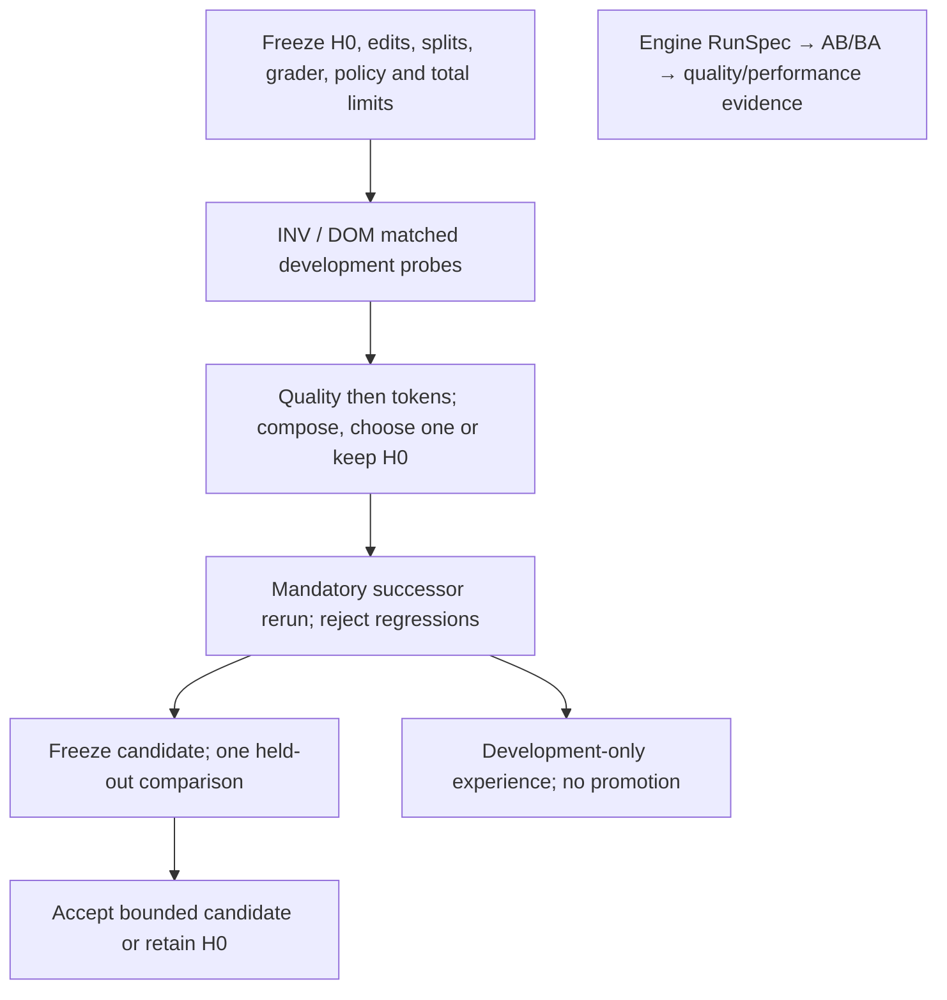

# Bounded harness improvement (offline MVP)

The [issue #93 proposal](https://github.com/InferMatrixLab/InferRSI/issues/93)
now has a single-step controller for trusted fixed-output performance-audit
experiments. It reuses the configurable Skill Eval comparison, trial executor,
independent grader and retained-evidence checks. It does not call a proposal
model, launch a real model, install runtime hooks or promote skills.

## Harness² and HarnessPro: what is combined

| Design | Source contribution | This implementation |
| --- | --- | --- |
| [Harness²](https://github.com/google-research/harness2/tree/1cfe254e8d25b15f37048c3730134686abe60335) | Task-local INV/DOM proposals, matched probes, composition and successor execution; experience for later tasks | At most one supplied general and one domain edit, matched development probes, conflict-aware composition and mandatory rerun |
| [HarnessPro](https://github.com/pzs19/HarnessPro/tree/8ae622eb4a4923dbb4b515be7ded614f88fd4f38) | Trace-driven diagnosis and quality/cost selection among reusable harnesses | Caller-declared quality floor and regression limit; quality first, then known input + output tokens; full search and execution accounting |

Harness² adapts during a task; HarnessPro searches for reusable operating points
offline. This MVP deliberately uses independent development grades for selection
(*verifier-guided search*), rather than reproducing either paper's label-free
feedback. It selects by a fixed lexicographic quality/token rule, which chooses
a Pareto member, without implementing population search or weighted profiles.
Higher quality may justify higher execution cost; at equal quality the candidate
must consume fewer known tokens. Ties retain H0. Cost here is a token proxy,
not dollars; cached input is a subset of input and is never added twice.

The last three proposal comments are the implementation requirements:
[comparison](https://github.com/InferMatrixLab/InferRSI/issues/93#issuecomment-6364484589),
[updated English plan](https://github.com/InferMatrixLab/InferRSI/issues/93#issuecomment-6364589831),
and [updated Chinese plan](https://github.com/InferMatrixLab/InferRSI/issues/93#issuecomment-6364595822).
Their historical statement that [PR #118](https://github.com/InferMatrixLab/InferRSI/pull/118)
was a draft is superseded: its [PR evaluation integration](skill-eval-pr.md) is
on main. That integration and this offline controller both reuse Skill Eval.
Neither paper's benchmark numbers establish an InferRSI improvement.

## Implemented flow



`src/inferrsi/harness/improvement.py` owns selection and usage accounting.
`tools/skill_eval_improve.py` owns freezing, declarative snapshot materialization
and orchestration through `tools/skill_eval_compare.py`. There is no second
subprocess runner. The engine lane and its acceptance contract remain separate.

1. **Freeze before probing.** `prepare(config, repo, output)` validates disjoint
   nonempty development/holdout IDs and split labels, common model/settings,
   default audit support, selection thresholds and the full scheduled call
   allowance. It freezes controller/grader hashes and all candidate inputs.
   Review task content for semantic overlap: distinct IDs alone do not establish
   independent held-out tasks.
2. **Materialize supplied edits.** `proposals` contains at most `inv` and `dom`
   maps of path to replacement text. `allowed_paths` may name only existing
   UTF-8 `.md`/`.txt` resources in the selected baseline bundle. Metadata,
   executable entries, symlinks, new files and out-of-bundle paths are rejected.
   Skill front matter remains fixed. Git object plumbing uses a temporary index;
   source branches, checkouts and the caller's index are unchanged. Candidate
   commits preserve the real H0 parent and original bytes outside the edits.
3. **Probe and select.** Each candidate is paired with H0 under balanced AB/BA
   ordering. Missing/inconclusive evidence, unknown token usage or inconsistent
   baseline grades retain H0. Candidates must pass the declared quality floor,
   meet or exceed H0 successes and obey the regression limit before token
   comparisons. Compatible eligible edits compose; conflicting whole-file edits
   select one candidate instead of silently merging. No partial-file synthesis.
4. **Rerun.** The selected successor, including H0, runs again in fresh trial
   workspaces. Composition must independently qualify here. A failed rerun
   retains H0 without trying another candidate. Rerun grades must preserve H0's
   development outcomes and cannot rank below an eligible probe under the frozen
   quality/token rule; a worse composition is rejected even if it beats H0.
   If budget/execution stops prevent
   rerunning, the report records the missing stage and retains H0.
5. **Freeze and gate once.** Write `final.json` and development-only
   `experience.json` before evaluating holdout. Holdout may only accept/reject
   the frozen candidate. Rejection retains H0; it never chooses the next edit.
   At equal held-out quality, token cost may tie H0 but may not increase; higher
   quality can justify higher cost under the same declared quality-first rule.
   An exclusive results directory consumes attempts, including interrupted ones;
   no retry or resume exists in this controller. A new directory is not proof
   of a new holdout: the operator must enforce campaign-wide non-reuse.

Every stage rechecks its authorized plan digest and reads grades through the existing
receipt/output/trace verification. Earlier probe evidence is re-read before
selection and all evidence is checked again before reporting acceptance.
An invalid local artifact cannot remain a passing candidate. These hashes are
local integrity checks, not signatures against coordinated rewriting.

## Budget and report interpretation

The total call allowance includes both arms of every probe, the successor rerun
and the held-out comparison. The same absolute deadline and remaining observed
token threshold carry across stages, including comparison preparation time.
Unknown token usage stops subsequent stages. The token threshold stops **new**
trials; one running trial can cross it. It is not a provider token or monetary
cap. Unusable evidence or exhausted limits retain H0.

The controller keeps a matched H0 in each comparison. With two proposals this
means three development comparisons and one held-out comparison, not the four
executor rollouts of the paper's single-task method. This conservative reuse of
the existing two-arm evaluator costs additional H0 executions; the report counts
them all. It does not infer that a composition works from its component probes.

`report.json` distinguishes:

- `usage.search`: both arms of probes and the mandatory development rerun.
- `usage.total`: all executed trials, including both held-out arms.
- `usage.selected_holdout`: held-out execution of the accepted candidate, or
  H0's matched held-out arm on rejection; unavailable if holdout never ran.
- Input/output/cached tokens, recorded command tool calls and executor elapsed
  seconds. Command counts cover the existing trace's `command_execution` items,
  not every possible tool type. `wall_seconds` covers the orchestration run;
  initial proposal materialization/preparation occurs before it.
- Zero proposal/composition **model** calls: edits are supplied data and
  composition is deterministic. Human authoring effort is not measured.
  Monetary cost remains unknown, rather than fabricated as zero.
- Verifier failures in pair grades, separate from runner/input/evidence errors.

The saved `development` record describes the attempted successor even if the
held-out gate later rejects it. `holdout.successes` scores the frozen candidate;
`selected` records the ultimate decision. A rejected candidate's score must not
be presented as the fallback H0 score.

## Reproduce the offline experiment

Requires Python 3.10+, dev dependencies and Git 2.45+ as in
[configured comparisons](skill-eval-comparison.md). From a development checkout:

```bash
python -m tests.fixtures.harness_improvement_demo --output <new-offline-output>
python -m pytest tests/test_harness_improvement.py tests/test_skill_eval_compare.py \
  tests/test_skill_eval_pipeline.py tests/test_skill_eval_verifier.py tests/test_skill_evaluation.py
```

The demo runs a successful composition, a cheaper degraded candidate, composition
regression and held-out regression, plus single H0 and equal-allowance repeated
H0 controls. It writes `summary.json`, full comparison reports, frozen inputs,
raw traces, independent grading outputs and receipts. Review raw bundles before
sharing; subprocess records contain local paths.
The [recorded example summary](examples/harness-improvement/summary.json) contains
only the scripted controller outcomes and locally observed CPU wall times; full
trial evidence is generated by the command above, not embedded in that excerpt.

Answers and token/tool observations are **scripted inputs** selected from the
actual candidate resource bytes. The unchanged audit verifier grades them in
real CPU subprocesses. This demonstrates controller behavior, not learned skill
efficacy, token savings from a model, transfer to new tasks, or engine speedup.
The repeated-H0 arm has the same total call/token/time *allowance* as the loop;
actual consumption can differ and is reported. Fixed repeat order cannot measure
model sampling variation. Actual CPU wall time includes subprocess overhead and
must not be interpreted as agent/model latency.

For embedding, the Python API is `prepare(...)`, then
`run_offline(repo, output, digest, client_factory=...)`. The factory is trusted
test code and receives only stage/candidate labels. `None` and `CodexClient`
are rejected. There is no generic real-execution CLI. A custom Python factory
can execute arbitrary code and is not confined by this API; only trusted offline
fixtures are supported.

## Remaining proposal scope

Real-model diagnosis/proposal, external process/filesystem/network isolation,
hard provider spending limits, synthesized diagnostic tests, multi-round search,
Store/CAS admission and library-on/off transfer evaluation remain future slices.
`experience.json` is a development record, not Store integration or a reusable
validated skill. The next task starts from an explicitly chosen H0. No canonical
catalog, knowledge store, model settings, engine RunSpec or permission policy is
automatically updated. Issue #93 acceptance remains separate from software tests.
