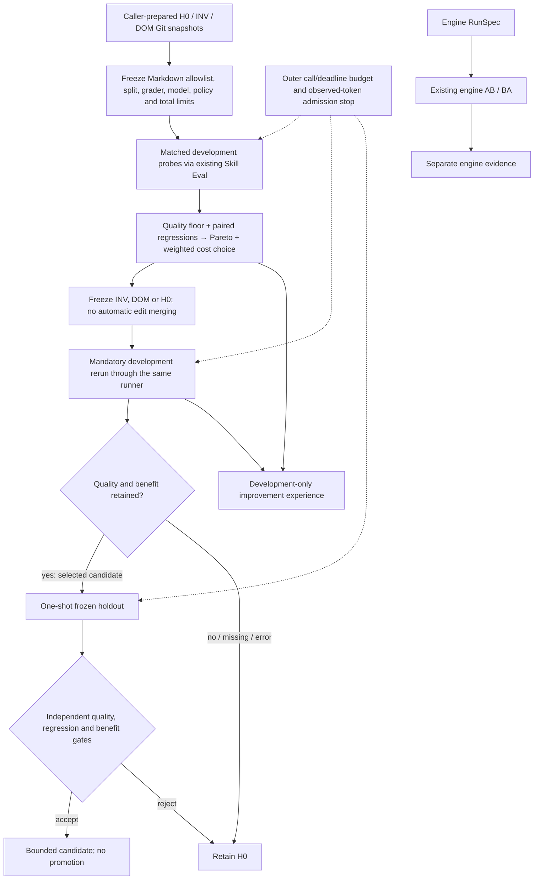

# Bounded harness improvement (offline first slice)

The policy from [issue #93](https://github.com/InferMatrixLab/InferRSI/issues/93)
now has an offline controller above the existing Skill Eval comparison tool.
It evaluates caller-prepared INV/DOM Markdown edits, chooses one whole candidate
or H0, reruns that choice, then applies a single held-out acceptance gate.
This is **verifier-guided search**, a deliberate adaptation of Harness².
It is not autonomous proposal generation or a demonstrated model improvement.

## What the two approaches contribute

| Source | Mechanism used here | Outside this slice |
| --- | --- | --- |
| [Harness² v1](https://arxiv.org/html/2610.14224v1) | A task-local reference, general INV and domain DOM alternatives, matched probes, successor execution and separate improvement experience | Model-generated edits, arbitrary composition, recursive rounds and cross-task library reuse |
| [HarnessPro v2](https://arxiv.org/html/2610.26770v2) | Quality and regression gates before Pareto filtering; normalized weighted squared-distance selection; execution cost separate from search overhead | Generated tests, executable hooks, offline population search and Lite/Medium/Heavy deployment families |

Neither paper's reported gains establish InferRSI gains. The existing independent
audit grader remains authoritative. The default task is performance-report
auditing, not general code optimization. PR integration is already delivered
by [#118](https://github.com/InferMatrixLab/InferRSI/pull/118); the older issue
comments' draft-only description is historical.

## Implemented architecture



No holdout feedback reaches selection or the experience artifact. H0 is an
explicit option in the Pareto set: its reference uses the pooled, equally sized
H0 probe executions, while each candidate still must pass its own paired H0
quality/regression checks. The weights and absolute minimum success rate come
from the frozen config. Missing/inconclusive evidence or unknown input/output
usage keeps H0. Flat normalized dimensions contribute zero; ties prefer H0,
then the candidate ID. A same-quality successor must remain cheaper on both the
development rerun and holdout. A quality gain may trade off against more tokens
according to the predeclared selection policy; no monetary price is inferred.

Composition in this slice selects INV, DOM or H0 as a complete snapshot. It
does not union two edits, so conflicting edits cannot silently be combined.
Source snapshots are materialized through the existing Git/KnowledgeReader
adapter; no second runner or Store-to-execution shortcut is introduced.

## Interfaces and reproduction

Requires development dependencies and Git 2.45 or newer, as does
[configured comparison](skill-eval-comparison.md).

```bash
python -m tests.fixtures.skill_eval_improvement_demo --output <new-output-dir>
python -m tools.skill_eval_improve report --output <new-output-dir>/bounded/run
pytest tests/test_skill_improvement.py
```

The demo creates a tiny temporary Git skill library, freezes separate development
and holdout cases, and runs real local subprocesses producing **scripted** answers,
usage and command events. It compares H0, repeated H0 with the same call budget,
and the bounded step. It retains per-trial outputs, grader assertions, traces,
receipts, per-phase totals and a machine-readable summary. Scripted token
differences test accounting and selection; they are not measured model savings.
Wall time measures this local fixture pipeline only. Preparation is reported
separately from execution. No GPU, model API or paid request is involved.
See the [recorded offline example](examples/harness-improvement/README.md), with
the actual aggregate JSON and its explicitly scripted metrics.

For other reviewed offline fixtures, prepare with:

```bash
python -m tools.skill_eval_improve prepare --repo <repo> \
  --config <config.json> --output <new-output-dir>
```

The config contains `skill`, `skill_root`, `cases`, `snapshots.H0/INV/DOM`,
`model`, and per-comparison `limits` using the existing comparison formats,
plus:

| Field | Contract |
| --- | --- |
| `allowlist` | Exact bundle-relative existing `.md` resources permitted to change; no additions/deletions or entrypoint changes |
| `policy.min_success_rate` | Absolute acceptance floor in addition to paired H0 quality |
| `policy.max_regressions` | Maximum allowed paired PASS→FAIL outcomes |
| `policy.quality_weight`, `policy.token_weight` | Finite nonnegative predeclared weights; at least one positive |
| `budget.max_task_calls` | Shared call ceiling across both probes, rerun and holdout |
| `budget.campaign_seconds` | Shared execution deadline; candidate processes use the existing executor/cleanup |
| `budget.token_stop_new_trials` | Shared observed-token threshold; unknown usage also stops admission |

`execute_offline(output, exact_plan_sha256, client=trusted_fixture)` has no default
client and rejects `CodexClient`. It is a Python interface for trusted offline
test adapters, not a sandbox for arbitrary Python clients. An exclusive start
marker prevents rerunning that output, including after a crash. Recover by
inspecting retained artifacts; never reuse exposed holdout tasks for tuning.
The marker does not police separate campaigns copied to other directories.

Preparation freezes all possible probe/rerun/holdout comparison plans. Only the
selected branch executes. Report regeneration rechecks frozen inputs, controller
hashes, selection receipts and the original comparison evidence. Modified
evidence cannot preserve a cached acceptance result. Hashes/receipts detect
consistency failures; they are not signatures or a malicious-process sandbox.

## Costs and evidence boundaries

Skill Eval summaries now expose input, output, cached-input and total tokens,
command execution counts and wall time. Cached-input tokens are a subset of
input and are not added twice. Missing or malformed usage stays unknown;
missing trial timing cannot become a partial total. `command_calls` counts the
trace's completed command-execution items, not every possible provider tool.
The outer token threshold cannot cap an in-flight request or provider bill.

The report separates each probe, rerun, holdout, selected-harness execution and
the total observed execution. Proposal authoring cost and monetary cost are
unknown; supplied proposals must not be described as free. The selected
execution figure is a subset of total execution, not an additional charge.
Failed and stopped attempts remain in totals. The independent verifier's FAIL
and runner/evaluation INCONCLUSIVE remain distinct, with retained error causes.

`development-experience.json` is improver-facing and contains only development
selection/rerun evidence and applicability limitations. It is not executor
skill content and does not write to the knowledge Store. Reviewed Store/CAS
admission and library-on/off transfer experiments are later P2 work.

Real-model automatic editing requires external filesystem/process confinement,
an explicitly authorized model/budget plan and fresh task validation. Fresh
directories and hashes do not provide that isolation. Efficacy and total-cost
benefits remain **INCONCLUSIVE** until those trials exist. Engine TTFT, TPOT,
GPU cost and service latency still require their separate RunSpec/AB-BA evidence.

## README diagrams

The existing animated How It Works diagram describes the engine experiment and
reviewed-knowledge loop, which this change does not alter. Keep that asset and
add an explicitly offline skill-policy path beside it. Architecture now names
the optional policy above Skill Eval and keeps the engine lane separate; the
broader system and module SVGs remain valid at their existing abstraction level.
