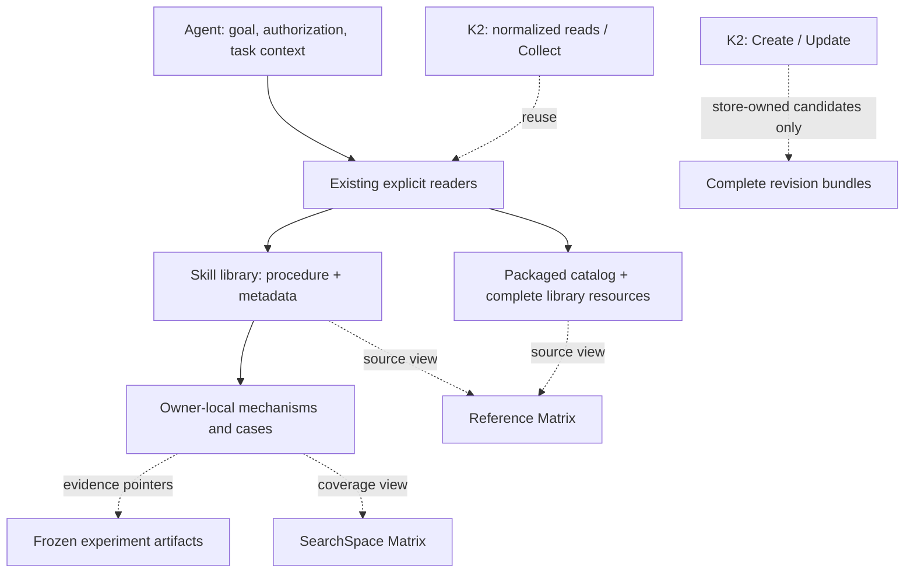

# Knowledge base contract

This implements the K0/K1 content foundation of [RFC #17](https://github.com/InferMatrixLab/InferRSI/issues/17).
The coding agent owns planning and conversation and acts within explicit scope
and delegated authority. Reading material never executes a helper or grants
permission to change a target system.

The three objectives remain **Roofline / optimization headroom**, **repository-evolution
knowledge**, and the **two-matrix Skill System**. Magpie collaboration rollout is
separate work, not an implemented capability of this knowledge base.

## Directory and responsibility map

```text
src/inferrsi/data/skill_library/
  README.md                         Library navigation
  skill-index.json                   Stable IDs → categorized paths/backend (48 skills)
  hardware/{ascend,cuda,host}/<id>/   Hardware/platform-specific complete skills
  frameworks/<framework>/<id>/      Framework-owned complete skills
  repositories/<repo>/              Engine entry, sub-skills and focused complete skills
  methods/<id>/                     General optimization/analysis complete skills
  workflows/<id>/                   Cross-repository research, evidence and skill lifecycle
  <owner>/translations/zh-CN/        Complete Chinese engine/workflow edition
  <owner>/references/               Owner-local supporting documents and source inventory
  <category>/<id>/SKILL.md           Name, description, substantive procedure
  <category>/<id>/metadata.json      Provenance, state and relationships
  <category>/<id>/references/        Owner's mechanisms, readsets and comparisons
  <category>/<id>/cases/             Owner's scoped cases (optional)
src/inferrsi/catalog.py              Installed knowledge reader
src/inferrsi/skill_catalog.py        Packaged or custom-root skill reader
src/inferrsi/data/repo_packs/        Contribution records and existing public IDs
src/inferrsi/data/repo_packs/inferrsi/ Generated records linking full packaged skills
src/inferrsi/data/knowledge_packs/   Dependency and peer records
evidence/<campaign-id>/             Frozen plans, results, patches and validators
docs/reference-matrix.md            Sources, inspected scope and extraction
docs/searchspace-matrix.md          Resource × optimization-stage coverage
```



Solid edges describe the K0/K1 foundation; dashed boxes are the K2
[normalized reads / Collect](knowledge-operations.md) and
[authorized local Create / Update](knowledge-store.md) operations, which reuse
those readers. No mandatory ContextPack, conversation manager, crawler or universal
performance loop is introduced. A generated catalog is a projection, not a third
metadata authority or maintained matrix.

## Field ownership and compatibility

| Item | Authority | Compatibility rule |
|---|---|---|
| New local-skill profile | `SKILL.md`: name, description and procedure; `metadata.json`: `profile: local-skill-v1`, kind, origin, state, provenance, applicability and relationships | Name stays the existing directory ID; listing combines metadata without reading procedure/resource bodies |
| Legacy local frontmatter | Existing frontmatter when no new profile is declared | Five inherited skills stay unchanged; no invented candidate state |
| Legacy sidecars | Existing keys retained unless explicitly normalized | Conflicting duplicate fields fail visibly; matching historical fields can be read |
| Catalog JSON | Existing record owns ID, tier, scope, recommendations, attribution and limitations | Do not migrate it into local sidecars or relabel imported records |
| Bilingual procedures/resources | Existing imported library and source manifest | Preserve both languages, licenses, source relationships and installed access; translations are distributed views, not independent authorities |
| Case | One owner-local case document plus structured identity/source record | Raw evidence stays frozen; case interpretation may evolve without rewriting results |

The 43 branch-added candidate headers were normalized without replacing their
procedures. All structured frontmatter fields, including tags, synchronization
lineage, unknown license and source-pack notes, are retained in sidecars. Existing
sidecar name/status duplication agreed with the frontmatter; normalization found
no contradictory values. Abbreviated historical repository pins remain explicitly
prefixes, not invented full SHAs. Legacy untyped source inventories remain marked
incomplete, with their substantive procedure/readsets retained for inspection.

`status`, permission to use and empirical validation are independent. A candidate
is not promoted by import, translation, a passing reader test or matrix placement.
External/internal origin and Skill/Knowledge/Case kind are attributes; contribution,
dependency and peer remain independent repository relationships.

## Sources and revisions

| Type | Identity and scope | Not interchangeable with |
|---|---|---|
| Git | URL, commit (or explicitly partial historical prefix), paths/readset | Paper version or tested runtime stack |
| Paper | Paper ID, version, sections and readset | Fabricated Git commit |
| Document | Version or immutable snapshot/hash, inspected sections; unknown fields explicit | A live URL presented as a frozen version |
| Internal | Issue/run, artifact identity, integrity reference and observation scope | Automatically validated reusable guidance |
| Local content revision | Required instruction/content bytes, resource bytes and dependency revisions | Upstream source revision or measured engine revision |

The legacy readers retain their command contracts. [Normalized reads](knowledge-operations.md)
identify complete declared dependency bundles and reject unavailable old snapshot
revisions. The [authorized store](knowledge-store.md) retains old metadata/resources
and verifies their bundle digest. An old revision never silently resolves newer
resource bytes. Typed source
examples are present for `audit-vllm-kv-lifetimes` (repository),
`calibrate-serving-simulation` (reviewed Vidur v2 mechanism), and the internal case.
Other source records retain their existing evidence rather than fabricated fields.

## Identity, revision coverage and the writable boundary

These rules are the contract that the K2 read and write operations implement;
the K0/K1 readers above do not enforce them by themselves.

| Authority | Owns | Access through Create / Update / Collect |
|---|---|---|
| `package` | Installed catalog records and complete skill library | Read-only adapter |
| `checkout` | An explicitly selected skills root: the canonical library checkout or a custom flat/registry tree | Read-only adapter; amendments use scoped repository PRs |
| `store` | Candidate bundles registered in one explicitly selected writable store | Create / Update and Collect |

- Public IDs are preserved. A reference may be qualified as `<authority>:<id>`;
  an unqualified ID that resolves in more than one authority is rejected as
  ambiguous, never resolved by precedence.
- Create rejects an ID already owned by a read-only adapter. Copying a
  repository-owned item into the store under the same identity is not an update
  path. An adaptation uses a distinct ID with `derived_from` provenance.
- A content revision covers the normalized metadata, entry content, required
  local resource bytes and explicit dependency revisions. Resource or dependency
  drift changes the revision or fails. External sources and evidence remain
  references with stated availability; they do not become retained bundle bytes.
- A read-only adapter without the requested snapshot reports an unavailable
  revision. Retained store revisions return their original resources. Neither
  falls back to the latest content.
- The store lives outside installed packages, source checkouts and frozen
  evidence. Runtime operations do not edit raw evidence, either matrix or any
  adapter source, and do not promote candidates. Matrix links change only
  through reviewed repository changes; an unexported store candidate is not
  repository coverage.

## K1 integration and shared resources

- [Repository-derived procedure](../src/inferrsi/data/skill_library/repositories/vllm/audit-vllm-kv-lifetimes/SKILL.md): preserve
  pinned scheduler/connector contracts and untested concrete-backend limits.
- [Reviewed paper mechanism](../src/inferrsi/data/skill_library/methods/calibrate-serving-simulation/SKILL.md):
  empirical calibration, joint-SLO shortlist and near-capacity queueing risk;
  source paper is not reread or reproduced by this organization work.
- [Internal admission/drain case](../src/inferrsi/data/skill_library/methods/inference-optimization-casebook/cases/admission-drain-occupancy.md):
  observation, original action, interpretation, counter-signals and original
  evidence pointers remain separate. Campaign INCONCLUSIVE is retained.
- [Benchmark design](../src/inferrsi/data/skill_library/methods/inference-benchmark-design/SKILL.md) and
  [evidence classification](../src/inferrsi/data/skill_library/methods/dense-performance-evidence/SKILL.md) consume
  that same case. No `shared/` namespace or duplicate case database is necessary.

Local `resource` access remains restricted to the selected skill. Declared
cross-skill `reference` access is restricted to the complete selected skills root:

```bash
inferrsi skills reference inference-benchmark-design \
  ../inference-optimization-casebook/cases/admission-drain-occupancy.md
# To select a source checkout explicitly, add before the subcommand:
# --root src/inferrsi/data/skill_library
```

Missing dependencies, undeclared references and escapes are errors. Migrated
profiles use packaged consumption; their stable skill IDs resolve through
`skill-index.json`. Custom flat trees remain supported with explicit `--root`.
A single copied skill folder with external links is **not** advertised as a
standalone export: retain the declared dependencies or the complete library.

### Complete packaged skills and catalog discovery

All 48 former root skills now have one canonical home under
[`src/inferrsi/data/skill_library/`](../src/inferrsi/data/skill_library/README.md).
Complete procedures, sidecars, references and cases are packaged, with 13 Ascend,
2 CUDA and 5 host skills under `hardware/`; the rest are grouped as frameworks,
repositories, methods or workflows. The 42 bilingual engine documents use the
same ownership layout: English entries under `repositories/<engine>/` and
`workflows/inference-engine-research/`, with complete Chinese editions in each
owner's `translations/zh-CN/`. Both editions retain their sub-skills and references.
The collection overview, import notes and source manifest belong to the research
workflow's references; Strata design-space analysis belongs to Strata. The library
root contains only navigation and the registry.

The [generated catalog](../src/inferrsi/data/repo_packs/inferrsi/knowledge/README.md)
projects the 48 registered skills into the contribution catalog. Its records
use `inferrsi.<backend>.skills.<name_with_underscores>` IDs, with `ascend` and
`cuda` for those hardware-specific scopes and `common` for the remaining skills.
Each `skill_documents.original` points to the full packaged procedure. The
`skills` CLI retains the original hyphenated skill IDs and defaults to this
48-ID registry; it does not enumerate both bilingual editions as duplicate IDs.

Use `inferrsi knowledge search --repo-type inferrsi --limit 100` in an ordinary
installation. Catalog JSON and full package bundle reads need no YAML parser:
`inferrsi read inferrsi.ascend.skills.ascend_graph_mode --material` reads the
record with its retained library dependency resources. The optional `skills`
extra enables frontmatter-based `skills list`, `show`, `resource` and `reference`.
An explicit `--skill-root src/inferrsi/data/skill_library` exposes the checkout
adapter's original skill and case identities for normalized reads.

Each record retains source metadata, including candidate state, unnormalized
provenance and unknown licenses. Its own `imported` state describes the catalog
record, not promotion or verification of the source skill. Backend placement
describes content scope; `common` and `skills.discovery` imply no cross-hardware
qualification. `inferrsi` is a knowledge source, not an executable target.

The complete library is the single content owner. Maintain stable paths and
backend classifications in `skill-index.json`, then refresh generated records
and navigation with `tools/build_skill_index.py`; do not hand-edit generated
cards. Its source-revision and consistency checks prevent attributing edited
metadata to an older snapshot. Preserve existing states, provenance, notices,
`UNKNOWN` licenses and the two matrices' authority. Migration and installed-package
checks do not establish licensing, empirical verification or automatic execution.

## Negative results as diagnostic options

The existing Case authority now also holds scoped rejected directions for
[Qwen B300](../src/inferrsi/data/skill_library/methods/inference-optimization-casebook/cases/qwen-b300-rejected-directions.md),
[Qwen Ascend](../src/inferrsi/data/skill_library/methods/inference-optimization-casebook/cases/qwen-ascend-rejected-directions.md)
and [Drama3 B300](../src/inferrsi/data/skill_library/methods/inference-optimization-casebook/cases/drama3-rejected-directions.md).
The records cite exact source summaries; they add no hardware validation.
Observation, original disposition and newly suggested revisit checks stay
separate. Raw evidence remains at its existing frozen owner.

This design uses failure as conditional evidence. Under comparable conditions,
it can reduce redundant work and suggest a cheap discriminating check. A hard
blacklist would overgeneralize across revisions, hardware and implementations;
an unqualified transcript dump would mix environment failures with algorithmic
ones. Reusing owner-local cases also keeps the existing source/revision rules
and avoids a second negative-result database. These are design arguments, not
a measured improvement in agent performance.

Read the case before choosing a candidate. State the applicable signal,
counter-signal, changed condition and next check; distinguish quality rejection,
missing gain, resource failure, confounding, missing integration and analytical
rejection. Confirm a new root cause with its own evidence. A retry needs its
own authorized scope and frozen controls. Cases do not change PASS / FAIL /
INCONCLUSIVE, promote a candidate, resume paused work or automatically route
tasks. [Collect examples](knowledge-operations.md#retrieve-diagnostic-options)
and the existing search-policy references expose the records explicitly.

## Implemented operations and bounded follow-ups

| Slice | Implemented here | Deferred contract |
|---|---|---|
| PR #12, K0/K1 | Ownership, preserved content, metadata projection, explicit instruction/resource/reference reads, both matrices and reusable case | No normalized Collect or mutation API claim |
| K2 reads | [`KnowledgeReader`](knowledge-operations.md) facade, typed sources, byte-derived bundle identity, authority-qualified refs with ambiguity rejection, exact revisions/resources and bounded Collect | Historical snapshot material must exist; no crawling or standalone export |
| K2 writes | Python `KnowledgeStore` for store-owned candidates, adapter-identity reservation, `derived_from` adaptations, SQLite writer serialization, duplicate/stale rejection, complete publication and immutable history | One authorized local directory only; no repository writer, promotion or distributed writer guarantee |

The writer will not edit site-packages, frozen evidence or source checkouts.
A version field alone provides no concurrency guarantee. No automatic promotion
or LLM generation is required.

[Issue #15](https://github.com/InferMatrixLab/InferRSI/issues/15) can consume the field
ownership, source-linked references and scoped case pattern here. Its mandatory
perf-loop, fixed skill count, global numeric policies and separate case registry
are not imported. Exactly two primary matrices remain; HBM is not host RAM and
H2D/IPC/team coordination do not establish Network coverage.
