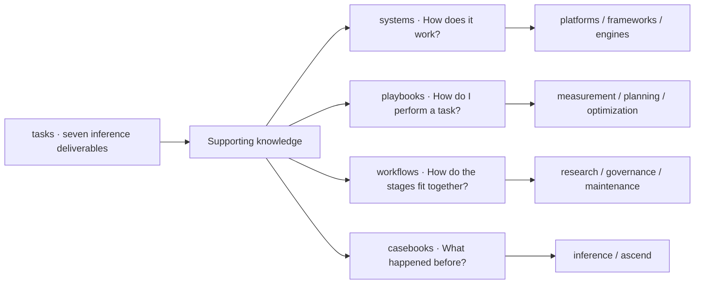
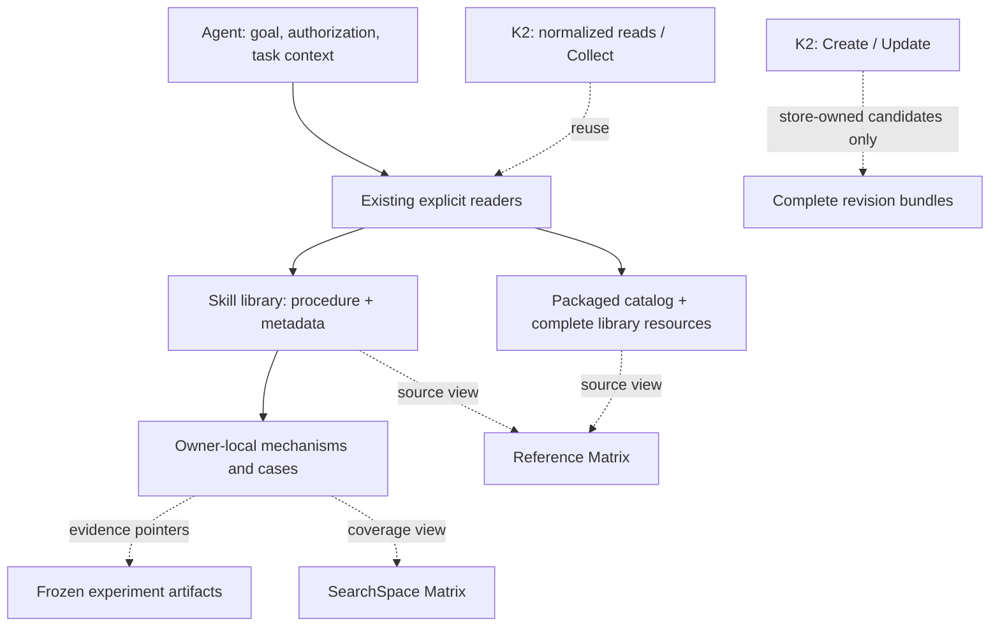

# Knowledge base contract

This implements the K0/K1 content foundation of [RFC #17](https://github.com/InferMatrixLab/InferRSI/issues/17).
The coding agent owns planning and conversation and acts within explicit scope
and delegated authority. Reading material never executes a helper or grants
permission to change a target system.

The three objectives remain **Roofline / optimization headroom**, **repository-evolution
knowledge**, and the **two-matrix Skill System**. Magpie collaboration rollout is
separate work, not an implemented capability of this knowledge base.

## Directory and responsibility map

The [illustrated layout and search guide](knowledge-layout.md) shows the task
entry, physical directories, evidence lookup and old-to-new bundle counts.

The [task router](../src/inferrsi/knowledge/data/skill_library/tasks/inference-task-router/SKILL.md) selects one of seven deliverables before opening supporting knowledge. For direct subject browsing, the first library directory answers the reader's question. The second
identifies a subsystem, an engineering activity, a workflow stage group or
the scope of a case collection. The registry maps each stable ID to a single
bundle; backend and evidence state remain separate metadata.



A platform-specific operation such as Ascend graph capture belongs in
`systems/platforms/ascend/`. The Ascend optimization casebook belongs in
`casebooks/ascend/`. A cross-platform benchmarking method belongs in
`playbooks/measurement/`. Engine-specific examples can still ship with their
parent procedure. Frozen run artifacts remain under `evidence/<campaign>/`.

For existing automation, resolve an ID through `skill-index.json` or use
`inferrsi skills show <id>`. Raw paths containing the old category need
the new location. A reference pinned to an earlier commit uses that
commit's original path; regenerate resource pins when adopting a new bundle.

The router declares `discovery_role: task-entry` in its sidecar. Read it
explicitly with `inferrsi skills show inference-task-router` and open the
chosen resource. Default `find` ranks evidence owners and excludes task
entrypoints before computing IDF. Unmarked skills retain ordinary discovery.
Use [the migration manifest](skill-layout-migration.csv) to resolve raw paths.
Retained material can be replayed from its saved bytes or matching source
snapshot. A digest-only reference requires its original package, checkout or
retained store revision. Never resolve an old digest to the new bundle.

The manifest records the cutover from main at `9b418d7` and is historical.
All 79 readable original checkout skills changed bundle revision when moved.
The seven case identities retained their previous checkout revisions even
though their resource locations moved. The legacy `husky` skill failed the
same source-identity validation on both snapshots, marked
`unavailable_at_cutover`. Its registry path can still be resolved.
Run `python tools/check_skill_layout_migration.py --before <old-checkout> --after <cutover-checkout>`
against these snapshots to verify every path and pin and reject old skill
digests at the new checkout. Validate privately retained campaign captures
and store revisions against their own saved material before rollout.

On Windows hosts enforcing the 260-character path limit, use a short checkout
and virtual-environment root for this layout. A wheel under a long temporary
installation path reproduced a failed read of a nested reference on such a host.


```text
src/inferrsi/knowledge/data/skill_library/
  README.md                         Library navigation
  skill-index.json                    Stable IDs → current bundle path and backend
  tasks/inference-task-router/          Entry skill and seven individually readable route cards
  systems/platforms/{ascend,cuda,host}/   Device and host implementation guidance
  systems/frameworks/<framework>/     Framework-specific behavior and procedures
  systems/engines/<repo>/             Engine entry, sub-skills and resources
  playbooks/{measurement,planning,optimization}/   Reusable engineering tasks
  workflows/{research,governance,maintenance}/     Cross-stage processes
  casebooks/{inference,ascend}/       Prior decisions, outcomes and retry conditions
  <owner>/references/               Owner-local supporting documents and source inventory
  <category>/<id>/SKILL.md           Name, description, substantive procedure
  <category>/<id>/metadata.json      Provenance, state and relationships
  <category>/<id>/references/        Owner's mechanisms, readsets and comparisons
  <category>/<id>/cases/             Owner's scoped cases (optional)
src/inferrsi/knowledge/catalog.py    Installed knowledge reader
src/inferrsi/knowledge/skill_catalog.py  Packaged or custom-root skill reader
src/inferrsi/knowledge/data/skill_library/records/<stable-id>.json   Authored engineering findings
src/inferrsi/knowledge/data/skill_library/config/                    Aliases and research profiles
src/inferrsi/knowledge/data/skill_library/_compiled/                 Generated YAML headers and Git provenance
src/inferrsi/harness/data/repo_packs/<repo>/pack.json  Target descriptor, read by repository_pack
evidence/<campaign-id>/             Frozen plans, results, patches and validators
docs/reference-matrix.md            Sources, inspected scope and extraction
docs/searchspace-matrix.md          Resource × optimization-stage coverage
```



Solid edges describe the K0/K1 foundation; dashed boxes are the K2
[normalized reads / Collect](knowledge-operations.md) and
[authorized local Create / Update](knowledge-store.md) operations, which reuse
those readers. No mandatory ContextPack, conversation manager, crawler or universal
performance loop is introduced. A generated catalog is a projection, not a third
metadata authority or maintained matrix.

## Field ownership and compatibility

| Item | Authority | Compatibility rule |
|---|---|---|
| New local-skill profile | `SKILL.md`: name, description and procedure; `metadata.json`: `profile: local-skill-v1`, kind, origin, state, provenance, applicability and relationships | Name stays the existing directory ID; listing combines metadata without reading procedure/resource bodies |
| Legacy local frontmatter | Existing frontmatter when no new profile is declared | Five inherited skills stay unchanged; no invented candidate state |
| Legacy sidecars | Existing keys retained unless explicitly normalized | Conflicting duplicate fields fail visibly; matching historical fields can be read |
| Catalog JSON | Existing record owns ID, tier, scope, recommendations, attribution and limitations | Do not migrate it into local sidecars or relabel imported records |
| Engine procedures/resources | Imported English library and source manifest | Preserve licenses, source relationships and installed access; catalog abstracts link the complete English procedures |
| Case | One owner-local case document plus structured identity/source record | Raw evidence stays frozen; case interpretation may evolve without rewriting results. Source identities and digests live only in the record; the document links it and cites the same source URLs. The record lists its own basename in `required_resources`, so that link resolves inside the read bundle |

The 43 branch-added candidate headers were normalized without replacing their
procedures. All structured frontmatter fields, including tags, synchronization
lineage, unknown license and source-pack notes, are retained in sidecars. Existing
sidecar name/status duplication agreed with the frontmatter; normalization found
no contradictory values. Sidecars omit fields equal to the reader defaults:
empty `sources` and `references`, and the former shared placeholder
`applicability`; absent sources still read as explicit unknown provenance.
Abbreviated historical repository pins remain explicitly
prefixes, not invented full SHAs. Legacy untyped source inventories remain marked
incomplete, with their substantive procedure/readsets retained for inspection.

`status`, permission to use and empirical validation are independent. A candidate
is not promoted by import, translation, a passing reader test or matrix placement.
External/internal origin and Skill/Knowledge/Case kind are attributes; contribution,
dependency and peer remain independent repository relationships.

### Applicability keys and recommendations

Sidecar `applicability` keys follow the contract settled in
[issue #91](https://github.com/InferMatrixLab/InferRSI/issues/91#issuecomment-6512087181).

| Key | States | Must not |
|---|---|---|
| `scope` | What the procedure applies to | Become a capability or efficacy claim |
| `prerequisites` | What must hold first: access, tooling, authorization | Restate the input contract |
| `input_contract` | What the caller supplies | Enumerate the procedure's own steps |
| `produced_artifact` | What it emits, at the body's evidence level | Upgrade a proposal into a validated configuration or measured result |
| `failure_modes` | How the procedure yields a wrong or unusable result | Restate `limitations` |
| `refusal_point` | Where the body says it withholds a conclusion | Invent a refusal the body does not state |
| `hardware` | A device dependency the body establishes | Be inferred from a source's hardware |

`recommendations` holds owner-supplied procedure advice. `tools/build_skill_index.py`
copies a declared list unchanged. A declared empty list states that the procedure
has no specific advice and does not fall back; only an absent field produces the
generic navigation defaults.

`limitations` is not owner-only. The generator emits four sentences of its own and
then appends the sidecar's `limitations` entries. `failure_modes` is therefore a
separate field rather than more `limitations` entries.

No mechanical allowlist restricts `applicability` keys. The packaged library uses
nine distinct keys: the seven above plus `architectures` and `excluded_mechanisms`,
which appear only in `systems/platforms/cuda/reason-hopper-kernels`. A closed key set would
reject that sidecar or have to grandfather it. Revisiting this is proposed for
batch 4 of issue #91 and is not agreed.

## Sources and revisions

### Resource-layer applicability

The SearchSpace Matrix owns positive resource-layer and lifecycle-stage mappings.
Its supplementary `Resource` tables describe guidance without claiming numbered
layer coverage. A missing mapping means unknown, not that a procedure applies
everywhere or nowhere.

A sidecar may declare `searchspace_not_applicable` as a non-empty reason when its
procedure does not address any of the five resource layers. The reason identifies
the procedure's actual scope and its source section. Omit the field for positive
or unanalyzed mappings; it is not a second mapping table. Device-independent
guidance may still address a resource layer, so `applicability.hardware` does not
determine this declaration.

The coverage view shows unknown, N/A, numbered coverage and supplementary guidance
separately. An N/A declaration alongside a positive matrix mapping is a visible
conflict; it counts as neither N/A nor coverage until reconciled. The generated
catalog retains the reason in `skill_metadata`. None of these declarations alters
skill maturity, empirical validation or execution authority.

### Source identities

| Type | Identity and scope | Not interchangeable with |
|---|---|---|
| Git | URL, commit (or explicitly partial historical prefix), paths/readset | Paper version or tested runtime stack |
| Paper | Paper ID, version, sections and readset | Fabricated Git commit |
| Document | Version or immutable snapshot/hash, inspected sections; unknown fields explicit | A live URL presented as a frozen version |
| Internal | Issue/run, artifact identity, integrity reference and observation scope | Automatically validated reusable guidance |
| Local content revision | Required instruction/content bytes, resource bytes and dependency revisions | Upstream source revision or measured engine revision |

The legacy readers retain their command contracts. [Normalized reads](knowledge-operations.md)
identify complete declared dependency bundles and reject unavailable old snapshot
revisions. The [authorized store](knowledge-store.md) retains old metadata/resources
and verifies their bundle digest. An old revision never silently resolves newer
resource bytes. Typed source
examples are present for `audit-vllm-kv-lifetimes` (repository),
`calibrate-serving-simulation` (reviewed Vidur v2 mechanism), and the internal case.
Other source records retain their existing evidence rather than fabricated fields.

## Identity, revision coverage and the writable boundary

These rules are the contract that the K2 read and write operations implement;
the K0/K1 readers above do not enforce them by themselves.

| Authority | Owns | Access through Create / Update / Collect |
|---|---|---|
| `package` | Installed catalog records and complete skill library | Read-only adapter |
| `checkout` | An explicitly selected skills root: the canonical library checkout or a custom flat/registry tree | Read-only adapter; amendments use scoped repository PRs |
| `store` | Candidate bundles registered in one explicitly selected writable store | Create / Update and Collect |

- Public IDs are preserved. A reference may be qualified as `<authority>:<id>`;
  an unqualified ID that resolves in more than one authority is rejected as
  ambiguous, never resolved by precedence.
- Create rejects an ID already owned by a read-only adapter. Copying a
  repository-owned item into the store under the same identity is not an update
  path. An adaptation uses a distinct ID with `derived_from` provenance.
- A content revision covers the normalized metadata, entry content, required
  local resource bytes and explicit dependency revisions. Resource or dependency
  drift changes the revision or fails. External sources and evidence remain
  references with stated availability; they do not become retained bundle bytes.
- A read-only adapter without the requested snapshot reports an unavailable
  revision. Retained store revisions return their original resources. Neither
  falls back to the latest content.
- The store lives outside installed packages, source checkouts and frozen
  evidence. Runtime operations do not edit raw evidence, either matrix or any
  adapter source, and do not promote candidates. Matrix links change only
  through reviewed repository changes; an unexported store candidate is not
  repository coverage.

## K1 integration and shared resources

- [Repository-derived procedure](../src/inferrsi/knowledge/data/skill_library/systems/engines/vllm/audit-vllm-kv-lifetimes/SKILL.md): preserve
  pinned scheduler/connector contracts and untested concrete-backend limits.
- [Reviewed paper mechanism](../src/inferrsi/knowledge/data/skill_library/playbooks/measurement/calibrate-serving-simulation/SKILL.md):
  empirical calibration, joint-SLO shortlist and near-capacity queueing risk;
  source paper is not reread or reproduced by this organization work.
- [Internal admission/drain case](../src/inferrsi/knowledge/data/skill_library/casebooks/inference/inference-optimization-casebook/cases/admission-drain-occupancy.md):
  observation, original action, interpretation, counter-signals and original
  evidence pointers remain separate. Campaign INCONCLUSIVE is retained.
- [Benchmark design](../src/inferrsi/knowledge/data/skill_library/playbooks/measurement/inference-benchmark-design/SKILL.md) and
  [evidence classification](../src/inferrsi/knowledge/data/skill_library/playbooks/measurement/dense-performance-evidence/SKILL.md) consume
  that same case. No `shared/` namespace or duplicate case database is necessary.

Local `resource` access remains restricted to the selected skill. Declared
cross-skill `reference` access is restricted to the complete selected skills root:

```bash
inferrsi skills reference inference-benchmark-design \
  ../inference-optimization-casebook/cases/admission-drain-occupancy.md
# To select a source checkout explicitly, add before the subcommand:
# --root src/inferrsi/knowledge/data/skill_library
```

Missing dependencies, undeclared references and escapes are errors. Migrated
profiles use packaged consumption; their stable skill IDs resolve through
`skill-index.json`. Custom flat trees remain supported with explicit `--root`.
A single copied skill folder with external links is **not** advertised as a
standalone export: retain the declared dependencies or the complete library.

### Complete packaged skills and catalog discovery

All 48 former root skills now have one canonical home under
[`src/inferrsi/knowledge/data/skill_library/`](../src/inferrsi/knowledge/data/skill_library/README.md).
Complete procedures, sidecars, references and cases are packaged together. Browse by
system, engineering task, workflow or prior outcome. Backend is recorded independently. The 21 engine and research-router skills
use the same ownership layout under `systems/engines/<engine>/` and
`workflows/research/inference-engine-research/`, including their sub-skills and references.
The library contains 144 `SKILL.md` files, all in English. The registered
[Lithos Metal candidate](../src/inferrsi/knowledge/data/skill_library/systems/engines/lithos-metal/SKILL.md)
adds three owner-local subskills for compiler/fusion, generation state and
serving/cache contracts; it adds no executable repository target.
The collection overview, import notes and source manifest belong to the research
workflow's references; Strata design-space analysis belongs to Strata. The library
root contains only navigation and the registry.

The [runtime catalog](../src/inferrsi/knowledge/data/skill_library/README.md)
projects the 81 registered skills into the contribution catalog. Its records
use `inferrsi.<backend>.skills.<name_with_underscores>` IDs, with `ascend` and
`cuda` for scopes that depend on those backends and `common` for the remaining skills.
Each `skill_documents.original` points to the full packaged procedure. The
`skills` CLI retains the original hyphenated skill IDs and defaults to this
81-ID registry; engine procedures remain available through library navigation
and catalog document pointers.

The registered [PyTorch](../src/inferrsi/knowledge/data/skill_library/systems/frameworks/pytorch/pytorch/SKILL.md)
and [TorchNPU](../src/inferrsi/knowledge/data/skill_library/systems/frameworks/torch-npu/torch-npu/SKILL.md)
operating graphs each retain eight child procedures, their sidecars, references,
scripts and source notices under one root. The children are available through
root resource reads and complete normalized bundles; they add no separate
registry IDs or executable repository targets. Earlier compiler, DCP and
TorchNPU allocator owners retain their independent source revisions.
All new profiles use `local-skill-v1`: only name and description are in YAML;
the AREX license, invocation and operating-role fields remain in sidecars.
An upstream AREX license check of a temporary frontmatter projection is distinct
from final InferRSI format checks, backend execution and managed DisCo import.
Required accelerator/distributed gaps remain `BLOCKED_REQUIRED_BACKEND`;
installed-wheel CPU observations do not validate the pinned source build.

Historical construction and verification records remain at the immutable
original delivery: [PyTorch](https://github.com/InferMatrixLab/InferRSI/blob/e668cff3b12e46a0dae1a007099c521afa848152/tests/fixtures/repo_to_skill/pytorch/reports/final/author-handoff.md),
[TorchNPU](https://github.com/InferMatrixLab/InferRSI/blob/e668cff3b12e46a0dae1a007099c521afa848152/tests/fixtures/repo_to_skill/torch-npu/reports/final/final-skill-report.md)
and [independent review](https://github.com/InferMatrixLab/InferRSI/blob/e668cff3b12e46a0dae1a007099c521afa848152/tests/fixtures/repo_to_skill/framework-review/independent-review.md).
These external records retain their original environments, native failures,
backend gaps and verification scope. Repackaging the unchanged runtime bytes
does not rerun those checks or establish new backend, quality or performance
results. The process fixture trees are not part of this delivery.

The registered [h3.c runtime audit](../src/inferrsi/knowledge/data/skill_library/systems/engines/h3-c/audit-h3-runtime-residency/SKILL.md)
owns MiniMax-H3 component/lifetime, AdaLN, precision/SSD mechanisms and the
retained Apple feasibility/header-inventory research. Its source-derived
candidate state and imported header observations remain separate from native
execution, media quality, target memory and performance qualification.

Use `inferrsi knowledge search --repo-type inferrsi --limit 100` in an ordinary
installation. Catalog JSON and full package bundle reads need no YAML parser:
`inferrsi read inferrsi.ascend.skills.ascend_graph_mode --material` reads the
record with its retained library dependency resources. The optional `skills`
extra enables frontmatter-based `skills list`, `show`, `resource` and `reference`.
An explicit `--skill-root src/inferrsi/knowledge/data/skill_library` exposes the checkout
adapter's original skill and case identities for normalized reads.

Each record retains source metadata, including candidate state, unnormalized
provenance and unknown licenses. Its own `imported` state describes the catalog
record, not promotion or verification of the source skill. Backend placement
describes content scope; `common` and `skills.discovery` imply no cross-hardware
qualification. `inferrsi` is a knowledge source, not an executable target.

The CUDA-owned [Hopper kernel reasoning candidate](../src/inferrsi/knowledge/data/skill_library/systems/platforms/cuda/reason-hopper-kernels/SKILL.md)
adds pinned KDA/KernelWiki source screening, selected primary-code qualification
and architecture-specific synchronization/resource/FP8 procedures. Its coverage
inventory distinguishes inspected bodies from source headers and excluded SM100
recipes; native execution and efficacy remain not_run.

Maintain stable skill IDs, paths and backends in `skill-index.json`. After committing changed skill sources, run `tools/build_skill_index.py` to refresh the two compiled inputs. The catalog assembles public records from the registry, canonical metadata, YAML headers and source fingerprints. Indexed material selection verifies the recorded hashes against the resources it reads. [Contribution workflow](knowledge-contribution-workflow.md)

Preserve existing states, provenance, notices,
`UNKNOWN` licenses and the two matrices' authority. Migration and installed-package
checks do not establish licensing, empirical verification or automatic execution.

## Negative results as diagnostic options

The existing Case authority now also holds scoped rejected directions for
[Qwen B300](../src/inferrsi/knowledge/data/skill_library/casebooks/inference/inference-optimization-casebook/cases/qwen-b300-rejected-directions.md),
[Qwen Ascend](../src/inferrsi/knowledge/data/skill_library/casebooks/inference/inference-optimization-casebook/cases/qwen-ascend-rejected-directions.md)
and [Drama3 B300](../src/inferrsi/knowledge/data/skill_library/casebooks/inference/inference-optimization-casebook/cases/drama3-rejected-directions.md).
The records cite exact source summaries; they add no hardware validation.
Observation, original disposition and newly suggested revisit checks stay
separate. Raw evidence remains at its existing frozen owner.

This design uses failure as conditional evidence. Under comparable conditions,
it can reduce redundant work and suggest a cheap discriminating check. A hard
blacklist would overgeneralize across revisions, hardware and implementations;
an unqualified transcript dump would mix environment failures with algorithmic
ones. Reusing owner-local cases also keeps the existing source/revision rules
and avoids a second negative-result database. These are design arguments, not
a measured improvement in agent performance.

Read the case before choosing a candidate. State the applicable signal,
counter-signal, changed condition and next check; distinguish quality rejection,
missing gain, resource failure, confounding, missing integration and analytical
rejection. Confirm a new root cause with its own evidence. A retry needs its
own authorized scope and frozen controls. Cases do not change PASS / FAIL /
INCONCLUSIVE, promote a candidate, resume paused work or automatically route
tasks. [Collect examples](knowledge-operations.md#retrieve-diagnostic-options)
and the existing search-policy references expose the records explicitly.

## Implemented operations and bounded follow-ups

| Slice | Implemented here | Deferred contract |
|---|---|---|
| PR #12, K0/K1 | Ownership, preserved content, metadata projection, explicit instruction/resource/reference reads, both matrices and reusable case | No normalized Collect or mutation API claim |
| K2 reads | [`KnowledgeReader`](knowledge-operations.md) facade, typed sources, byte-derived bundle identity, authority-qualified refs with ambiguity rejection, exact revisions/resources and bounded Collect | Historical snapshot material must exist; no crawling or standalone export |
| K2 writes | Python `KnowledgeStore` for store-owned candidates, adapter-identity reservation, `derived_from` adaptations, SQLite writer serialization, duplicate/stale rejection, complete publication and immutable history | One authorized local directory only; no repository writer, promotion or distributed writer guarantee |

The writer will not edit site-packages, frozen evidence or source checkouts.
A version field alone provides no concurrency guarantee. No automatic promotion
or LLM generation is required.

[Issue #15](https://github.com/InferMatrixLab/InferRSI/issues/15) can consume the field
ownership, source-linked references and scoped case pattern here. Its mandatory
perf-loop, fixed skill count, global numeric policies and separate case registry
are not imported. Exactly two primary matrices remain; HBM is not host RAM and
H2D/IPC/team coordination do not establish Network coverage.

The registered [vllm-metal candidate](../src/inferrsi/knowledge/data/skill_library/systems/engines/vllm-metal/SKILL.md) adds selected platform/ABI, KV/offload lifecycle and speculative/deferred/dispatch procedures. Installed pure API/parser evidence is partial; required Apple native/model/quality/service evidence remains blocked. It is portable AREX-informed repository integration, not DisCo CLI execution or managed import.

The registered [mistral-rs candidate](../src/inferrsi/knowledge/data/skill_library/systems/engines/mistral-rs/SKILL.md) adds selected Metal paged-attention layout, metadata/workspace and preparation/evidence contracts. Rust tooling and required Apple native/model evidence are unavailable; offline helpers and source test definitions are not native execution or candidate promotion.

The [mlx-swift-lm candidate](../src/inferrsi/knowledge/data/skill_library/systems/engines/mlx-swift-lm/SKILL.md) owns selected Swift generation-lifetime and recurrent native/ops contracts, with source/observation limits preserved. No Swift compile, original native/host-control test, actual Metal/model/quality/service run is implied by its helpers or packaged discovery.

The [mlc-llm candidate](../src/inferrsi/knowledge/data/skill_library/systems/engines/mlc-llm/SKILL.md) separates artifact metadata, supported consumers, Apple targets, pinned TVM runnable/runtime boundaries and compiled/runtime KV configuration. Canonical hashes, serializable fallback or estimated limits are not native/model/quality/fit/service evidence.

The registered [h3-metal FastH3 audit](../src/inferrsi/knowledge/data/skill_library/systems/engines/h3-metal/audit-h3-metal-fasth3-semantics/SKILL.md) supplements earlier h3.c residency with fork-specific effective configuration, tensor/schedule semantics and VSA eligibility/fallback. Its offline declaration arithmetic and label probes do not qualify native conversion, sparse attention, media, memory fit or performance; required Apple/model evidence remains blocked/not_run.

The registered [local-dream candidate](../src/inferrsi/knowledge/data/skill_library/systems/engines/local-dream/SKILL.md)
owns selected Android desired/serving/readiness and unauthenticated-host
boundaries, native diffusion dispatch/cancellation/cache and DiT/QNN packaging
contracts. Its helper compares declarations only; required Android/Qualcomm,
model, image quality, fit and service/performance evidence remains
`BLOCKED_REQUIRED_BACKEND / not_run`. This is portable AREX-informed candidate
integration, not a fully verified DisCo import. Pinned CC BY-NC 4.0 source rights
and machine SPDX `NOASSERTION` remain separate.
