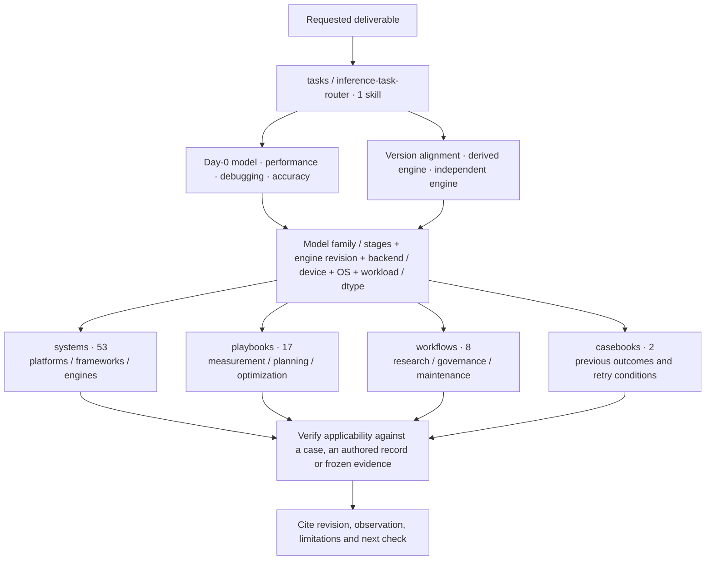
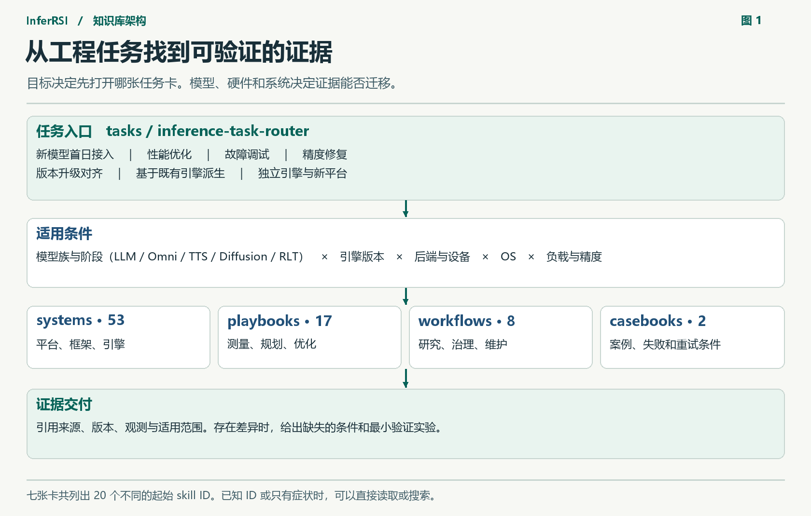
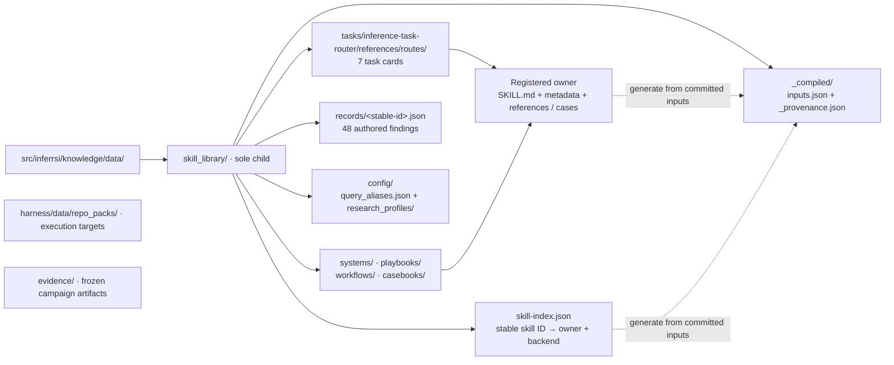
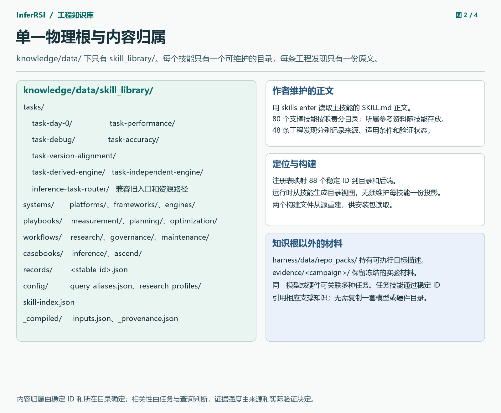
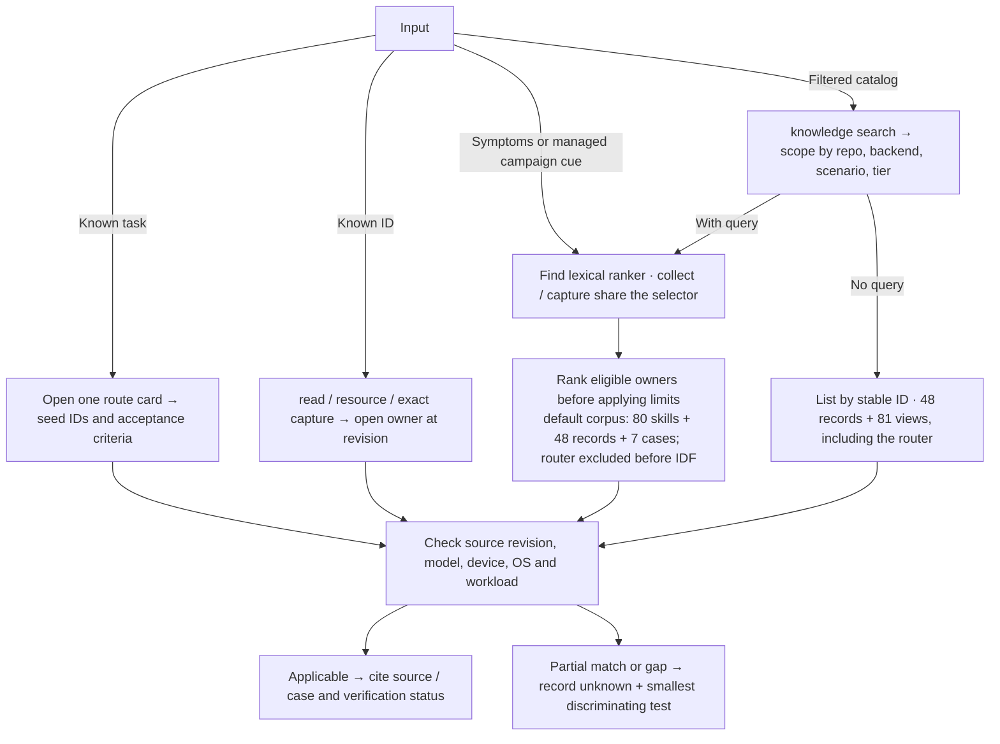
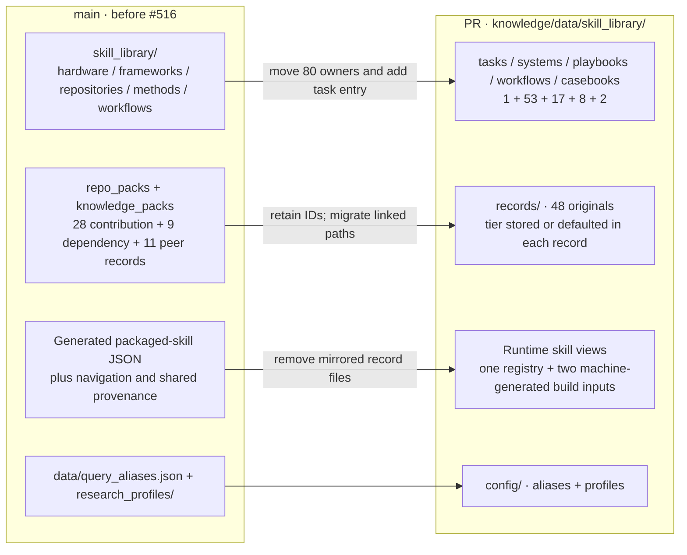
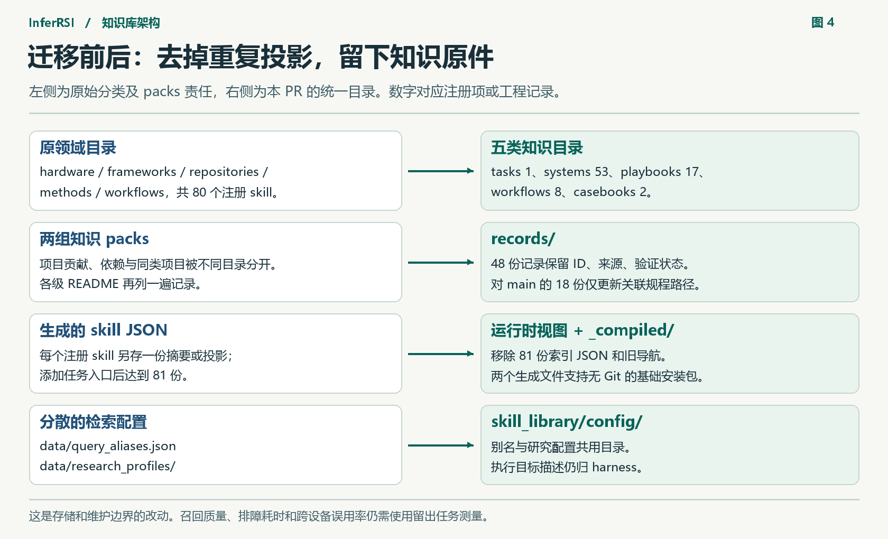

# Knowledge layout and retrieval

Start from the work an engineer needs to finish. The library has one physical root, one source location per registered skill and one authored file per engineering finding. Search and the catalog are two views over those sources. The migration manifest maps historical checkout paths and revisions. [Migration manifest](skill-layout-migration.csv)

## 1. Task layers and evidence





## 2. One physical knowledge root





## 3. Search paths and evidence delivery




## 4. Before and after





## Directory contract

```text
src/inferrsi/knowledge/data/
└── skill_library/
    ├── tasks/inference-task-router/        SKILL.md, metadata.json, references/routes/*.json
    ├── systems/                           platforms/{ascend,cuda,host}, frameworks/, engines/
    ├── playbooks/                         measurement/, planning/, optimization/
    ├── workflows/                         research/, governance/, maintenance/
    ├── casebooks/                         inference/, ascend/
    ├── records/<stable-id>.json            28 contribution + 9 dependency + 11 peer
    ├── config/                            query_aliases.json, research_profiles/
    ├── skill-index.json                   stable ID → directory and backend
    └── _compiled/                         inputs.json, _provenance.json
```

The README documents the library. A procedure, including its resources, belongs in one registered directory. An engineering record carries its own sources, applicability and verification status. Its filename must match its stable ID. The registry locates each skill. The existing protected `knowledge/catalog.py` owns the public view fields, including source links, recommendations and verification status. Builds compile YAML headers and pinned Git fingerprints required by the base wheel. The catalog reads canonical sidecars and emits the public schema-1 record on demand. Publishing the same skill under multiple engine or accelerator trees would require synchronized edits. Represent these dimensions on the task card and in owner metadata. For a new environment with no applicable local evidence, retain the unknown and the first check that could resolve it. [Record authoring guide](../src/inferrsi/knowledge/data/skill_library/records/README.md)

## Seven deliverables

| Task card | Inputs to distinguish | Acceptance evidence |
| --- | --- | --- |
| Day-0 model | Model revision, stages, reference implementation, backend | Stage outputs, first end-to-end result, regression fixture |
| Performance | Target metric, workload, bottleneck, quality floor | Paired baseline/candidate runs, quality check and variability |
| Debug | Symptom, last-good configuration, first failing stage | Minimal reproduction, implicated boundary, regression check |
| Accuracy | Reference outputs, dtype, preprocessing, seeds | First divergence, agreed tolerance and end-to-end result |
| Version alignment | Versions of vLLM, vLLM-Omni, vLLM-Ascend and afd-plugin as applicable | Compatibility matrix, paired versions and rollback point |
| Derived engine | Parent revision, inherited APIs and changed paths | Upstream behavior checks and tests of the fork delta |
| Independent engine | Runtime, model format, device, OS and operator availability | Device-native first result, capability gaps and resource bounds |

A Windows TTS accuracy regression during an engine upgrade can start with accuracy and use version alignment as a secondary card. Establish the last-good input, wrapper, preprocessing and audio comparison. An Ascend 910B1 TTS report is an analogue until the caller supplies target-specific evidence. Conversely, an exact match to its documented model, fixed prompt, wrapper and device deserves consideration. LLM, Omni, TTS, Diffusion and RLT are workload conditions. CUDA, ROCm, Ascend, XPU, mobile and Windows are scoped explicitly. A route mentioning a target establishes a question to test. Use a supported CLI filter only where the reader implements it.

## Search and read examples

```bash
inferrsi skills resource inference-task-router references/routes/accuracy.json
inferrsi find "TTS quality regression after engine upgrade"
inferrsi knowledge search --tier peer --repo-type qwen3_tts_engine --backend ascend --json
inferrsi knowledge show flashinfer.cuda.llm.paged_decode_dispatch
```

Known task cards seed 20 distinct skill IDs across seven routes. Known IDs can skip routing. Free-text discovery ranks the owner once and returns a path, evidence state and explanation. A catalog query applies scope filters and reuses Find to rank the eligible owners; the no-query listing returns complete records in ID order. Ranked Collect and campaign capture use the same selector. Explicit IDs can still capture a task card’s owner. The caller checks applicability before applying a result. A finding or failed attempt can be proposed as a record with a source, a scoped conclusion and a retry condition. The program does not autonomously promote session notes.

## Design choices and benefits

Agent V describes Git-backed shared memory with human guidance, hard-to-rediscover facts, indexed workflows and session experience. InferRSI adopts the distinction between a procedure, a scoped finding and a run. Accepted findings enter through review. Frozen experiment materials stay in `evidence/`. [Agent V](https://inferact.ai/news/agent-v-connecting-people-and-agents-for-autonomous-inference)

MindIE Agent separates agent capabilities, knowledge and execution plugins. KDA specializes in kernel development. Cannbot Skills packages Ascend procedures for reuse. InferRSI needs cross-engine, cross-model and cross-platform retrieval as well as evidence qualification. It combines a task front door, technical owners, stable IDs and scoped evidence. A claim that it retrieves better than any of these projects requires a common task benchmark. [MindIE Agent](https://github.com/mindie-agent/mindie-agent) · [KDA](https://github.com/NVlabs/kda) · [Cannbot Skills](https://github.com/hicann/cannbot-skills)

Measure with three arms on the same corpus and tool budget: prior layout and search, unified layout with direct search, and unified layout with optional routing. Use held-out tasks across the seven types, blinded reviewers and paired cases with an applicable answer and a similar-looking incompatible target. Use four held-out tasks for each of the seven task types. Run each arm in an isolated session and balance the order. The primary metric is the fraction of answerable tasks with an applicable, cited owner in the top three. Report top-five applicable-source recall separately. For missing evidence, score unjustified transfer, correct abstention and mistaken abstention separately. Record time to first useful evidence, files opened and maintenance effort. Compare A→B and B→C separately using the gates in the acceptance issue. Approve broader rollout only when the team meets its predeclared quality and cost targets.

The authoring benefit is directly inspectable: one finding file or one skill owner is edited; no per-pack navigation list or projected record is maintained. Two compiled files are reproducible build products. Their shared merge point is a cost: resolve source edits, then regenerate. The build-time Git pin identifies source provenance. Installed material selection checks the resource hashes. Whole-library dependency revisions, checkout revisions, and hashes of individual findings have different scopes. Historical checkout pins must be replayed on the corresponding snapshot. Compared with main after #507, the full layout migration rejects 79 old checkout skill pins, retains the seven case pins from that baseline and preserves the pre-existing unavailable `husky` read. Direct callers that open old pack filenames must move to the record ID or new path.

A provenance-only refresh preserves an authored record’s bundle pin when its linked skill resources stay identical. Each registered casebook is a skill package; the seven rankable cases are individual evidence items.

The consolidation step moved all 48 files byte-for-byte from the preceding PR layout. Compared directly with main before the layout migration, 30 are byte-identical and 18 update only the path in `skill_documents`. All 48 retain their IDs, tiers, source pins and verification state. An installed package bundle for an authored record that declares linked skill documents also includes library dependencies. Editing a referenced library file can change that bundle revision. Archive a known-good snapshot for pinned replay.
