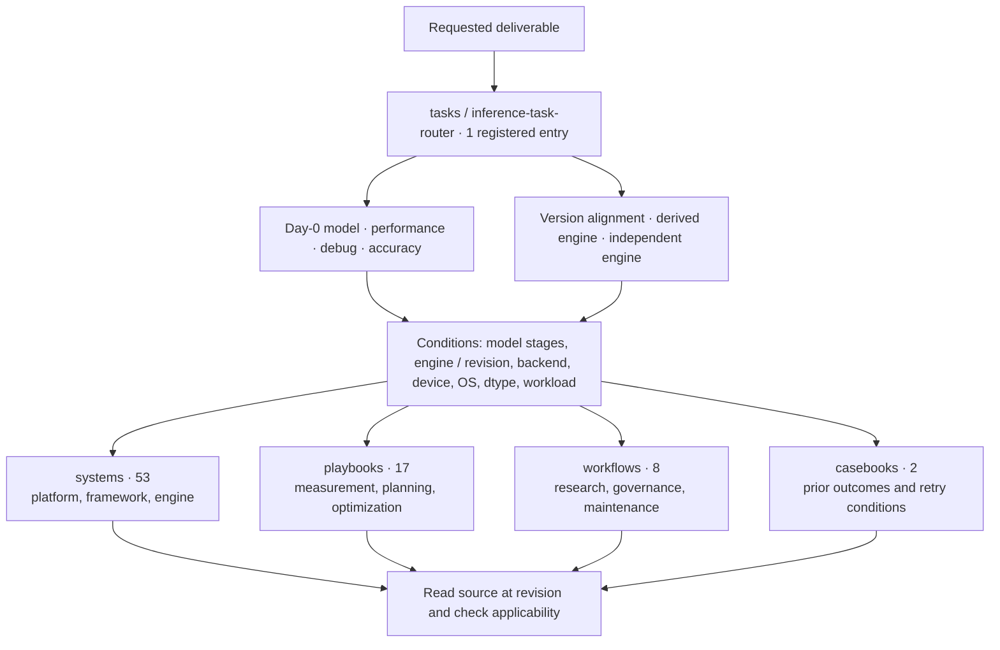
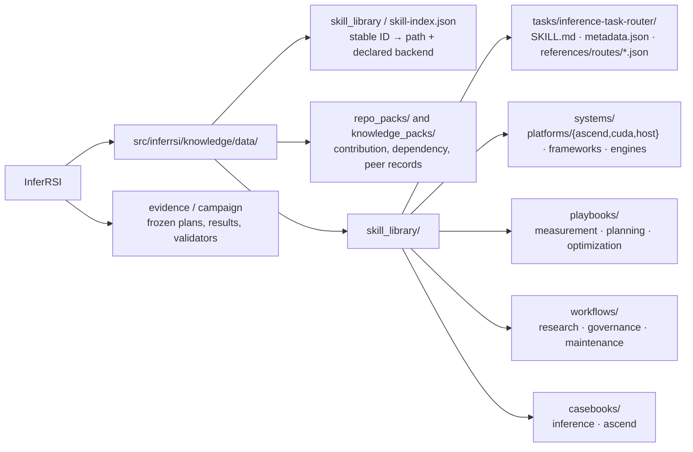
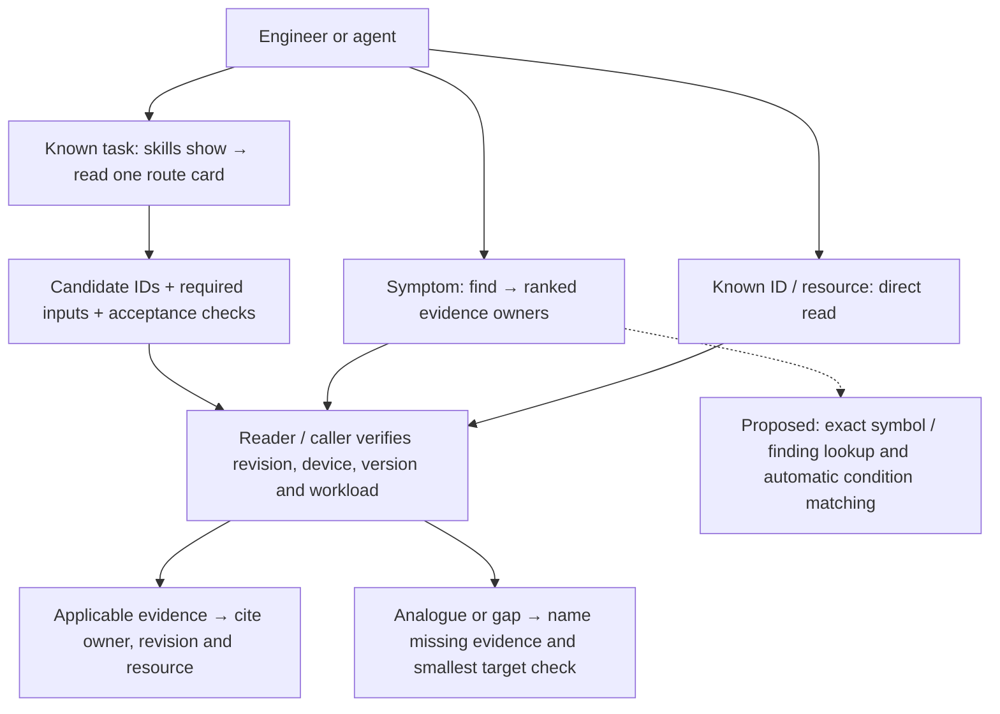
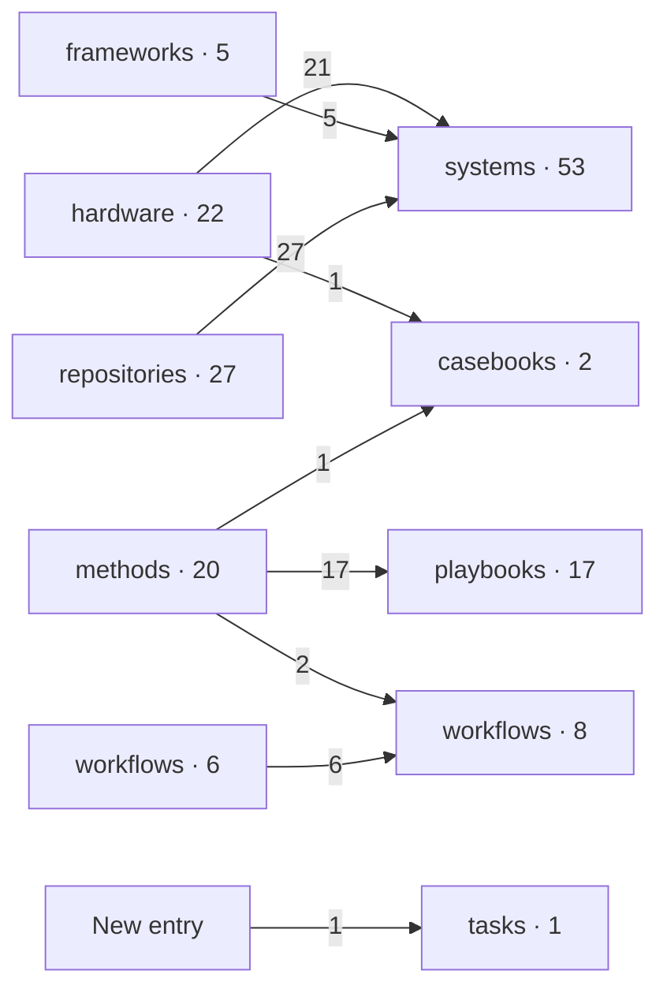

# Knowledge layout and retrieval

Use the [task cards](../src/inferrsi/knowledge/data/skill_library/tasks/inference-task-router/SKILL.md) when the deliverable is known. Use `inferrsi find` for symptom-based discovery or open a known owner directly. [Knowledge base contract](knowledge-base.md) · [Migration manifest](skill-layout-migration.csv)

## 1. Task entry, supporting knowledge and evidence

One registered entry exposes seven addressable cards. A compound request may have a primary and secondary task. The cards point to 20 distinct seed IDs across the library. The full catalog remains available.

[Chinese diagram (PNG)](assets/knowledge-layout/01-task-layers.png)

## 2. Physical directory and provenance

Counts refer to registered bundles. Each ID has one source location. Individual bundles may carry references or cases. Contribution records, dependency and peer records, and frozen experiments have separate owners.

[Chinese diagram (PNG)](assets/knowledge-layout/02-physical-layout.png)

## 3. Search, direct reads and delivery

Default `find` ranks 135 evidence entries: 80 skills, 48 records and 7 cases. The entry skill is excluded before IDF is computed. The caller checks applicability and records gaps. Dashed items are proposed extensions.

[Chinese diagram (PNG)](assets/knowledge-layout/03-search-and-delivery.png)

## 4. Mapping the 80 original registered bundles

Edge labels count bundles, grouped by stable ID. The new entry adds one registration. The seven route cards are resources in that entry.

[Chinese diagram (PNG)](assets/knowledge-layout/04-before-after.png)
