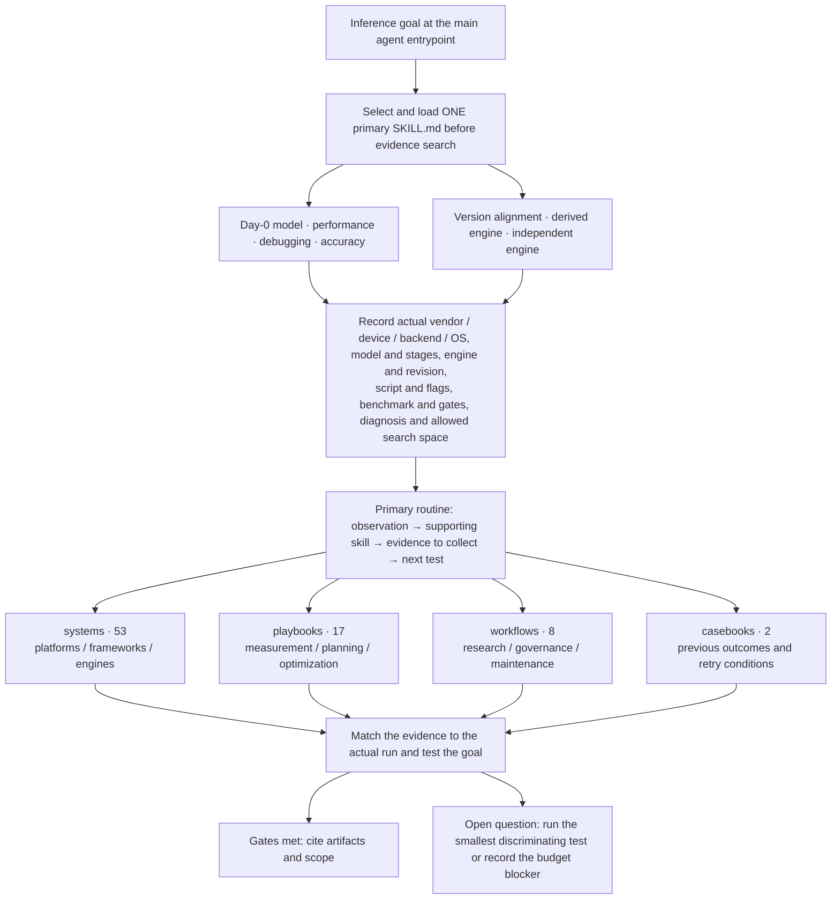
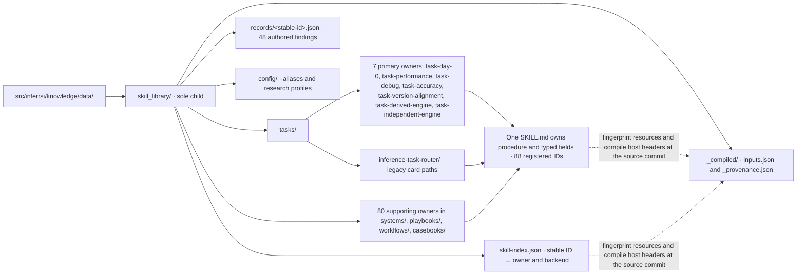
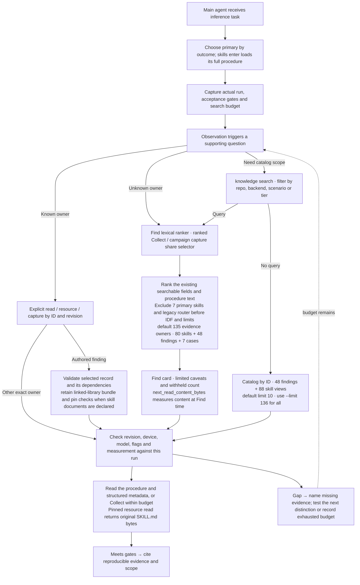
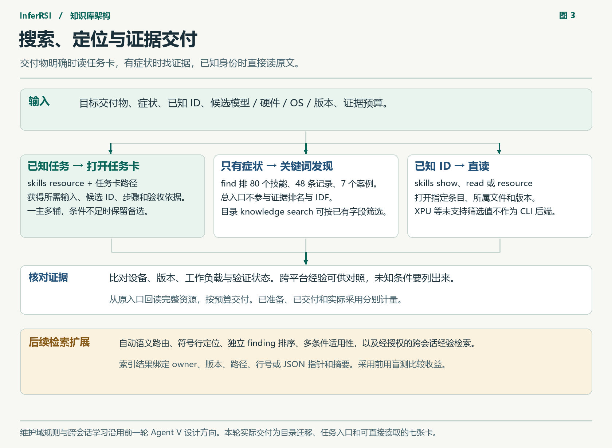
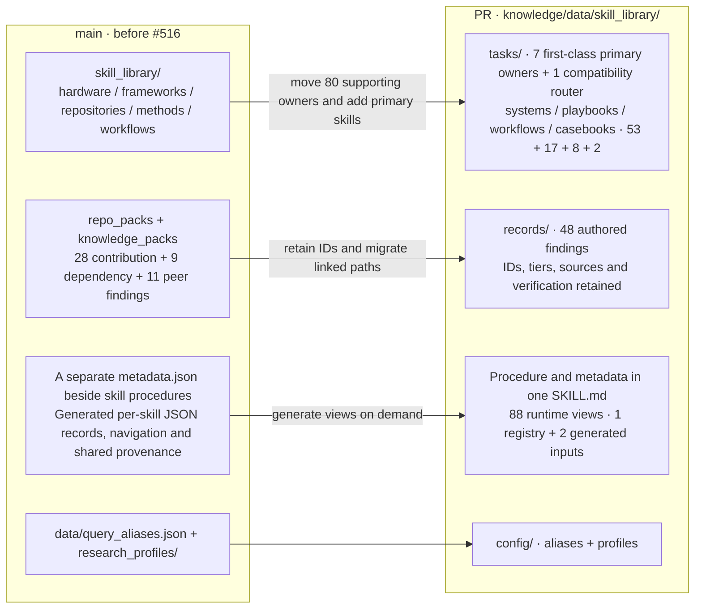

# Knowledge layout and retrieval

Start from the work an engineer needs to finish. The library has one physical root, one source location per registered skill and one authored file per engineering finding. Search and the catalog are two views over those sources. The migration manifest maps historical checkout paths and revisions. [Migration manifest](skill-layout-migration.csv)

To check the effect of this layout on search, compare unmodified main with the PR on the same machine. The [search comparison](../tools/compare_find_layouts.py) checks ordered results across both trees and times the end-to-end CLI. The [task queries and acceptance criteria](../tests/fixtures/find/layout-queries.json) define the workload.

## 1. Task layers and evidence




## 2. One physical knowledge root




## 3. Search paths and evidence delivery





## 4. Before and after




## Directory contract

```text
src/inferrsi/knowledge/data/
└── skill_library/
    ├── tasks/
    │   ├── task-day-0/                    SKILL.md contains the procedure and its structured fields
    │   ├── task-performance/
    │   ├── task-debug/
    │   ├── task-accuracy/
    │   ├── task-version-alignment/
    │   ├── task-derived-engine/
    │   ├── task-independent-engine/
    │   └── inference-task-router/         compatibility entry and original route resources
    ├── systems/                           platforms/{ascend,cuda,host}, frameworks/, engines/
    ├── playbooks/                         measurement/, planning/, optimization/
    ├── workflows/                         research/, governance/, maintenance/
    ├── casebooks/                         inference/, ascend/
    ├── records/<stable-id>.json            28 contribution + 9 dependency + 11 peer
    ├── config/                            query_aliases.json, research_profiles/
    ├── skill-index.json                   stable ID → directory and backend
    └── _compiled/                         inputs.json, _provenance.json
```

The README documents the library. A procedure, including its resources, belongs in one registered directory. An engineering record carries its own sources, applicability and verification status. Its filename must match its stable ID. The registry locates each skill. The existing protected `knowledge/catalog.py` owns the public view fields, including source links, recommendations and verification status. Builds compile YAML headers and pinned Git fingerprints required by the base wheel. Authors edit structured fields in the same SKILL.md as the procedure. The catalog combines that embedded object with the compiled host header and resource fingerprints to emit the public schema-1 record on demand. Publishing the same skill under multiple engine or accelerator trees would require synchronized edits. Capture these dimensions for the actual run and compare them with owner metadata. For a new environment with no applicable local evidence, retain the unknown and the first check that could resolve it. [Record authoring guide](../src/inferrsi/knowledge/data/skill_library/records/README.md)

Budgeted Collect can deliver a `skill-procedure` view. The
[Collect contract](knowledge-operations.md#ranked-discovery-and-budgeted-context)
describes its byte ranges and source identity. The
[Find contract](operations.md#find--find--inferrsiknowledgeknowledge_findfind)
covers read sizes, limitations and the revision needed for a reproducible read.

Claude reads `disable-model-invocation` from the native YAML header. Across this migration, the 33 procedures that previously exposed that flag and `metadata.disco-role` still expose them. For 22 other procedures (nine PyTorch, nine TorchNPU and four Lithos), the old sidecar alone contained those values. Readers of imported metadata can decode the same Boolean and role from `metadata.inferrsi`; promoting them into the native header would change host invocation behavior. [Claude skill invocation](https://code.claude.com/docs/en/skills#control-who-invokes-a-skill)

### What to edit

| When you change | Edit | How the change reaches readers |
| --- | --- | --- |
| A procedure, its applicability, provenance, tags or declared resources | The owner's `SKILL.md`. Ordinary agent fields such as `name` and `description` stay in the YAML header. `metadata.inferrsi` carries the structured InferRSI fields as a JSON string in a YAML block scalar. | The build compiles the header and resource hashes. Find uses the existing searchable fields and procedure text. |
| A supporting example, script or case | Its owner-local resource under `references/`, `scripts/` or `cases/` | Open it through the owner's ID and revision. |
| An independent engineering finding | `records/<stable-id>.json` | Its source, applicability and verification status travel with that evidence item. |
| A new registered procedure | Add its owner directory and record the ID, path and backend in `skill-index.json` | Listing and exact reads resolve the new ID. Regenerate the two files under `_compiled/` from the committed sources. |

This migration folds the fields from 107 paired files into their procedures, including 19 nested procedures. The 19 remain resources of their registered parents. The 48 JSON findings each represent independently addressable evidence. Query aliases, route cards, case records and test inputs retain their own file formats.

## Seven deliverables

| Required primary skill | Inputs to distinguish | Acceptance evidence |
| --- | --- | --- |
| [Day-0 model](../src/inferrsi/knowledge/data/skill_library/tasks/task-day-0/SKILL.md) | Model revision, stages, reference implementation, backend | Stage outputs, first end-to-end result, regression fixture |
| [Performance](../src/inferrsi/knowledge/data/skill_library/tasks/task-performance/SKILL.md) | Target metric, workload, bottleneck, quality floor | Paired baseline/candidate runs, quality check and variability |
| [Debug](../src/inferrsi/knowledge/data/skill_library/tasks/task-debug/SKILL.md) | Symptom, last-good configuration, first failing stage | Minimal reproduction, implicated boundary, regression check |
| [Accuracy](../src/inferrsi/knowledge/data/skill_library/tasks/task-accuracy/SKILL.md) | Reference outputs, dtype, preprocessing, seeds | First divergence, agreed tolerance and end-to-end result |
| [Version alignment](../src/inferrsi/knowledge/data/skill_library/tasks/task-version-alignment/SKILL.md) | Versions of vLLM, vLLM-Omni, vLLM-Ascend and afd-plugin as applicable | Compatibility matrix, paired versions and rollback point |
| [Derived engine](../src/inferrsi/knowledge/data/skill_library/tasks/task-derived-engine/SKILL.md) | Parent revision, inherited APIs and changed paths | Upstream behavior checks and tests of the fork delta |
| [Independent engine](../src/inferrsi/knowledge/data/skill_library/tasks/task-independent-engine/SKILL.md) | Runtime, model format, device, OS and operator availability | Device-native first result, capability gaps and resource bounds |

The main entrypoint loads the primary that owns the user's acceptance criterion. Record hardware vendor, device, backend and OS, model specification and stages, engine and version, run script and flags, benchmark, acceptance criteria, current diagnosis and allowed search space. State unknowns and obtain the smallest missing input that affects the decision.

For example, when a Windows TTS engine still runs after an upgrade but audio quality falls, load **task-accuracy** before the first search. Fix the prompt, reference audio or codec tokens, seed, preprocessing, dtype and tolerance. Compare the last-good and target stacks on that input. When only the target stack fails, consult version alignment to isolate the changed component. When both stacks diverge, trace the model's earliest mismatching stage. An Ascend 910B1 result can suggest what to measure; verifying a Windows repair requires the original target reproducer and held-out quality checks. If the reference is missing or the allowed budget runs out, record the missing comparison and its impact.

LLM, Omni, TTS, Diffusion and RLT describe workload conditions. CUDA, ROCm, Ascend and XPU describe backends. Mobile devices and Windows add deployment constraints. Check these dimensions against evidence individually. Use only the filters supported by the chosen CLI reader.

## Search and read examples

```bash
inferrsi skills enter task-accuracy
inferrsi find "TTS quality regression after engine upgrade"
inferrsi knowledge search --tier peer --repo-type qwen3_tts_engine --backend ascend --json
inferrsi knowledge show flashinfer.cuda.llm.paged_decode_dispatch
```

For an inference task, run `inferrsi skills enter <task-id>` and read its returned `instructions` before choosing the first supporting query. Its decision points specify the observation that warrants opening a supporting skill, the evidence to retrieve and the next action. A direct evidence lookup outside the main agent workflow can still use an exact ID or free text. The compatibility router retains its historical resource paths.

For an exact read of an authored finding, the reader validates the selected record and the inputs of its bundle. A stale metadata edit in an unrelated skill cannot block a standalone finding such as FlashInfer paged decode. A record that declares linked skill documents retains its library dependencies and bundle revision checks. Changes to those dependencies can invalidate a pinned read.

Find skips incidental system files such as `.DS_Store` beside the records and still validates record JSON. It ranks each eligible evidence owner once. A scoped catalog query reuses Find; a catalog listing without a query includes the eight task entries. Ranked Collect and managed campaign capture use the same evidence selector, and explicit IDs can still capture a task owner. Check revision, applicability and verification before using a result. Propose a reusable finding for human review with its source, scoped conclusion and retry condition.

## Design choices and benefits

Agent V describes Git-backed shared memory with human guidance, hard-to-rediscover facts, indexed workflows and session experience. InferRSI adopts the distinction between a procedure, a scoped finding and a run. Accepted findings enter through review. Frozen experiment materials stay in `evidence/`. [Agent V](https://inferact.ai/news/agent-v-connecting-people-and-agents-for-autonomous-inference)

MindIE Agent separates agent capabilities, knowledge and execution plugins. KDA specializes in kernel development. Cannbot Skills packages Ascend procedures for reuse. InferRSI needs cross-engine, cross-model and cross-platform retrieval as well as evidence qualification. It combines a task front door, technical owners, stable IDs and scoped evidence. A claim that it retrieves better than any of these projects requires a common task benchmark. [MindIE Agent](https://github.com/mindie-agent/mindie-agent) · [KDA](https://github.com/NVlabs/kda) · [Cannbot Skills](https://github.com/hicann/cannbot-skills)

For the separate question of how much the task entry helps engineers, measure three arms on the same corpus and tool budget. A uses the prior layout and search. B runs direct search on the unified layout as an evaluation-only ablation. C uses the normal main entrypoint on that same layout and loads the selected primary before evidence search. Use held-out tasks across the seven types, blinded reviewers and paired cases with an applicable answer and a similar-looking incompatible target. Use four held-out tasks for each of the seven task types. Run each arm in an isolated session and balance the order. The primary metric is the fraction of answerable tasks with an applicable, cited owner in the top three. Report top-five applicable-source recall separately. For missing evidence, score unjustified transfer, correct abstention and mistaken abstention separately. Record time to first useful evidence, files opened and maintenance effort. Compare A→B and B→C separately using the gates in the acceptance issue. Approve broader rollout only when the team meets its predeclared quality and cost targets.

The authoring benefit is directly inspectable: one finding file or one skill owner is edited; no per-pack navigation list or projected record is maintained. Two compiled files are reproducible build products. Their shared merge point is a cost: resolve source edits, then regenerate. The build-time Git pin identifies source provenance. Installed material selection checks the resource hashes. Whole-library dependency revisions, checkout revisions, and hashes of individual findings have different scopes. Historical checkout pins must be replayed on the corresponding snapshot. Compared with main after #507, the full layout migration rejects 79 old checkout skill pins, retains the seven case pins from that baseline and preserves the pre-existing unavailable `husky` read. Direct callers that open old pack filenames must move to the record ID or new path.

A provenance-only refresh preserves an authored record’s bundle pin when its linked skill resources stay identical. Each registered casebook is a skill package; the seven rankable cases are individual evidence items.

The consolidation step moved all 48 files byte-for-byte from the preceding PR layout. Compared directly with main before the layout migration, 30 are byte-identical and 18 update only the path in `skill_documents`. All 48 retain their IDs, tiers, source pins and verification state. An installed package bundle for an authored record that declares linked skill documents also includes library dependencies. Editing a referenced library file can change that bundle revision. Archive a known-good snapshot for pinned replay.
