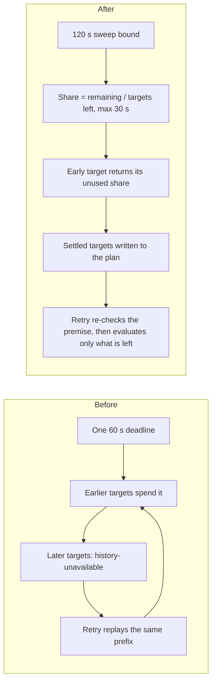

# Knowledge contribution admission

This implements [issue #50](https://github.com/InferMatrixLab/InferRSI/issues/50).
Executable rules live in [the policy configuration](../.github/knowledge-model-policy.json).
The stable commit-status context is **`knowledge-model-policy`**.

## Rollout and scope

Start in **report-only**: noncompliance produces a failed status and workflow,
while the status is not yet required for merging. Required-check enforcement
needs separate acceptance and repository-owner authorization. This lightweight
metadata check complements the four CI lanes; it adds no device/campaign lane.
Success means **declaration compliance only**, not proven execution settings,
knowledge accuracy, independent review, Skill Eval or candidate promotion.
Never request private session logs, secrets or hidden reasoning. This policy is
prospective; do not reconstruct unknown identities or rewrite historical commits.

The exact protected scope is:

- `src/inferrsi/data/skill_library/**`
- `src/inferrsi/data/knowledge_packs/**`
- `src/inferrsi/data/repo_packs/**/knowledge/**`
- `docs/reference-matrix.md`, `docs/searchspace-matrix.md`
- `docs/knowledge-base.md`, `docs/knowledge-operations.md`, `docs/knowledge-store.md`
- `src/inferrsi/catalog.py`, `src/inferrsi/skill_catalog.py`,
  `src/inferrsi/knowledge_operations.py`

Deletions and both rename paths count. Mechanical/generated changes have no
automatic exemption. Running a generator or obtaining an approved-model review
or signature does not replace material authorship. Other source files are not
blanket-protected. Other PRs receive the stable status as `Not applicable`.

## One PR-body declaration

Use exactly one fenced JSON block and disclose every material AI author:

```knowledge-model-policy
{
  "schema_version": 1,
  "head_sha": "<current-full-head-sha>",
  "human_only": false,
  "material_ai_authors": [
    {
      "tool": "<actual-tool-or-agent>",
      "model_id": "<exact-model-id-or-unknown>",
      "effort": "<actual-effort-or-unknown>",
      "role": "author"
    }
  ]
}
```

For human-only work set `human_only=true` and `material_ai_authors=[]`, explicitly
declaring no material AI involvement. Content review still applies. Mixed work
uses `false` and lists every material AI author. Reviewer/signing provenance stays
on the separate review record. Unknown values stay truthful and do not qualify.
Update `head_sha` after new commits. Missing/duplicate blocks or fields,
conflicting declarations and stale coverage fail. PR text is never shell input.

| Owner label | Canonical ID | Explicit aliases | Allowed effort |
| --- | --- | --- | --- |
| Claude Opus 5.5 | `claude-opus-5-5` | `anthropic.claude-opus-5-5` (Bedrock) | `xhigh`, `max` |
| GPT-6-Astra | `gpt-6-astra` | None | `xhigh`, `max` |
| GPT-6.1 Sol | `gpt-6.1-sol` | None | `xhigh`, `max` |

IDs and effort support were checked on 2026-10-21 against official
[Claude IDs](https://platform.claude.com/docs/en/models/opus-5-5/overview),
[Claude effort](https://platform.claude.com/docs/en/build-with-claude/effort),
[GPT-6 Astra](https://developers.openai.com/api/docs/models/gpt-6-astra) and
[GPT-6.1 Sol](https://developers.openai.com/api/docs/models/gpt-6.1-sol) docs.
Actual client settings still need truthful declaration. OpenAI uses
`reasoning.effort`; Claude uses `output_config.effort`. Identity is resolved first,
then effort uses explicit set membership. Default, `high`, `ultra` and unknown
settings do not qualify. Aliases are never inferred. Suspension also denies aliases.

## Explicit exceptions and policy review

The approval owner is `@Dong1017`. Their own contributions require a separately
designated independent maintainer in trusted `independent_approvers`; none is
designated initially. A PR cannot designate or approve its own exception.
Retain truthful attribution and add an exception request to the same PR block:

```json
"exception": {"paths": ["<every-protected-changed-path>"], "reason": "<specific-reason>"}
```

An authorized maintainer posts a top-level **PR conversation comment**:

```knowledge-policy-approval
{
  "schema_version": 1,
  "pull_request": 123,
  "head_sha": "<current-full-head-sha>",
  "decision": "approve",
  "no_material_involvement": true,
  "approvals": [
    {"kind": "exception", "paths": ["<every-protected-changed-path>"], "reason": "<exact-request-reason>"}
  ]
}
```

CI verifies the actual comment author. Copying a block into the PR body grants
nothing. The approver declares no material involvement and cannot be the PR
opener or a known commit author/committer. Account checks do not prove agent
independence; truthful disclosure and independent designation remain required.
Unlinked Git identities cannot be inferred by CI. PR number, head, exact scope
(including applicable rename paths) and request reason must match. New commits
require renewed approval. Exceptions cannot excuse malformed/missing attribution;
explicitly unknown settings may be considered by the approval owner.

`policy_paths` classifies changes to this mechanism — the policy config, this
checker, the metadata workflow, the runner and this document — and reports them in
each result. Classification is not a gate: a policy-only change does not fail for
lack of a separate approval, and passing it is not a statement about content
quality. Nothing in this mechanism grants an exception: an approval of kind
`policy-change`, including historical comments, cannot excuse protected knowledge
changes or substitute for knowledge author admission. One comment may still carry
both kinds in `approvals`; only the `exception` kind is evaluated. Checks use the
target branch's policy, never the PR's proposed replacement.
Each authorized account's latest comment containing the approval fence replaces
its earlier declarations. Use `decision: "revoke"` to revoke its grants. Comment
edits/deletions trigger reevaluation; delete all applicable grants or post a
revocation if older grants also exist. Approval is admission metadata, not
independent content review or merge permission.

## Trusted execution, refresh and validation

GitHub [commit statuses](https://docs.github.com/en/rest/commits/statuses#about-commit-statuses)
belong to a SHA/context, not a PR. A head shared by multiple
open PRs is ineligible, even if one PR declares compliant authorship or receives a
PR-specific exception. The checker reads all open repository PRs, across target
branches and API pages, and requires a unique head both before evaluation and
before publishing its result. Close the extra PR or use a distinct commit before
retrying. An exception cannot bypass head uniqueness. A closed peer no longer
shares the head: the remaining open PR is evaluated on its own metadata and
receives its own verdict. The checker reads the full open-PR collection once
before evaluation and once before publication, with API pagination in both scans.
Results are published only from that fresh scan, and only for a target that is
still open against the policy branch with an unchanged head; applicable approvals
are reread before publication. The collection request count scales with its page
count, not page count times PRs.

## Lifecycle and reruns

A merged or closed PR that is no longer part of the sweep receives no new status;
its earlier verdict stays historical. Publication never targets a captured head
for work whose base advanced or whose head changed. One evaluation pass is
followed by a publication pass that re-reads the target. If the head, base, body
or approvals moved, or if head ownership changed because a peer closed, the checker
reassesses once against the current metadata and the current open-PR collection
before writing. A green is published only from a verified premise.

### Invalidation before evaluation

Once a target is confirmed open against the policy branch with a valid head, the
checker immediately publishes `pending` ("Admission evaluation in progress") to
that head **before** it assesses changed files, declarations, exceptions or
approvals. Confirming the target necessarily reads the PR body; what the
invalidation precedes is the evaluation of that evidence. A verdict from an
earlier run therefore cannot survive into a window where the current evidence
could reject it. If that `pending` write fails, the target's success path
stops: the result is `invalidation-failed`, no evaluation verdict is published,
and the runner retries. Nothing is written over the failed invalidation, because
that write would be the same operation that just failed.

The old result is replaced rather than deleted, so the status history keeps both
the superseded verdict and its replacement. A `pending` status is not a merge
signal; callers must read the latest status of the current head, not any earlier
entry.

### Status capacity on a long-lived head

GitHub keeps at most 1,000 statuses for one SHA and
[context](https://docs.github.com/en/rest/commits/statuses#create-a-commit-status).
A write past that bound is rejected with a validation error rather than
discarded, and the context name is compared case-insensitively. Because every
run writes an invalidation and a verdict, an unchanged head would eventually
stop accepting writes.

The checker therefore reads this context's history for the head before writing,
counting case-insensitively, and keeps a reserve of 8 statuses. At or below 990
recorded statuses it evaluates normally; 991 to 999 use the reserve handling
below; 1,000 is saturated. At 991 or above it publishes one `budget-exhausted`
failure instead of evaluating, so the newest entry is a failure rather than an
earlier success, and reports that a new head is required.
That verdict is terminal: a later sweep recognises it as its own and writes
nothing, so repeated sweeps do not consume the reserve. If that one write
fails, the run reports `publication-failed`; the next sweep attempts the same
single write once more.

A head can also carry statuses from other contexts, so the read is bounded by
both 50 pages and time. Time is split rather than shared as one absolute
deadline. Each target receives an equal part of what is left in the sweep,
capped at 30 seconds, so a target that finishes early returns its unused time
to the later ones. The sweep itself is bounded by 120 seconds per attempt, and
one 15-second reserve is withheld from the sweep so publication still fits after
the last read. Each history request is additionally capped by the share still
remaining. Exhausting the page bound or the target's share is reported as
`history-unavailable`, which publishes the failure immediately and lets the
remaining targets continue.

The former design gave every target one absolute 60-second deadline: targets are
processed serially, so the first ones spent it and each later target then failed
closed, and a whole-sweep retry replayed the same prefix.

Retries now carry progress. Each attempt writes the targets it settled to a plan
file, and the next attempt inherits them instead of re-invalidating and
re-publishing the same verdicts, so an exhausted tail cannot replace a verdict an
earlier attempt already published. A carried target is trusted only after one
cheap re-read shows it is still open against the policy branch at the same head,
base, state and declaration. Any change to those falls back to full evaluation,
and the plan is discarded outright when the trusted base differs, because a
different base means different loaded code and policy.

Carrying is limited to settled verdicts: `compliant`, `noncompliant` and the two
capacity states. Work reported as rerunnable - unreadable evidence, a failed
write, an advanced or entered target - is never inherited, so a genuine failure
is retried and stays visible rather than being optimistically cached.

The premise stored with a verdict must be the one that produced it. A target
reassessed during the publication pass is therefore stored with the snapshot,
approval comments and ownership that reassessment used, not with the earlier
evaluation's evidence; otherwise a changed-then-reverted approval would make the
stored premise match again and the stale success would be reused. If the open-PR
collection cannot be read, no target is carried, because a target read alone
cannot prove it does not share its head.

At or above the cap nothing can be written at all. The run reports
`budget-saturated` without attempting a write. An earlier `success` may still be
the head's newest entry and can therefore still satisfy the required context:
this head is blocked from receiving new statuses, not necessarily blocked from
merging, and this checker cannot replace that entry. A new head is the only
recovery, and the result is not retried. If the history cannot be read, the
result is `history-unavailable`: the failure is published immediately rather than
in the publication pass, so a sweep that is cut off before reaching this target
still replaces the old verdict. If that write fails, the result is
`publication-failed` and the run retries.

### Paths that cannot invalidate an old result

Fail-closed invalidation is not universal. These paths are reported explicitly and
must not be described as enforced:

| Situation | Behavior and limitation |
| --- | --- |
| The target PR cannot be read at all | Its head may already be merged, so no write is attempted. The result is `unverified`, the run fails, and an earlier green remains `pending`-free until a run can read the target |
| The `pending` write itself fails | Result is `invalidation-failed`; the earlier verdict still applies to the head and the run fails visibly |
| The final verdict write fails | Result is `publication-failed`; the head keeps the `pending` placeholder, which does not satisfy a required check |
| The PR is closed before publication | No verdict is written. If the target was still open at evaluation time it keeps the `pending` it received there, and the workflow reports success without a verdict for that head |
| The head advances before publication | No verdict is written. The superseded head keeps its `pending`; the new head has no status until a run covers it, and the run exits `2` for that retry |
| A merge attempt races the run | The check reads metadata, invalidates, evaluates and publishes without holding any lock. A merge authorized by the previous state can land between the last read and the status write |
| The head has used its reserved status capacity | Result is `budget-exhausted`: one failure is recorded there and no success is published. The entry is recognised on later sweeps, so nothing further is appended and the state is not retried. Only a new head resumes evaluation |
| The head is already at the 1,000-status cap | Result is `budget-saturated`: no write is possible, so an earlier `success` may still be the head's newest entry and this checker cannot replace it. The head is blocked from new statuses, not necessarily from merging; only a new head resumes evaluation |
| The status history cannot be read | The failure is published immediately rather than in the publication pass, so a sweep cut off before reaching this target still replaces the old verdict. If that write also fails, the head keeps the earlier verdict and the result is `publication-failed`, which retries |
| GitHub has not yet dispatched the event | Enforcement cannot precede the event that triggers it. A commit or body edit is enforced only after a run for that change has published a result |

`pending` narrows the window in which an old success describes stale evidence. It
does not close the window between the last metadata read and the status write, and
it cannot act when GitHub supplies no event. Repository protection plus a required
check is what turns these states into an actual merge block.



When the trusted base advances mid-sweep, the checker returns a retryable result
promptly instead of re-evaluating against its own stale checkout. It exits `2`,
and trusted `tools/run_knowledge_model_policy.sh` refetches `main` and runs the
checker again from the current code and policy. The runner is the single retry
owner with a bounded budget; after exhaustion the workflow run fails. See the
limitations table above rather than reading this as unconditional fail-closed
enforcement.

Each result carries `kind` alongside the status `state`:

| `kind` | Meaning |
| --- | --- |
| `compliant` | Declaration and approvals satisfy the trusted policy |
| `noncompliant` | Genuine rejection: declaration, approval or head eligibility (including a shared head) |
| `evaluator-error` | GitHub API or incomplete evidence; never a rejection |
| `unverified` | Compliance could not be published without unverified lifecycle or ownership metadata |
| `deferred` | Work could not be completed in this run; rerun required |
| `closed` | Target left the sweep; no status was written |
| `advanced` | The evaluated head was superseded; nothing is written to the new head |
| `publication-failed` | Status write failed; the verdict was not recorded |
| `invalidation-failed` | The earlier result could not be replaced by `pending`; no verdict was published |
| `history-unavailable` | The head's status history could not be read within its share of the sweep, so the capacity margin is unproven; an explicit failure replaces the old result immediately, before any other target is processed |
| `budget-exhausted` | The head has used its reserved status capacity; one failure is recorded there, no success is published and a new head is required |
| `budget-saturated` | The head already holds 1,000 statuses for this context; nothing can be written, so an earlier success may remain the newest entry |

The final JSON summary counts each kind, lists the `noncompliant_pull_requests`, and
states the sweep `execution` as `ok`, `failed` or `unfinished`. Exit codes: `0`
the sweep completed (any number of individual rejections are their own red
statuses), `1` an execution error, `2` unfinished work to rerun. A rerun never
overrides a recorded rejection. A rejection belongs to its own PR: one PR's
rejection neither greens nor fails another PR's status.

The workflow handles PR open/reopen/close/commits/body-or-base edits on any target
branch (a PR against another base can share a main PR's head), approval-comment
creation/edit/deletion, every main push and manual dispatch. Main pushes refresh
all open main-target PRs. All triggers share one serialized status writer and each
run refreshes every open main-target PR, so replacing a pending job cannot lose another
PR's refresh or let an older run overwrite a newer result. It checks out `main`,
executes only trusted code, installs no PR
dependencies and treats PR text/files as API data. Permissions are limited to
contents/PR/issues read and commit-status write. Statuses explicitly target the
PR head because `pull_request_target` runs against base code. Metadata and
approvals are reread before publication; changes fail closed and need a fresh run.
PR edits and status publication are not atomic: integrators still check the
current head and latest run.

The shared concurrency group belongs to the declaration job. Ordinary Issue
comments skip that job and do not displace queued PR/base refreshes.

File pagination must exactly match `changed_files`; more than the GitHub files
API's 3,000-file limit fails visibly. Exception/policy approvals require complete
commit attribution within the PR commits API's 250-commit limit. API failures
never become compliant/non-applicable results. Current rules have no merge queue;
`merge_group` is explicitly unsupported. Validate a trusted integration before
enabling a queue with this required check.

HTTP diagnostics retain only the response status, a conservative category,
numeric rate-limit timing/remaining headers, and a bounded GitHub request ID.
Raw response messages, error arrays, request URLs and credentials are not logged.
A 403 alone is not proof of rate limiting; a 422 is a validation error, not proof
that the status-history cap was reached. Read requests may retry once when an
explicit rate-limit delay fits inside their remaining retry budget (at most 60
seconds). The wait is deducted before passing the remaining timeout to the retry.
The urllib timeout applies to socket operations, not a strict total wall-clock
deadline for reading the response.
Status POSTs are never retried by the transport. The existing outer sweep retry
plan remains unchanged; this diagnostic improvement does not repair permissions,
restore exhausted status capacity, or guarantee that historical red checks clear.


### Trigger-PR conclusion versus global sweep health

Every workflow event still refreshes **all open policy-branch PRs** through the
single serialized writer. This is necessary because concurrency may replace a
pending event. The runner still makes up to three attempts when global work is
unfinished; a green triggering PR never stops those retries early. The triggering
PR is evaluated first without dropping any peer from the sweep.

Only after the final attempt does a PR or PR-comment job use that triggering PR's
own verified result for its job conclusion. A `pull_request_target` result must
match the immutable event head; rerunning an old event cannot turn its historical
head green using a newer head's compliance. Missing/malformed event heads and
advanced heads fail closed with an explicit stale-event reason. PR comments lack
a head snapshot and retain current-head semantics. A peer PR's history/publication error
therefore does not turn a verified compliant trigger PR red. A noncompliant
trigger PR, unavailable evidence, status-publication failure, capacity failure,
advanced head, or missing target still fails its own job. A freshly checked
closed/non-policy-branch target is explicitly **not applicable**, not an admission
or acceptance PASS. It is added to the sweep even when absent from the open list.
Push-to-main and manual workflow-dispatch jobs continue to report global execution
health. Explicit CLI `--pull-request` and dry-run behavior is unchanged.

The runner deletes the report before each attempt. The checker atomically writes
a report bound to repository, event digest/type, policy SHA and attempt identifier;
the final consumer rejects missing, malformed, duplicate, stale or mismatched
reports. It never falls back to an earlier attempt's success. Failed collection
reads additionally produce synthetic target `0` in reporting sweeps (included in
result counts), which blocks projection even if an individual result is green.

All target results and global health remain in structured logs. The final scope,
target kind, policy SHA and global summary are also written to the job summary;
an incomplete/failed sweep emits a warning even when the trigger PR job passes.
This isolates unrelated job conclusions without clearing any peer's failing
commit status or hiding repository-wide failures. No admission rules, publishing
permissions, status-history limits, or acceptance requirements are weakened.

The bootstrap PR cannot exercise a target-branch workflow that has not landed:
independently review and accept it before merging, then validate report-only on
real PRs. Local/PR CI success does not close #50 or authorize required enforcement.

```bash
python -m pytest tests/test_knowledge_model_policy.py
python -m ruff check tools/check_knowledge_model_policy.py tests/test_knowledge_model_policy.py
python tools/check_knowledge_model_policy.py --repository <owner/repo> --pull-request <number> --policy-sha <base-sha> --dry-run
```

`--dry-run` reads public metadata and reports the local candidate's result without
publishing statuses. It does not show the main workflow is operational. Production
uses runtime-injected `GITHUB_TOKEN`; never pass tokens as CLI arguments. The
existing ready lane runs unit tests on Python 3.10 and 3.11 in its full suite.

