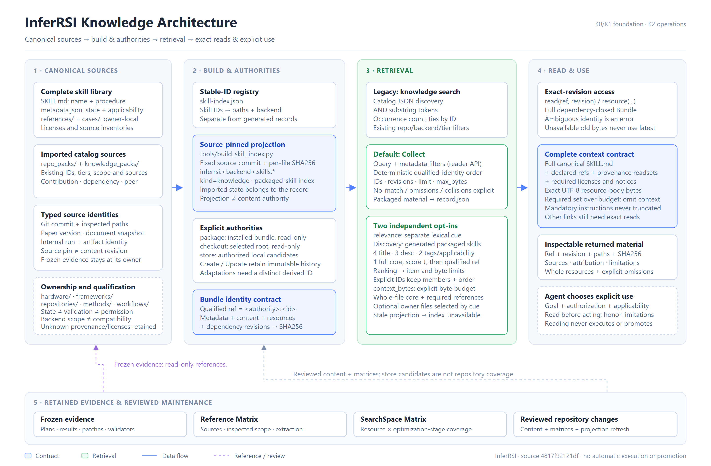

# Knowledge retrieval audit

This audit covers the existing file-backed knowledge system and a bounded
manifest optimization. The [accepted scope](https://github.com/InferMatrixLab/InferRSI/issues/190)
owns the comparison protocol, revision pins and acceptance criteria. CPU
retrieval correctness and latency do not establish agent task quality, model
performance or an inference-service gain. The frozen 20-pair experiment
observed a **40.01% paired-median reduction in hot relevance-collect latency**,
with a **95% bootstrap interval of 38.38%–41.06%**, on the local CPU setup.
The frozen 24-case quality comparison preserves
every serialized output exactly; the quality figures below describe existing
retrieval behavior, not an improvement introduced by this manifest patch.

## Construction and ownership

Complete procedures live in
[`skill_library`](../src/inferrsi/data/skill_library/README.md): `SKILL.md`,
sidecar metadata, owner-local references, cases, scripts and licenses. The
registry maps stable names to categorized paths and backends.
[`build_skill_index.py`](../tools/build_skill_index.py) derives packaged JSON
abstracts and source-file hashes from those owners; it does not create another
editable procedure authority. Hand-maintained repository knowledge records
retain their own IDs, source revisions, applicability and verification limits.
[`catalog.py`](../src/inferrsi/catalog.py) validates and reads contribution,
dependency and peer records from their existing package-data directories.

| Axis | Meaning | Boundary |
| --- | --- | --- |
| Kind | `skill`, `knowledge`, `case` | Generated packaged skill abstracts are `knowledge`; checkout procedures are `skill` |
| Tier | `contribution`, `dependency`, `peer` | Repository relationship, independent of kind and empirical validity |
| Authority | `package`, `checkout`, `store` | Qualified identity ownership; collisions require explicit authority |
| Origin, state, applicability | Where guidance came from and where it may apply | Import or candidate state does not establish validation, permission or promotion |

[`KnowledgeReader`](../src/inferrsi/knowledge_operations.py) normalizes these
sources into complete Bundles. A package reader retains one catalog/library
snapshot. Checkout reads reload their current bytes; the optional
[`KnowledgeStore`](../src/inferrsi/knowledge_store.py) retains exact revisions in
an explicitly selected local SQLite workspace. Store writes publish candidate
bundles transactionally and do not edit the package or checkout.

A Bundle revision covers normalized metadata, every included resource hash and
resolved dependency revisions. Packaged records with `skill_documents` retain
the entire shared library as a conservative dependency closure. Returning a
small context therefore does not imply constructing a small Bundle. Reading
content never executes its procedure or scripts.

The editable architecture artifacts are retained with this campaign:
[English SVG](../evidence/knowledge-retrieval-20261027/results/architecture/inferrsi-knowledge-architecture.en.svg),
[Chinese SVG](../evidence/knowledge-retrieval-20261027/results/architecture/inferrsi-knowledge-architecture.zh-CN.svg),
[Chinese PNG](../evidence/knowledge-retrieval-20261027/results/architecture/inferrsi-knowledge-architecture.zh-CN.png)
and [source/rebuild notes](../evidence/knowledge-retrieval-20261027/results/architecture/SOURCE-NOTES.md).

## Entrypoints and actual context delivery

| Entrypoint | Matching and ordering | Returned material |
| --- | --- | --- |
| `knowledge search` / `search_knowledge()` | All query tokens must occur in serialized catalog JSON; occurrence-count score, then ID | Catalog records; no complete Bundle construction |
| Default `collect()` | Whitespace-token AND substring matching over normalized metadata plus entrypoint; qualified identity order | Validated items; `material=True` adds the entrypoint body |
| `collect(relevance=...)` | Eligible generated packaged skills; distinct lexical words weighted by title, summary, tags/applicability and core; score then qualified ID | Same validated items; explicit IDs preserve caller membership/order |
| `collect(context_bytes=...)` | Mandatory complete core/references/readsets/licenses/notices, then optional complete owner resources ranked by cue or path | Separate exact-revision `contexts`, explicit omissions and UTF-8 body-byte accounting |
| `read()` / `resource()` | Explicit owner and optional/required exact revision | Complete Bundle view or selected exact resource bytes |

The merged [PR #129](https://github.com/InferMatrixLab/InferRSI/pull/129)
implemented the optional selection and context path; it is present in the
current source. The Python API returns context resources and omissions;
[`cli.py`](../src/inferrsi/cli.py) exposes `--relevance` and `--context-bytes`,
prints complete context bodies in text mode and returns the full envelope with
`--json`. `KnowledgeStore.collect()` delegates those same options to its reader.
An external agent must consume the returned material; these calls do not
automatically activate skills or execute a workflow.

For generated packaged skills, `material=True` still means `record.json`, not
the canonical `SKILL.md`. The latter is supplied through the optional context
view or exact resource access. Item limits and serialized `max_bytes` accounting
remain separate from context-body bytes. An oversized mandatory context is
omitted atomically; the selected item may still be returned.

The entrypoints are not interchangeable. The Python collect API supports
`repo`, `tier`, `backend` and `scenario`, but the current collect CLI parser and
dispatch do not expose them. The generator's README example
`inferrsi collect --repo-type inferrsi ...` consequently uses an unsupported
flag. This is a separate usability correction; this patch does not modify the
parser or regenerate catalog content.

## Redundant manifest work and the bounded change

Previously `Bundle.manifest()` hashed resource bytes during dependency
validation and again for its returned resource inventory. Directory
dependencies also rebuilt a sorted resource traversal. Required resource paths
were reparsed after the same content keys had already passed path validation.

The change creates one sorted resource digest map per manifest call, reuses it
for direct and directory dependency checks, and returns that same map. Present
string required paths reuse the earlier content validation; missing, unsafe
and malformed requirements retain their validation path. Nothing is cached
across calls: the frozen dataclass still contains mutable dictionaries, so each
manifest must observe changed metadata, bytes, resources and dependencies.

The remaining work is deliberate in this slice: each Bundle still validates
its complete closure, and collection still constructs eligible Bundles before
selection/output budgeting. Cross-Bundle caching, metadata-first indexes and
selection changes require their own mutation/identity contracts and evidence.

[`test_bundle_manifest.py`](../tests/test_bundle_manifest.py) compares the
manifest and revision with the complete digest formula, checks one resource
hash per manifest call, and exercises mutations, deletion, unsafe paths,
required resources and dependency revisions. Existing reader/selection/store
tests cover source drift, stale projections, checkout changes, budgets and
revision rejection. The paired CPU report retains fresh/reused reader results, CLI costs,
exact output parity and all measured regressions.

## Constructed retrieval evaluation

The [prospective packet](../evidence/knowledge-retrieval-20261027/README.md)
contains 16 development and 8 withheld synthetic cases, covering natural
phrasing, symbols, multiple terms, backend filters and negatives. An explicitly
configured Codex `gpt-6.1-sol` / `xhigh` author labelled relevant identities from
original shipped procedure content before inspecting rankings. These are
partial, source-grounded AI judgements, not human gold labels, production logs,
a statistically representative sample or an exhaustive relevance inventory.
The withheld queries stayed hidden from the runtime author and orchestrator
until the runtime candidate was fixed. No query, label or budget was tuned
after the quality result.

Both API entrypoints use `repo="inferrsi"`, the same case backend and `limit=5`.
Search takes `query=cue`; relevance collect takes `query="", relevance=cue`.
Default collect is a separate diagnostic with `query=cue`. The context/material
mode adds a 1,048,576-byte item budget and 65,536-byte context-body budget.

| API mode | Success@5, 20 positives | MRR@5, 20 positives | Empty items, 4 negatives |
| --- | --- | --- | --- |
| Catalog search | 4/20 (20%) | 0.2000 | 4/4 |
| Default collect diagnostic | 4/20 (20%) | 0.2000 | 4/4 |
| Relevance collect | 20/20 (100%) | 0.9625 | 2/4 |
| Context/material item ranking | 20/20 (100%) | 0.9625 | 2/4 |

Development search/default Success@5 was 3/14 and MRR@5 0.2143; withheld was
1/6 and 0.1667. Relevance/context-item Success@5 was 14/14 and 6/6, with MRR@5
0.9464 and 1.0000 respectively. Each split had two negatives: search/default
returned empty items for both, relevance/context for one. Full per-case outputs
and byte digests are retained in
[`quality.json`](../evidence/knowledge-retrieval-20261027/results/quality.json).
All **96 outputs per revision** had exact canonical-serialization parity,
including identity order, revisions, resource hashes, omissions and byte
accounting. Source and complete-corpus identities also matched their initial
snapshots at the end. The manifest patch therefore preserved this measured
behavior; it did not create the relevance path or its higher scores. That path
was already delivered by #129.

The item metrics do not establish delivery of the correct procedure body. A
separate **post-hoc diagnostic**, not a changed frozen gate, found labelled-owner
contexts delivered in **19/20** answerable cases. In `withheld06`, the correct
`performance_ceiling_analysis` item is first, but its complete mandatory context
requires **170,782 bytes**, more than the frozen **65,536-byte** budget.
`context_limit` omits that owner's context atomically; 51,702 bytes of other
candidates' contexts are still returned. Calling this 20/20 correct body
delivery would hide the limitation.

Three source-backed examples explain the measured boundaries:

- `DefaultStager` (`dev02`) yields no search/default items because this symbol
  is absent from their indexed record text. Relevance examines the canonical
  core and finds `dcp_async_save_performance` first; context mode delivers its
  two required resources, **12,636 bytes**. A metadata projection miss does not
  mean the underlying procedure lacks the answer.
- The negative `sourdough levain hydration recipe` (`dev16`) returns five
  systems skills through relevance and two contexts totaling **38,037 bytes**.
  The scorer accepts any positive substring overlap; `recipe` also occurs in
  unrelated systems procedures as `recipe`/`recipes`. It has no calibrated
  no-answer threshold or generic-term penalty.
- For `dev14`, `claim_contract` is fourth: broader performance/evidence skills
  precede the more specific validator-freeze answer. Broad word overlap can
  therefore dilute first-position precision even when Success@5 is satisfied.

## Prospective CPU latency result

Twenty paired groups (ten AB, ten BA) measured four fixed hot-query types on the
local Intel Core i7-8565U / Windows 10 / CPython 3.12.6 setup. The frozen paired
median reduction was **40.01%**, with 95% bootstrap interval **38.38%–41.06%**,
satisfying the prospective CPU retrieval gate. The measurement loop retained
640 API calls and 160 CLI processes over 836.162 seconds. All 400 cross-version
output pairs and 80 exact CLI stdout pairs matched; source/corpus identities
remained unchanged. Independent read-only review reproduced the raw statistics
and bootstrap exactly.

Regressions are explicit: API search `dev01` p50 **+1.19%**; CLI search `dev05`
p50 **+2.50%**; CLI relevance decode p95 **1.810 → 3.046 ms (+1.236 ms, +68.31%)**.
No cause is established by these observations. Each per-query p95 uses only
20 repeats, not additional query types or a service tail guarantee. OS cache,
clock/power state and background load were uncontrolled; no service/model/agent
benefit is inferred.

[performance.md](../evidence/knowledge-retrieval-20261027/results/performance.md)
retains the complete per-mode/query p50/p95 tables for all 48 revision-specific
groups, methodology and limitations; [latency-summary.json](../evidence/knowledge-retrieval-20261027/results/latency-summary.json)
preserves exact nanosecond summaries, and [benchmark.json](../evidence/knowledge-retrieval-20261027/results/benchmark.json)
retains all raw observations and output digests. The baseline profile and #129
trace remain separate diagnostics.

## Local validation and remaining qualification

The complete local pytest attempt reported **10 failed, 1,340 passed, 6 skipped,
2 errors and 135 subtests passed**, in 953.11 seconds. Rechecking the eleven
selected failing/erroring functions on both revisions gave 9 failed, 4 passed
and 3 errors per side. The CRLF fixture initially failed, then errored during
the polluted focused run; isolated from the large-parameter fixture, both
revisions reproduced 1 failed/1 passed with `Skill metadata must remain
unchanged`. All initial failures/errors were thus reproduced on the baseline.
This remains a failed whole-suite result.

The observed blockers involve Windows environment-variable length, GBK
decoding, unavailable Bash, temporary-path differences, an asset-manifest
snapshot and unavailable `os.getpgrp`, plus the CRLF fixture behavior above.
All 20 new manifest regressions passed; the runtime author separately reported
80 targeted passes and a selected baseline run reported 104 passes. Default
isolated wheel/sdist builds succeeded after an earlier no-isolation attempt
failed for missing setuptools. All 469 packaged data files and the packaged
runtime source matched the source byte-for-byte. Exact qualifications and the
wheel digest are in
[`validation-summary.md`](../evidence/knowledge-retrieval-20261027/results/validation-summary.md).
The evidence inventory tests subsequently passed **23 tests**; the read-only
inventory check reported **no errors, 9 bundles and 120 verified hashes**.
`ruff check src tests tools` passed. A wheel-only, site-disabled smoke read
108 records and reproduced all four `DefaultStager` output hashes from the
formal candidate quality result. Its first harness attempt stopped at an
unresolved temporary short-path import-origin check before retrieval;
normalizing the expected path fixed that harness check. No package defect
was established by that retry. Remote CI is pending at PR creation. Rerun
the full suite on a clean supported Linux environment; local baseline
reproduction is not cross-platform qualification.

Independent reviewers performed read-only checks; their model/effort settings
are unknown and are not listed as material authors. The review record retains
the pre-measurement validator corrections, quality/body-delivery distinction,
raw benchmark recomputation and diagram check. These checks are separate
from human/maintainer goal acceptance, merge and issue closure, which remain
with the authorized owner.

Follow-up work should remain separately scoped: first make canonical-body
discovery and API/CLI filtering consistent; then evaluate generic-term weighting
and no-answer behavior with independent labels; then distinguish item discovery
from complete required-body delivery and make required bytes visible before
choosing a budget. A later performance slice may address repeated full-library
closure/hash work across Bundles, but only with explicit mutation and revision
contracts. This patch changes none of those behaviors.

## Quality limits and historical evidence

Less hashing cannot repair retrieval behavior. Default collect still has AND
substring matching and identity order. Optional relevance still uses literal
word overlap, positive-score eligibility and fixed field weights: it does not
resolve synonyms, infer task intent or provide calibrated no-answer confidence.
Whole-resource context can still exceed a budget, and callers still need to
follow omitted links through exact revisions. These are existing boundaries;
any observed misses or false positives must be reported with the measured cases.
No score, order, query, context budget or omission rule changes in this patch.

The closed [issue #128 owner report](https://github.com/InferMatrixLab/InferRSI/issues/128)
records accepted delivery of bounded whole-resource software and its comparison
packet: 36 attempts, 34 task PASS and 2 INCONCLUSIVE. It reports that C used
25.74% more input/output tokens than B, with no accepted reduced-cost/preserved-quality
benefit. Those are historical owner-reported results, not a rerun or new
independent verification by this audit. This work preserves that conclusion;
retrieval metrics and CPU parity cannot upgrade it to agent efficacy.
