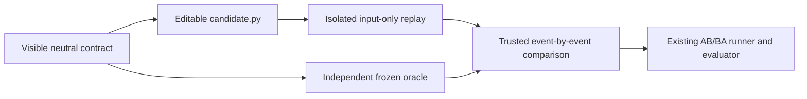

# Synthetic CPU KV-block reclamation qualification

This is a bounded **model-free mechanism-transfer task**, not vLLM conformance,
a natural historical-repository holdout, an accelerator result or agent efficacy.
The accepted slice is recorded in [the scoped execution record][scope]. It does
not replace the broader task-efficacy proposal, the serving-parser task or the
Indexer acceptance boundaries.

This synthetic task was deliberately constructed around the nominated knowledge's
dual-readiness mechanism. Independent oracle authorship is **not independent task
selection**. Both arms' visible contract and correct starter already state the
readiness rules; a later comparison tests utility while preserving those rules,
not discovery of a hidden requirement. It is a selected synthetic near-transfer
probe, not an independently sampled case.

The visible starter is a correct but deliberately repeated linear scan. Its
contract includes request finish, asynchronous save completion, a processed-step
write fence, deterministic reclamation order, generation identity, idempotent
callbacks and atomic invalid-input handling. Only `candidate.py` may change.
Shared blocks, refcounts, prefix matching, transport and real concurrency are
outside this task.

## Trust and evidence boundaries



- The independent verifier author freezes the semantic oracle and disjoint
  development/grader traces without reading the nominated knowledge or target
  implementation. Static trace observations are checked against that oracle.
- The candidate process receives its source, a trusted driver and input events,
  never oracle code, expected answers, other trials, knowledge or reference code.
  Return types, event counts, every reclamation list and pending state are checked.
  Raw inputs necessarily reach the candidate during replay; expected results and
  the grader fixture store do not. Every output byte remains untrusted, even if
  the candidate tampers with its Python driver or output serializer.
  In-process tuple/list assertions are ordinary compatibility checks, **not**
  anti-tamper acceptance: malicious same-interpreter code can bypass them. The
  externally enforced acceptance is frozen observable trace-envelope equality
  and host whole-command timing, not immutable per-call driver/type behavior.
- `kv_reclamation.invoke` reuses the existing bubblewrap command and host
  `execute_command` deadline. Network/PID namespaces, clear environment,
  read-only mounts and hard process/memory/CPU/output limits are probed. There is
  **no unisolated fallback**. This boundary confines artifacts, not a future actor.
  Group-cleanup probes cover the tested host process group; the hard no-fork
  boundary is checked separately. This is not arbitrary detached-tree or future
  actor cleanup certification.
- Missing output, changed protected paths and incorrect artifacts are rejected.
  Infrastructure failure, unavailable isolation and timeout remain unverified
  (`INCONCLUSIVE`), distinct from a completed comparison refuting a claim.
- Workbench timing reuses `run_experiment` and `evaluate`. It measures host elapsed
  time of the whole CPU task command, including sandbox/interpreter startup. The
  candidate cannot supply a claimed timing metric. Inputs, repetition count and
  numeric headroom gates live only in the frozen qualification plan.
- Correctness precedes timing. An optimized software control must pass the full
  verifier and the headroom gate; premature save/fence release, generation errors,
  cached answers/event skipping, missing output and protected edits are negative
  controls. A/A and no-op comparisons must not meet the improvement gate.
- All runs, including failures, are retained. There is no retry-until-pass rule.
  The CI receipt retains hashes, statuses, raw timing samples and control coverage.
  Its `raw-evidence.zip` retains actual control outputs and AB/BA evidence with
  labelled path redactions, without hostnames, credentials or full environment dumps.

## Meaning of a successful qualification

Qualification can establish only that this exact host/task/verifier combination
has discriminating controls and measurable software headroom. CI success is not
an engine campaign `PASS`, a knowledge benefit, an actor isolation certificate or
permission to infer broad transfer. The original tests and historical outcomes
remain unchanged.

The prospective A2/A3 comparison holds W constant and changes only a complete,
pinned `audit-vllm-kv-lifetimes` owner bundle. Before any paid step it still needs a
frozen executable actor/tool protocol, demonstrated read isolation (including W
package data and host files), full K-to-target contamination audit, known charges,
conservative reservations, authorized plan identity and a final-artifact grader.
A provider `read_file`/`submit_answer` path is not an iterative editing agent.
No model calls or paid adapter are part of this delivery.

## Reproduce

From a checkout with Linux system Python, Git and distribution bubblewrap:

```sh
PYTHONPATH=src /usr/bin/python3 -m tools.qualify_kv_reclamation \
  --plan evidence/kv-reclamation-20261030/plan/qualification-plan.json \
  --revision "$(git rev-parse HEAD)" --output <new-output-directory-outside-checkout>
```

The command never accepts arbitrary source or grader paths. The existing Ready
workflow runs a non-required Ubuntu job with no secrets and retains the sanitized
receipt. Its exit code gates software controls, **not** numerical performance:
always read `qualification_verdict` in the receipt. A green job with insufficient
headroom does not qualify the task. The original manual parser qualification,
test matrix, branch protection and default serving-parser adapter are unchanged.

The initial local run is retained as `INCONCLUSIVE`: the cloud host refused the
required network namespace setup. It did not run any candidate without isolation.
Trusted direct-import controls are labelled separately and do not upgrade that
result. See the [frozen plan and retained evidence](../evidence/kv-reclamation-20261030/README.md).

The independently frozen benchmark tests retain their original standalone layout.
In this integrated checkout, use the checked wrapper test or set the documented
oracle location without modifying frozen files:

```sh
KV_FROZEN_ORACLE="$PWD/evidence/kv-reclamation-20261030/validator/independent/oracle.py" \
  pytest evidence/kv-reclamation-20261030/validator/test_benchmark.py
```

[scope]: https://github.com/InferMatrixLab/InferRSI/issues/248#issuecomment-6526000390
