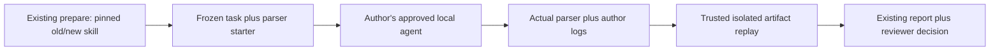

# Local engineering evidence for SkillEval

SkillEval can check a **code artifact**, rather than ask a model to grade its own
answer. The first adapter is one public CPU response-parser task reconstructed
from the error-stream observation in [PR 90](https://github.com/InferMatrixLab/InferRSI/pull/90).
It is not the original server, a GPU experiment, a hidden benchmark, or acceptance
of that PR. The [frozen task contract](../tests/fixtures/skill_eval_engineering/contract.md)
records source revisions, starter hash, exact behavior and exclusions.

## What changed



`tools/skill_eval_compare.py` still owns prepare/execute/report and paired
snapshots. `tools/skill_eval_local.py` adds manual stage/capture, without launching
an agent. `src/inferrsi/harness/skill_eval_engineering.py` owns the one task and
19 public behavior probes for that one task. `skill_evaluation.py` separates the single writable
artifact from frozen inputs. The existing cloud read/submit route is unchanged;
it cannot perform this artifact-editing task and is rejected for this adapter.

```mermaid
sequenceDiagram
    participant R as Reviewer / author
    participant S as SkillEval
    participant A as Approved local agent
    participant V as Isolated verifier
    R->>S: prepare pinned plan
    R->>S: execute --stage-local (one arm)
    S-->>R: Frozen task / skill + writable parser.py
    R->>A: Run under separately approved environment and budget
    A-->>R: parser.py and retained execution logs
    R->>S: execute --capture-local
    S->>V: Actual retained source, one input vector at a time
    V-->>S: Raw returned values (not self-assessed PASS)
    S-->>R: Report, exact checks, limits and artifact links
    R->>R: Repeat other arm; independently review evidence and PR scope
```

There is no SSH dispatcher, CI result-return protocol, new judge/translator call,
or automatic merge. The author posts an accessible evidence report in the PR;
the reviewer checks its current head and accepted scope before deciding.

## Prepare a plan

Start from an existing comparison configuration. Set `adapter` to
`engineering-artifact-v1`, `mode` to `update`, explicit baseline/candidate full
Git SHAs, selected skill ID/root, approved model/settings and existing limits.
Do not add a provider `client`, custom `schema` or `grader`. Generate the case
without silently changing its contract:

```python
from inferrsi.harness.skill_eval_engineering import REQUEST
from inferrsi.infra.artifacts import write_json

write_json("cases.json", [{
    "id": "serving-response-v1", "split": "development",
    "request": REQUEST,
    "provenance": "Reconstructed CPU fixture from PR 90's public error-stream case",
}])
```

```sh
python tools/skill_eval_compare.py prepare --repo /path/to/repo \
  --config /path/to/config.json --output /path/to/evidence
```

Keep the returned frozen-plan SHA externally with the acceptance record. This
freezes task, schema, starter, verifier/controllers and both selected bundles.
Before any real agent call separately establish trustworthy **whole-run cost
bounds**, model identity, tool access, isolated environment, run order/repeats,
timeout and treatment of failed/retried attempts. A plan hash is not permission
to spend, and wall-clock/token stop-new-trials is not a hard per-call dollar cap.

## Author-run handoff

Use separate fresh workspace paths outside the evidence tree for each arm. Stop
all producers before capture. The CLI's `--current-head` is supplied by the
reviewer after reading GitHub; it is checked against the plan, not fetched or
authenticated by this offline command.

```sh
python tools/skill_eval_compare.py execute --output /path/to/evidence \
  --authorize PLAN_SHA --stage-local /path/to/baseline-work \
  --task-id serving-response-v1 --condition baseline --repeat 1 --current-head HEAD_SHA
```

Only `parser.py` may change. `task.json`, `INSTRUCTIONS.txt` and `knowledge/` stay
frozen. The task needs no imports, dependencies, network or hardware. Author
execution must occur in an already-approved environment; staging does not start
it or imply that the host is safe. Do not expose credentials, the other arm's
work, or private verifier/campaign files to the agent. Tests here are public, so
this is not a blind generalization experiment. The old default Codex client uses
`danger-full-access` and is explicitly refused for automatic engineering runs.
A `workspace-write` label alone also does not establish read confinement.

Retain agent stdout/stderr and an author execution description in a separate
submission directory. `execution.json` must have exactly these fields:

```json
{
  "model": {"name": "the-frozen-approved-model", "effort": "the-frozen-effort"},
  "environment": "runtime/image and versions actually used",
  "access": "actual tools, filesystem/network/oracle/other-arm access and limits",
  "resources": "approved bound, observed cost or unknown, all attempts and retries",
  "usage": null,
  "elapsed_seconds": 30,
  "agent_exit_code": 0,
  "summary": "What changed, what remains, and scope limits"
}
```

`usage` may contain observed nonnegative `input_tokens`, `output_tokens` and
`cached_input_tokens`; missing usage stays unknown. Logs and metadata are
**author-supplied**, not an authenticated controller trace or proof of spending.
Do not fabricate a model run from deterministic software controls. Preserve failed
attempts; stage/capture refuse to overwrite an existing attempt. New trials need
a new prepared evidence directory, with earlier attempts linked by the author.

```sh
python tools/skill_eval_compare.py execute --output /path/to/evidence \
  --authorize PLAN_SHA --capture-local /path/to/baseline-work \
  --submission /path/to/baseline-logs --task-id serving-response-v1 \
  --condition baseline --repeat 1 --current-head HEAD_SHA
python tools/skill_eval_compare.py report --output /path/to/evidence
```

Repeat for candidate under the same approved controls. Actual source is captured
separately from the summary, hashed and reverified at report time. Changing any
frozen file, missing artifact/log, mismatched head or unavailable sandbox must not
become a clean comparison. Nonzero author exit or exceeding frozen timeout is
reported separately from the artifact's independently checked behavior.

## Replay environment and interpretation

Replay requires Linux, bubblewrap namespace creation and system Python. It mounts
only system runtime libraries, a trusted runner and the submitted artifact;
there is no home, repository, other arm or network. The runner has bounded CPU,
wall time, address space, file size and descriptor/process resources. Expected
outputs remain in the trusted parent; each child sees just one input vector.
A capture from an isolation-blocked host can still retain source and logs. Later
`report` on a qualified reviewer host replays that source into separate
`artifact_checks` / `artifact_verdict`; it preserves the original capture error,
INCONCLUSIVE trial and unverified comparability rather than rewriting history.

No unsafe host fallback exists. Syntax/runtime failures after successful sandbox
preflight are failed task checks. Inability to establish isolation is INCONCLUSIVE.

The implementation workspace's probe returned
`NETLINK_ROUTE ... Operation not permitted`; no independent artifact replay or
real agent effect is claimed from that host. Use a host where this exact sandbox
preflight succeeds, under independently approved execution/cost conditions.
Do not request privilege escalation or disable isolation to make a test green.

Manual pairs use `artifact_improved` / `artifact_regressed` / `artifacts_both_pass`
/ `artifacts_both_fail`, **not causal skill fix/regression claims**. Environment,
access and usage comparability remain unverified author reports. A reviewer must
reconcile them; checks cannot authenticate who produced an artifact or prove
logs exhaustive. Negative/no-gain/inconclusive evidence can still be useful.

The first screen should answer: what artifact behavior changed, exact failures,
coverage limits and what this does/does not imply for the PR. Share report and
readable retained artifacts after privacy review, not local paths alone.
Preserve separate conclusions for knowledge/source correctness, software CI,
artifact checks, skill benefit and whole-PR acceptance.

## Tracking disposition

This delivery is a bounded software slice, not closure of the full evolution:

| Item | Disposition / next evidence |
| --- | --- |
| Risk-based merge evidence | Source-only, operational and hardware claims remain distinct; pilot is not a repository-wide gate |
| First engineering task | Frozen reconstructed CPU parser; source/code/limits linked above |
| Local entrypoint and artifacts | Stage/capture/replay via existing compare flow; real host and execution remain prerequisites |
| Judge applicability/calibration | Deferred: deterministic artifact checks need no judge; any later semantic judge needs fixed rubric, blinded order and known-bad/partial controls before use |
| Real paired run + PR review | Pending approved local environment/cost bounds, actual logs and independently reviewed PR evidence; no fabricated success |
| Negative controls | Software tests cover correct/wrong artifact, missing evidence, stale head, frozen-input changes and unavailable isolation; not model outcomes |
| Later corpus scoring | Separate bounded scope decision; not implemented or accepted by this single-task delivery |

Benchmark construction and retrieval quality remain separate work. This adapter
neither requires a giant per-skill question bank nor establishes full skill or
knowledge-corpus coverage.
