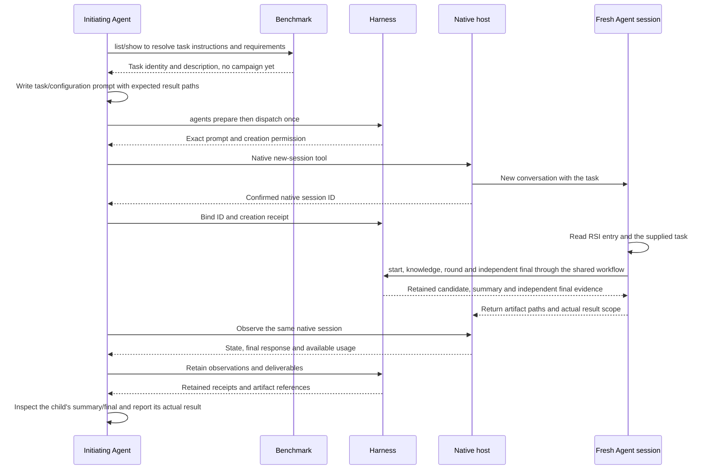

# Run a task in a fresh native Agent session

The initiating Agent uses its host's existing new-conversation tool. Harness
freezes the request, reserves one creation attempt, associates the returned
native ID and retains observations and delivered files. No Agent CLI or Apps
service is started. This first phase targets the current host; DSH launch and
other CLI adapters remain separate work.

This is the Agent workflow default for packaged optimization benchmarks, enforced
by the entry instructions rather than automatic session creation in Python.
Ordinary user projects
default to the current Agent conversation through `campaign start/round/final`.
Both use the same Harness lifecycle; see the
[complete sequence diagram](optimization-workflow-unification.md#时序图).
Harness freezes the explicit task and evaluation conditions, not an inferred
interpretation of an arbitrary user goal.

The initiating conversation resolves the task/configuration and hands off a
self-contained request before any campaign exists. The new conversation reads
the RSI entry and runs the complete start/knowledge/round/final workflow itself.
The parent observes the native conversation and retains returned artifacts.
The Agent-job deadline covers handoff and observation; the separate campaign
budget begins when the execution Agent calls start. These are separate records.



## Prepare and dispatch

Use the installed plugin launcher when running from a plugin. The examples use
the equivalent `inferrsi` entry. Keep local job records private; prompts, receipts
and source files may contain user paths or other task data.

```bash
inferrsi agents prepare --job ./outputs/agent-job \
  --prompt-file ./task.md --workspace ./target \
  --title 'Optimize the requested workload' --max-minutes 180
inferrsi agents dispatch --job ./outputs/agent-job
```

Prepare freezes the prompt and explicit configuration. Optional `--model`,
`--effort` and `--plugin-ref` record caller requests, not observed settings or
proof that a plugin was loaded. Do not assume that a new conversation inherits
the parent's model, skills, permissions or environment.

Only the first successful dispatch returns `may_create: true` and `handoff`.
Use the host's actual fresh-session tool with that prompt and workspace. In
Codex desktop, discover `create_thread`, resolve a matching project with
`list_projects`, and create a new thread; do not fork or copy this conversation.
Use only supported and authorized settings. A missing native capability is an
unsupported host, not permission to silently substitute a CLI or a subagent.

Dispatch persists before the host call. If delivery is interrupted or uncertain,
inspect the original host operation. Repeating dispatch returns `may_create:
false`. Do not create a replacement. Wait for a confirmed native ID; a queued
creation handle is not a ready session ID.
If the native tool definitively rejects creation before any session exists,
retain that error through `agents record` with `state: failed`,
`creation_outcome: not_created`, `session_id: null`, the host name and the actual
`native_receipt`. An uncertain/disconnected call must remain unresolved; it is
not a definite rejection. Neither case automatically retries.

```bash
inferrsi agents bind --job ./outputs/agent-job --host codex \
  --session-id '<NATIVE_SESSION_ID>' --host-id '<NATIVE_HOST_ID>' \
  --receipt ./private/native-creation.json
inferrsi agents status --job ./outputs/agent-job
```

Binding the same ID is idempotent; replacing it is rejected. The receipt is an
opaque JSON export of the host tool response. Harness does not guess fields in
different hosts' responses or authenticate caller-supplied receipts.

## Observe and collect

Use the host's native wait/read operations on the bound ID. Retain a normalized
observation with the original tool output in `native_receipt`:

```json
{
  "host": "codex",
  "host_id": "<NATIVE_HOST_ID>",
  "session_id": "<NATIVE_SESSION_ID>",
  "state": "completed",
  "native_receipt": {"example": "replace with the actual host response"}
}
```

Allowed states are `running`, `needs_attention`, `completed`, `failed` and
`cancelled`. Use `host_id: null` when the binding has no host ID. A completed
turn need not mean the whole task is complete: inspect the final response and
task artifacts. The native record's `task_acceptance` remains `not_assessed`;
independent task assessment is stored in the Harness campaign. Benchmark supplies
the packaged task's rules; host completion cannot supply an optimization PASS.

```bash
inferrsi agents record --job ./outputs/agent-job \
  --observation ./private/native-observation.json --artifact ./target/candidate.py
```

Artifacts must be within the declared workspace and are copied and hashed.
Native receipts remain labelled caller exports. Add `usage_scope: session_total`
and actual `usage` counters only when observed. Repeated cumulative snapshots
replace the previous meter rather than being summed. Unknown usage and money
stay unknown. If the latest observation omits usage, its `usage` is null; an
earlier partial meter remains separately linked as `last_observed_usage` and
cannot become the final cost. An optimization round is not a model turn; these snapshots do not
by themselves provide per-round token attribution.

`record` appends an observation, including after a terminal state. A later
observation must keep the same terminal state and may supply usage or artifacts
that were unavailable earlier. It cannot reopen the job or authorize another
dispatch. Each call retains its receipt and each supplied artifact as a separate
snapshot; identical submissions are not deduplicated. Earlier deliveries remain
unchanged, and artifact counts do not contribute to token totals.

The deadline is recorded and checked before dispatch. It does not stop a native
host. The initiator must observe the job and use supported host cancellation
when needed; requesting cancellation is not evidence that execution stopped.
There is no background observer, automatic retry or automatic continuation.

## Connect an optimization benchmark

First resolve the task with `benchmarks list/show`. Prepare a standalone prompt
containing the task identity and runtime revision, entry/launcher paths, prepared
environment, knowledge condition, round/time budget, sampling arguments and
expected artifact paths. Use the same generic request interface as any other
Agent task; the parent does not call `benchmarks session start`.

```bash
inferrsi agents prepare --job ./outputs/qwen-agent --workspace . \
  --prompt-file ./private/qwen-request.md --title 'Qwen optimization' \
  --max-minutes <host-job-budget>
inferrsi agents dispatch --job ./outputs/qwen-agent
```

The prompt is copied and hashed before dispatch. No optimization directory or
campaign deadline exists yet. Unlike the removed task-specific handoff, this
generic CLI does not automatically hash task/runtime files: the request must
identify a fixed runtime/task revision, and the child must verify it before
starting. Once start runs, the optimization controller checks its frozen runtime,
task and candidate identities normally.

The prompt should explicitly assign the execution role, for example:

```text
You are the execution Agent for the specified InferRSI benchmark.
Read the supplied entry instructions and verify the runtime/task revision.
Create the optimization session with the supplied task, condition, sampling
and budget. Complete its knowledge/round workflow and independent final yourself.
Do not launch another Agent. Do not reuse earlier solutions or parent history.
Return the session directory, summary.json, selected source, final evidence,
dashboard and actual available usage. Report missing or failed steps honestly.
```

The execution Agent follows [optimization benchmarks](optimization-benchmarks.md)
from start to final in that one new conversation. The parent observes it and
records the returned summary, selected code and evidence with `agents record`.
Those artifacts must be within the declared workspace; if execution used a
remote environment, the child first exports them to that workspace and reports
their original locations. A result directory can be returned as a path, while
the artifact option copies explicitly selected files, not whole directories.

The parent inspects the delivered summary/final rather than running another
mandatory final. A missing final is incomplete work, even if the host reports
completion. Generic Agent-job completion remains separate from task acceptance.

## Design references

The task/Agent separation follows the
[AgentKernelArena launcher](https://github.com/AMD-AGI/AgentKernelArena/blob/abc91d3040e19ede4bc57afbce89c8d086400381/agents/codex/launch_agent.py).
Host-specific capability boundaries and retaining native trajectories follow
[Harbor's Agent integration](https://docs.harborframework.com/agents/custom-agents)
and [ATIF](https://docs.harborframework.com/agents/atif). This phase uses native
host tools; it does not import either framework or implement their CLI drivers.
