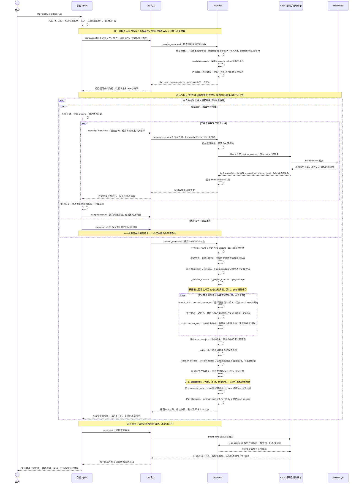
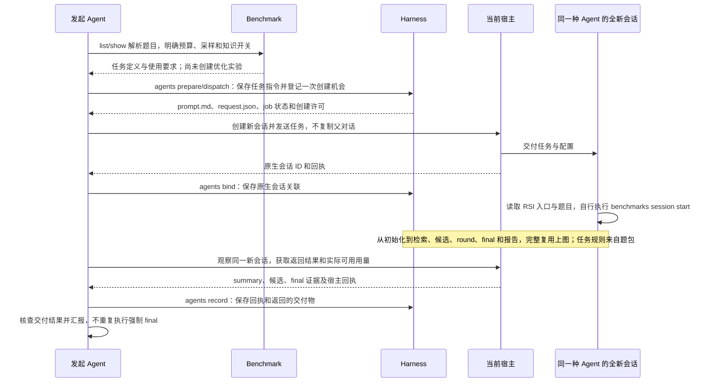

# 普通任务与 Benchmark 任务共用的 RSI 优化流程

**Agent 理解需求并修改代码；Harness 固化明确提供的任务和验收协议，执行检查、判定留存结果，管理候选、轮次、预算和最终复测；Benchmark 提供题包及其专用规则；Knowledge 提供按需检索的资料。**

普通用户任务默认在当前 Agent 会话完成。题库 Benchmark 默认交给当前宿主中同一种 Agent 的全新会话；发起方只解析任务配置、派发并回收结果，新会话自行创建优化实验并执行到 final。用户明确要求当前会话时也可直接执行。新会话由 Agent 调用宿主工具创建，Benchmark 不自动启动 Agent。

本页描述已接通的局部实现，遵循 [已接受的架构决定](https://github.com/InferMatrixLab/InferRSI/issues/362#issuecomment-6722325612) 和 [模块设计](https://github.com/InferMatrixLab/InferRSI/issues/362#issuecomment-6708348735)。它没有完成整个仓库的模块迁移，也没有添加 Apps 包或 DSH/Agent CLI 启动器。

## Harness 固定什么，规则从哪里来

“固定”指保存明确的参数、脚本和输入身份，在后续受管操作中检测漂移。**它不表示从自然语言自动推导验收标准，也不表示隔离了所有外部环境。**

| 条件 | 由谁给出 | 本实现如何使用 |
| --- | --- | --- |
| 任务目标、可修改代码和基线 | 用户/Agent，或内置题包 | 保存 TASK.md、声明的输入文件与基线快照 |
| 工作负载、模型配置、质量含义 | 项目的验收脚本/输入，或题包协议 | 留存协议目录；外部模型、数据、依赖和硬件由调用方固定并核验 |
| 性能指标、方向和通过门槛 | 用户/Agent 明确准备，或题包声明 | 固定命令、JSON 字段、单位、方向、门槛与采样参数 |
| Agent、知识开关和实验预算 | 实验发起方 | 保存条件标签、知识开关、轮次/时间限制与 final 预留；宿主配置另留回执 |
| 候选是否可接受 | 固定检查的实际结果 | 正确性拒绝为 FAIL；缺少结果或无法解释的执行失败为 INCONCLUSIVE |

例如用户说“帮我优化 vLLM 推理吞吐，输出质量不能下降”，Agent 需要先把模型、精度、请求集、并发/请求速率、输入输出长度、计时口径和质量检查落实为可运行协议。可以复用项目已有脚本，并在需要时补适配。Harness 不会自行选择这些参数，也不能用任意输出相似度替代用户认可的质量要求。普通请求直接进入 Harness，无需经过 Benchmark。

题库场景由 Benchmark 提供这些任务资源与专用规则。以 Qwen 为例，输出误差、完整 case 覆盖与计时样本检查留在题包自己的脚本中；Harness 负责冻结和加载协议、执行脚本、留存判定并选优，不把 Qwen 专用逻辑搬进公共目录。

服务吞吐目标需要覆盖约定服务负载的测量与质量检查，单算子一致性或一个 forward 加速不足以说明该目标已达成。当前项目适配器只判定所给脚本及门槛；它不自动证明质量测试充分、环境可比或收益有统计显著性。

## 时序图

以下是普通项目的完整流程。CLI 接入既有入口，调用 Harness 的 `optimization_session.session_command()`。初始化、执行、判定和结算均在 Harness 内；CLI 注入 KnowledgeReader 和已有知识记录回调。知识记录回调在 `apps/campaign.py`，展示在 `apps/views`，记录由 `harness/records` 写入；Harness 仍负责优化状态与预算。

先准备任务条件，再调用 start。start 内复制任务、脚本和基线并写入计划/状态，不执行测量。Agent 逐次调用 round，最后调用 final 独立重测已保存的最佳版本。



### 题库新会话只增加派发与回收



通用 Agent job 与优化实验是两个独立记录：前者保存派发及宿主状态，后者由执行会话创建并管理。任务指令写明运行时/题目版本、入口、环境和预算；通用 `agents prepare` 保存 prompt，不自动校验题包版本，执行 Agent 必须在 start 前核对。宿主完成不代表任务通过，缺少 final 时仍须报告不完整。

Harness 没有常驻 Agent 驱动。Agent 逐次调用这些操作，代码在调用时检查固定条件、状态与预算。入口说明引导 Agent 使用这条链路，不能保证所有外部 shell 行为都进入记录。未提交修改不成为受管候选，未完成 final 的搜索不能算完成评测。

## 两个入口，共用一套控制器

| 场景 | 入口 | 候选与停止规则 |
| --- | --- | --- |
| 普通项目优化 | `campaign start/knowledge/round/status/final/recover` | 声明多个文件或目录；默认 `up_to` 轮次上限，final 必须说明结束原因；也支持 `exact` |
| 题库优化 | `benchmarks session start/knowledge/round/status/final/recover` | 题包定义候选和评测；当前 Qwen 是单个 Python 文件、固定轮数 |
| 题库默认新会话 | `agents prepare/dispatch/bind/record` + 宿主工具 | 先派发任务；新会话创建 campaign 并执行到 final，父会话回收结果 |
| 一次测量 | 原有 `run` 或 `benchmarks run` | 保留独立使用方式；不会自动生成多轮候选 |
| 旧式手动 campaign | 原有 `campaign init/record/decide` | 兼容已有记录；不允许写进新控制器管理的 campaign 形成第二套状态 |

两个优化入口都调用 `harness.optimization_session.session_command`，再调用 **同一个** `harness.optimization.evaluate_round`。执行与评测适配也在 Harness 内。普通项目由 `harness.project` 固化调用方协议并判定留存结果，整个生命周期不导入 Benchmark。

题库 `start` 由 CLI 经 `benchmark.registry` 定位资源目录，再交给 `harness.task_protocol.prepare` 固化；后续从冻结目录加载题包自己的 `optimization.py`，无需再次查询注册表。专用协议检查仍属于题包。两类 `assess` 都只读留存结果，不重新测量。KnowledgeReader 与 `apps/campaign.py` 的记录回调由 CLI 注入，Harness 不直接导入 Benchmark 或目标 Knowledge 模块，也不经记录模块间接引入知识实现。

本次交付可以分成三块：**Benchmark 的优化题目、Harness 的优化管理与验收、Harness 与宿主协作的新会话派发和回收**。第三块不改变第二块的生命周期；新会话仍自行 start 到 final。

受管操作退出码 0 表示本次状态操作正常完成，包含正常记录一个 FAIL 候选；blocked 或参数错误返回 2。是否达成优化目标必须读取 assessment 的 verdict，不能把操作退出码当成验收结论。旧 `run` 的退出码约定保持不变。

当前完整题库迭代适配为 Qwen。MoE/TTS 仍是自己的单候选测量入口，尚未因此自动支持 `benchmarks session`。

## 普通项目怎么接入

无需先登记成题库任务。Agent 准备一个协议目录，包含测量、质量脚本以及要固定的输入/配置，再调用 `campaign start --help` 按实际项目填写参数。

下面是命令结构；尖括号是需要落实的项目条件，不是可直接执行的默认值。命令以 argv 执行，不经 shell；Windows 命令参数中的路径建议用正斜杠。

```bash
inferrsi campaign start --directory <campaign-dir-outside-project> \
  --repo <editable-project> --include <source-dir> --include <config-file> \
  --protocol <acceptance-dir> --instructions <task.md> \
  --measure-command '"{python}" "{protocol}/measure.py" --project "{candidate}" --result "{result}"' \
  --quality-command '"{python}" "{protocol}/quality.py" --project "{candidate}" --reference "{baseline}" --result "{result}"' \
  --metric-key <json.field> --metric-unit <unit> --direction <maximize-or-minimize> \
  --quality-key <json.boolean-field> --scope <actual-validation-scope> \
  --min-improvement-pct <agreed-gate> --warmups <count> --repetitions <count> \
  --rounds <limit> --round-mode up_to --max-minutes <total-budget> \
  --evaluation-timeout-seconds <per-evaluation-budget> --knowledge on
```

`{candidate}` 在基线步骤指向留存基线，在候选步骤指向本轮快照；`{baseline}` 始终是基线。`{protocol}` 指向冻结协议，`{result}` 是本步骤输出文件。脚本需从这些路径读取项目和条件；已有 editable 安装、绝对导入或外部服务不会被自动改成候选版本。Agent 必须验证脚本确实测到指定版本。

项目适配器先检查基线和候选质量，再做 warmup 和交替顺序的基线/候选测量；每轮和 final 使用相同协议。每步骤启动新进程，因此跨进程 warmup 只能预热可持久缓存；设备/进程内 warmup 必须在测量脚本内完成并说明。性能取声明指标的中位数，当前没有通用服务生命周期管理器或统计显著性判定。

结果协议：

- 测量脚本正常结束并写 JSON，提供指定字段的有限正数。
- 质量脚本正常结束并写 JSON，提供指定字段的严格布尔值。`false` 拒绝候选；基线拒绝说明协议/基线前提不成立。
- 脚本可捕获已知候选错误，正常结束并写 `{"status":"candidate_failure","reason":"..."}`。候选失败保留为 FAIL 并消耗一轮，后续可修改。不要把设备故障捕获成候选错误。
- 非零退出、超时、缺少或无法解析的输出不猜测为正确性失败，而是 INCONCLUSIVE，阻止继续把缺失证据当成有效比较。

准备后，Agent 在当前会话循环：

```bash
inferrsi campaign knowledge --directory <campaign-dir> --query '<current-question>' --context-bytes <budget>
inferrsi campaign round --directory <campaign-dir> --candidate <editable-project> --hypothesis '<what-and-why>'
inferrsi campaign status --directory <campaign-dir>
inferrsi campaign final --directory <campaign-dir> --reason '<why-search-ended>'
inferrsi dashboard --input <campaign-dir> --output <report.html>
```

知识检索和 profiling 按当前问题需要进行，不要求每轮重查或每轮 profile。知识关闭时受管 `knowledge` 操作拒绝执行；这不是对宿主所有文件访问的隔离。

## 实际保留什么、保护什么

`campaign.json` 关联计划，`plan.json` 固定协议、预算和候选格式，`state.json` 是唯一可写控制状态。`summary.json` 是可重建摘要，dashboard 从同一记录生成展示；不额外写一份 `rounds.jsonl`。原有知识交付和优化日志格式继续复用。

每轮保存声明的多文件候选、假设、执行记录、检查输出和判定。新增文件、内容变化与符号链接会接受范围检查；目录候选同时绑定文件权限。冻结协议的文件集合变化会被拒绝。未声明的模型权重、系统依赖与外部服务不因此被打包或验证。哈希是漂移检查，不是可信执行沙箱。

只有满足质量和性能门槛的候选参与选优；方向可为延迟最小或吞吐最大。没有有效改善则保留基线。final 从留存最佳快照执行，不使用工作目录中未提交修改。总预算预留 final 时间，默认等于一次评测上限；新会话搜索使用扣除预留后的预算。固定轮数未完成不能提前宣称结束；`up_to` 至少一轮后才能带原因结束搜索。

失败轮保留，基础设施失败标记 blocked。普通项目在独立执行副本中运行，日志和缓存不写入冻结基线或留存候选；已声明源码的修改仍会被拒绝。执行后发现冻结内容漂移时，留存拒绝原因，`status` 可以读取阻断原因，但不返回可用成绩。

执行副本只包含 `--include` 声明的文件或目录，不是整个原项目工作区。脚本通过相对 cwd 路径读取的配置、数据或辅助源码也必须纳入声明范围；未声明文件不会自动从原目录补入。外部模型和服务仍需由调用方明确提供和验证。

执行器抛出异常时，若已有完成记录则收集该记录，不重复启动；没有记录则标记 blocked，清理状态保持未知，不自动重试。进程被中断后的 `recover` 只接收已有结果，不重新启动命令；没有完成记录时，需确认原进程及资源清理。运行中的旧 session 应继续使用其冻结 runtime，不能直接换新代码恢复。

判定器异常按基础设施失败结算，`assessment.reason` 保留异常类型和消息，避免普通编程错误被隐藏成无类型的失败描述。执行器异常的原始类型和消息保存在该次尝试的 `coordinator-error.json` 中。此处捕获异常用于保留失败状态，不代表候选通过；进程中断仍沿用上述恢复流程。

每轮 token 只接受实际增量导出，未知不补零。整会话用量另存，不重复叠加到曲线。终止后的总耗时固定，之后打开 dashboard 不增加。HTML 只投影已清洗字段；原始本地记录可能含命令、路径等私有信息，公开前需要检查。

## 验证范围与后续

软件集成测试通过真实子进程验证多文件候选、最大/最小指标、质量拒绝后继续、固定协议漂移拒绝、提前结束、final 预留、恢复、知识关闭和 dashboard 同源读取。合成数字只用于测试状态与选择规则，不能作为性能收益。

边界回归在全新 Python 进程内禁止导入 Benchmark，验证普通项目 start、knowledge、round、recover、final、status 和 dashboard；题库回归在 start 后禁用注册表访问，验证后续 round/final 仍使用已冻结的协议。

内置 Qwen 与项目入口回归共同检查同一控制器。新会话仍走宿主交接契约，宿主完成不等于任务验收。当前改动的测试不代表新增 NPU 性能结果，不代表 vLLM 质量协议已写好，也不代表 RSI 对任何用户任务均有收益。

后续可扩展 MoE/TTS 迭代协议、更多项目适配和宿主驱动；不为每种任务复制 Harness 的循环管理。
