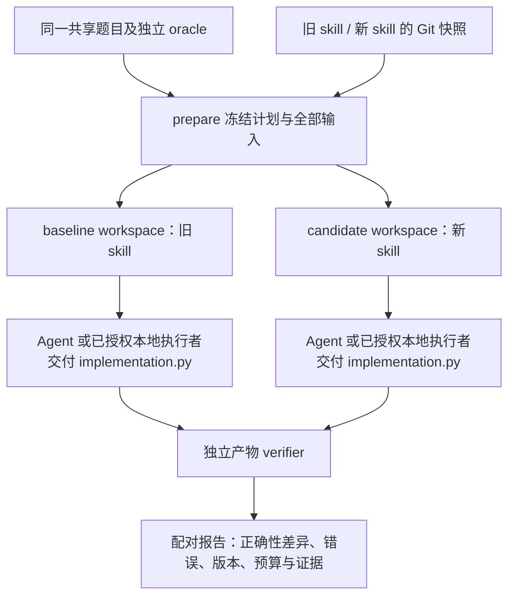

# 将共享任务接入正式 SkillEval 两臂比较

这一步把 `rmsnorm-cpu` / `softmax-cpu` 接入现有 `tools.skill_eval_compare`：两边使用各自的旧/新 skill，交付真实 `implementation.py`，由共同的独立 verifier 检查，再进入现有配对报告。调用者不再需要手工拼接底层 `run_trial`。

**本次新增接入只判定产物正确性。** 它复用共享题目、变化输入与标量 oracle，并增加隔离执行的产物交接。性能仍由明确的 Workbench 实验回答；不能把 sandbox 启动时间或子进程声称的 latency 当作优化分数。

## 接入前后，分别能做什么

| 入口 | 原有能力 | 本次新增能力 |
| --- | --- | --- |
| `benchmarks compare` | 对已审核可信实现执行 Workbench 比较 | 仍承担已审核源码的正确性与测量，不改它的计时协议 |
| `benchmarks.skill_verifier` | 单个 controller 指定的已审核文件经过底层 verifier | 历史离线接口保留，不把它直接开放给任意模型源码 |
| `tools.skill_eval_compare` | audit、diagnostic，以及固定 parser 工程任务 | 新增 `engineering-benchmark-v1`，可冻结共享任务、两臂 skill、模型/预算、schema、starter 和 grader，并接收两边实际文件 |
| `tools.skill_eval_local` | parser 的 stage/capture 本地交接 | 共享 benchmark 也能导出每臂 workspace、留存实现和作者日志，再独立检查 |
| `tools.skill_eval_improve` | 离线 audit 的选择、重跑和 holdout 控制 | 本次仍不支持共享 benchmark；公开 development 题不能冒充独立 holdout |

两臂改变的是提供给 Agent 的 skill。题目、正确性标准、候选入口和输入序列保持相同。固定作者脚本可以检查接线行为，但不是 skill 收益实验。

starter 本身是正确实现，因此原样保留也能通过正确性检查。这层入口能检查优化过程有没有破坏语义、拒绝错误产物，并保留两边真实实现；它不能区分“正确但未优化”和“正确且更快”。性能选择必须另有经过资格验证的测量，不能把正确性 PASS 当作优化成功。

本次设计沿用[既有调研](01-research.md)中的任务、候选、独立评测分工，并结合现有 RSI 接口作了以下选择：

| 接入方式 | 当前决定与理由 |
| --- | --- |
| 将模型生成源码直接交给可信 CPU worker | 不采用；该 worker 的前提是已审核可信源码，不能充当正式生成产物的隔离边界 |
| 新建一套两臂控制器 | 不采用；现有 compare 已有 skill 快照、预算、日志、配对和留存复核 |
| 把整个 grader 与候选一同放进子进程并直接接受 verdict | 不采用；应由受信父进程持有答案并计算断言，候选不能提交自己的通过结论 |
| 沿现有 artifact 交接扩展 adapter，隔离执行候选，父进程检查数组 | 采用；共享数值规则并复用既有控制器，同时明确保护宿主与判定正确性的职责 |

先交付正确性接入，是因为当前计时仍未完成可靠性能排序资格。引入隔离子进程不会自动解决测量噪声；性能比较需要独立定义和验证计时边界。

## 一次比较怎样运行



| 环节 | 实际输入和操作 | 保留什么 |
| --- | --- | --- |
| prepare | canonical task descriptor、旧/新 skill revision、模型与共同预算；冻结题包、schema、starter、grader/controller | `plan/freeze.json`、`plan/tasks.json`、各臂 bundle、每题 starter 和题包副本 |
| stage / 调用客户端 | 每次独立 workspace，只给同一任务、starter 和该臂 skill；候选只能改 `implementation.py` | 冻结输入哈希与执行日志；默认不启动不受限 Agent |
| capture | 在 producer 停止后有界读取真实文件，拒绝危险路径/特殊节点，保留源码字节与 SHA-256 | `implementation.py`、原始答案、扩展后的留存答案、作者日志或 controller trace |
| verifier | 受信父进程生成输入与 oracle；Linux bubblewrap 子进程只执行候选并返回数组；父进程独立比较 | 164 个正确性断言及输入/任务身份；没有性能分数 |
| report | 检查留存文件与 receipt，使用已冻结、受信的 verifier 复核实际产物 | 两臂结果、错误原因、版本、资源记录和相对证据链接；不再次调用 Agent |

当前内置题每次完整检查为 6 个基础输入 + 35 个变化输入，runner 按该顺序调用 41 次并由父进程检查 164 个断言。该顺序复用 `numpy-axis1-v2` 的规则。输入对象在单个子进程中保留，runner 只加载一次 `compute`，避免每次起进程而掩盖普通状态错误。

## 产物执行的边界

正式 adapter 为 `inferrsi.harness.skill_eval_benchmark`，候选文件固定为 `implementation.py`，入口仍是 `compute(x, *, eps)`。本地 producer 的答案仅为：

```json
{"artifact": "implementation.py", "summary": "描述实际改动"}
```

controller 从文件读取源码，再添加留存用的 `artifact_source`；Agent 不能用一句“测试通过”替代实际产物。

受信父进程持有题包、输入生成器、独立 oracle 和断言。候选只在既有 Linux bubblewrap namespace/read-only mount 机制内运行，挂载所需系统 Python、匹配版本的 NumPy、runner 和实现；不挂载仓库、另一臂、答案或 grader。输出规模、进程资源和时间有界，父进程只解释数组数据，不执行候选提供的校验代码。

留存的 `returned_calls` 表示父进程收到并检查的格式合法回复，不是独立设备 trace，也不能证明任意候选都按约定执行了 `compute`。OS 隔离保护宿主资源；公开题集及同一子进程里的 Python runner 不提供隐藏测试、恶意协议伪造防护或独立的输入修改证明。结果的适用范围必须保留这些限制。

这仍不是整台机器上所有 Agent 活动的隔离保证。**产物 replay 的隔离与产物生产者的权限是两个边界。** 注入客户端需由调用者负责实际执行权限与预算；手工提交的作者日志无法认证模型身份、访问权限或全部尝试。没有合格本地客户端时，正式入口拒绝启动默认 danger-full-access Agent。

Windows、缺少 bubblewrap、不能创建 namespace、系统 NumPy 不满足运行条件时，都保留 `artifact_sandbox_unavailable` / INCONCLUSIVE，不回退到宿主执行。源码仍可留存，之后在支持的 reviewer 环境中复核；原始 unavailable 记录不能改写成当时已通过。

## 如何从现有入口开始

以下是手工两臂交接示例。占位符须替换为实际已冻结的 skill 路径、Git commit、模型设置和预算；它不是默认实验门槛。无需编造一份自定义题目，直接生成当前 canonical descriptor：

```bash
python -c "from inferrsi.harness.skill_eval_benchmark import task_descriptor; from inferrsi.infra.artifacts import write_json; from pathlib import Path; write_json(Path('cases.json'), [task_descriptor('rmsnorm-cpu')])"
```

配置示意：

```json
{
  "adapter": "engineering-benchmark-v1",
  "mode": "update",
  "skill": "<skill-id>",
  "skill_root": "<repo-relative-skill-root>",
  "cases": "cases.json",
  "snapshots": {
    "baseline": {"git_revision": "<old-skill-full-commit>"},
    "candidate": {"git_revision": "<new-skill-full-commit>"}
  },
  "model": {"name": "<approved-model>", "effort": "<frozen-effort>"},
  "limits": {
    "repeats": 1,
    "max_task_calls": 2,
    "timeout_seconds": 60,
    "campaign_seconds": 180,
    "token_stop_new_trials": 10000
  }
}
```

冻结、导出 baseline workspace：

```bash
python -m tools.skill_eval_compare prepare --config config.json --repo <skill-checkout> --output <new-evidence-directory>
python -m tools.skill_eval_compare execute --output <evidence-directory> --authorize <plan-sha256> --stage-local <new-baseline-workspace> --task-id rmsnorm-cpu --condition baseline --repeat 1 --current-head <new-skill-full-commit>
```

Agent 在该 workspace 内读取任务和分配的 skill，只修改 `implementation.py`。记录实际 stdout/stderr 和作者 `execution.json`，字段与边界沿用[本地交接文档](../../local-skill-evaluation.md)。完成后 capture：

```bash
python -m tools.skill_eval_compare execute --output <evidence-directory> --authorize <plan-sha256> --capture-local <baseline-workspace> --submission <baseline-logs> --task-id rmsnorm-cpu --condition baseline --repeat 1 --current-head <new-skill-full-commit>
```

对 candidate 使用新的 workspace 和独立日志，把 `--condition` 改为 `candidate`。两臂完成后：

```bash
python -m tools.skill_eval_compare report --output <evidence-directory>
```

`--authorize` 绑定 prepare 输出的计划哈希；配置、任务或代码变动后必须重新 prepare。它不是重新授权远端模型费用的替代机制。本次没有新增 provider、generation-only 或 `skill_eval_improve` 支持。

## 怎样判断结果有实际用途

| 观察 | 正确解释 |
| --- | --- |
| 正确实现 PASS，错误实现 FAIL | 共用裁判检查了实际源码行为 |
| baseline FAIL、candidate PASS | 产物正确性出现差异；固定脚本对照仅证明流程作用 |
| 手工两臂报告 artifact_improved | 作者提交的产物检查改善；身份、环境和成本仍是作者报告，不能直接证明 skill 因果收益 |
| sandbox unavailable、预算不完整、输入漂移 | INCONCLUSIVE 或拒绝执行；不能计作干净胜负 |
| 两边均 PASS | 在当前公开输入上都正确；并不表示候选更快 |

接入验证分两层：跨平台 controller 测试使用真实作者脚本进程写候选，模拟 verifier 响应，验证冻结、交接、报告、预算和错误传播；Linux 软件对照执行真实 sandbox 与独立 oracle，验证正确/错误实现确实产生不同结论。前者不能代替后者。

复现测试入口：

```bash
python -m pytest tests/test_skill_eval_benchmark_compare.py tests/test_skill_eval_benchmark.py
```

严格 Linux 软件对照设置 `INFERRSI_REQUIRE_BENCHMARK_SANDBOX=1`：缺少隔离环境时测试失败，不能用 skip 形成绿色资格结论。实际执行结果由本轮验证记录/CI 链接另行记录；本文的命令和测试设计本身不代表执行已经通过。

## 已执行的软件验证

在 `dfcc18557fd065dbe499f5cbaf77ad20cf6c5870`，现有 ready/review CI 内新增的 [benchmark-artifact-controls](https://github.com/InferMatrixLab/InferRSI/actions/runs/41745549558/job/126297873523) 已实际通过：**49 tests、0 failures、0 errors、0 skipped**。这是 Ubuntu 22.04 系统 Python + 匹配 NumPy + bubblewrap 的软件对照，严格环境变量已开启，未调用模型。下载的原始 JUnit 与[可公开汇总](formal-validation-summary.json)记录所有测试名称、原件 SHA-256 和来源。

job 日志确认实际 checkout 为 PR 合并快照 `e74eb3d0a693f88599805faa8bc1afaf05544dbc`，与上述 head 比较为零文件差异；隔离运行时预检输出 NumPy 2.2.6。不会把 CI 的合并快照误称为直接 checkout 了 head。

其中 5 个 case 明确执行真实 sandbox：Softmax 与 RMSNorm 各自的正确/错误实现；同进程状态缓存重放拒绝；宿主 sentinel 与 oracle 文件不可见；正式 prepare/execute/report 的两臂文件交接。其余测试覆盖控制器、协议和拒绝路径，并不全部属于真实 sandbox 执行。

本地 Windows 新测试为 44 passed、5 个真实 Linux 控制 skipped。旧路径的两批回归分别为 66 passed/14 failed、133 passed/1 failed；全部 15 个失败报告在未修改基线复现，来自 symlink 权限、CRLF 字面量或 Windows 路径行为，该本地批次仍不绿。新 hosted 全量检查与上述专门软件控制分开记录。

同一 head 的 [ready/review 全流程](https://github.com/InferMatrixLab/InferRSI/actions/runs/41745549558) 已完成：Python 3.10 / 3.11 full-check、两套 installed-package 检查和 PR references 均通过；Draft 的既有 KV qualification 按原规则跳过。全量日志中的精确计数保存在上述汇总，真实 NumPy sandbox 的无跳过结果由专门 job 单独证明。之后仅文档/证据整理的提交不冒充这次原始执行版本。

首个 Linux CI 准备阶段曾因系统 pip 的 editable-build hook 失败，未进入 sandbox 测试。随后改为显式安装系统 NumPy 与测试依赖、直接从 checkout 运行，才得到上述成功记录；没有改变宿主 namespace 安全策略或加入 host fallback。该成功只验证当前软件环境中的接口、数值和隔离控制，不证明性能收益、真实技能收益或全硬件资格。

## 本轮交付结束后，仍然分开验收的内容

共享任务已经有正式两臂产物入口的设计与实现位置；是否在某个具体平台完成真实 sandbox 软件对照，以对应执行记录为准。性能排序、真实旧/新 skill 的 Agent 实验、生产者隔离资格、成本效果、改进控制器及目标硬件仍需各自证据。

Profiling 仍由主 Agent 根据实际瓶颈调用：对已审核实现可使用 `benchmarks profile`，真实设备需对应 profiler。当前 formal adapter 不会自动做 profile、选择下一次候选或晋升 skill。它提供“同题、两臂、真实产物、独立检查”的接入层，供这些现有流程使用。

在当前 RSI 中继续推进一次实现优化时，主 Agent 从报告的 `implementation.py` 证据链接取得候选，审核其源码与适用范围后，再用现有 Workbench 做 profile 和配对测量。formal adapter 的通过结果不会自动把未经审核的代码送入可信 worker，也不会自动批准该实现。
