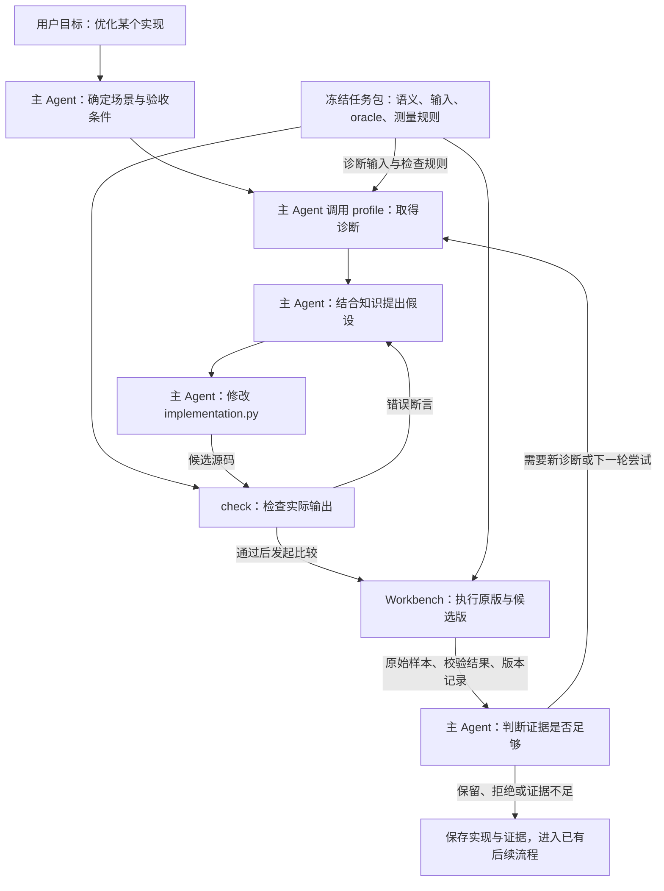

# 从零读懂 #252：做了什么，怎样在 InferRSI 中使用

这份导读先讲用途，再沿一个 RMSNorm 例子走到代码与结果。总览见 [README](README.md)，本轮审查结论见 [review](review.md)。

**我们给 InferRSI 增加的是 Engineering Benchmarks（共享工程评测任务）：一份题目、一份候选实现，交给固定的独立评测，得到可追溯的正确性、诊断和计时结果。** 主 Agent 根据这些证据决定修改、保留或放弃实现。

## 1. 先理解它解决哪一个问题

假设你对 Agent 说：“用 InferRSI 优化 RMSNorm。”只有这个名字还不够：沿哪个维度归约？输入是什么精度和布局？可以改哪些文件？怎样判断算错？究竟计时哪一段？

没有共享任务时，调用者仍然可以使用已有 Workbench，但需要自己提供这些命令和规则。不同实验若自行定义输入与答案，结果很难直接比较。

这次把规则放进一个任务包。当前 `rmsnorm-cpu` 明确要求：CPU、NumPy、float32、沿 axis=1 归约，保留 epsilon，不修改输入。Agent 只交付 `implementation.py` 中的 `compute(x, *, eps)`。工具检查这个文件的实际行为，并记录是哪一版题目、裁判、源码和运行环境产生了结果。

它在 RSI 中的位置是**任务与评测层**。Workbench 继续负责运行实验；主 Agent 继续负责调查、读论文、分析 profile、写代码和决定下一轮。评估 skill 是否有效时，新增的[正式两臂产物 adapter](formal-integration.md)复用这层任务；实际技能收益仍需要受控 Agent 实验。

## 2. 四个子任务，具体交付了什么

四项分别可以简称为“选题复用、统一规则、交付题包、接入验证”。它们是交付步骤；运行一次优化时不会依次执行这四项。

| 子任务 | 实际做的事情 | 交付物 | 对使用者的作用 | 当前边界 |
| --- | --- | --- | --- | --- |
| ① **选题复用** · [#334](https://github.com/InferMatrixLab/InferRSI/issues/334) | 读论文和固定版本源码，对照现有 RSI，决定首批范围 | [调研与选型](01-research.md) | 确定先做 Softmax/RMSNorm，复用任务分工与数学题意，避免重复已有执行器 | CPU 子集是提议，范围待维护者接受 |
| ② **统一规则** · [#335](https://github.com/InferMatrixLab/InferRSI/issues/335) | 定义题目格式、候选入口、执行动作和内容身份 | [契约说明](02-contract.md)、`TaskPackage`、worker、CLI | 不同消费者使用同一题目和裁判；比较中源码或规则漂移会被发现 | 当前只接受 `numpy-axis1-v2`，新设备需要自己的 adapter |
| ③ **交付题包** · [#336](https://github.com/InferMatrixLab/InferRSI/issues/336) | 将两道题变成可运行包，补边界输入与独立答案 | [任务说明](03-tasks.md)、两套 manifest/基线/候选/许可 | Agent 有具体修改对象；错误轴、漏 epsilon、输出重放等错误可被独立检查 | 只覆盖声明的 CPU 输入；不能外推 GPU、通信、容量或服务 |
| ④ **接入验证** · [#337](https://github.com/InferMatrixLab/InferRSI/issues/337) | 生成真实 RunSpec，接现有 Workbench 与底层 SkillEval verifier，运行对照 | [集成说明](04-integration.md)、复现工具、验证记录 | 实验结果进入已有结果目录，错误产物被拒绝，正确实现留下计时证据 | Workbench、底层 verifier 和正式两臂正确性产物入口已实现；可靠性能排序和技能收益未完成 |

因此，“四项都有代码或文档交付”和“整个 #252 已验收”是两个状态。尤其第④项只完成了表中明确列出的接入层级。

## 3. RSI 的两条循环，分别在优化什么

| 循环 | 本轮改变什么 | 比较什么 | 谁用结果作决定 |
| --- | --- | --- | --- |
| **优化引擎实现** | `implementation.py` 或真实引擎中的实现 | 原版和候选版是否正确、是否有可分辨的性能差异 | 主 Agent / 实验负责人 |
| **优化优化者** | Agent 使用的 skill、知识或 harness | 两种条件下，Agent 产出的实现质量、速度、成功率和资源成本 | SkillEval 实验负责人及其支持的改进流程 |

第一条路径已有实际执行。第二条早期只有底层 verifier，后续已补上正式 `skill_eval_compare` 与 local stage/capture：两臂交付真实文件，隔离执行候选，父进程独立检查并形成配对报告。验证使用作者脚本和正确/错误软件对照；没有让两组真实 Agent 分别使用旧/新 skill 生成代码，所以没有 skill 有效性的结论。具体平台验证见[正式接入说明](formal-integration.md)。

即便一份事先写好的候选在可靠测量中更快，也不能说明“某个 skill 帮助 Agent 写出了它”。需要先固定任务、模型和预算，再比较 Agent 在两种技能条件下真实交付的文件。

### 优化一次实现时，应该怎样运作

下面展示主 Agent 应采用的工作顺序。箭头表示数据和决定的传递；目前没有后台控制器自动强制走完整张图。



| 图里的框 | 谁调用、输入是什么 | 框里实际做什么 | 交出什么，下一步怎么用 |
| --- | --- | --- | --- |
| 确定场景 | 用户与主 Agent；目标模型、硬件、负载、质量要求 | 判断题目是否覆盖真实需求，冻结实验范围和预算 | 可检查的实验计划；当前 CPU 题不自动覆盖同名 GPU 算子 |
| profile | 主 Agent；基线或候选源码与任务 | 独立运行 CPU cProfile，查看调用结构 | `profile.txt`；用来形成或检查假设，不参与速度分数 |
| 提出假设 | 主 Agent；profile、论文、知识和既往失败 | 解释准备改哪一处、预期为什么有用 | 一项可检验的改动，例如尝试减少中间数组 |
| 修改实现 | 主 Agent；受约束的候选文件 | 修改 `compute`，保持题目语义 | 待审核候选源码；题目、oracle 和基线仍是固定比较输入 |
| check | CLI 或消费者；题目与候选源码 | 用独立参考答案检查基础和变化输入 | `passed`、具体断言、输入身份；错误实现需要修正 |
| Workbench | `compare` 生成 RunSpec 后调用既有 runner | 按 AB/BA 顺序运行原版/候选；各 worker 内先检查，再计时并验证每次输出 | `result.json`、原始样本、`evaluation.json`、`status.json`、源码快照 |
| 判断与保存 | 主 Agent / 负责人；上述完整记录 | 分开判断正确性、测量可信度和任务是否代表真实目标 | 保留、拒绝或证据不足，并保留理由供下一轮使用 |

AB/BA 是调换执行顺序：一轮先原版再候选，下一轮先候选再原版，减少固定先后顺序的影响。它本身不保证消除噪声。

### 谁确保 Agent 按流程走

当前有两层约束：

- **代码强制的局部规则：** manifest/adapter 校验；执行前后身份校验；候选数值检查；检查失败不输出可用性能指标；超时与执行错误保留状态。
- **由主 Agent 遵循的工作流程：** 先研究与 profiling、冻结假设和验收门槛、根据证据决定下一轮。现有插件入口和工作流文档提供指导，没有 hooks/daemon 强制每次都先做研究或 profile。

直接调用 `compare` 不会先自动运行 `profile`。通用 Workbench runner 是先执行 AB/BA，再运行可选 quality command；本次任务 worker 在每个测量进程内部执行正确性检查。不能据此声称通用 runner 已经实现了完整的全局阶段控制。

评论中的 **Optimization search policy** 负责“下一步试什么、分多少预算、何时停止”。它消费测量与失败信息。#252 提供任务和评测结果，独立 policy RFC 讨论搜索决策；当前实现没有新的 search controller。真实入口和剩余接入见 [RSI 接入审计](rsi-integration.md)。

## 4. 以 RMSNorm 为例，评测器到底在检查什么

计算语义是 `y = x / sqrt(mean(x*x, axis=1, keepdims=True) + eps)`。这里 axis=1 很关键：对四维 `(N,C,H,W)` 输入，沿 C 维归约，不能换成常见的“最后一维归约”实现。

三个文件/角色各有职责：

| 角色 | 当前实现 | 用途 |
| --- | --- | --- |
| **baseline** | 任务包中的 NumPy 实现 | 性能比较中的原版 |
| **candidate** | 用户/Agent 交付的 `compute` | 待优化和受检查的实现 |
| **oracle** | 评测器中的标量 double、`math.fsum` 参考算法 | 判断答案是否正确；不拿它的慢速执行时间作为性能基线 |

“独立 oracle”指算法实现独立，减少基线和候选共享同一错误的风险。Workbench 的 worker 执行已审核可信源码，没有恶意代码隔离。正式 SkillEval 的新 adapter 使用另一条产物隔离路径，在父进程保留 oracle；两条执行边界详见[正式接入说明](formal-integration.md)。

六类基础输入覆盖普通值、跨步布局、全零、大数值、极小值和单元素归约。其中 `large` 指数值大，`tiny` 指数值小；不是张量规模大小。极小值可揭示遗漏 epsilon；跨步输入可揭示对内存连续性的错误假设。

### 一次调用如何得到结果

以当前两道内置题的默认规则为例：

1. 预先生成全部输入、独立答案和输入摘要。这些准备不计入计算时间。
2. 检查 6 个基础输入。每次检查 shape/dtype、数值有限、输入未变、答案在容差内。
3. 对 5 个有变化的 workload，各准备 2 次预热 + 5 次采样，共 35 次调用。每次输入字节不同，所有输入对象保留存活；预检、预热或早先采样不会给后面的同输入缓存命中创造条件。
4. 每次实际调用后，在计时范围外验证输出。正确性错误立即使这次测量不可用。
5. `check` 共执行 41 次并产生 164 个断言；`measure` 留下 25 个计时样本；`profile` 单独记录 35 次变化输入调用，不生成性能指标。全零 case 只参与正确性检查。

预定输入写入 `input_sequence`，实际调用写入 `executed_calls`。失败可能只完成前缀；有一份完整计划不代表完整执行。每个计时样本还绑定自身的 `sample_input_sha256`。

计时范围是同步 `compute` 调用，函数内部申请数组的成本包含在内；进程启动、输入生成、oracle、预热和输出检查不包含在分数内。每个 workload 先取 5 个样本的中位数，再相加得到 `suite_latency_ms`。这是固定小任务集的指标，不能解释成某模型的请求延迟。

## 5. 自己从哪里开始看和运行

先读任务，再复制候选。安装/运行命令的详细参数见[使用文档](../../engineering-benchmarks.md)。下列演示在仓库根目录执行；输出目录必须未存在，重复试验应换新名字。

```bash
python -m pip install -e ".[dev,benchmarks]"
inferrsi benchmarks list
inferrsi benchmarks show rmsnorm-cpu
python -c "from pathlib import Path; import shutil; from inferrsi.harness.benchmarks import load_task; p=Path('runs/benchmark-demo'); p.mkdir(parents=True); shutil.copyfile(load_task('rmsnorm-cpu').root / 'candidate.py', p / 'implementation.py')"
inferrsi benchmarks check rmsnorm-cpu --candidate runs/benchmark-demo/implementation.py --output-dir runs/benchmark-demo/check --timeout-seconds 30
inferrsi benchmarks profile rmsnorm-cpu --candidate runs/benchmark-demo/implementation.py --output-dir runs/benchmark-demo/profile --timeout-seconds 30
inferrsi benchmarks plan rmsnorm-cpu --candidate runs/benchmark-demo/implementation.py --repo . --output-dir runs/benchmark-demo/runs --repetitions 3 --max-minutes 2 --min-improvement-pct 0
inferrsi benchmarks compare rmsnorm-cpu --candidate runs/benchmark-demo/implementation.py --repo . --output-dir runs/benchmark-demo/runs --repetitions 3 --max-minutes 2 --min-improvement-pct 0
```

这是学习接口的演示，数字是演示预算，`min-improvement-pct 0` 不是正式验收门槛。`plan` 只打印 RunSpec；`compare` 重新生成并执行 RunSpec。正式实验必须在搜索前保存并冻结计划，不应把两条命令之间重新生成的内容误当成自动锁定的历史计划。

先打开 `runs/benchmark-demo/check/result.json` 看失败断言或通过范围，再打开 `runs/benchmark-demo/profile/profile.txt`。`compare` 返回实际 run 目录和保留状态：PASS 退出 0，FAIL 退出 1，INCONCLUSIVE 退出 2。错误实现若使测量未完成，比较通常为 INCONCLUSIVE；其独立正确性 grade 可为 FAIL。在 run 目录中查看：

| 文件 | 读它是为了什么 |
| --- | --- |
| `run.lock.json`、`task.lock.json` | 确认比较命令、任务、预算与规则 |
| `baseline/trial-*/result.json`、`candidate/trial-*/result.json` | 查看每题样本、每次输入身份和正确性检查 |
| `evaluation.json` | 查看原始聚合和描述性 verdict，包括统计显著性未建立的声明 |
| `status.json`、各 trial 的 `execution.json` | 确认是否完成，区分数值拒绝、执行失败和预算问题 |
| `source_checks.json` | 确认比较期间源码是否变化 |

学习后再编辑候选并用新的输出目录验证。示例使用仓库已忽略的 `runs/` 目录。修改受 Git 跟踪的文件会进入 Workbench 源码快照；每次正式实验应保存独立计划和结果。

## 6. 证据说明它有什么实际用处

本节的 v2 归档来自 2026-11-03 UTC，使用旧 grader `0b75b5b…`，对应 ce84506e 发布、ac03ae23 保留的测量实现。本轮 CLI 修复改变了 grader 身份；输入与计时协议仍为 v2，但这 300 个样本不是修复后新 head 的运行证据。完整身份边界见 [审查记录](review.md)。

| 实际做过的检查 | 观察到了什么 | 能支持的结论 | 不能推出什么 |
| --- | --- | --- | --- |
| 历史 v1：RMSNorm 漏 epsilon 的合理错误实现 | 普通输入冒烟通过，完整任务和底层 SkillEval verifier 都拒绝；无性能指标 | 任务边界用例能补普通冒烟的漏洞 | 没有证明所有 RMSNorm 错误都能捕获 |
| 既有 v2 记录：id/content memo 和按 shape 重放旧输出 | 正确 memo 没有旧输入缓存命中；错误重放被拒绝 | 计时不再因预检复用输入而只测旧答案回放 | 没有隐藏题集或防恶意作弊保证 |
| 既有 v2 记录：两题经过真实 Workbench 和底层 verifier | 规则、输入配对一致；保留 12 个 trial、300 个计时样本及两份 profile | 两个消费者实际使用了同一套任务规则 | 没有证明正式 SkillEval 两臂已接通 |
| 历史 v1：同码与 einsum 对照 | 同码也出现很大的时间差，两次原始性能 verdict 均 FAIL | 必须保留负结果并先解决测量可信度 | 不能认定 einsum 稳定变慢，也不能宣布优化成功 |
| 既有 v2 记录：profile | 保留 CPU 调用路径；文本时间精度下多项显示 0.000 | 诊断操作确实独立运行，可检查调用结构 | 不能据此认定内存带宽瓶颈或函数耗时占比 |

既有 v2 记录的 [300 个原始样本及聚合](replay-measurements.json)、[输入与身份摘要](replay-validation-summary.json)、[RMSNorm profile](replay-profiles/rmsnorm-cpu.txt) 和 [Softmax profile](replay-profiles/softmax-cpu.txt) 已可直接检查。它们来自同一次既有运行，此次整理没有重跑或筛除慢样本。

v2 Workbench 的两次原始 verdict 是 PASS，但仍是描述性结果。某组 trial 的范围相对中位数超过 100%，同码噪声资格还未完成，所以我们的决定仍是：**没有证据宣布可靠性能提升。** 历史 v1 的 360/720 个样本不可与 v2 的 300 个样本混合评分。

源码 CI 与实验验收也要分开：已记录的 hosted Linux Python 3.10/3.11 全量检查通过；历史 Windows 全量结果仍是 3479 passed、51 skipped、56 failure reports，所有失败在原始基线复现，但该次全量仍不绿。具体 revision 与本轮回归见 [review](review.md)。

## 7. 为什么选择这套设计，和 AMD 的项目是什么关系

AMD [AgentKernelArena 的固定版本任务契约](https://github.com/AMD-AGI/AgentKernelArena/blob/47c2658a07efc7c2c0f72751781a5b5690471b0b/docs/how-to/add-task.md) 把任务语义、Agent 可修改的实现、性能基线、正确性参考、工作负载和评测操作分清楚。这种分工让人容易理解“给 Agent 什么、要求交什么、谁来验收”。本次借鉴的就是这层职责。

| 来源/方案 | 在本次具体落在哪里 | 选择理由 |
| --- | --- | --- |
| AgentKernelArena | 任务包明确输入、候选、baseline、reference、评测 | 给用户和 Agent 明确的工作对象 |
| KernelBench | 两道归约算子的数学题意、axis=1 与来源许可 | 题目真实明确，CPU 适配可在硬件未定时检验共享边界 |
| BackendBench | 边界与布局检查思路 | 提高普通输入之外的错误识别能力 |
| SkillsBench | 题目/答案与技能条件分离 | 让两臂比较使用共同裁判 |
| AlphaEvolve、AIDE | evaluator 与候选搜索策略分开 | #252 保持任务评测职责，搜索策略走独立设计 |
| InferRSI 已有 Workbench/SkillEval | RunSpec、AB/BA、执行状态、verifier | 复用现有运行机制，让任务能在本项目发挥作用 |

完整论文与固定源码引用、未采用方案见 [01-research](01-research.md)。当前约束下选择“小任务包 + 具体 adapter + 现有执行器”有可验证的交付；它不表示 CPU 小题已足以代表真实推理系统，也不表示完整引入另一套 GPU 平台更适合我们。

## 8. 看代码的顺序，以及剩下的工作

先看一题的 manifest 和候选，再看执行，再看接入。无需先逐行读历史 JSON。

| 顺序 | 入口 | 重点 |
| --- | --- | --- |
| 1 | [RMSNorm task.json](../../../src/inferrsi/data/engineering_benchmarks/rmsnorm-cpu/task.json)、[candidate.py](../../../src/inferrsi/data/engineering_benchmarks/rmsnorm-cpu/candidate.py) | 题目规定了什么，Agent 改哪里 |
| 2 | [numpy_task.py](../../../src/inferrsi/harness/benchmarks/numpy_task.py) | 输入、独立 oracle、check、profile 与计时的真实边界 |
| 3 | [contract.py](../../../src/inferrsi/harness/benchmarks/contract.py)、[worker.py](../../../src/inferrsi/harness/benchmarks/worker.py) | manifest 合法性、内容身份、执行前后检查、RunSpec |
| 4 | [consumers.py](../../../src/inferrsi/harness/benchmarks/consumers.py)、[CLI](../../../src/inferrsi/harness/benchmarks/cli.py) | 如何复用执行器，如何呈现状态和结果 |
| 5 | [skill_verifier.py](../../../src/inferrsi/harness/benchmarks/skill_verifier.py) | 已审核产物如何交给现有底层 verifier |
| 6 | [正式 adapter](../../../src/inferrsi/harness/skill_eval_benchmark.py)、[正式接入说明](formal-integration.md) | 两臂产物交接、隔离计算与父进程检查 |
| 7 | [测试](../../../tests/test_engineering_benchmarks.py)、[复现入口](../../../tools/engineering_benchmark_validate.py) | 正确/错误对照和实际消费者验证 |

下一步优先级是：维护者确认首批范围；建立能分辨差异的 CPU 测量条件与同码对照；在已接入的正式两臂入口上选定受支持的生产者与隔离运行环境，再用受控 Agent 实验检验技能收益。目标硬件确定后，新增设备 adapter、真实负载和对应层级验收。

本次 PR 保持 Draft，四个子 Issue 保持打开。我们已经交付了共享任务、真实评测入口及组件证据；正式两臂正确性产物入口已实现，实际平台控制结果见接入记录；可靠性能排序、真实优化者收益、改进控制器和设备/服务收益仍需完成。
