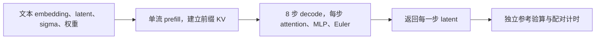

# Qwen-Image 2.1 独立去噪任务

这道题让 Agent 优化一次包含 prefill 和全部去噪步骤的请求。它参考优化前的
Qwen-Image 2.1 单流 DiT，保留原有前缀 KV 缓存、8 步 target decode、交错 RoPE、
共享 modulation、SwiGLU 和 Euler 更新。首版使用缩比网络，计分 case 为 2–4 层、
hidden 256–512，输入是随机权重、文本 embedding 和初始噪声 latent。



Agent 实现 `compute(latents, text, text_mask, sigmas, positions, params, *, config)`。
工具检查每一步的输出、文本 key mask、输入和参数只读，以及参数同地址原位更新后的
结果。计时覆盖一次完整请求的准备、prefill、全部 decode、调度更新与输出完成。

基线保留了可研究的重复 conditioning、调制量逐 token 展开、逐 block tanh、
eager RoPE 和分开的 gate/up 投影。Agent 可以研究请求内复用、投影或点运算融合、
attention 实现、内存布局与分配，以及 host 调度开销。

完整题包位于
[`qwen21-denoise-npu`](../src/inferrsi/benchmark/tasks/qwen21-denoise-npu/TASK.md)。
目录包含基线、独立参考、输入生成、任务定义、评测入口与许可，可以直接复制到已有
PyTorch/torch_npu 环境中运行。评测期间持续阻止 vllm、vllm_omni、diffusers、
transformers 导入。现有 InferRSI external-command scenario 可调用相同命令。

在复制后的题包目录中，将候选保存为 `candidate.py`，例如先从 `baseline.py` 复制，
再执行以下命令。

```bash
npu run --gpus 1 --timeout 18m --wait 30m -- \
  python benchmark.py --candidate candidate.py --output-dir outputs/round-01 \
  --pairs 2 --samples 3 --warmups 1
```

每次使用新的输出目录。`result.json` 保存逐步误差、原始计时、各 case 的耗时及加速比，
`snapshot/` 和 `identity.json` 保存本次实际执行的代码及 SHA256。调用方设置轮数、
保留候选、选择最佳版本并独立复测。

任务入口已经在单张 Ascend910B1 上执行完整同码控制和手写复用控制，均通过全部 case
的正确性检查。零输出、修改输入、旧输出缓存和引擎导入四类控制均被拒绝。wheel 中的
题包文件已与验证源码逐字节核对。性能数字与原始记录随本次交付的验证报告保存。

详细边界和规则见
[TASK.md](../src/inferrsi/benchmark/tasks/qwen21-denoise-npu/TASK.md)，
来源和适配说明见
[NOTICE.md](../src/inferrsi/benchmark/tasks/qwen21-denoise-npu/NOTICE.md)。
本题覆盖缩比去噪器的 latent 数值与耗时，完整图像质量、真实 checkpoint、文本编码器、
VAE、服务和多卡执行各有相应的工作负载与验证要求。
