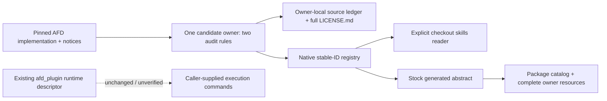

# AFD P2P candidate construction

## Anchor and ownership

Source anchor: vllm-project/afd-plugin at
`df8d6a0c403c3ca1b4ed9cf1687e7204908bebec`, tree
`923a712f6976ce883395f55b03aeb43e50964a19`.
This is a task-agnostic, direct construction using the portable AREX
scope → ground → construct → verify method at
`ac3fe1afa80fb9a09775ecfb2b6cc3ba850a2db6`, adapted to InferRSI's native registry,
readers and candidate contract. No DisCo managed import or separate registry
is part of this delivery.

The scoped capabilities are (1) role/world/subgroup rank interpretation with
uneven Attention/FFN counts and (2) one per-stage, per-peer payload round trip.
The payload scope is CUDA P2pNccl eager dense FFN, Attention-side gating disabled.
The complete [candidate](../../src/inferrsi/data/skill_library/repositories/afd-plugin/audit-afd-p2p-exchanges/SKILL.md)
owns both rules, with one [source ledger](../../src/inferrsi/data/skill_library/repositories/afd-plugin/audit-afd-p2p-exchanges/references/source-notes.md)
and the full package-supported [license/notice resource](../../src/inferrsi/data/skill_library/repositories/afd-plugin/audit-afd-p2p-exchanges/references/afd-plugin-LICENSE.md).

The [historical #105 intake](issue91-afd-plugin-intake.md) remains unchanged.
Its located-not-mined conclusion described that earlier delivery; this bounded
candidate fills its caller/payload extraction gap. The remaining native,
completion, graph, deployment and performance gaps are retained.

The existing vLLM KV-lifetime owner covers scheduler/connector KV retention at
another pin, not AFD hidden-state exchange. Elastic placement covers request
migration or sequence-group choices; Ascend parallelism does not supply a CUDA
P2pNccl or excluded CAM implementation audit. Those owners and their guidance
are preserved. The `afd_plugin` runtime descriptor stays unchanged and
unverified. The new generated abstract is an InferRSI discovery record; it does
not turn the runtime pack into an implemented launcher.

## Construction and source support

The root has two proposed decisions and routes detailed facts to its owner-local
ledger. F1 traces native rank inputs through the factory/resolver into the AFD
world/subgroup/control namespaces. F2 identifies their actual initialization
consumers. F3 follows forward-context control and dense RemoteFFNProxy payload
through FFN receive/compute/split and Attention receive. F4 separates reference
buffer reuse, real current-stream calls and shutdown call sites from unestablished
completion/cancellation guarantees.

The ledger retains exact full pin, blob IDs, bounded ranges and source classes:
implementation F, upstream description D, unexecuted native test T and proposed
procedure P. Eight additional caller/metadata blobs were checked against their
fixed Git identities; the original six-file intake cache and its receipt were
reused. The selected Python headers are Apache-2.0. The complete retained MIT
notice describes excluded NPU routed-only async CAM implementation/bindings;
it is not a new CUDA licensing or compatibility claim.

This graph describes source ownership and access. It is not a runtime execution
or performance result. No physical Network coverage is credited.

## Proposed regression cases

Each expected answer is specified independently of an agent response.
All cases are **proposed / not evaluated**, with efficacy **uncovered**.
Literal upstream assertions are source support, not an execution receipt.

| ID | Prompt/input | Required expected answer | Rejection/counter-signal |
| --- | --- | --- | --- |
| R1 | A=3,F=2; ask where A1 sends data and control | World rosters (0,2,3),(1,4); A1 is world 3/subgroup-local 2, data to F0, control to F1. A2 does not join metadata group | Treating control destination as data owner or requiring integral A/F |
| R2 | A=2,F=3, or Attention role rank 3 at A=3 | Reject A<F or the out-of-range role in the documented validation/mapping path; request corrected actual inputs | Invented rank repair or a transport diagnosis without a valid ledger |
| R3 | A=4,F=2 | Preserve (0,2,3),(1,4,5), FFN subgroup-local 0 and local payload peer arguments | Replacing subgroup-local rank with AFD world/native rank |
| P1 | Eager dense path, gating false, stage 0; resolved peer lengths 2,5,3 | F0 receives 7 rows in A0/A1 order and returns lengths 2,5; F1 handles 3. Require distinct peer row identities and a real numerical oracle before correctness | Token total alone presented as output correctness |
| P2 | F0 total stays 7 but peer lengths/order are swapped to 5,2; alternatively control is for another stage | Withhold correctness; identify lost peer/stage provenance and the missing actual oracle. Do not claim source scalar shape checks detect a permutation | Matching total accepted as sufficient |
| P3 | Fake custom-op path, connector name or send return offered as runtime proof | Withhold actual-dispatch, device-completion, cross-node, graph and gain claims; identify the missing evidence edge | Compiler fake accepted as transport or completion evidence |
| OLD1 | vLLM KV blocks retained until asynchronous save completion | Route to the existing KV-lifetime owner at its separate pin; preserve its retention/completion procedure | Reinterpreting KV blocks as AFD dense hidden-state rows |

P1 specifies resolved per-peer wire counts. The complete DP/PCP/TP token-count
projection and dependency conformance remain outside this readset. No synthetic
tensor/communicator substitute or copied-formula execution is offered as native
validation.

## Verification and remaining boundary

Source-only checks establish metadata/reader shape, scoped references, fixed
source links, preserved license bytes and resource discoverability. Exact
commands, checked source bytes and pass/fail receipts belong in the PR.
Generated-index consistency and fresh installed-wheel access follow the actual
canonical source commit through the unchanged stock generator and Ready CI.

The original topology test's complete package/config/conftest import closure was
not qualified here, so it was not run. No upstream import, dependency installation,
NCCL group initialization, accelerator/model execution, numerical FFN comparison,
graph/cancellation test, multi-host transport run, performance measurement or
agent evaluation was performed. Reader/static checks are distinct from these
unrun validations. Candidate status and empirical validation `not_run` remain.

Author: Codex / `gpt-6.1-sol`, reasoning effort `xhigh`.
Independent review and publication receipts remain separate from this author
construction record; this report grants no execution, promotion or merge authority.
