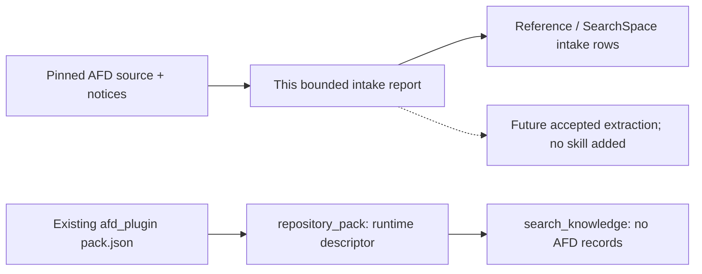

# AFD plugin repository intake

Status: **descriptor-only / intake-plan; located-not-mined**. This report proposes a bounded source extraction for Issue #91. It adds no operating skill, knowledge record or SearchSpace coverage credit.

## Identity and license

- Canonical repository: [vllm-project/afd-plugin](https://github.com/vllm-project/afd-plugin), GitHub repository ID `1238474765`.
- Inspected source: `df8d6a0c403c3ca1b4ed9cf1687e7204908bebec`, tree `923a712f6976ce883395f55b03aeb43e50964a19`; retrieved through fixed-revision GitHub connector reads on 2026-10-23. The complete tree listing was not truncated; only the bounded files below were read.
- The existing [pack descriptor](../../src/inferrsi/data/repo_packs/afd_plugin/pack.json) already names this repository. Its only scenario is `systems.afd`; execution requires caller-supplied external commands, and CUDA/ROCm/Ascend compatibility remains `unverified`. The descriptor is unchanged.
- [LICENSE](https://github.com/vllm-project/afd-plugin/blob/df8d6a0c403c3ca1b4ed9cf1687e7204908bebec/LICENSE#L1-L12) contains Apache-2.0, and the selected Python implementation/test files carry Apache-2.0 SPDX headers. The same [license file, lines 203–229](https://github.com/vllm-project/afd-plugin/blob/df8d6a0c403c3ca1b4ed9cf1687e7204908bebec/LICENSE#L203-L229) also retains an MIT notice for imported NPU routed-only async CAM kernel sources and adapted bindings. Those sources are outside this readset; this is not a claim that every repository file has one license.
- The [README compatibility statement](https://github.com/vllm-project/afd-plugin/blob/df8d6a0c403c3ca1b4ed9cf1687e7204908bebec/README.md#L11-L25) targets vLLM v0.30.0 / `ced6857a` and vllm-ascend `8d4409d6`. These short dependency references are upstream statements, not a fully frozen or locally validated dependency tuple.

## Selected mechanism and decision

**Follow up with a narrow P2pNccl rank-mapping extraction.** The concrete question is: for three Attention ranks and two FFN ranks, which ranks join each communicator, and which rank namespace does a send/receive argument use?

The selected source distinguishes role rank, AFD world rank, subgroup index/rank and the metadata-plane rank. FFN ranks precede Attention ranks in the AFD world. For `A >= F`, Attention ranks form contiguous, balanced blocks whose sizes differ by at most one; integral `A/F` is unnecessary. At `A=3,F=2`, the inspected test expects world-rank subgroups `(0,2,3)` and `(1,4)`. These are source/test observations, not an executed distributed result.

This is more specific than a generic parallelism checklist: the mapping is consumed by actual world/subgroup construction and by NCCL-backed custom-op sends/receives. A later extraction should trace the exact role-rank producer and complete per-stage payload path before proposing an operating procedure. This intake does not establish completion semantics, multi-host transport, graph correctness, capacity or throughput.

## Bounded source anchors

All links use the full source revision above. Blob IDs identify the retrieved file bytes; ranges delimit the portions used for this intake.

| Source / inspected range | Git blob | Evidence used |
| --- | --- | --- |
| [README.md:11–25, 57–65, 302–309, 337–339](https://github.com/vllm-project/afd-plugin/blob/df8d6a0c403c3ca1b4ed9cf1687e7204908bebec/README.md#L11-L25) | `95f7a9b4b611eaee75fa6d168f444e118eddb722` | External Attention/FFN plugin, connector/backend scope, activation boundary and license statement; upstream benchmark claims not adopted |
| [LICENSE:1–12, 203–229](https://github.com/vllm-project/afd-plugin/blob/df8d6a0c403c3ca1b4ed9cf1687e7204908bebec/LICENSE#L203-L229) | `ecad9322682f406d448bb428ffeb7a2e2531195c` | Apache license and retained MIT subset notice |
| [afd_plugin/config.py:311–350](https://github.com/vllm-project/afd-plugin/blob/df8d6a0c403c3ca1b4ed9cf1687e7204908bebec/afd_plugin/config.py#L311-L350) (file read in full) | `2e004e572f9ad7cc7d0fc297ee6a63edc2a2ae7b` | P2pNccl-specific topology validation; CAMAsync and connector options are separate gates |
| [afd_plugin/distributed/topology.py:16–183](https://github.com/vllm-project/afd-plugin/blob/df8d6a0c403c3ca1b4ed9cf1687e7204908bebec/afd_plugin/distributed/topology.py#L16-L183) (file read in full) | `20be8f64c6e2108f40df2bfbc3c86b0b01bf5362` | Role/world/subgroup namespaces, `A >= F`, balanced boundaries and metadata destinations |
| [afd_plugin/connectors/gpu/p2p.py:1–42, 145–205, 243–312, 620–698, 930–980](https://github.com/vllm-project/afd-plugin/blob/df8d6a0c403c3ca1b4ed9cf1687e7204908bebec/afd_plugin/connectors/gpu/p2p.py#L243-L312) | `a0be75ed8bacc6fde8734f46e5208676a5d5fa90` | Mapping consumer, distinct process groups, subgroup send/receive arguments and real `PyNcclCommunicator` calls; operator fake registrations are not runtime evidence |
| [tests/unit/distributed/test_topology_partition.py:21–112](https://github.com/vllm-project/afd-plugin/blob/df8d6a0c403c3ca1b4ed9cf1687e7204908bebec/tests/unit/distributed/test_topology_partition.py#L21-L112) (file read in full) | `9fc955dde26f59972671d7349313412c71a520f6` | Literal uneven partitions, complete balanced membership, namespace agreement and preservation of divisible layouts; tests inspected, not run |

The README recommends Decode, while the connector module describes support for prefill and decode; neither is locally qualified.

## Ownership, applicability and follow-up

Reuse the repository identity `afd_plugin`; do not add another registry. The future primary owner, if a procedure is later accepted, should be an AFD repository capability reached through that existing identity. No owner is registered by this intake.

The existing [vLLM KV-lifetime procedure](../../src/inferrsi/data/skill_library/repositories/vllm/audit-vllm-kv-lifetimes/SKILL.md) owns scheduler/connector KV retention and completion obligations at a different pin. It does not supply this hidden-state Attention/FFN rank mapping. [Elastic serving placement](../../src/inferrsi/data/skill_library/methods/evaluate-elastic-serving-placement/SKILL.md) separates replica migration and sequence-parallel group changes; neither is this AFD partition. [Ascend parallelism guidance](../../src/inferrsi/data/skill_library/hardware/ascend/ascend-distributed-parallel/SKILL.md) is not evidence for CUDA P2pNccl or the excluded NPU CAM branches. Existing owners remain unchanged.

A later authorized extraction should:

1. Trace the real worker caller of `resolve_role_rank` into connector creation, then the chosen Attention→FFN→Attention payload path; freeze the complete vLLM/plugin/PyTorch/CUDA/NCCL tuple.
2. Retain uneven `A=3,F=2` and divisible layouts, `A<F` rejection, out-of-range role rank, and role/world/subgroup confusion as proposed positive/negative cases. Existing upstream partition assertions provide source anchors only.
3. Separate topology invariants from initialization collective participation, device/stream completion, graph capture, multi-host networking and performance. The last group requires separately authorized runtime evidence; no Network coverage follows from a connector name.

## Discovery and checks

The canonical reader loads `pack.json` through `catalog.repository_pack("afd_plugin")`; it is a runtime descriptor, not a source-backed skill. `catalog.search_knowledge(repo="afd_plugin")` remains empty. Source reports are documentation navigation, not installed knowledge assets.

On the source-only patch, the existing descriptor contract/catalog checks and a bounded reader/link/source-blob check passed. The latter checked the descriptor's supported field shape, unchanged unverified backend values, actual checkout-package resource access, empty knowledge results, every report-local link, pinned source link ranges and all six retrieved Git blob identities. InferRSI's reader parses JSON; this is not a claim that the repository has a dedicated repo-pack JSON Schema validator.

No upstream test, plugin import, NCCL initialization, device/model execution, dependency installation, wheel build, efficacy evaluation or performance measurement was run. These checks establish navigation, identity and descriptor preservation only. Author: Codex / `gpt-6.1-sol`, `effort=xhigh`, intake author; independent review is separate.
