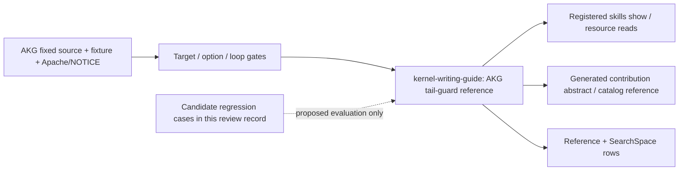

# AKG Affine tail-guard distillation

This construction record covers one issue #91 increment: diagnosing tail
protection in AKG-MLIR's static CUDA Affine loop tiling. The user question is why
a non-divisible elementwise shape can acquire full point-loop bounds, and what
evidence is needed before trusting its accesses. It does not summarize AKG's
compiler or agent framework.

## Construction and ownership

The AREX portable `distill-ml-knowledge` and `extend-repo-skill` workflow
(`ac3fe1afa80fb9a09775ecfb2b6cc3ba850a2db6`) was applied as
scope → ground → construct → verify, using an incremental owner extension.
The InferRSI library/reader contract remains authoritative.

- **Scope:** one static, single-band, zero-based unit-step elementwise fixture
  and the selected `inequality-convert-to-if` control flow.
- **Ground:** repository identity and discovery prefix resolved to
  [mindspore-ai/akg @ 5aa15f3fe4d856eb60cd3b27447e04f5f1fb4dff](https://github.com/mindspore-ai/akg/tree/5aa15f3fe4d856eb60cd3b27447e04f5f1fb4dff).
  The [canonical source ledger](../../src/inferrsi/data/skill_library/methods/kernel-writing-guide/references/akg-affine-tail-guards.md#source-ledger)
  records exact implementation/fixture/license ranges.
- **Construct:** reuse [kernel-writing-guide](../../src/inferrsi/data/skill_library/methods/kernel-writing-guide/SKILL.md).
  Its existing tail-mask and verify-before-benchmark guidance owns the question.
  The added reference supplies target/option/loop gates, an explicit example,
  failure observations and a bounded verification procedure. No new skill or
  registry is needed; existing metadata and candidate maturity are retained.
- **Verify:** separate package/schema/link readability from compiler IR checks,
  backend correctness and agent efficacy. Local deterministic check receipts
  belong to the PR. The latter three have not been executed here.

The existing AscendC tiling and operator-tuning owners were compared for overlap.
They own handwritten AscendC buffer/tiling design and a tuning campaign; AKG's
CUDA compiler guard is a different mechanism. The older generic masks and
NPU-specific caveats remain valid and are preserved.

The generated abstract is an access projection refreshed from a real committed
canonical source revision. It adds no independent content authority or backend
qualification.

## Bounded discovery exclusions

Three exploratory files were inspected at the same full revision before
choosing the CUDA slice. No implementation mechanism was extracted from them:

| Fixed path / read range | Reason excluded |
|---|---|
| [AffineTailBlockTiling.cpp, 1–231](https://github.com/mindspore-ai/akg/blob/5aa15f3fe4d856eb60cd3b27447e04f5f1fb4dff/akg-mlir/lib/Dialect/Affine/Transforms/AffineTailBlockTiling.cpp#L1-L231) | Separate CPU vector-width tail pass |
| [AffineTailBlockTiling.h, 1–33](https://github.com/mindspore-ai/akg/blob/5aa15f3fe4d856eb60cd3b27447e04f5f1fb4dff/akg-mlir/include/akg/Dialect/Affine/Transforms/AffineTailBlockTiling.h#L1-L33) | Declaration for that separate pass |
| [NPUAutoTiling.cpp, 1–1204](https://github.com/mindspore-ai/akg/blob/5aa15f3fe4d856eb60cd3b27447e04f5f1fb4dff/akg-mlir/lib/Transforms/NPUAutoTiling.cpp#L1-L1204) | NPU host/device tiling ABI; outside CUDA remainder protection |

Repository metadata and the AKG-MLIR subtree inventory were used for bounded
discovery. The public library addition paraphrases the selected mechanism.
The source license is Apache-2.0; the source NOTICE attributes MindSpore AKG,
Copyright 2019–2025 Huawei Technologies Co., Ltd. No upstream runtime was run.

## Candidate regression cases

These are proposed old/new evaluation cases, not an eval runner or a new
registry. Compare the baseline owner with the extended owner under the same
prompt/tool/source allowance. Record an actual evaluation separately before
claiming agent effectiveness. **Agent efficacy: not evaluated / uncovered.**

| Case | Prompt / situation | Baseline contract to retain | Added expected behavior and rejection signal |
|---|---|---|---|
| Old tail-mask regression | Handwritten Triton elementwise kernel, `n=1003`, `BLOCK=256`: can the store mask alone make unmasked loads safe? | Keep rule 6: valid bounds protect loads and stores; verify before benchmarking | Reject treating AKG compiler-generated guards as permission to remove handwritten load masks |
| Old verification regression | A new kernel runs faster on one shape but has no reference comparison | Keep accuracy/reference gate before timing and the fixed workload | Reject promotion from source reading or a CPU package check to device correctness/performance |
| New static CUDA tail | AKG fixture shape `[32,1280,768]`, tiles `[32,30,30]`; full point loops appear in IR | Preserve the generic access-bound contract | Resolve `process=cuda` and static gate; derive the 1279/767 predicates; check both loads and store are within the then-region; reject guard deletion or an executed-kernel claim from FileCheck |
| New option precedence | Static CUDA function with `inequality-convert-to-if=false`, then with `separate=true` | Do not infer dispatch from a flag name | Explain static CUDA forces the guard field true, while `separate` wins branch priority; inspect actual selected output |
| New backend boundary | A user asks whether the CUDA guard fixture proves Ascend tails or a GPU reduction with barriers is safe | Preserve backend-specific verification and NPU caveats | Route to the actual target/loop/lowering implementation; state these paths are uncovered rather than copying the CUDA conclusion |
| New diagnostic boundary | The compiler produces IR and an inequality-conversion diagnostic | Require evidence tied to the actual output | Inspect stderr, output IR and guard placement; helper failure printing is not a demonstrated process-level failure contract |

## Coverage and limits

The two matrices credit only source-derived Accelerator
Diagnose / Configure / Verify guidance. They retain the old dated negative
storage/OS findings and unknown Host/Communication scope; this increment does
not add measured resource coverage.

Compiler/FileCheck execution, downstream lowering, device memory access,
thread/synchronization behavior, numerical equivalence and performance are
`not_run`. Agent efficacy is `not_evaluated`. The small fixed-source readset is
sufficient to state the pass's selected mechanism and propose checks; it cannot
qualify every loop, backend or compiler version.
