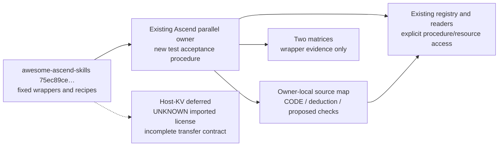

# Issue #91: awesome-ascend-skills bounded extraction

Authority: [incremental priority 2](https://github.com/InferMatrixLab/InferRSI/issues/91#issuecomment-6340868624).
Material author: Codex author agent, configured `gpt-6.1-sol`, `xhigh`.
Execution and independent-review receipts belong to the PR record, separately
from source observations and the proposed outcome cases below.

## AREX construction record

- Anchor `z`: repository `ascend-ai-coding/awesome-ascend-skills`,
  `75ec89ce9d401be8ac95980e1c3f42f8d4315057` (historical prefix `75ec89c`),
  tree `7728edb7e478c1ff6db942f15537319aa1a1f0db`; task-agnostic distillation.
- Method: AREX-Skill `ac3fe1afa80fb9a09775ecfb2b6cc3ba850a2db6`,
  `distill-ml-knowledge` → `extend-repo-skill`; strategy `reuse-existing`,
  reuse mode `single`. InferRSI's existing owner, sidecar, registry/readers and
  source-commit-bound catalog are the deployment contract; no DisCo import.
- **Scope (`Q`):** assess host-KV evidence; extract actionable communication-test
  selection, shape/payload, timing, result-validation and counterexample rules.
  Do not inspect an entire serving engine, qualify native collectives, execute
  source code or make an efficacy/performance claim.
- **Ground (`X`):** eight fixed text blobs, retrieved through the connected
  GitHub reader and read statically. The local communication wrappers supply
  CODE evidence. KV recipes supply DOC evidence only; deductions are labeled
  D and future checks P. No mutable linked implementation is promoted to evidence.
- **Construct (`G_tilde`):** reuse `ascend-distributed-parallel`; add one nearby
  route and owner-local acceptance/readset document, minimal typed provenance,
  and matching matrix rows. Preserve all historical strategy guidance and
  candidate maturity. The host-KV assessment stays here; no new host skill or
  duplicate allocator/tiering procedure is created.
- **Verify:** actual checkout discovery, schema/resource/bundle bytes and local
  links; source-line/blob support and preservation of the old body. Backend,
  transport, numerical runtime and agent efficacy are **not_run**. Catalog
  generation uses a real canonical source commit and the stock generator;
  exact commands/results and independent review remain in the PR receipt.
- **Handoff (`R`):** this construction record, the owner-local readset and the
  PR's revision-scoped receipts. Accepted coverage is limited to what those
  checks establish; no automatic promotion, installation or execution authority.

## Existing owners and overlap

| Existing asset | Existing responsibility | Decision |
|---|---|---|
| `ascend-distributed-parallel` | Card groups, strategy activation, communication masking and in-model attribution | Extend with isolated-test evidence acceptance; retain the existing procedures. |
| `host-memory-management` | General CUDA-oriented pinned/async/NUMA guidance | Preserve; a brief NPU recipe cannot qualify its CUDA examples for TorchNPU. |
| `torchnpu-pinned-host-memory-lifecycle` | Separately pinned TorchNPU host allocation, pending-copy ownership and reuse | Preserve; do not duplicate its implementation ledger or infer swapped-memory behavior from it. |
| LMCache `kv-tier-management` | Separately pinned MP-mode retention, prefetch, eviction and tier semantics | Preserve; it does not establish a cannbot/model-specific KV manager. |

## Host-KV boundary

DOC: [KV overview:7-10,403-409](https://github.com/ascend-ai-coding/awesome-ascend-skills/blob/75ec89ce9d401be8ac95980e1c3f42f8d4315057/external/cannbot/model/model-infer-kvcache/SKILL.md#L7-L10)
retains original cannbot identity `ac5bbd2b4cf427d011874e11f8d1e8b1bef66eda`
and `license: UNKNOWN`; its
[offload section](https://github.com/ascend-ai-coding/awesome-ascend-skills/blob/75ec89ce9d401be8ac95980e1c3f42f8d4315057/external/cannbot/model/model-infer-kvcache/SKILL.md#L403-L409)
explicitly marks the advanced features incompletely documented and supplies an
API name plus a reference to another repository. That implementation was not read.

DOC: the [multi-stream header:8-11](https://github.com/ascend-ai-coding/awesome-ascend-skills/blob/75ec89ce9d401be8ac95980e1c3f42f8d4315057/external/cannbot/model/model-infer-multi-stream/SKILL.md#L8-L11)
retains the same imported identity and UNKNOWN license. Its
[KV example:13-18,40-69](https://github.com/ascend-ai-coding/awesome-ascend-skills/blob/75ec89ce9d401be8ac95980e1c3f42f8d4315057/external/cannbot/model/model-infer-multi-stream/examples/kvcache-offload-async-stream.md#L13-L69)
describes a separate transfer stream, events and swapped/temporary allocations,
but expressly says the fragments may not show the complete transfer. It does
not establish when a copy is issued, recorded, awaited, reused or freed.

D: these declarations and snippets are insufficient for a reusable host-KV
implementation contract or a new RAM capability. The outer
[README MIT declaration:727-749](https://github.com/ascend-ai-coding/awesome-ascend-skills/blob/75ec89ce9d401be8ac95980e1c3f42f8d4315057/README.md#L727-L749)
does not resolve the imported UNKNOWN license. No source code is copied and no
host runtime procedure is added. P: a later extraction needs an explicitly fixed,
license-resolved cache-manager/API implementation, concrete tensor shapes and
ownership/copy/event/reuse paths, then a separately authorized correctness and
timeline check. This repository slice leaves that gap open rather than inferring
overlap or compatibility from async syntax.

## Bounded readset

All paths are relative to the same full source commit above. The eight blobs are:

| Path | Read scope and use |
|---|---|
| `README.md` | 727-749: root MIT declaration only |
| `external/cannbot/model/model-infer-kvcache/SKILL.md` | 1-11,403-409: imported identity/license and incomplete offload pointer |
| `external/cannbot/model/model-infer-multi-stream/SKILL.md` | 1-17: imported identity/license only |
| `external/cannbot/model/model-infer-multi-stream/examples/kvcache-offload-async-stream.md` | 1-73: documentation recipe and its explicit incomplete-transfer boundary |
| `skills/training/hccl-test/scripts/quick-verify.sh` | 1-238: launch, result heuristic and cleanup; no execution |
| `skills/training/hccl-test/scripts/parse-hccl-result.py` | 1-141: result schema and summary logic; no execution |
| `skills/training/torch-npu-comm-test/scripts/comm-bench.py` | 1-412: allocation, dispatch, validator, timing, reporting and CLI; no execution |
| `skills/training/torch-npu-comm-test/references/supported-ops.md` | 49-58,81-89,143-152,195-224: documented shape and P2P intent checked against code |

Detailed communication clauses map to immutable lines in the
[owner-local readset](../../src/inferrsi/data/skill_library/hardware/ascend/ascend-distributed-parallel/references/awesome-ascend-communication-tests.md).

## Candidate old/new cases

The following cases are **not evaluated**; agent efficacy is **uncovered**.
Any later comparison uses identical worker model/effort, task, permissions,
tools and budget against the parent procedure and this candidate. Keep complete
outputs and apply the grading criteria independently. This work does not change
the Issue #88 runner or authorize model calls or device experiments.

| Case | Copyable task | Required distinction / failure condition |
|---|---|---|
| New: unsupported PASS | `A PyTorch/HCCL communication report says reduce_scatter --check PASS. The shape is 1024,4096 and group size is 4. What has actually been checked, what are the input/output bytes, and what evidence is missing?` | Input has four times the first dimension of output; validator falls through True. Require dtype for exact bytes and an actual result oracle. Fail if PASS is accepted as numerical validation or both operations are assigned the same input bytes from CLI shape alone. |
| New: subgroup oracle | `The pinned benchmark's SUM check fails on global ranks 1 and 3, while default-world SUM passed. Explain a source-supported counterexample and the next check without diagnosing the fabric from this alone.` | Distinguish global tags 2+4 from expected group-position sum 1+2; label deduction, not reproduced backend failure. Require group-aware reference. |
| New: timing and native wrapper | `Our async communication flag lowers a reported percentile and the native quick wrapper prints success. Can we claim compute/communication overlap and faster network links? Plan the smallest discriminating follow-up.` | Work wait plus NPU synchronization completes each timed call; samples/report are rank-local; formula bandwidth is not physical transport measurement. Require raw per-case logs, oracle scope, actual timeline and authorized owned-process cleanup. Fail if syntax or marker is treated as overlap/transport proof. |
| Regression: existing strategy activation | `Ulysses is configured but the model profile shows allGather and no allToAll. An isolated all-to-all benchmark is green. What must be established before attributing a parallelism gain?` | Preserve the existing ParallelConfig activation and actual allToAll/model-stage attribution gates. Fail if a communication-test result substitutes for sharding activation, matched card groups or in-model measurement. |
| Defer: host KV | `The KV guide mentions empty_with_swapped_memory and an async stream example. Is that enough to implement a correct cache manager or claim lower host memory and overlapped copies?` | State DOC-only/incomplete transfer, UNKNOWN imported license and unread original implementation; identify missing ownership/copy/event/reuse evidence. Fail if the incomplete recipe is promoted to a new host-runtime capability. |
