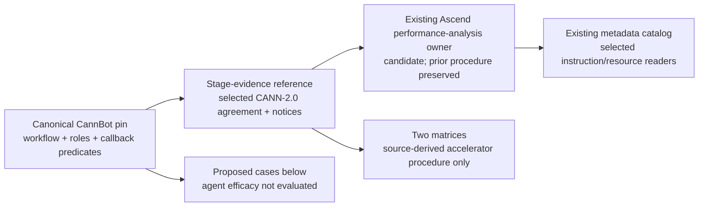

# Canonical CannBot stage-evidence extension

Refs [issue #91](https://github.com/InferMatrixLab/InferRSI/issues/91).

## Construction and ownership

- Source anchor `z`: canonical `cann/cannbot` at
  `c0e2ad23ee1a73e3c0f84c8df1cc459e2aae3110`, tree
  `a381cd1241541bde9f881bbe12f5b97caa671b7c`, independently retrieved from
  its anonymous public Git endpoint on 2026-10-23. No mirror substitutes for it.
- Capability `Q`: one decision rule for accepting a fixed-stage PyTorch/Ascend
  optimization report: current execution identity, quality result and comparable
  measurements must agree; callback completion has a narrower meaning.
- Evidence `X`: the bounded [source ledger and trace](../../src/inferrsi/data/skill_library/hardware/ascend/ascend-performance-analysis/references/cannbot-stage-evidence.md).
  Exact Git objects establish identity; source reading establishes instructions
  and callback predicates. No upstream code, installer, agent host, model, API,
  device or paid evaluation was executed.
- Strategy: `reuse-existing`, AREX `distill-ml-knowledge` + `extend-repo-skill`
  with bounded `verify-repo-skill` checks, at AREX revision
  `ac3fe1afa80fb9a09775ecfb2b6cc3ba850a2db6`. Scope → ground → construct →
  verify uses InferRSI's existing registry/readers. Its candidate-case report
  and typed source contracts replace the external managed-import layout; no
  DisCo deployment, license-field migration or additional registry is added.
- Material author: Codex / `gpt-6.1-sol`, effort `xhigh`.

| Existing responsibility | Decision |
|---|---|
| `ascend-performance-analysis`: NPU profile diagnosis and shared-machine measurement discipline | Sole extended owner; preserve stable ID, candidate maturity and prior five-layer procedure |
| `inference-benchmark-design`: controlled comparison; `dense-performance-evidence`: claim/evidence levels | Refer to their responsibilities without duplicating their procedures |
| `ascend-operator-tuning` / `ascend-operator-profiling`: single-operator tuning and metrics | Preserve; this extension concerns model-stage report acceptance |
| Historical awesome-ascend-skills / `cannbot-skills` material | Preserve pins and UNKNOWN license boundaries; the canonical app is a separate source |

The fixed flow has an actual source-level chain: baseline metadata production
and consumption → stage-2 KV/attention analysis → confirmed implementation →
reviewer validation → primary-agent repair/diagnosis/advance decisions. These
are workflow instructions. The registered hooks check selected writes,
progress-read markers, self-check words and retry counts; their exit codes
require host integration to affect execution. The reference states each
producer, consumer, condition and boundary. It does not import KV implementation,
default accuracy thresholds, or an execution authority from the source.

The selected source license is **CANN Open Software License Agreement Version
2.0** (`CANN-2.0` in both plugin manifests). The complete agreement and Huawei
copyright attribution accompany the new reference. Its stated Huawei-system
purpose and notice/distribution conditions remain explicit. No generic license
or compatibility conclusion is made, and no implementation is copied.

## Proposed old/new regression cases

These are independently specified review cases, not agent outputs or executed
tests. Apply identical prompts and rubrics to exact pre-extension and extended
bundles in a future separately authorized evaluation. Record independent
answers, source support and missing coverage. No unmerged comparison runner
is used. Agent efficacy is **not evaluated**; model/backend/serving coverage
is **uncovered** by these proposed cases.

| Case / copyable request | Expected observations | Reject |
|---|---|---|
| New positive: “Our stage-2 report links the current model/stage/candidate revision, logs showing the changed attention module ran, matched baseline inputs/configuration, the frozen validator's successful result and comparable prefill/decode measurements. What conclusion can we accept?” | Check actual artifact identities and boundaries; allow only the demonstrated stage conclusion, then use the existing profile pipeline for attribution; retain separate whole-model/serving scope | Hook success substitutes for inspecting artifacts; stage success becomes L4/whole-model qualification |
| New negative: “The stop callback returned zero. The self-check has all required headings but says compilation failed and output was abnormal; it links no validator output. Can we mark accuracy PASS?” | Keyword presence is the inspected predicate, with no value/numerical check; zero may also occur without readable progress. A recorded failed frozen gate is FAIL; otherwise absent numerical evidence is INCONCLUSIVE. Request the current stage's loaded-code and actual validator artifacts | Reported exit zero or a keyword-complete section proves numerical success; claim a reproduced host defect |
| New identity variant: “Two model directories contain progress.md. The newer file has a successful report for another model/stage. Our changed module has no execution log. Which report can support our timing claim?” | Stop helper selects newest-by-mtime, while the acceptance rule requires current model/stage/revision and actual execution; withhold this claim and identify the missing binding | Newest file or marker existence proves the requested model was tested; treat the hypothetical as an observed run |
| New baseline variant: “The model could not run until multi-card stage 1. May we attribute later KV-stage gains to the earlier parallel-validation timing?” | Source instructs collecting the runnable deployment baseline after parallel verification and ignoring the earlier timing for later comparisons; inspect current inputs/configuration, oracle and measurement boundaries | File presence proves comparability; a configuration/card-count change is silently counted as the KV-stage gain |
| Existing regression: “A hypothetical step trace has Computing=40, Communication=20, Overlapped=15 and Free=10 in one consistent unit. The summed communication-stream durations are larger. How should we classify the step before proposing a fix?” | Preserve the existing four-tuple method: exposed communication is 5, utilization denominator is 40+5+10; do not substitute summed overlapping durations. Check capture/column quality and continue the five-layer diagnosis without inventing a performance gain | Remove or bypass the old pipeline; sum overlapping streams; call a source-only deduction a device measurement |

## Verification boundary

Deterministic schema, catalog/reader, resource/link and source-identity results,
the tested snapshot and the generated-index source revision belong in the PR's
checked-content evidence. They establish discoverability and packaging, not
accuracy, gain or agent efficacy. Source hook evaluation, host blocking behavior,
NPU/model execution and per-case agent comparison remain not_run/not evaluated.
Independent review and publication do not close all of issue #91.
