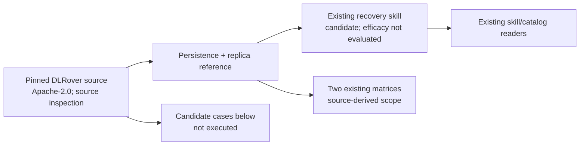

# DLRover persistence and replica extension

Refs [#91](https://github.com/InferMatrixLab/InferRSI/issues/91) and its
[priority scope](https://github.com/InferMatrixLab/InferRSI/issues/91#issuecomment-6340868624).

## Construction record

- Anchor `z`: source repository `intelligent-machine-learning/dlrover` at
  `e35b1ad90e2928ca6bacf5d22117f713566c5cb0`; task-agnostic distillation.
- Capabilities `Q`: distinguish queued save, serializer return, done-file
  publication, tracker update and durable recovery; trace full/sharded replica
  transport through its consumer; select bounded follow-up checks by failure domain.
- Evidence `X`: seven immutable files, read ranges and Apache-2.0 attribution in
  the [canonical source inventory](../../src/inferrsi/data/skill_library/methods/checkpoint-recovery-consistency/references/sources.md).
  Source text was fetched through the GitHub connector. No source package was
  installed or imported; documentation intent is kept separate from implementation.
- Construction strategy: `reuse-existing`, single `extend-repo-skill` workflow
  under AREX `distill-ml-knowledge` (AREX revision
  `ac3fe1afa80fb9a09775ecfb2b6cc3ba850a2db6`). Scope, ground, construct and verify
  apply to InferRSI's existing canonical owner and reader contract. This is a
  staged repository extension, with no DisCo managed import or router rebuild.
- Authority: delegated repository slice under the accepted #91 priority scope;
  no additional runtime, device or paid-evaluation authority is inferred.
- Material author: Codex / `gpt-6.1-sol`, effort `xhigh`.

| Existing area | Keep / extend decision | Verification target |
|---|---|---|
| `SKILL.md`: readiness, positive-step agreement, helper lifetime | Preserve; route deeper DLRover questions to one new reference | Old readiness/step candidate case; reader access |
| C4 NVIDIA complete-iteration and async-finalizer distinctions | Preserve; no new C4 source inspection | Existing content and local links |
| C3 persistent fallback and replica transport | Add DDP/common-directory call path and full/sharded transport boundaries | Immutable source support; new candidate cases |
| Metadata, stable ID, maturity and library placement | Preserve existing multi-source owner; no DisCo frontmatter/license migration | Schema/catalog/index/reader checks |
| Reference / SearchSpace matrices | Update only DLRover's scoped extraction and mechanism rows | Local links; no new measured coverage |

## Candidate old/new cases

These are proposed regression/use cases for a future separately authorized
agent evaluation, not evaluated outcomes. Use the same prompt and output rubric
against the pre-extension and extended skill revisions; retain independent
answers and exact bundle revisions. Do not infer agent efficacy from source
review or deterministic reader tests. No evaluation runner or paid calls are added.

Each answer should state its conclusion, source-supported reason, uncertainty
and smallest authorized next check. The expected observations below are a
review rubric, not fabricated agent output.

| Case / copyable request | Required observations | Reject |
|---|---|---|
| New: “Our DLRover DDP save call returned normally and `wait_latest_checkpoint` also returned. May we advertise the latest generation as durable?” | Public wrapper drops the engine Boolean; queueing and tracker polling differ; timeout also returns without success value; inspect actual tracker, expected payloads and storage ordering before a durability conclusion | Successful return proves completion or power-loss survival |
| New: “The common-directory saver has as many done files as configured global shards. Does that prove optimizer state and payload durability?” | Commit compares count; configured, truthy mapped state controls writes; markers do not check identities/content/state semantics; POSIX marker `fsync` precedes context-close without explicit flush, payload callback supplies its own behavior | Count/marker `fsync` proves full state, atomic generation publication or durable tensors |
| New: “A sharded backup group has global ranks 1 and 3; the failed host's local shared memory is missing. Which source boundaries must we check before accepting replica recovery?” | Gloo CPU byte/metadata transport, world-position rank mapping, rank-key versus index lookup in gather; engine allocates/sets metadata without visible received-byte copy; propose real target-version payload and topology checks | Replica flag, matching metadata, or collective return proves restored bytes; claim a reproduced runtime failure |
| Regression: “One saving participant cannot acquire the memory lock; after restart loader steps are 41 and 42. Another system has one clean NVIDIA local shard. Which checkpoint is acceptable?” | DLRover readiness skips the new save and releases acquired locks; unequal loader steps do not load; positive equal steps still require actual state; NVIDIA selection needs complete participating-rank coverage | Skip becomes new checkpoint; steps chosen independently; one clean file proves global generation completeness |

## Verification and handoff

Static/source review establishes candidate guidance only. Backend execution,
checkpoint loading, failure injection, power-loss tests and agent efficacy are
not evaluated. NVIDIA evidence remains carried at its original inspection date.

Deterministic check results and the final generated-index source revision are
recorded in the PR's checked-content evidence. The generator requires committed
canonical inputs; no uncommitted content is attributed to a historical revision.
Fresh-install smoke is opt-in and creates a new installation; it was not run
in this source-only lane, which excludes dependency installation. Independent
review and publication belong to the parent lane; this construction record does
not declare approval or close #91.
