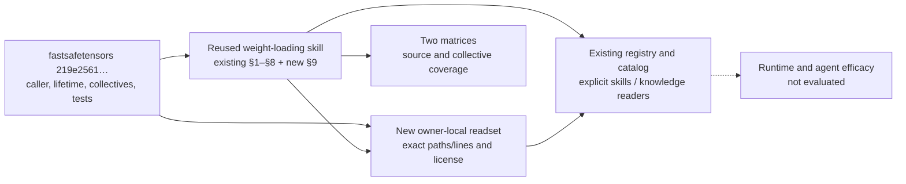

# Issue #91: fastsafetensors delivery distillation

Scope authority: [Issue #91 priority](https://github.com/InferMatrixLab/InferRSI/issues/91#issuecomment-6340868624).
This is one repository slice; it does not complete the whole issue.
Material author: Codex author agent, configured `gpt-6.1-sol`, `xhigh`.
Execution and independent-review receipts belong to the accompanying PR record.
No efficacy evaluation has been executed.

## AREX construction record

- Anchor `z`: source repository `foundation-model-stack/fastsafetensors` at
  `219e2561a41ede2d5d8eba611c248bb0effbf580`; task-agnostic source distillation.
- Method: AREX-Skill `ac3fe1afa80fb9a09775ecfb2b6cc3ba850a2db6`,
  `distill-ml-knowledge` → `extend-repo-skill`; construction strategy
  `reuse-existing`, reuse mode `single`. InferRSI's existing owner, sidecar,
  readers and generated catalog remain the destination contract. The DisCo
  install/router/frontmatter steps are outside this repository's task.
- **Scope (`Q`):** select whole-tensor replication, dimension scatter or
  independent filtered reads; recognize coalescing eligibility and memory /
  completion counter-signals. Preserve §1–§8 and candidate maturity. No new
  skill ID, registry, runner, device run or model-call budget.
- **Ground (`X`):** resolve the historical prefix from a clean source checkout;
  inspect caller, owner-only copier selection, collective adapters, readiness,
  output lifetime and author tests. The owner-local
  [readset](../../src/inferrsi/data/skill_library/methods/weight-loading-optimization/references/fastsafetensors-transfer-readset.md)
  maps each rule to immutable paths/lines and Apache-2.0 attribution. Other
  source claims, including inherited I/O/save performance, remain carried evidence.
- **Construct (`G_tilde`):** one existing skill with additive §9 and one source
  reference, minimal sidecar provenance and matching matrix rows. No new runtime
  helper is needed. Existing root discovery leads to the procedure and its
  declared local resource; the generated catalog is a projection.
- **Verify:** deterministic schema, local-link, discovery, resource-byte and
  reader tests; source-support review; proposed cases below. Runtime source
  tests and agent outcome trials are not run. Static/package success cannot
  promote the candidate or establish communication gains.
- **Handoff (`R`):** this record plus the readset. Graph acceptance is limited
  to the source support and packaging evidenced in the PR; catalog generation
  uses a real commit containing the canonical source bytes. Independent review
  is recorded separately from author checks. No managed/global import.

| Required capability | Existing workflow coverage | InferRSI adaptation |
|---|---|---|
| Source identity, evidence and narrow extension | `extend-repo-skill`: full | Full-SHA source/readset under existing owner |
| Preserve old behavior and new/regression cases | `extend-repo-skill`: full | Add §9; cases below, outside runtime roots |
| Source/license mapping | `extend-repo-skill`: full source obligation | Inspect pinned LICENSE; retain multi-source attribution rather than assigning one license to the complete owner |
| Static checks and independent review | `extend-repo-skill`: applicable | Existing InferRSI readers/index/tests; independent reviewer receives actual patch |
| Runtime deployment | DisCo-specific importer is not the destination | Scoped repository PR and existing wheel packaging; no second router |

## Candidate old/new evaluation cases

These are reviewable proposals, **not evaluated**. No claim is made that an
agent follows them more accurately or faster. Issue #88 owns comparison tooling;
this slice does not modify it. For a separately authorized old/new trial, use
the same task, model/effort, permissions, tool budget and source context against
the parent skill and this candidate, retain both complete outputs, and assess
the checks below without supplying the expected answer to the worker.

| Case | Copyable user request | Expected checks / failure condition |
|---|---|---|
| New: replication versus TP | `A two-rank PyTorch loader assigns the checkpoint file to group rank 1. One bias must be replicated; one [8, 12] matrix must be split on dimension 1. Explain the load and delivery plan, including a subgroup made of world ranks 1 and 3.` | Distinguish file ownership from model slice; broadcast bias, scatter dimension-1 intervals [0,6) and [6,12); group rank 1 is world rank 3; identical method order; contiguous source slices and separate receive allocations. Fail if the pipeline is claimed to select TP dimensions or each rank directly reads only its slice. |
| New: coalescing and counterexample | `Our distributed PyTorch startup has many adjacent small weights. Can we use broadcast_run_bytes=16777216 and broadcast_run_tensors=64? Some weights must stay resident and others are copied into existing parameters. Explain one valid option and when coalescing will not run.` | Check multi-rank PyTorch/no resident predicate, identical limits/plan, boundaries and oversized singleton; explain resident predicate disables coalescing and non-resident yields must be relocated/released. Fail if the limits are called a hard memory cap, scatter is said to be coalesced, or fewer payload bytes are promised. |
| New: early stop and readiness | `A coalesced loading iterator may stop after its first output while file I/O is still in flight. Explain what must complete before cleanup and what storage a retained small tensor can keep alive. Would borrowed_tensors remove the distributed copies?` | Source ranges ready before cloning; CUDA/NCCL stream-ordered wait versus final CUDA drain, with CPU/Gloo completion following its own backend contract; iterator close before loader close; owning view can retain a whole run; borrowed mode requires a single-process loader group. Fail if close is skipped, borrowed distributed mode is proposed, or CUDA/NCCL work.wait is treated as a CPU-blocking whole-device drain. |
| Regression: existing startup measurement | `A loader starts faster after changing mmap mode and warming the filesystem cache. Can we report lower per-request latency? Design a fair loading comparison before choosing a transfer optimization.` | Preserve §1/§2/§6/§7: source/format/placement/duplication; startup denominator separate from per-request work; same loading mode/cache protocol and affinity; init/header/io/get phases, bytes/counts and hit-based warmup. Fail if new collective guidance replaces the existing measurement discipline or implies a request/service gain. |

Coverage remains **uncovered** for live collective execution, uneven/empty
scatter, packed-dtype backend acceptance, accelerator/NPU and inter-node
compatibility, startup performance and agent efficacy. The proposed checks in
§9 define a future bounded validation, not authorization to run it.

## Check and review receipts

The PR records exact checked revisions, commands, pass/fail/skipped states,
source-commit-bound catalog generation and independent-review findings.
Those receipts distinguish source/packaging checks from the unexecuted outcome
cases above. Commit, push and PR publication belong to the integrator.
