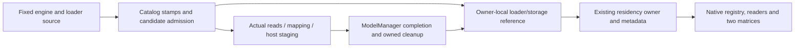

# Stable-diffusion.cpp catalog-to-storage construction

This bounded Issue #91 slice extends the existing
[`audit-sd-cpp-residency`](../../src/inferrsi/data/skill_library/repositories/stable-diffusion-cpp/audit-sd-cpp-residency/SKILL.md)
candidate. It preserves its stable ID, eight residency steps, MIT text, original
source pin and historical archive receipt. No engine, dependency, evaluator or
hardware execution is introduced. Material author: Codex / `gpt-6.1-sol`,
reasoning effort `xhigh`.

## Scope → ground → construct → verify

| AREX phase | Decision and native InferRSI asset |
|---|---|
| Scope | Fill the catalog/source → actual byte delivery → immediate storage-consumer gap. Select ordinary non-ZIP safetensors and its shard index; leave generic startup optimization with `weight-loading-optimization`. Do not replace request-time residency guidance. |
| Ground | Fixed leejet/stable-diffusion.cpp `b13a48219d5cdf408edcb93da6cd69b612ed03d3`, tree `df847d004c6529eefb02bb629d7ee26e740121a9`. Twelve C++ blobs and retained MIT text have exact byte identity checks; semantic ranges are in the [new ledger](../../src/inferrsi/data/skill_library/repositories/stable-diffusion-cpp/audit-sd-cpp-residency/references/loader-storage-boundaries.md#fixed-readset-and-attribution). The prior nineteen-blob receipt remains historical. |
| Construct | Reuse one owner and the native metadata/readers. Add [two loader/storage decisions](../../src/inferrsi/data/skill_library/repositories/stable-diffusion-cpp/audit-sd-cpp-residency/references/loader-storage-boundaries.md), a root route, additive source/validation notes and scoped entries in both matrices. No new ID, backend, counter or parallel registry is needed. |
| Verify | Check actual owner/resource discovery, metadata, local links, immutable source ranges and retained license. Preserve the old eight-step body and source identity. Bind generated records to a real source commit only after source freeze. Exact execution and independent-review receipts belong to the PR; package/schema checks do not qualify native loading or agent efficacy. |

AREX portable distill/extend guidance is used from fixed
`ac3fe1afa80fb9a09775ecfb2b6cc3ba850a2db6`; this is an InferRSI candidate extension,
not a managed-skill installation. The root license is MIT, Copyright (c) 2023
leejet, retained as the complete existing owner `LICENSE` (Git blob
`56e1e5a63852c3bcd5ac4fcdfecb7666f5274169`). No runtime implementation is copied;
this attribution does not license models, unexpanded dependencies, external ZIP
code or unrelated embedded helpers.

## Observations, deductions and execution boundary

Source observation: dependency checks compare path, size and mtime; internal
source/catalog revisions are generations. Metadata parsing and non-ZIP byte
bounds precede actual reads. Regular stream reads and mapping copies can return
failure; host staging/conversion and backend-copy calls are distinct. The
manager's destination callback records a name before bytes are delivered, while
loaded-state publication requires all selected source groups to succeed.
Failure cleanup releases the parameter blocks created for that load. Shared
mapping owners can remain in loader caches or other blocks.

Deduced audit rule: neither a matching stamp nor a successful destination
callback is a byte-identity/completion oracle. Require an independent content
manifest/output oracle when that conclusion matters. Do not infer global
rollback, pinned allocation, physical SSD traffic, cache eviction or device
completion from these interfaces. Loader stage counters divided by the last
file's thread count are not a cold-storage bandwidth denominator.

Native parser/load/failure injection, allocation/unmap behavior, backend-copy
completion, full-model image quality and performance are **not_run**. Matching
GGML/private headers/build and a legal minimal fixture are prerequisites, not
replaceable by mocks or extracted formulas. The source-only readset does not
qualify all GGUF/Torch/ZIP formats, special quantization/conversion correctness,
video/audio or every backend. Agent efficacy is **not evaluated / uncovered**.

## Proposed regression cases

All rows are proposed; no case below is a runtime result. Expected decisions
are stated independently of a source keyword or successful reader invocation.

| Case | Input/condition | Independent expected decision / oracle |
|---|---|---|
| New identity positive | A required shard has changed under the selected index | Refresh/invalidate before reuse; inspect real source and consumer state plus caller result. |
| New identity negative | Same path/size/mtime, different independently recorded digest | Do not certify equal bytes from catalog stamps or generation IDs. Preserve the differing digest. |
| New admission negative | A selected tensor interval exceeds the real file | The real parser/add-file rejects that candidate; its failed admission does not replace the previous accepted catalog. |
| New read negative | A file becomes short after catalog admission | The caller observes failure; callback invocation does not count as load completion. Inspect loaded flags/new-block cleanup without presuming universal rollback. |
| New staging positive | Supported ordinary dtype with the actual read/staging/mapping path selected | Compare real tensor bytes to an independent legal small-fixture oracle. Keep input/target byte counts separate and owners alive through use. |
| New lifetime negative | One block releases its map owners while another owner/cache retains the mapping | Do not predict final unmap or memory savings from one release. Check actual retained owners and final destruction. |
| Old dispatch regression | CPU or multi-device scheduling with a small `max_vram` | Preserve the existing distinction from the non-CPU single-device segmented path; a small budget alone is insufficient dispatch evidence. |
| Old lifetime regression | An active/queued weight becomes unpinned | Preserve the existing distinction between eligibility for reclamation and immediate physical free; async capability alone is not useful overlap. |

If native prerequisites are later supplied, run the real selected parser/manager
for the new cases and the actual backend/model for residency/image claims.
Package/readers validate retained content and access only. Keep preparation,
first image, warm requests, byte equality/quality, host/device peaks and timing
denominators separate; no result in one category promotes the candidate.
