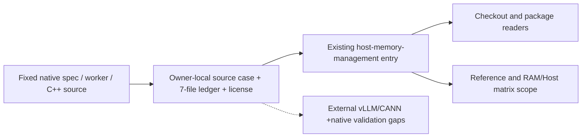

# vLLM-Ascend native host descriptor-pool extension

## Construction decision

This bounded Issue #91 contribution extends the existing [host-memory-management](../../src/inferrsi/data/skill_library/hardware/host/host-memory-management/SKILL.md) owner. The user problem is host descriptor retention after native CPU KV-offload submission or wait. The added rule follows normal event-query-gated pool reuse, with readiness, ownership and physical RAM release kept separate.

The AREX portable distill/extend method was applied as scope → ground → construct → verify. The existing InferRSI ownership/schema/readers remain authoritative; this is not a DisCo managed import or a routing/license migration. One source case owns the new behavior; no new skill ID, backend, count, runtime helper or dependency is introduced. Existing four mechanisms, CUDA/Python/NUMA examples and source history remain. Only the blanket NPU limitation is narrowed to route to the versioned case; historical broad API, threshold and performance statements are not revalidated by this extension.

The [source note](../../src/inferrsi/data/skill_library/hardware/host/host-memory-management/references/vllm-ascend-native-offload.md) supplies the bounded procedure and actual caller/consumer/cleanup order. The [seven-file ledger](../../src/inferrsi/data/skill_library/hardware/host/host-memory-management/references/vllm-ascend-native-offload-readset.json) pins vllm-project/vllm-ascend, repository ID 924058625, commit 8a8e1e05ecb64a30804c99c8f362909f9a0cb5bf and actual tree 5ca8fb3b2c6b9a64d74a3b9a74403ce44014e4a5, with exact Git blobs, SHA256, byte counts, real EOF bounds and selected ranges. Source verification date is 2026-10-23. The acquisition cache used the commit as its request label; reconstructed Git tree bytes bind the actual tree above.

Full original Apache-2.0 [LICENSE bytes](../../src/inferrsi/data/skill_library/hardware/host/host-memory-management/references/vllm-ascend-LICENSE.md) are retained (11,357 bytes); contributor and Huawei notices remain attributed. No root NOTICE entry exists in the inspected root tree; this is not a third-party-license audit. This source addition does not relicense the owner's older material.

## Evidence boundary

The single-tier native spec creates private CPU payload mirrors and per-direction handlers. A Transfer retains descriptor bases during normal submission/polling; get_finished() reclaims only after a successful head end-event query. A tracked wait synchronizes without recycling. Shutdown pops before synchronizing the extracted event and then clears pools/lists; no stronger descriptor-retention, bug or safety conclusion follows from that expression.

The local queue/consumer/reclamation chain is observed. Upstream vLLM manager, compute_sub_block_ptrs and ABI compatibility are unpinned; shared mmap/tiering, prefetch/simple variants and request retirement are excluded. C++ CPU dispatch still submits NPU DMA. The old documentation pin bc8115ed, the ACLGraph owner and TorchNPU allocator source remain independent authorities. No backend/runtime, physical RAM saving, Network, quality or performance qualification is added.

## Candidate usability/regression cases

All cases below are proposed source-only discriminators, not executed agent evaluations or native test results.

| Case | Copyable request | Required distinction |
|---|---|---|
| New — submission | Native transfer_async returned True and recorded an end event. Can I reuse its CPU pointer/size arrays immediately? | Follow queued Transfer ownership; normal pool return requires successful head-event query. |
| New — wait | I waited for a tracked job but its host descriptor memory remains. Is this a proven leak? | Wait synchronizes without popping/recycling; distinguish queued, pooled and allocator-held storage. |
| New — completed poll | A real head event query succeeds. What becomes reusable in this native handler? | Descriptors, streams and events enter pools; CPU payload mirrors have a different lifetime. No OS page-release claim. |
| New — larger job | The next transfer needs more descriptor entries than a reclaimed triple contains. What does the pinned source do? | Allocate a larger triple; source observation does not prove a runtime or throughput outcome. |
| Negative — CPU dispatch | The op is registered on CPU. Can its offload lifetime be validated without NPU runtime? | CPU describes pointer-array placement; the C++ consumer uses a current NPU stream and async CANN copies. |
| Negative — shutdown | Shutdown pops a Transfer then synchronizes its end event. Does that prove every descriptor reference survives the wait, or prove a native bug? | Report the exact source order and unresolved CANN retention; neither conclusion is established. |
| Regression — old CUDA route | I have a measured CUDA H2D preparation bottleneck and want the existing pinned-memory/stream/NUMA guide. | Preserve the four historical routes; the new Ascend case supplies no additional CUDA validation or replacement API. |
| Regression — other Ascend owner | I have TorchNPU host allocator cache pressure or ACLGraph replay evidence. Does it prove native descriptor pooling ran? | Keep allocator/graph pins and owners separate; this source rule does not establish dispatch or cross-version compatibility. |

## Verification interpretation

Source identity/range/license checks, typed checkout metadata, actual checkout/package-protocol resource access and existing repository tests can verify this contribution's source/package contract. Source-stage reads do not replace regeneration from a real source commit, an isolated installed-wheel check or final-head CI.

Native imports/tests are not_run: the inspected author environment lacks Torch, TorchNPU, vLLM and NumPy. No dependency installation, mocks, fake tensors, upstream substitutes, NPU/model execution or paid agent comparison was used. Native output correctness, teardown, physical memory, performance and agent efficacy remain unvalidated. Proposed later native checks require the real compatible stack and separate execution authority.

Material author: Codex, actual gpt-6.1-sol / xhigh, role author. Independent review and PR readiness are separate from Issue #91 completion and backend qualification.
