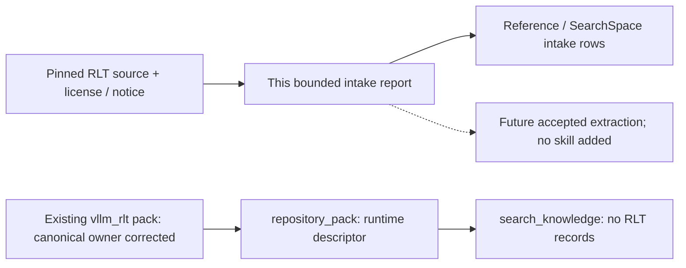

# vLLM-RLT repository intake

Status: **descriptor-only / intake-plan; located-not-mined**. This report proposes one bounded source extraction for Issue #91. It adds no operating skill, knowledge record or SearchSpace coverage credit.

## Identity, descriptor and license

- The requested legacy name `ThinkFlowLab/vllm-rlt` resolves through GitHub repository metadata to [InferMatrixLab/vllm-rlt](https://github.com/InferMatrixLab/vllm-rlt), repository ID `1363830789`. The stable InferRSI repo ID remains `vllm_rlt`.
- Inspected source: `4a350344027960a48384626aa646f1765fda6d4f`, tree `4c2cab1f497513ea0590060eb53ee0b179a5bf70`; fixed-revision connector retrieval on 2026-10-23. The recursive tree listing was not truncated; only the bounded files/ranges below were read.
- The existing [pack descriptor](../../src/inferrsi/data/repo_packs/vllm_rlt/pack.json) is corrected only to the canonical source repository, with the earlier name retained in its existing `notes` field. Its scenarios stay `recurrent.fixed_depth` and `recurrent.adaptive_exit`; execution remains caller-supplied, and CUDA/ROCm/Ascend compatibility stays `unverified`. No provenance or license fields are added to the descriptor schema.
- [LICENSE:1–12](https://github.com/InferMatrixLab/vllm-rlt/blob/4a350344027960a48384626aa646f1765fda6d4f/LICENSE#L1-L12) contains Apache-2.0, also declared by [README:313–315](https://github.com/InferMatrixLab/vllm-rlt/blob/4a350344027960a48384626aa646f1765fda6d4f/README.md#L313-L315). [NOTICE:1–14](https://github.com/InferMatrixLab/vllm-rlt/blob/4a350344027960a48384626aa646f1765fda6d4f/NOTICE#L1-L14) retains ByteDance/Ouro and upstream Qwen/HuggingFace model/configuration attribution and distinguishes this standalone runtime from an upstream CDB implementation. This records the inspected license/notice facts, not a whole-tree or model-weight license audit.
- [README:34–52](https://github.com/InferMatrixLab/vllm-rlt/blob/4a350344027960a48384626aa646f1765fda6d4f/README.md#L34-L52) describes an independent recurrent-model engine with vLLM-style organization that does not require vLLM to be installed. The repository name does not establish compatibility with a particular vLLM runtime.

The bounded pointer search found the old full repository name only in this descriptor among source JSON and manifest-like files. The separate historical source citation in `tools/render_inferrsi_loop.py` already points at the canonical owner and an older full source revision; it remains unchanged.

## Selected mechanism and decision

**Follow up with synchronous early-exit KV finalization in LAST_EXITED, using SHARED as a distinct storage-layout countercase.** The concrete question is: when token (t) exits at a shallow loop depth but a later token executes deeper, what makes the skipped-depth KV history valid?

At this pin, `KVCacheManager` maps LAST_EXITED to one physical plane per recurrence depth and SHARED to one plane. Allocation/capacity is separate from written-position validity. `finalize_token` first requires the exit position to be written for the configured recurrent layers; in LAST_EXITED it copies K/V from the last executed plane into each skipped deeper plane and records validity. Existing shallower executed planes are preserved. SHARED has no skipped-plane copies.

The distinction from `mark_finalized` is decisive: that method updates bookkeeping without copying tensor contents. The runner's asynchronous branch queues its finalize kernel and records an event before calling it; the ordinary `finalize` branch calls the copying `finalize_token` and carries a boundary-stream dependency/event when a stream exists. These bounded caller observations do not prove the asynchronous kernel, all consumers or output correctness. A valid logical frontier is not evidence that the host waited for CUDA completion.

The source provides useful literal regression ideas, including a later token using a deeper loop across a page boundary and sentinel values proving that `mark_finalized` does not copy. Upstream tests were inspected, not executed. This intake recommends further extraction, not a layout switch, a runtime repair or a performance optimization.

## Bounded source anchors

All source links use the full revision above. Blob identities cover retrieved bytes; implementation coverage is limited to the ranges listed.

| Source / inspected range | Git blob | Evidence used |
| --- | --- | --- |
| [README.md:1–110, 246–315](https://github.com/InferMatrixLab/vllm-rlt/blob/4a350344027960a48384626aa646f1765fda6d4f/README.md#L34-L101) | `b742543ff16ab36c7f0c7e26f9451f8e3c496f45` | Standalone recurrent engine, fixed/adaptive scenarios and experimental execution warnings; benchmark/model-support claims not locally adopted |
| [LICENSE:1–16](https://github.com/InferMatrixLab/vllm-rlt/blob/4a350344027960a48384626aa646f1765fda6d4f/LICENSE#L1-L16) | `d645695673349e3947e8e5ae42332d0ac3164cd7` | Root Apache-2.0 declaration |
| [NOTICE:1–14](https://github.com/InferMatrixLab/vllm-rlt/blob/4a350344027960a48384626aa646f1765fda6d4f/NOTICE#L1-L14) | `4e818fb84c79f6f8dee13c559765e516a1f0a58f` | Retained model/configuration lineage and standalone-runtime distinction |
| [docs/kv_cache_walkthrough.md:1–122](https://github.com/InferMatrixLab/vllm-rlt/blob/4a350344027960a48384626aa646f1765fda6d4f/docs/kv_cache_walkthrough.md#L76-L95) (file read in full) | `4ea2661e0f558767f5a602d99e6fab9b14c0e88d` | Capacity, validity, lifetime and early-exit ownership; declared GPU/transport validation limits |
| [vllm_rlt/core/kv_cache_manager.py:1–28, 80–160, 186–189, 427–468, 513–514, 643–695, 747–795](https://github.com/InferMatrixLab/vllm-rlt/blob/4a350344027960a48384626aa646f1765fda6d4f/vllm_rlt/core/kv_cache_manager.py#L747-L795) | `3bb6bf02ca0bdb65b3c709f6f82a8a1025faaa51` | Plane mapping, recurrent-layer gate, copying versus marking, and uninitialized-prefix rejection |
| [vllm_rlt/core/memory.py:1–141](https://github.com/InferMatrixLab/vllm-rlt/blob/4a350344027960a48384626aa646f1765fda6d4f/vllm_rlt/core/memory.py#L123-L141) (file read in full) | `f0a8edc975d33627e2c78f24f202b6923400212f` | Context only: startup sizing/overrides are a separate decision; no sizing method or memory/performance result extracted |
| [vllm_rlt/worker/model_runner.py:1–45, 1261–1348](https://github.com/InferMatrixLab/vllm-rlt/blob/4a350344027960a48384626aa646f1765fda6d4f/vllm_rlt/worker/model_runner.py#L1278-L1344) | `58e3414f1757f98bf5ebf3bb7b90fe3ecd9fdd22` | Actual finalization consumers, loop-count-to-zero-based-depth conversion and bounded stream/event observations; full submit/collect/retirement path unread |
| [tests/test_kv_cache.py:1–112, 131–183, 216–260](https://github.com/InferMatrixLab/vllm-rlt/blob/4a350344027960a48384626aa646f1765fda6d4f/tests/test_kv_cache.py#L38-L107) | `d49c59f25b1e5cdc493cebaab56dda3cb90cee7e` | Copy isolation, early exit across a page boundary, invalid unwritten history, SHARED plane mapping and bookkeeping-only sentinels; tests inspected, not run |

## Ownership, applicability and follow-up

Reuse the existing `vllm_rlt` identity. A future accepted repository capability should own the recurrent-depth KV contract rather than extending the [vLLM connector KV-lifetime procedure](../../src/inferrsi/data/skill_library/repositories/vllm/audit-vllm-kv-lifetimes/SKILL.md): that procedure covers remote-KV completion and retention at a separate vLLM pin. [vLLM admission guidance](../../src/inferrsi/data/skill_library/repositories/vllm/diagnose-vllm-admission-pressure/SKILL.md) addresses resource admission, not early-exit history propagation. Neither existing owner establishes this engine's semantics. No new owner, alias or registry is created here.

A later authorized extraction should:

1. Start with the synchronous path recommended by the source README. Trace the actual selected request's early-exit decision through the caller of runner finalization, later attention consumption and request retirement; freeze the model/configuration, layout, recurrent layers and full dependency tuple. The CDB paper and model upstreams are not substitutes for this source trace.
2. Preserve source-anchored positive cases: shallower planes unchanged, copied deeper-plane values, later-token deeper attention across a page boundary, and the SHARED single-plane behavior. Preserve negative/countercases: finalize before required layers are written, read through an unwritten gap, and treating `mark_finalized` as tensor-copy or completion evidence.
3. Keep asynchronous preemption/speculation, CUDA kernel/graph behavior, model/output equivalence, prefix reuse, transfer protocol, CPU snapshots and memory-sizing performance outside the initial extraction. The [README warnings](https://github.com/InferMatrixLab/vllm-rlt/blob/4a350344027960a48384626aa646f1765fda6d4f/README.md#L70-L75) explicitly report asynchronous correctness/cleanup limitations; this intake neither reproduces nor resolves them.

The readset is adequate for this bounded intake decision, not a complete operating procedure or conformance audit. KV copies in the inspected manager are local tensor copies; they establish no Network coverage. Device KV allocation also does not by itself establish a host-RAM mechanism.

## Discovery and checks

`catalog.repository_pack("vllm_rlt")` reads the existing packaged runtime descriptor. `catalog.search_knowledge(repo="vllm_rlt")` remains empty. Documentation navigation is not an installed knowledge asset.

On the source-only patch, the existing descriptor contract/catalog checks and a bounded reader/link/source-blob check passed: the supported existing v1 field shape, preserved scenarios/execution/unverified backend values, actual checkout-package resource bytes, empty knowledge results, report-local links, pinned source-link ranges and all eight retrieved Git blob identities. No dedicated repo-pack JSON Schema enforcement is claimed; the reader parses JSON.

No upstream test or module import, model/device/CUDA execution, dependency installation, wheel build, efficacy/paid evaluation or performance measurement was run. Author: Codex / `gpt-6.1-sol`, `effort=xhigh`, intake author; independent review is separate.
