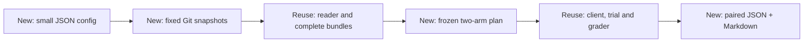

# Configured skill comparisons

`python -m tools.skill_eval_compare` prepares addition/update comparisons and
generates JSON and Markdown reports. It reuses the existing reader,
`CodexClient`, `run_trial`, verifier and error handling. The original
[pilot](skill-evaluation.md) remains available with its original interfaces.



## Configuration and planning

Start with [addition.json](examples/skill-comparison/addition.json) or
[update.json](examples/skill-comparison/update.json). Replace the revision and
model placeholders. Run from the repository root with the development
dependencies installed (`python -m pip install -e ".[dev]"`).

```bash
python -m tools.skill_eval_compare prepare --repo . \
  --config docs/examples/skill-comparison/update.json --output <new-output-dir>
python -m tools.skill_eval_compare report --output <new-output-dir>
```

Both commands are model-free. The initial report retains all scheduled pairs as
missing. Configuration paths (`cases`, optional `schema`, optional `grader`)
are relative to the configuration file. `skill_root` is relative to the Git
repository. The default schema and standalone grader are the existing
performance-report audit schema and `tools/skill_eval_verifier.py`.

| Field | Contract |
| --- | --- |
| `mode` | `addition`: absent target versus selected candidate; `update`: selected old versus selected new bundle |
| `skill`, `skill_root` | Stable checkout skill ID and its library root; no version registry |
| `snapshots.baseline/candidate.git_revision` | Full immutable commit SHAs available in the local repository; no fetch |
| Optional `bundle_revision` per snapshot | Reader content-revision assertion after the Git snapshot is materialized |
| `cases` | JSON list of supported performance-report audit inputs; each case requires string `id`, `request` and `split`, with unique safe IDs; unknown fields are rejected at every structured level |
| `model` | Shared `name` and `effort`; independent ephemeral session for every trial |
| `limits` | Positive integer repeats, maximum calls, per-trial timeout, whole-run seconds and observed-token stop threshold |

Each historical library is materialized from raw Git blobs in a short temporary
directory, then read and exported through `KnowledgeReader` and `export_bundle`.
Checkout filters, Git export attributes and replacement refs cannot substitute
different bytes. Snapshot inspection, raw blob reads and source diffs all use
Git's [`--no-replace-objects`](https://git-scm.com/docs/git#Documentation/git.txt---no-replace-objects)
and [`--no-lazy-fetch`](https://git-scm.com/docs/git/2.46.0#Documentation/git.txt---no-lazy-fetch).
Preparation requires Git **2.45 or newer**, and checks `git --version` before
creating output or reading snapshot objects; older clients fail with an explicit
prerequisite error. The lazy-fetch control was introduced in the
[Git 2.45 release](https://github.com/git/git/blob/master/Documentation/RelNotes/2.45.0.adoc).
Missing commits, trees or blobs
fail locally; partial-clone promisor remotes are not contacted by preparation.
The retained bundles include the full body, owner-local resources and declared
references/dependencies. `reader.read(..., revision=...)` checks those bytes;
it never retrieves a historical Git version.
This entry point accepts regular non-executable Git blobs only. Executable
entries (`100755`), symlinks and submodules are rejected during preparation;
their semantics must not be silently changed by byte-only bundle export.

In addition mode, the baseline workspace contains only `task.json`, even if the
source revision itself contains the target skill. That baseline commit may also
predate the entire skill library; its Git revision is still validated and
recorded. Update baselines and all candidates require a nonempty library.
In update mode, each side
receives its corresponding retained bundle. Source libraries and answer keys
are not copied into trial workspaces.

The plan freezes one set of cases, schema, grader, prompt, model/settings and
limits for both sides, records Git and bundle revisions/resource hashes, and
surfaces changed source paths and dependencies. Two Git commits can contain the
same bundle: `same_bundle=true` makes that visible. Case, schema, grader or
exported-resource changes after preparation are rejected. Custom graders must
be standalone scripts implementing the existing verifier result/exit contract.

The input shape is the existing performance-report audit. Fields are `id`,
`split`, `mode`, `provenance`, `request`, `contract`, `evidence_scope`, `baseline`,
`candidate`, and `evidence_keys`. Missing execution fields (`id`, `request`,
`split`), unknown keys and incompatible nested types are rejected before output
is created; grader expectations/metadata never become additional task fields.

### Default audit support

Preparation checks the following complete support boundary against the actual
default grader, including an explicitly selected or byte-identical copy. An
accepted contract cannot add promises that this grader does not enforce.

| Input | Supported contract / behavior |
| --- | --- |
| `mode=audit` | Requires `contract.min_reduction_pct`, finite and within `[0, 100]`. The grader compares the median of per-group latency means against this threshold. |
| Optional audit flags | `scope="fixed_workload"`, `quality_required=true`, `all_requests_required=true`, `statistical_significance_required=false` only. Quality and completion checks are always enabled; omitted flags do not disable them. |
| Other contract fields | Rejected, including spread limits, required regimes, statistical significance enabled, and custom verdict/output semantics. No statistical testing or regime-coverage framework is provided. |
| `mode=extract` | Requires an empty `contract`; checks descriptive reduction only and returns no acceptance verdict or claim. |
| `evidence_scope` | `http_fixed_workload` or `kernel`. Kernel-only evidence produces an inconclusive service audit rather than a service PASS. |
| Both reports | Require latency groups, workload, quality, and all three request counts. Workload needs positive integer `steps` and `concurrency`; optional `shape` must have at least one dimension, all positive integers. Differing valid workloads remain negative audit cases. |
| Measurement coverage | The total number of latency samples across all groups must equal `reported_requests` in each arm, including extract mode. Groups may have different sizes; partial or extra observations are rejected before creating a plan. |
| Audit baseline | Requires `quality="passed"` and zero failed requests; existing request accounting then requires every baseline request to be reported. Failed/missing baseline quality or failed baseline requests cannot support this default comparison. Candidate quality/completion failures remain valid negative audit cases. |
| `evidence_keys` | Audit requires the complete reference set listed below, so negative cases remain answerable. Extract requires both latency paths only. Additional references may name existing report fields; unknown paths are rejected. The grader checks the answer's references and its computed verdict, findings, scope and reduction. |

The audit reference set is `contract`, `evidence_scope`, `baseline.latencies_ms`,
`candidate.latencies_ms`, `baseline.workload`, `candidate.workload`,
`candidate.quality`, `candidate.failed_requests`, `candidate.total_requests`,
and `candidate.reported_requests`. Missing references fail preparation instead
of creating an exam that no answer can pass.

Missing default-audit inputs and unsupported settings fail before creating a
plan. The old pilot's interface, inputs and grader remain unchanged; its broader
contract metadata is not silently accepted as supported comparison gates.
A distinct custom standalone grader owns its declared contract and may use the
broader typed input shape, including the pilot's contract metadata. Both arms
still share that frozen grader; preparation never executes it.

Each report arm's quality value must be `passed`, `failed` or `missing`.
Latency data must contain nonempty groups of finite, strictly positive samples.
Unknown quality values, negative/zero/nonfinite samples and empty groups are
rejected before freezing; they cannot produce a passing comparison from an
invalid input such as a negative candidate latency and a reduction above 100%.
When request counts are supplied, all three fields are required and must be
nonnegative; reported and failed counts cannot exceed the total. Nonempty
latency data requires a positive request total. Every unreported request must
be accounted for by the known failed count. An unexplained reporting gap is
rejected before preparation; known failures and their omitted records remain
valid negative audit cases, including the old pilot's omission fixtures.
Free-text requests and provenance remain caller-authored inputs to review.
On Git older than 2.45, comparison snapshot integration tests are explicitly
skipped with the prerequisite reason; pure support-boundary and version checks
still run. Run the integration tests with a supported Git before claiming they
passed.

## Execution boundary

Execution uses the existing real client and requires separate explicit
authorization for the exact printed plan SHA-256, revisions and limits:

```bash
python -m tools.skill_eval_compare execute --output <new-output-dir> \
  --authorize <authorized-plan-sha256>
```

This command can invoke the configured model. Preparing a plan or checking an
offline fixture does not authorize it. Offline tests inject a fixed-output
client; they do not invoke this real-client CLI command.

Ordering alternates baseline/candidate and candidate/baseline across matched
groups. Pair identity is case ID plus repeat. A case with `split="discovery"`
uses local `.agents/skills` exposure without an assigned-skill prompt; discovery
results/totals are separate from the paired comparison. Supplying a skill is
not evidence that the client discovered or used it.

Execution accepts a fresh results directory only, with no retries or resume.
The existing executor owns deadlines and child-process cleanup. Maximum calls
and elapsed time bound the run. The token threshold stops new trials using
observed usage; it is not a provider-side hard token or monetary cap, and one
trial can cross it. Missing/partial usage and monetary cost remain unknown.
An execution failure stops new trials and retains the remaining missing sides.
Run status is `completed` only when every scheduled trial is recorded and no
execution stop reason exists. A failed or timed-out final trial remains `stopped`
with `client_failed` or `client_timeout`, even when recorded and expected trial
counts are equal.
Before starting a real trial, execution resolves the configured client executable,
probes its version without a model call, and uses that resolved executable for
every trial. Execution evidence records its full command path locally; JSON and
Markdown reports expose its basename, SHA-256 and version. An unavailable client
or failed version probe fails before starting trials. Injected offline clients
are identified by their implementation class; unavailable executable/version
metadata remains null.

`CodexClient` disables global/bundled skills, apps, plugins, memories and web,
and creates fresh sessions. Its controlled exposure is not OS read confinement.
Review access and all raw artifacts before sharing a separately authorized
real-client run.

## Reports and offline controls

See the generated [Markdown example excerpt](examples/skill-comparison/report-example.md)
and [JSON example excerpt](examples/skill-comparison/report-example.json).

`report` reads the frozen plan and retained results without invoking a client,
grader or trial. It verifies the frozen comparison, pilot, harness, local
executor, process-cleanup and artifact-helper controller hashes before interpreting results.
It can run after the original skill source checkout is unavailable, using the
same controller implementation; changed controller code requires a new plan.

| Pair outcome | Meaning |
| --- | --- |
| `fix` / `regression` | Completed FAIL→PASS / PASS→FAIL task grades |
| `unchanged_correct` / `unchanged_incorrect` | Completed PASS/PASS / FAIL/FAIL |
| `missing_pair` | At least one side was never attempted; any available side remains visible |
| `inconclusive` | Complete pair includes an execution, output, grading or input-integrity error |

An interrupted attempt without a completed record is INCONCLUSIVE with
`interrupted_attempt`; reporting does not rewrite its evidence. Missing pairs
take precedence over comparing an incomplete pair. Neither category becomes a
fix or regression. Trial grades describe answer correctness; an answer correctly
rejecting an input report can itself PASS.

For every retained trial, reporting reads the answer bytes once and compares
their SHA-256 with `result.json`'s recorded `output_sha256`. Missing or modified
answers become INCONCLUSIVE even when the retained grade was PASS. Original
trial records remain untouched; JSON shows the recorded and current output
hashes, and both report formats retain available output/evidence links.
Comparison execution also records hashes for the execution record, agent trace
and error log, and verifier result/output/error logs in `evidence_sha256`.
Report regeneration checks those files against the recorded hashes. Missing or
changed evidence becomes INCONCLUSIVE; older comparison records without these
hashes also remain INCONCLUSIVE rather than retaining an unsupported PASS.
After completing each comparison trial, the controller separately writes
`receipt.json` with the SHA-256 of `result.json`. Reporting verifies this receipt
before accepting that record's verdict, grading assertions or usage. A missing,
invalid or mismatched receipt makes the trial INCONCLUSIVE, with no accepted
assertions or usage, even when its answer and grader files are unchanged.
Report regeneration leaves the original record and receipt untouched.
These local checks detect missing or changed artifacts; they are not signatures
against coordinated modification of both an artifact and its recorded hash.
The final run status has its own `results/status.receipt.json`. Reporting checks
it before using completion, trial counts, stop reason, observed tokens or client
runtime. Missing/invalid proof or changed status bytes produce an `unverified`
status with unknown completion/budget fields, while individually verified trial
grades remain available. Neither report regeneration nor integrity checking
invokes the client or grader.

`report.json` and `report.md` retain revisions, settings, limits, source/resource
changes, case outputs, grading assertions and relative evidence links. Raw
execution commands and local workspace paths stay in local artifacts. Preserve
the complete output directory to keep its evidence links usable.
Invalid UTF-8 output bytes are displayed as backslash escapes; the linked raw
output remains unchanged and the error stays INCONCLUSIVE. The Markdown output
fence is longer than every backtick run in the answer so malformed model text
cannot escape its code block.

Run offline acceptance and the old pilot regression tests with:

```bash
python -m pytest tests/test_skill_eval_compare.py tests/test_skill_eval_pipeline.py \
  tests/test_skill_eval_verifier.py tests/test_skill_evaluation.py
```

The controlled fixtures use real temporary Git commits with different body,
resource and dependency bytes, plus independently specified answers checked by
the existing verifier. A deliberately incorrect candidate must fail. Fixed
outputs establish pipeline behavior only; they provide no skill-efficacy or
hardware-performance evidence.

To generate a complete local example with fixed outputs and retained evidence:

```bash
python -m tests.fixtures.skill_eval_compare_demo --mode update --output <new-offline-output>
```

The fixture creates real temporary Git snapshots and produces one fix, one
regression, one inconclusive pair and one missing pair. It never constructs the
real client. Its fixed answers are pipeline controls, not model measurements.
