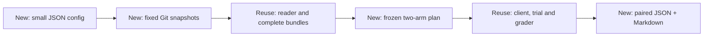

# Configured skill comparisons

`python -m tools.skill_eval_compare` prepares addition/update comparisons and
generates JSON and Markdown reports. It reuses the existing reader,
`CodexClient`, `run_trial`, verifier and error handling. The original
[pilot](skill-evaluation.md) remains available with its original interfaces.



## Configuration and planning

Start with [addition.json](examples/skill-comparison/addition.json) or
[update.json](examples/skill-comparison/update.json). Replace the revision and
model placeholders. Run from the repository root with the development
dependencies installed (`python -m pip install -e ".[dev]"`).

```bash
python -m tools.skill_eval_compare prepare --repo . \
  --config docs/examples/skill-comparison/update.json --output <new-output-dir>
python -m tools.skill_eval_compare report --output <new-output-dir>
```

Both commands are model-free. The initial report retains all scheduled pairs as
missing. Configuration paths (`cases`, optional `schema`, optional `grader`)
are relative to the configuration file. `skill_root` is relative to the Git
repository. The default schema and standalone grader are the existing
performance-report audit schema and `tools/skill_eval_verifier.py`.

| Field | Contract |
| --- | --- |
| `mode` | `addition`: absent target versus selected candidate; `update`: selected old versus selected new bundle |
| `skill`, `skill_root` | Stable checkout skill ID and its library root; no version registry |
| `snapshots.baseline/candidate.git_revision` | Full immutable commit SHAs available in the local repository; no fetch |
| Optional `bundle_revision` per snapshot | Reader content-revision assertion after the Git snapshot is materialized |
| `cases` | JSON list of performance-report audit inputs with unique safe `id`, `request` and `split`; no answer/oracle fields |
| `model` | Shared `name` and `effort`; independent ephemeral session for every trial |
| `limits` | Positive integer repeats, maximum calls, per-trial timeout, whole-run seconds and observed-token stop threshold |

Each historical library is materialized from raw Git blobs in a short temporary
directory, then read and exported through `KnowledgeReader` and `export_bundle`.
Checkout filters and Git export attributes cannot substitute different bytes.
The retained bundles include the full body, owner-local resources and declared
references/dependencies. `reader.read(..., revision=...)` checks those bytes;
it never retrieves a historical Git version.

In addition mode, the baseline workspace contains only `task.json`, even if the
source revision itself contains the target skill. In update mode, each side
receives its corresponding retained bundle. Source libraries and answer keys
are not copied into trial workspaces.

The plan freezes one set of cases, schema, grader, prompt, model/settings and
limits for both sides, records Git and bundle revisions/resource hashes, and
surfaces changed source paths and dependencies. Two Git commits can contain the
same bundle: `same_bundle=true` makes that visible. Case, schema, grader or
exported-resource changes after preparation are rejected. Custom graders must
be standalone scripts implementing the existing verifier result/exit contract.

## Execution boundary

Execution uses the existing real client and requires separate explicit
authorization for the exact printed plan SHA-256, revisions and limits:

```bash
python -m tools.skill_eval_compare execute --output <new-output-dir> \
  --authorize <authorized-plan-sha256>
```

This command can invoke the configured model. Preparing a plan or checking an
offline fixture does not authorize it. Offline tests inject a fixed-output
client; they do not invoke this real-client CLI command.

Ordering alternates baseline/candidate and candidate/baseline across matched
groups. Pair identity is case ID plus repeat. A case with `split="discovery"`
uses local `.agents/skills` exposure without an assigned-skill prompt; discovery
results/totals are separate from the paired comparison. Supplying a skill is
not evidence that the client discovered or used it.

Execution accepts a fresh results directory only, with no retries or resume.
The existing executor owns deadlines and child-process cleanup. Maximum calls
and elapsed time bound the run. The token threshold stops new trials using
observed usage; it is not a provider-side hard token or monetary cap, and one
trial can cross it. Missing/partial usage and monetary cost remain unknown.
An execution failure stops new trials and retains the remaining missing sides.

`CodexClient` disables global/bundled skills, apps, plugins, memories and web,
and creates fresh sessions. Its controlled exposure is not OS read confinement.
Review access and all raw artifacts before sharing a separately authorized
real-client run.

## Reports and offline controls

See the generated [Markdown example excerpt](examples/skill-comparison/report-example.md)
and [JSON example excerpt](examples/skill-comparison/report-example.json).

`report` reads the frozen plan and retained results without invoking a client,
grader or trial. It can run after the original source checkout is unavailable.

| Pair outcome | Meaning |
| --- | --- |
| `fix` / `regression` | Completed FAIL→PASS / PASS→FAIL task grades |
| `unchanged_correct` / `unchanged_incorrect` | Completed PASS/PASS / FAIL/FAIL |
| `missing_pair` | At least one side was never attempted; any available side remains visible |
| `inconclusive` | Complete pair includes an execution, output, grading or input-integrity error |

An interrupted attempt without a completed record is INCONCLUSIVE with
`interrupted_attempt`; reporting does not rewrite its evidence. Missing pairs
take precedence over comparing an incomplete pair. Neither category becomes a
fix or regression. Trial grades describe answer correctness; an answer correctly
rejecting an input report can itself PASS.

`report.json` and `report.md` retain revisions, settings, limits, source/resource
changes, case outputs, grading assertions and relative evidence links. Raw
execution commands and local workspace paths stay in local artifacts. Preserve
the complete output directory to keep its evidence links usable.
Invalid UTF-8 output bytes are displayed as backslash escapes; the linked raw
output remains unchanged and the error stays INCONCLUSIVE.

Run offline acceptance and the old pilot regression tests with:

```bash
python -m pytest tests/test_skill_eval_compare.py tests/test_skill_eval_pipeline.py \
  tests/test_skill_eval_verifier.py tests/test_skill_evaluation.py
```

The controlled fixtures use real temporary Git commits with different body,
resource and dependency bytes, plus independently specified answers checked by
the existing verifier. A deliberately incorrect candidate must fail. Fixed
outputs establish pipeline behavior only; they provide no skill-efficacy or
hardware-performance evidence.

To generate a complete local example with fixed outputs and retained evidence:

```bash
python -m tests.fixtures.skill_eval_compare_demo --mode update --output <new-offline-output>
```

The fixture creates real temporary Git snapshots and produces one fix, one
regression, one inconclusive pair and one missing pair. It never constructs the
real client. Its fixed answers are pipeline controls, not model measurements.
