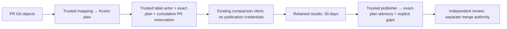

# Skill PR planning and feedback

The advisory [Skill PR workflow](../.github/workflows/skill-eval-pr.yml) connects
skill changes to the existing [comparison command](skill-eval-comparison.md).
It does not add an execution engine or a required efficacy gate. Refs #101; parent #88.



## Automatic planning

`pull_request_target` uses the workflow implementation on trusted main. It reads
PR commits as raw Git objects without checking out PR files, importing PR Python,
running PR graders, or invoking a model. The small
[mapping](../tools/skill_eval_pr_cases.json) owns skill/resource paths and the
existing case file. A new entrypoint selects absent/new; an existing entrypoint
selects old/new. Declared resource/dependency paths can select the same comparison.
Add mappings only when the named cases actually cover that skill's behavior.
Unmapped paths remain `uncovered`. Deletions and unsupported snapshot modes are
explicitly `unsupported`; they cannot count as passes. Rename detection is off:
a rename is a deletion plus an addition and retains the deletion gap.

The initial mapping associates `inference-benchmark-design` and the prospective
`audit-fixed-workload-claim` addition with the existing `audit-threshold` holdout
case. The latter reserves the path for the bounded fixed-workload audit skill
proposed for real addition acceptance; it does not add that skill or authorize
execution. Until a PR adds that path, it selects no comparison. Library
navigation/index changes are uncovered;
coverage of one skill is not library-wide qualification. Changes to the mapping,
cases, workflow or comparison implementation also trigger planning.

The PR plan contains compared base/head SHAs, trusted implementation SHA, mapping
and adapter hashes, selected cases/splits, frozen grader/schema/case hashes,
model/effort, limits, estimated calls and coverage gaps. Its SHA-256 is computed
over canonical JSON (sorted keys, compact separators). Each comparison retains
its existing `plan/freeze.json` SHA-256. The PR plan hash binds those hashes; it
does not replace or modify the comparison format. Execution identity is
`skill-eval-<PR-plan-SHA-256>`. Repeated preparation is deterministic.

Plans and reports have one identifiable bot comment beginning with
`<!-- inferrsi-skill-eval-pr:v1 -->`. A new head/base, trusted implementation,
mapping, exam, model or budget produces a new plan. Earlier authorization and
results are stale. The planner replaces the summary with the current plan and
missing pairs. A publisher checks live revisions twice and refuses older writer
runs, so delayed jobs cannot replace a newer summary. All plan/execute/publish
runs for one PR share non-cancelling Actions concurrency.

### Refresh a plan without execution

Dispatch **Skill PR evaluation** on **main** with `action=plan` and the PR number
to rebuild the plan and update its single **PLANNED** summary using the current
trusted workflow implementation. No execution approval fields or `source_run`
are needed. This reuses the automatic prepare/publish path; it makes no model
calls, reserves no execution, and produces no evaluation results. The controller
also rejects `action=plan` with its authorize, execute or pack CLI modes.
Supplying execution fields or a `source_run` to this action does not authorize
execution or import earlier results.

Legacy `action=execute` is now explicitly blocked. Automatic paid execution uses
the trusted opt-in label controller described below. `action=publish` requires a
validated original source run and never schedules model execution.

A new trusted implementation or changed PR inputs creates a new plan identity;
old hashes and approvals cannot authorize it. A plan dispatch has a non-execution
run title, so it does not consume that plan's execution identity. It still adds
an Actions dispatch-history record, subject to the existing history limit below.
Re-running an old workflow uses its original implementation; it cannot select
the newer diagnostic code by refreshing main. An authorized plan dispatch offers
a repeatable current-main publication recheck without changing the subject PR;
automatic PR planning can also exercise that publisher. Retain the safe HTTP
diagnostic or successful summary receipt. Neither entry repairs a permission
denial. This verifies publication only, not evaluation.

## Execution authorization and environment

Planning grants no execution budget. The trusted deployment configuration,
latest authorized label-add event and current actor permission are required;
PR text and dispatch inputs cannot supply that authority. Automatic execution
uses the existing frozen provider plans and enforces their complete worst-case
reservation against USD 200 cumulatively per PR. The non-provider default mapping
remains useful for offline planning, but cannot execute as a paid PR fallback.

The bounded [issue 215 deployment record](skill-eval-deployment-215.md) supplies
the reviewed configuration for PR159/160 only. It creates no provider credential
or execution label. A historical successful run does not establish current
credentials, permission, provider readiness or remaining budget. See the
deployment checklist below before enabling the switch.

The controller alone has owner-approved `contents: write` for the dedicated Git
budget ledger. Its existing model executor runs in a sanitized child process with
no GitHub/Actions write tokens. Checkout uses `persist-credentials: false`.
The publisher remains a separate fresh job and alone requests PR/issue comment
write permissions. Planning and publication have read-only repository contents.
In the controlled fork [baseline](https://github.com/Dong1017/OmniRSI/actions/runs/40455073055),
the same Actions job could create/update an ordinary Issue comment but received
permission HTTP403 for a PR conversation comment with PullRequests read.
The owner-approved [contrast](https://github.com/Dong1017/OmniRSI/actions/runs/40460346043)
verified PR comment creation/update with PullRequests write, preserving the HTTP
client and other grants. The [result and restoration record](https://github.com/Dong1017/OmniRSI/issues/3#issuecomment-6435261413)
covers that fork push context; upstream recovery still needs a successful
publication receipt from the merged trusted workflow. Advertised endpoint
permission alternatives alone do not prove effective authorization.

The existing client's controlled skill exposure is not OS read confinement.
Plan artifacts contain files rather than empty directories. The adapter restores
each comparison's empty results directory after download; the existing executor
still rejects nonempty results, and the exclusive execution claim still rejects
duplicate attempts.

## Duplicate prevention and interrupted execution

The durable Git ledger, not expiring artifacts or Actions titles, binds each
frozen plan to one workflow run/attempt. All revisions of one PR share the same
USD 200 ceiling. Reservation and claim are separate compare-and-swap transitions;
an ambiguous write, duplicate plan, exhausted allowance or missing/corrupt history
blocks execution. Claims are deliberately non-idempotent. Interrupted requests
retain their full conservative reservations, including when no cost receipt was
produced. No takeover, automatic paid retry, refund or reset is provided.

An exclusive local claim file also prevents duplicate execution in one retained
directory. Attempts other than `run_attempt=1` cannot execute. Publication-only
retry makes no new model calls and consumes no new reservation.

## Publication and retention

Use `action=publish` with the PR number and original **execution `source_run` ID**
to retry publication. The publisher reconstructs the current plan rather than
trusting dispatch-supplied plan fields. This mode contains no call to the client or
comparison executor. A lost publication response is safe: the next attempt finds
and updates the same marked bot comment instead of creating another summary.

The publisher reconstructs trusted inputs from Git and the maintained mapping.
It requires the source run's workflow path, event, trusted revision and exact
plan identity. Automatic runs have only a PR-number title, so before downloading
results the publisher reads that source run's unique `skill-eval-plan` artifact
through the authenticated Actions API and requires its original `pr-plan.json`
fingerprint to equal the complete freshly reconstructed plan. This binds both
initial publication and publish-only retries to the actually planned PR head,
even when main and skill bytes stayed unchanged. Missing, expired, ambiguous or
invalid source plans cannot substantiate results; artifact files are never
executed. Dispatch sources retain their exact plan-hash title requirement.
It then downloads only that run's uniquely named result artifact.
ZIP members must be bounded, unique, regular files at explicitly scheduled
result paths; traversal, symlinks, executable scripts and replacement plans or
Markdown are rejected before extraction. GitHub authorization is stripped on
artifact-download redirects. The publisher imports no artifact Python and runs
no artifact scripts. It regenerates the existing report from retained data and
cross-checks accepted grades with the trusted default audit verifier in process.
Custom graders are outside this small mapping's support boundary.

Reports show fix, regression, unchanged-correct, unchanged-incorrect,
inconclusive and missing-pair counts, plus uncovered/unsupported changes,
revisions, settings, limits, exam identity and an evidence link. Discovery stays
separate. Raw model text and supplied Markdown never become PR comment content.
Malformed or inconsistent evidence fails closed or remains inconclusive; it
cannot turn into a positive result. These integrity checks are not cryptographic
attestation of a hostile executor's observations.

| Artifact | Content | Retention |
| --- | --- | --- |
| `skill-eval-plan` | PR plan, comparison freezes, bundles and validator inputs; generated authorization receipt for execution | 30 days |
| `skill-eval-results` | `results.zip`, containing retained trial/status records, answers, hashes and raw evidence | 30 days |
| `skill-eval-report` | Trusted regenerated JSON/Markdown reports and PR plan | 30 days |

Results remain generated Actions artifacts, not routine commits to main. The
summary labels outcomes historical and gives their verification expiry. They
are verifiable only while the artifact remains available and before its expiry;
the comment alone is not retained evidence. A publication retry after expiry
replaces the outcome counts with **EXPIRED / unverified** and never reevaluates.
Missing/deleted artifacts cannot substantiate results. Repository retention
limits can shorten the requested 30 days. There is no background expiry monitor.

## Offline verification and real acceptance

Run the integration controls and original pilot regressions:

```bash
python -m pytest tests/test_skill_eval_pr.py tests/test_skill_eval_compare.py \
  tests/test_skill_eval_pipeline.py tests/test_skill_eval_verifier.py \
  tests/test_skill_evaluation.py
ruff check src tests tools
pytest
```

Generate a complete offline example for either mode:

See the [offline summary excerpt](examples/skill-eval-pr/summary-example.md).

```bash
python -m tests.fixtures.skill_eval_pr_demo --mode addition --output <new-addition-output>
python -m tests.fixtures.skill_eval_pr_demo --mode update --output <new-update-output>
```

These commands use temporary real Git commits, the existing verifier, fixed-output
clients and a simulated GitHub interface. They make no GitHub requests or model
calls. Each generates a fix, regression, unchanged-correct, unchanged-incorrect,
inconclusive and missing pair, a single simulated PR summary, and retained
evidence. They validate integration behavior only. The summary's example GitHub
link is simulated; inspect the corresponding local `publication/` evidence.

The workflow is already on main. The bounded #88/#101 addition/update acceptance
established the existing real-agent execution and feedback path, including a
valid neutral update; it did not establish whole-library efficacy or subject-PR
merge readiness. The deployed #215 path subsequently completed owner-authorized
revision-scoped real runs on [#159](https://github.com/InferMatrixLab/InferRSI/actions/runs/40700386355)
and [#160](https://github.com/InferMatrixLab/InferRSI/actions/runs/40700395804), with retained
publication. #159's candidate was inconclusive and the advisory reported a regression;
#160 was unchanged-correct. These bounded observations are not skill-efficacy claims.
[Acceptance progress](https://github.com/InferMatrixLab/InferRSI/issues/215#issuecomment-6471044747)
tracks the remaining #215 work; the issue is not declared closed here.
Neither fixed outputs nor green CI authorize paid trials, merge or issue closure.

## Reading the advisory guidance

The existing summary derives one advisory from trusted regenerated comparisons,
not an aggregate score. Its applicability is exactly the displayed base/head,
trusted implementation and PR plan hash (which binds each comparison and exam).
The publisher reconstructs these inputs and checks live PR revisions before
writing; an old execution cannot be republished against a new plan. No background
monitor updates an already-posted comment when inputs change or artifacts expire.
Check the current PR and artifact availability before relying on a saved comment.

| Evidence | Advisory / next action |
| --- | --- |
| Any current, verified regression | Address observed regression; fixes elsewhere never cancel it |
| PLANNED, missing/expired/invalid evidence, incomplete execution or pairs | Obtain missing evidence; do not infer quality from preparation or a green job |
| Uncovered/unsupported changes, no selected cases | Obtain relevant evidence or an explicit reviewer disposition of the boundary |
| Unchanged-incorrect | Existing failure remains visible; fix or explicitly disposition it |
| Complete covered fixes and/or unchanged-correct pairs | Covered evidence supports proceeding to independent review, not approval |

Per-case outcomes remain visible, including simultaneous fixes, regressions and
gaps; discovery does not replace paired holdouts. Correct→correct is valid neutral
evidence, never incremental benefit. A coverage gap is not a requirement to test
every changed file: a reviewer can explicitly disposition navigation, unsupported
content or another boundary. The automated report does not invent that decision
or silently count the gap as passed. Content/source review, authorship admission,
and merge authority remain independent.

Knowledge-only changes under `src/inferrsi/data/repo_packs/**/knowledge/**` and
`src/inferrsi/data/knowledge_packs/**` now trigger bounded automatic planning.
Unmapped paths remain uncovered, select no paid work, and publish insufficient
evidence rather than a pass. Other repository-pack paths can use the existing
**plan-only dispatch** for an explicit scope report. No unrelated audit grader
is introduced for knowledge content.

### Relevant #179 integrity reconciliation

The current comparison loader checks schedule/task/repeat consistency, limit
shape, exported bundle resources and frozen exam hashes. The report regrades
retained default-audit answers with trusted code; custom graders are unverified.
The PR adapter validates mapping IDs before creating paths, reconstructs the
exact PR plan, checks run provenance and regrades again. The checkpoint now
requires completed execution before recommending accepted reporting. These are
existing corrections, not newly repaired historical defects in this slice.

Limits remain: semantic consistency and unkeyed receipts do not attest a hostile
executor, the actual model/hardware used, or consistently fabricated retained
answers. Standalone freeze fields are not all independently authenticated.
The PR path's trusted reconstruction narrows that boundary; it does not create
cryptographic provenance. Review guidance is advisory evidence interpretation,
not execution attestation or skill-efficacy certification. Unrelated harness
lifecycle/Windows contention work was tracked separately in the now-closed #179.

## Label-gated cumulative paid execution

The trusted controller extends the existing prepare/execute/pack/publish pipeline;
it is not another runner. It uses only the existing Yibuapi Messages agent and
frozen comparisons. Automatic execution is opt-in, advisory and never a merge
approval. The bounded skill/knowledge path filters remain; label addition,
removal, closing and revision events are included. A removal or closure stops
subsequent requests through a live GitHub check, independently of whether a
path-filtered notification starts another workflow. Already in-flight calls
cannot be revoked. Closed events never start preparation or paid work.

**Deployment is present on trusted main.** Owner-reviewed configuration and
audited ledger genesis were deployed for the bounded #159/#160 rollout. A new
deployment still requires separate owner approval, credentials and ledger audit;
the code never creates these prerequisites implicitly.
`tools/skill_eval_auto_config.json` is strictly shaped as:

- `schema_version: 1`, immutable `repository_id`, dedicated `label`, and explicit
  owner-authorized GitHub logins in `operators`;
- finite Unix `expires_at` and `review_evidence` identifying the owner review;
- complete `provider` (existing provider-config schema) and its canonical JSON
  `provider_sha256`. Only Yibuapi `claude-opus-5-5`, USD 8 input / 40 output / 0.4
  cache-read per million are accepted. Cache-write, request fees, effective group,
  full-context input bound, output/request limits, and current rate-evidence
  comment must **also** be explicitly reviewed. No unknown rate defaults to zero;
- `anchors`, keyed by PR number string: each entry contains `ref`,
  `genesis_commit`, and `checkpoint_commit`, referencing the separately audited
  per-PR Git ledger described in [the budget contract](skill-eval-budget-core.md).
  Unknown historical spending is a blocker, never an empty zero-cost ledger.

Every eligible plan reserves its entire enforceable worst case against the same
repository-ID + PR-number USD 200 ceiling, then wins a one-shot durable claim
before any provider request. Duplicate events, attempts, label re-additions and
changed heads cannot replenish the allowance. Reservations are deliberately never
refunded automatically: a successful, interrupted or uncertain run retains its
full bound. The report separates known/legacy spending, conservative unresolved
reservations and remaining capacity. Unknown accounting is explicitly blocked.

The latest applicable label-add action must belong to an allowlisted operator
who **currently** retains repository write/maintain/admin permission. Merely
having the label, being the PR author, or supplying dispatch text does not grant
authority. Each provider request rechecks live label event identity, open/non-draft
state, exact head/base, operator permission, configuration expiry and durable
claim. Eligibility and every request also authenticate the repository ID and read
`refs/heads/main`: its current commit must equal the plan implementation version.
The historical PR comparison base is independently bound and need not equal that
version. A main advance before preparation, reservation or a later request blocks
paid execution. A revision produces a fresh frozen binding against the original PR ledger.

Only the trusted controller job has `contents: write`. Its executor child gets an
allowlisted environment, a short-lived local request-gate capability and the
provider key, not the GitHub/Actions write tokens. PR content remains data, not
executed code. The separate publisher never makes model calls. Publication-only
retry remains supported via the original source run and exact current plan.
For `pull_request_target`, authenticated run `head_sha` must equal the PR head;
it is not the trusted implementation SHA. Publication verifies the workflow event,
path and repository identity, then the complete immutable original source-plan
fingerprint before downloading results. Manual dispatch retains its implementation
SHA contract. Neither event metadata alone nor a result can rebind an old plan.
Legacy paid `workflow_dispatch execute` is explicitly blocked instead of bypassing
the cumulative ledger. Existing credential-free injected-client tests still work.

The bounded real-run verification above exercised planning, guarded execution and
retained publication. It does not authorize additional runs or establish general
skill efficacy. Offline controller tests do not establish provider charges.

Unpaid events (including label removal and duplicates) look up an exact frozen-plan
fingerprint in the verified Git ledger and reuse its authenticated original source
run. They do not spend or mutate the ledger. The publisher still verifies source
workflow identity and the complete original plan before importing evidence; changed
plans never inherit old results. Missing/expired/invalid evidence remains explicit.
An unreadable configured ledger blocks publication instead of erasing evidence.

The implementation version itself is part of the frozen plan. Deploying this
retention repair therefore makes the earlier real-run plans historical; their
source links remain receipts, not evidence for a newly generated plan. Same-plan
preservation is verified offline without new paid validation. Do not weaken the
version/exam binding merely to restore an older comment.

### Free planning remains available when execution is blocked

The full changed-skill scope is planned before paid admission. If the combined
reservation exceeds the approved total, the report retains every comparison and
marks paid execution blocked; it neither increases the cap nor splits the plan
to bypass it. Missing labels or audited anchors also do not suppress free advice.

Expired trusted configuration or pricing remains usable only as frozen planning
identity; live paid checks still reject it. Missing, unreadable or corrupt trusted
configuration produces an explicit mapping-only scope report with an unconfigured
model, no provider selection and no executable comparison freezes. It never
silently falls back to another model/provider. These blocked plans are rejected
by PR authorization and execution as well as the automatic controller. Direct
standalone comparison-harness behavior is unchanged.
