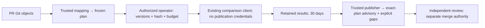

# Skill PR planning and feedback

The report-only [Skill PR workflow](../.github/workflows/skill-eval-pr.yml) connects
skill changes to the existing [comparison command](skill-eval-comparison.md).
It does not add an execution engine or a required efficacy gate. Refs #101; parent #88.



## Automatic planning

`pull_request_target` uses the workflow implementation on trusted main. It reads
PR commits as raw Git objects without checking out PR files, importing PR Python,
running PR graders, or invoking a model. The small
[mapping](../tools/skill_eval_pr_cases.json) owns skill/resource paths and the
existing case file. A new entrypoint selects absent/new; an existing entrypoint
selects old/new. Declared resource/dependency paths can select the same comparison.
Add mappings only when the named cases actually cover that skill's behavior.
Unmapped paths remain `uncovered`. Deletions and unsupported snapshot modes are
explicitly `unsupported`; they cannot count as passes. Rename detection is off:
a rename is a deletion plus an addition and retains the deletion gap.

The initial mapping associates `inference-benchmark-design` and the prospective
`audit-fixed-workload-claim` addition with the existing `audit-threshold` holdout
case. The latter reserves the path for the bounded fixed-workload audit skill
proposed for real addition acceptance; it does not add that skill or authorize
execution. Until a PR adds that path, it selects no comparison. Library
navigation/index changes are uncovered;
coverage of one skill is not library-wide qualification. Changes to the mapping,
cases, workflow or comparison implementation also trigger planning.

The PR plan contains compared base/head SHAs, trusted implementation SHA, mapping
and adapter hashes, selected cases/splits, frozen grader/schema/case hashes,
model/effort, limits, estimated calls and coverage gaps. Its SHA-256 is computed
over canonical JSON (sorted keys, compact separators). Each comparison retains
its existing `plan/freeze.json` SHA-256. The PR plan hash binds those hashes; it
does not replace or modify the comparison format. Execution identity is
`skill-eval-<PR-plan-SHA-256>`. Repeated preparation is deterministic.

Plans and reports have one identifiable bot comment beginning with
`<!-- inferrsi-skill-eval-pr:v1 -->`. A new head/base, trusted implementation,
mapping, exam, model or budget produces a new plan. Earlier authorization and
results are stale. The planner replaces the summary with the current plan and
missing pairs. A publisher checks live revisions twice and refuses older writer
runs, so delayed jobs cannot replace a newer summary. All plan/execute/publish
runs for one PR share non-cancelling Actions concurrency.

### Refresh a plan without execution

Dispatch **Skill PR evaluation** on **main** with `action=plan` and the PR number
to rebuild the plan and update its single **PLANNED** summary using the current
trusted workflow implementation. No execution approval fields or `source_run`
are needed. This reuses the automatic prepare/publish path; it makes no model
calls, reserves no execution, and produces no evaluation results. The controller
also rejects `action=plan` with its authorize, execute or pack CLI modes.
Supplying execution fields or a `source_run` to this action does not authorize
execution or import earlier results.

Only `action=execute` schedules authorization and execution. Its five approval
fields remain mandatory in the controller, although optional in the shared
dispatch form. `action=publish` still requires a validated original execution
run; a planning-only run is not a supported source for retained results.

A new trusted implementation or changed PR inputs creates a new plan identity;
old hashes and approvals cannot authorize it. A plan dispatch has a non-execution
run title, so it does not consume that plan's execution identity. It still adds
an Actions dispatch-history record, subject to the existing history limit below.
Re-running an old workflow uses its original implementation; it cannot select
the newer diagnostic code by refreshing main. An authorized plan dispatch offers
a repeatable current-main publication recheck without changing the subject PR;
automatic PR planning can also exercise that publisher. Retain the safe HTTP
diagnostic or successful summary receipt. Neither entry repairs a permission
denial. This verifies publication only, not evaluation.

## Explicit execution authorization

Planning grants no execution budget. An operator with repository `write`,
`maintain` or `admin` permission dispatches **Skill PR evaluation** on **main**:

| Dispatch input | Required approval |
| --- | --- |
| `action=execute`, `pr` | The PR being evaluated |
| `plan_sha256` | The exact PR plan hash displayed in its summary |
| `version` | The full trusted implementation SHA from that summary |
| `base`, `head` | Both full compared revisions |
| `budget` | The complete displayed Budget JSON, including limits per comparison and total estimated calls |

The authenticated dispatch actor's current collaborator permission is queried;
knowledge of a hash or a PR comment is insufficient. The explicit inputs must
match the newly reconstructed plan exactly. Authorization and current revisions
are rechecked in the execution job immediately before starting the existing
comparison command. No shell evaluates user-provided inputs.

The selected model is **`gpt-6.1-sol`, effort `xhigh`**, requested by the owner.
Each selected comparison schedules **2 task calls**: one absent/old and one new arm,
one case, one repeat. Limits are 180 seconds per trial, 600 seconds per comparison,
and an observed-token stop threshold of 20,000. This stops new trials; it is not
a provider token or monetary hard cap. One trial can cross the threshold, and
unreported usage/cost remain unknown. Selecting both mapped owners schedules four
calls. Mapping more skills increases the total;
the exact total is shown in the plan and requires renewed authorization.

### Execution environment prerequisite

Execution reuses the configured comparison client and cleanup path. The client
and separately authorized model access must already be available in that job's
environment; the Codex path checks `codex --version` and never substitutes fixed
outputs. The optional provider configuration has its own readiness checks and
reservation contract. A historical successful run does not establish current
credential availability, permission, provider readiness or remaining budget.
Do not dispatch paid work without current exact-plan authorization. This guide
and an issue/label proposal do not activate paid execution or provision secrets.

The execute job has read-only repository permissions, no publication token in
its model step, and checkout uses `persist-credentials: false`. The privileged
publisher is a separate fresh job. Model access must not also grant PR publishing.
Only the publish job requests `pull-requests: write`, alongside its existing
`issues: write`; planning and execution retain read-only repository permissions.
In the controlled fork [baseline](https://github.com/Dong1017/OmniRSI/actions/runs/40455073055),
the same Actions job could create/update an ordinary Issue comment but received
permission HTTP403 for a PR conversation comment with PullRequests read.
The owner-approved [contrast](https://github.com/Dong1017/OmniRSI/actions/runs/40460346043)
verified PR comment creation/update with PullRequests write, preserving the HTTP
client and other grants. The [result and restoration record](https://github.com/Dong1017/OmniRSI/issues/3#issuecomment-6435261413)
covers that fork push context; upstream recovery still needs a successful
publication receipt from the merged trusted workflow. Advertised endpoint
permission alternatives alone do not prove effective authorization.

The existing client's controlled skill exposure is not OS read confinement.
Plan artifacts contain files rather than empty directories. The adapter restores
each comparison's empty results directory after download; the existing executor
still rejects nonempty results, and the exclusive execution claim still rejects
duplicate attempts.

## Duplicate prevention and interrupted execution

Actions records the authorization dispatch as
`skill-eval execute PR <number> plan <SHA-256>`. Under the shared concurrency
group, only the earliest matching execution run may proceed. Every status is
considered, including queued, failed and cancelled runs. Attempts other than
`run_attempt=1` cannot execute. An exclusive local claim file additionally prevents
two callers sharing the same retained directory from entering the comparison.

The Actions run is the durable execution tombstone, not the expiring artifact.
An interrupted or failed attempt is consumed even if it might have stopped
before any paid work. There is no automatic paid retry/resume. Do not delete
execution workflow runs; inaccessible/incomplete run history fails closed.
Authorization requires a stable integer `total_count`, exactly that many unique
run IDs and no overlapping pages. GitHub's filtered workflow-run searches have a
[1,000-result limit](https://docs.github.com/en/rest/actions/workflow-runs?apiVersion=2022-11-28#list-workflow-runs-for-a-workflow).
Reaching that limit is ambiguous, so a reported total of 1,000 or more blocks
execution immediately. Missing/changing totals or an early short/empty page
also block execution; a short page alone never proves complete history.
Deleting this coordination history removes duplicate-prevention evidence and
requires human reconciliation before any further execution of the same plan.
Workflow reruns may republish results but must not rerun evaluation.

## Publication and retention

Use `action=publish` with the PR number and original **execution `source_run` ID**
to retry publication. The publisher reconstructs the current plan rather than
trusting dispatch-supplied plan fields. This mode contains no call to the client or
comparison executor. A lost publication response is safe: the next attempt finds
and updates the same marked bot comment instead of creating another summary.

The publisher reconstructs trusted inputs from Git and the maintained mapping.
It requires the source run's workflow path, event, trusted revision and exact
plan identity. It downloads only that run's uniquely named result artifact.
ZIP members must be bounded, unique, regular files at explicitly scheduled
result paths; traversal, symlinks, executable scripts and replacement plans or
Markdown are rejected before extraction. GitHub authorization is stripped on
artifact-download redirects. The publisher imports no artifact Python and runs
no artifact scripts. It regenerates the existing report from retained data and
cross-checks accepted grades with the trusted default audit verifier in process.
Custom graders are outside this small mapping's support boundary.

Reports show fix, regression, unchanged-correct, unchanged-incorrect,
inconclusive and missing-pair counts, plus uncovered/unsupported changes,
revisions, settings, limits, exam identity and an evidence link. Discovery stays
separate. Raw model text and supplied Markdown never become PR comment content.
Malformed or inconsistent evidence fails closed or remains inconclusive; it
cannot turn into a positive result. These integrity checks are not cryptographic
attestation of a hostile executor's observations.

| Artifact | Content | Retention |
| --- | --- | --- |
| `skill-eval-plan` | PR plan, comparison freezes, bundles and validator inputs; generated authorization receipt for execution | 30 days |
| `skill-eval-results` | `results.zip`, containing retained trial/status records, answers, hashes and raw evidence | 30 days |
| `skill-eval-report` | Trusted regenerated JSON/Markdown reports and PR plan | 30 days |

Results remain generated Actions artifacts, not routine commits to main. The
summary labels outcomes historical and gives their verification expiry. They
are verifiable only while the artifact remains available and before its expiry;
the comment alone is not retained evidence. A publication retry after expiry
replaces the outcome counts with **EXPIRED / unverified** and never reevaluates.
Missing/deleted artifacts cannot substantiate results. Repository retention
limits can shorten the requested 30 days. There is no background expiry monitor.

## Offline verification and real acceptance

Run the integration controls and original pilot regressions:

```bash
python -m pytest tests/test_skill_eval_pr.py tests/test_skill_eval_compare.py \
  tests/test_skill_eval_pipeline.py tests/test_skill_eval_verifier.py \
  tests/test_skill_evaluation.py
ruff check src tests tools
pytest
```

Generate a complete offline example for either mode:

See the [offline summary excerpt](examples/skill-eval-pr/summary-example.md).

```bash
python -m tests.fixtures.skill_eval_pr_demo --mode addition --output <new-addition-output>
python -m tests.fixtures.skill_eval_pr_demo --mode update --output <new-update-output>
```

These commands use temporary real Git commits, the existing verifier, fixed-output
clients and a simulated GitHub interface. They make no GitHub requests or model
calls. Each generates a fix, regression, unchanged-correct, unchanged-incorrect,
inconclusive and missing pair, a single simulated PR summary, and retained
evidence. They validate integration behavior only. The summary's example GitHub
link is simulated; inspect the corresponding local `publication/` evidence.

The workflow is already on main. The bounded #88/#101 addition/update acceptance
established the existing real-agent execution and feedback path, including a
valid neutral update; it did not establish whole-library efficacy or subject-PR
merge readiness. #215's advisory behavior still needs revision-scoped real-PR
demonstration and independent review. Offline controls are not that demonstration.
Neither fixed outputs nor green CI authorize paid trials, merge or issue closure.

## Reading the advisory guidance

The existing summary derives one advisory from trusted regenerated comparisons,
not an aggregate score. Its applicability is exactly the displayed base/head,
trusted implementation and PR plan hash (which binds each comparison and exam).
The publisher reconstructs these inputs and checks live PR revisions before
writing; an old execution cannot be republished against a new plan. No background
monitor updates an already-posted comment when inputs change or artifacts expire.
Check the current PR and artifact availability before relying on a saved comment.

| Evidence | Advisory / next action |
| --- | --- |
| Any current, verified regression | Address observed regression; fixes elsewhere never cancel it |
| PLANNED, missing/expired/invalid evidence, incomplete execution or pairs | Obtain missing evidence; do not infer quality from preparation or a green job |
| Uncovered/unsupported changes, no selected cases | Obtain relevant evidence or an explicit reviewer disposition of the boundary |
| Unchanged-incorrect | Existing failure remains visible; fix or explicitly disposition it |
| Complete covered fixes and/or unchanged-correct pairs | Covered evidence supports proceeding to independent review, not approval |

Per-case outcomes remain visible, including simultaneous fixes, regressions and
gaps; discovery does not replace paired holdouts. Correct→correct is valid neutral
evidence, never incremental benefit. A coverage gap is not a requirement to test
every changed file: a reviewer can explicitly disposition navigation, unsupported
content or another boundary. The automated report does not invent that decision
or silently count the gap as passed. Content/source review, authorship admission,
and merge authority remain independent.

Knowledge-only changes under `src/inferrsi/data/repo_packs/**` or
`src/inferrsi/data/knowledge_packs/**` are outside the current automatic path
filter. Use the existing **plan-only dispatch** for an explicit scope report;
unmapped paths remain uncovered and select no paid work. Absence of a triggered
workflow is not an evaluation pass. This slice does not expand automatic paths
or introduce an unrelated audit grader for knowledge content.

### Relevant #179 integrity reconciliation

The current comparison loader checks schedule/task/repeat consistency, limit
shape, exported bundle resources and frozen exam hashes. The report regrades
retained default-audit answers with trusted code; custom graders are unverified.
The PR adapter validates mapping IDs before creating paths, reconstructs the
exact PR plan, checks run provenance and regrades again. The checkpoint now
requires completed execution before recommending accepted reporting. These are
existing corrections, not newly repaired historical defects in this slice.

Limits remain: semantic consistency and unkeyed receipts do not attest a hostile
executor, the actual model/hardware used, or consistently fabricated retained
answers. Standalone freeze fields are not all independently authenticated.
The PR path's trusted reconstruction narrows that boundary; it does not create
cryptographic provenance. Review guidance is advisory evidence interpretation,
not execution attestation or skill-efficacy certification. Unrelated harness
lifecycle/Windows contention work remains outside this slice and under #179.
