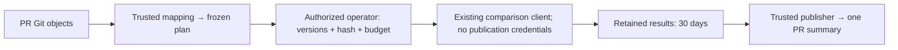

# Skill PR planning and feedback

The report-only [Skill PR workflow](../.github/workflows/skill-eval-pr.yml) connects
skill changes to the existing [comparison command](skill-eval-comparison.md).
It does not add an execution engine or a required efficacy gate. Refs #101; parent #88.



## Automatic planning

`pull_request_target` uses the workflow implementation on trusted main. It reads
PR commits as raw Git objects without checking out PR files, importing PR Python,
running PR graders, or invoking a model. The small
[mapping](../tools/skill_eval_pr_cases.json) owns skill/resource paths and the
existing case file. A new entrypoint selects absent/new; an existing entrypoint
selects old/new. Declared resource/dependency paths can select the same comparison.
Add mappings only when the named cases actually cover that skill's behavior.
Unmapped paths remain `uncovered`. Deletions and unsupported snapshot modes are
explicitly `unsupported`; they cannot count as passes. Rename detection is off:
a rename is a deletion plus an addition and retains the deletion gap.

The initial mapping covers only `inference-benchmark-design` and the existing
`audit-threshold` holdout case. Library navigation/index changes are uncovered;
coverage of one skill is not library-wide qualification. Changes to the mapping,
cases, workflow or comparison implementation also trigger planning.

The PR plan contains compared base/head SHAs, trusted implementation SHA, mapping
and adapter hashes, selected cases/splits, frozen grader/schema/case hashes,
model/effort, limits, estimated calls and coverage gaps. Its SHA-256 is computed
over canonical JSON (sorted keys, compact separators). Each comparison retains
its existing `plan/freeze.json` SHA-256. The PR plan hash binds those hashes; it
does not replace or modify the comparison format. Execution identity is
`skill-eval-<PR-plan-SHA-256>`. Repeated preparation is deterministic.

Plans and reports have one identifiable bot comment beginning with
`<!-- inferrsi-skill-eval-pr:v1 -->`. A new head/base, trusted implementation,
mapping, exam, model or budget produces a new plan. Earlier authorization and
results are stale. The planner replaces the summary with the current plan and
missing pairs. A publisher checks live revisions twice and refuses older writer
runs, so delayed jobs cannot replace a newer summary. All plan/execute/publish
runs for one PR share non-cancelling Actions concurrency.

## Explicit execution authorization

Planning grants no execution budget. An operator with repository `write`,
`maintain` or `admin` permission dispatches **Skill PR evaluation** on **main**:

| Dispatch input | Required approval |
| --- | --- |
| `action=execute`, `pr` | The PR being evaluated |
| `plan_sha256` | The exact PR plan hash displayed in its summary |
| `version` | The full trusted implementation SHA from that summary |
| `base`, `head` | Both full compared revisions |
| `budget` | The complete displayed Budget JSON, including limits per comparison and total estimated calls |

The authenticated dispatch actor's current collaborator permission is queried;
knowledge of a hash or a PR comment is insufficient. The explicit inputs must
match the newly reconstructed plan exactly. Authorization and current revisions
are rechecked in the execution job immediately before starting the existing
comparison command. No shell evaluates user-provided inputs.

The selected model is **`gpt-6.1-sol`, effort `xhigh`**, requested by the owner.
The initial mapping schedules **2 task calls**: one absent/old and one new arm,
one case, one repeat. Limits are 180 seconds per trial, 600 seconds per comparison,
and an observed-token stop threshold of 20,000. This stops new trials; it is not
a provider token or monetary hard cap. One trial can cross the threshold, and
unreported usage/cost remain unknown. Mapping more skills increases the total;
the exact total is shown in the plan and requires renewed authorization.

### Execution environment prerequisite

Execution reuses `CodexClient` and the current process cleanup path. The existing
client executable and separately authorized model access must already be
available in that job's environment. The repository currently has **no such
hosted-job model provisioning**. The workflow fails its `codex --version` preflight
when the client is absent; it never substitutes fixed outputs for real execution.
This delivery adds no runner, model credential, secret or repository security
setting. Real-agent end-to-end acceptance remains blocked on owner-approved
access to the selected client in the execution environment. Do not dispatch a
paid trial until that prerequisite and its budget are separately authorized.

The execute job has read-only repository permissions, no publication token in
its model step, and checkout uses `persist-credentials: false`. The privileged
publisher is a separate fresh job. Model access must not also grant PR publishing.
The existing client's controlled skill exposure is not OS read confinement.
Plan artifacts contain files rather than empty directories. The adapter restores
each comparison's empty results directory after download; the existing executor
still rejects nonempty results, and the exclusive execution claim still rejects
duplicate attempts.

## Duplicate prevention and interrupted execution

Actions records the authorization dispatch as
`skill-eval execute PR <number> plan <SHA-256>`. Under the shared concurrency
group, only the earliest matching execution run may proceed. Every status is
considered, including queued, failed and cancelled runs. Attempts other than
`run_attempt=1` cannot execute. An exclusive local claim file additionally prevents
two callers sharing the same retained directory from entering the comparison.

The Actions run is the durable execution tombstone, not the expiring artifact.
An interrupted or failed attempt is consumed even if it might have stopped
before any paid work. There is no automatic paid retry/resume. Do not delete
execution workflow runs; inaccessible/incomplete run history fails closed.
Authorization requires a stable integer `total_count`, exactly that many unique
run IDs and no overlapping pages. GitHub's filtered workflow-run searches have a
[1,000-result limit](https://docs.github.com/en/rest/actions/workflow-runs?apiVersion=2022-11-28#list-workflow-runs-for-a-workflow).
Reaching that limit is ambiguous, so a reported total of 1,000 or more blocks
execution immediately. Missing/changing totals or an early short/empty page
also block execution; a short page alone never proves complete history.
Deleting this coordination history removes duplicate-prevention evidence and
requires human reconciliation before any further execution of the same plan.
Workflow reruns may republish results but must not rerun evaluation.

## Publication and retention

Use `action=publish` with the original **execution `source_run` ID** and the current
plan inputs to retry publication. This mode contains no call to the client or
comparison executor. A lost publication response is safe: the next attempt finds
and updates the same marked bot comment instead of creating another summary.

The publisher reconstructs trusted inputs from Git and the maintained mapping.
It requires the source run's workflow path, event, trusted revision and exact
plan identity. It downloads only that run's uniquely named result artifact.
ZIP members must be bounded, unique, regular files at explicitly scheduled
result paths; traversal, symlinks, executable scripts and replacement plans or
Markdown are rejected before extraction. GitHub authorization is stripped on
artifact-download redirects. The publisher imports no artifact Python and runs
no artifact scripts. It regenerates the existing report from retained data and
cross-checks accepted grades with the trusted default audit verifier in process.
Custom graders are outside this small mapping's support boundary.

Reports show fix, regression, unchanged-correct, unchanged-incorrect,
inconclusive and missing-pair counts, plus uncovered/unsupported changes,
revisions, settings, limits, exam identity and an evidence link. Discovery stays
separate. Raw model text and supplied Markdown never become PR comment content.
Malformed or inconsistent evidence fails closed or remains inconclusive; it
cannot turn into a positive result. These integrity checks are not cryptographic
attestation of a hostile executor's observations.

| Artifact | Content | Retention |
| --- | --- | --- |
| `skill-eval-plan` | PR plan, comparison freezes, bundles and validator inputs; generated authorization receipt for execution | 30 days |
| `skill-eval-results` | `results.zip`, containing retained trial/status records, answers, hashes and raw evidence | 30 days |
| `skill-eval-report` | Trusted regenerated JSON/Markdown reports and PR plan | 30 days |

Results remain generated Actions artifacts, not routine commits to main. The
summary labels outcomes historical and gives their verification expiry. They
are verifiable only while the artifact remains available and before its expiry;
the comment alone is not retained evidence. A publication retry after expiry
replaces the outcome counts with **EXPIRED / unverified** and never reevaluates.
Missing/deleted artifacts cannot substantiate results. Repository retention
limits can shorten the requested 30 days. There is no background expiry monitor.

## Offline verification and real acceptance

Run the integration controls and original pilot regressions:

```bash
python -m pytest tests/test_skill_eval_pr.py tests/test_skill_eval_compare.py \
  tests/test_skill_eval_pipeline.py tests/test_skill_eval_verifier.py \
  tests/test_skill_evaluation.py
ruff check src tests tools
pytest
```

Generate a complete offline example for either mode:

See the [offline summary excerpt](examples/skill-eval-pr/summary-example.md).

```bash
python -m tests.fixtures.skill_eval_pr_demo --mode addition --output <new-addition-output>
python -m tests.fixtures.skill_eval_pr_demo --mode update --output <new-update-output>
```

These commands use temporary real Git commits, the existing verifier, fixed-output
clients and a simulated GitHub interface. They make no GitHub requests or model
calls. Each generates a fix, regression, unchanged-correct, unchanged-incorrect,
inconclusive and missing pair, a single simulated PR summary, and retained
evidence. They validate integration behavior only. The summary's example GitHub
link is simulated; inspect the corresponding local `publication/` evidence.

The workflow becomes active after this implementation is on main. Draft PR CI
tests its offline behavior; it does not activate an unmerged privileged workflow.
#101/#88 remain open until one **real addition** and one **real update** complete
the separately authorized agent execution and automatic PR feedback path.
Neutral/negative outcomes are valid. Neither fixed outputs nor green CI establish
skill efficacy, authorize paid trials, merge a PR or close either issue.
