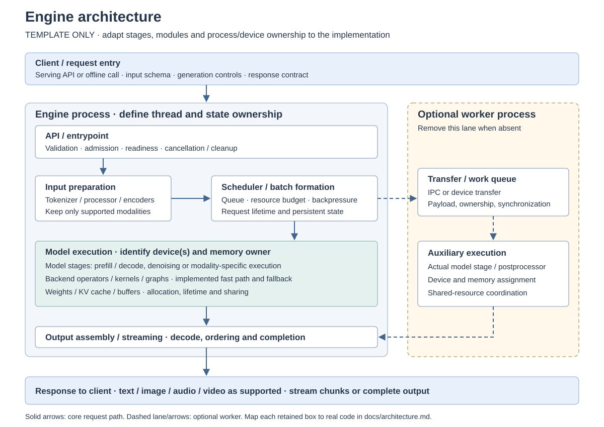
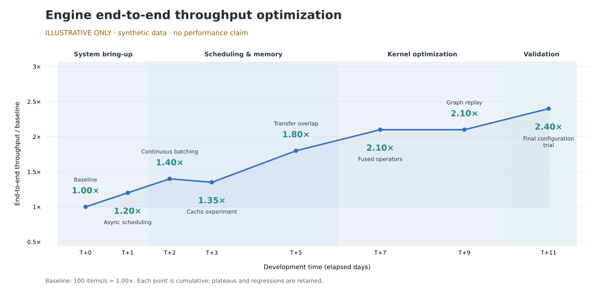

# InferRSI-\<model>


An [InferMatrixLab](https://github.com/InferMatrixLab) project.

**Template:** set the repository name and this README's title to the same resolved
engine name using the following convention:

| Target backend | Repository name and README title |
| --- | --- |
| GPU (default) | `InferRSI-<model>`; omit the backend suffix and its hyphen |
| NPU | `InferRSI-<model>-npu` |

Replace `<model>` with the model's public short name, retaining its version;
never use a private local model path. For example, a model named `ExampleModel-v1`
uses `InferRSI-ExampleModel-v1` on GPU and `InferRSI-ExampleModel-v1-npu` on NPU.
The suffix is a naming convention; record the actual execution backend and
supported combinations below and in the recipe.

Fill the identity below and remove template guidance before publication. Keep
the InferRSI generation attribution as the final nonempty line, after all other
sections, including future additions. Retain the separate organization and
upstream/license attribution. Add an approved local banner only after following
[asset ownership](docs/assets/README.md).

```text
Engine: <engine-name>
Purpose: <model-or-modality-and-runtime-purpose>
Implementation: https://github.com/InferMatrixLab/<engine-repo>
Upstream sources: <original-projects-and-contribution-boundaries>
License: <engine-license-and-upstream-notices>
Model weights: <model-source-and-separate-license>
Maintainers: <real-github-logins>
```

[Architecture](docs/architecture.md) · [Optimization progress](docs/optimization-progress.md) ·
[Reproduction](docs/reproducibility.md) ·
[Contributing](CONTRIBUTING.md) · [Recipes](recipes/README.md) ·
[Evidence](evidence/README.md)

## Scope and supported combinations

Describe the actual engine implementation, intended workload and what the
repository maintains. List each known combination separately; an absent
combination is unknown. Deployment state and performance acceptance are separate.

```text
Model / revision: <provider/model-and-version>
Task: <task_snake_case>
Backend / precision: <backend> / <precision>
Hardware / count: <exact-device-model> / <positive-device-count>
Deployment status: <unverified|validated|unsupported>
Deployment evidence and date: <evidence-url-and-date-or-unverified>
Acceptance: <PASS|FAIL|INCONCLUSIVE>
Acceptance issue / evidence: <issue-and-evidence-urls-or-incomplete>
Known limitations: <specific-scope-or-blockers>
```

## Architecture



**Template diagram — replace with this engine's implemented architecture.** Keep
an architecture figure embedded in every delivered engine README, following the
level of detail in the
[MiniCPM-o 4.5 single-GPU engine](https://github.com/InferMatrixLab/minicpm-o-4.5-single-gpu-engine#architecture).
Show request/response flow, model stages, scheduling and memory ownership,
process/device boundaries, and links to actual modules in
[architecture](docs/architecture.md). Remove unused stages and optional workers;
the example does not prescribe a model, backend, process count or language.

## Environment

Record the operating system, device/driver/firmware, runtime, compiler, language,
framework and dependency versions, model access/license requirements, disk and
memory requirements. Keep versioned examples in [configs](configs/README.md).
Do not imply compatibility for a device or version that has no supporting facts.

## Install

Replace these entire commands with reviewed, executable instructions for the
documented deployment version. Record source versus released-package ownership
explicitly. Model installation may have separate terms and credentials; never
commit secrets.

```bash
git clone https://github.com/InferMatrixLab/<engine-repo>.git
cd <engine-repo>
git checkout <deployment-tag-or-commit>
<reviewed-install-command>
```

## Start

Document configuration, model path, device selection, ports, readiness signal,
logs and shutdown. This complete command must match the source recipe.

```bash
<reviewed-start-command>
```

## Minimal request

Show a complete request and the observable success condition, expected media or
output shape, and output location. Include a health/readiness check where used.

```bash
<minimal-request-command>
```

## Reproduce and validate

Follow [reproducibility](docs/reproducibility.md) for the exact software/hardware
combination and evidence identity. Describe [tests](tests/README.md), quality
validators and [benchmarks](benchmarks/README.md) separately. Record warmups,
workload, measured versus setup time, units, statistics and required L0–L4 levels.

```bash
<lightweight-engine-check-command>
<model-quality-validation-command>
<benchmark-command-if-available>
```

## Results and limitations

Link original reports with their revision, device count, precision, workload,
statistics and validation scope. Keep negative results. Hardware deployment and
quality/performance work not yet run must be labeled accordingly. Do not add a
gain claim before the acceptance issue and complete evidence justify `PASS`;
CPU CI alone does not validate an accelerator or an E2E service.

| Configuration / workload | Baseline E2E throughput | Candidate E2E throughput | Gain | Quality / acceptance | Evidence |
| --- | --- | --- | --- | --- | --- |
| `<exact-comparison-scope>` | `<value-and-unit-or-not-measured>` | `<value-and-unit-or-not-measured>` | `<ratio-or-not-measured>` | `PASS` / `FAIL` / `INCONCLUSIVE` | `<acceptance-issue-and-results>` |

Define the metric, timing boundary, concurrency, warmups, repetitions and
statistic next to the results. Report unmeasured cells explicitly; keep detailed
comparison tables and remaining performance gaps in the linked evidence.

### End-to-end optimization progress



**Illustrative template only — synthetic values, not benchmark results.** The
chart shows the intended presentation: development time, phase bands, named
optimization milestones and cumulative E2E throughput relative to one baseline.
Replace it with evidence-backed measurements for this engine; preserve plateaus
and regressions. When no comparable measurements exist, retain a clearly marked
illustration or show an explicit “not measured” figure; never imply a measured
gain. Update the alt text and caption when replacing the illustration.

[Data, redraw command and evidence mapping](docs/optimization-progress.md).
State the exact comparison scope, acceptance issue, current verdict and remaining
quality/E2E gaps beside the measured figure. Measurements from incomplete or
failed campaigns must remain labeled; a plotted value alone does not imply `PASS`.

## Recipes and contribution

The engine owns its [source recipes](recipes/README.md); the
[InferMatrixLab recipe catalog](https://github.com/InferMatrixLab/recipe) owns the
schema, locked collection and website. Follow [contributing](CONTRIBUTING.md) to
update the implementation and recipe together, then request catalog sync.

## License and acknowledgements

Add the engine's actual license file and its navigation link, plus upstream
copyright/notices and model-weight terms. Explain forks, reused implementations,
patches and independent work accurately. Do not treat the organization name or
this template as permission to relicense external work.

由 [InferRSI](https://github.com/InferMatrixLab/InferRSI) 生成。
