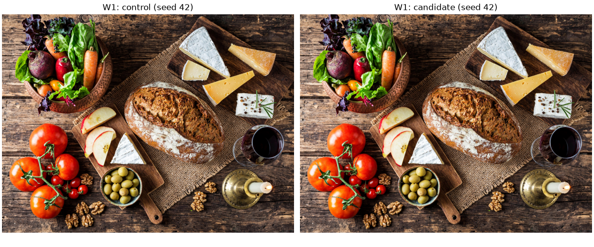
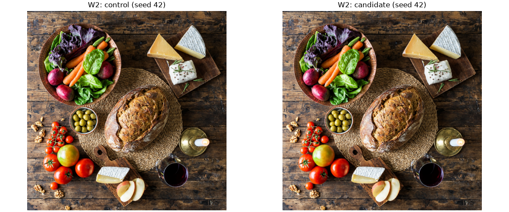
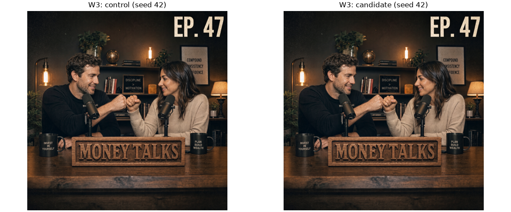

# Current PR image comparisons

These are the first measured seed-42 outputs from the same-revision round-two
control and candidate, one pair per author workload. They were selected by
request index, not appearance. Control uses native SP4 VAE execution; candidate
uses decoder tile batch32 and FP16 encoder tile batch8. Both retain the original
six steps, canvas, prompts and deterministic settings.

The full-resolution PNGs are losslessly recompressed and verified against the
recorded RGB hashes in `images.json`. The comparison panels below are resized
visual aids; use the full-resolution links to inspect detail.

The 30-image numerical screen passed (minimum PSNR 34.60 dB, SSIM 0.9870).
Only these six representative images are included here; the remaining raw images
remain local. Complete visual acceptance and final ABBA qualification are pending.
All three latency targets remain unmet; campaign acceptance is **INCONCLUSIVE**.

## W1

Full resolution: [control](W1-control.png) · [candidate](W1-candidate.png)

## W2

Full resolution: [control](W2-control.png) · [candidate](W2-candidate.png)

## W3

Full resolution: [control](W3-control.png) · [candidate](W3-candidate.png)
